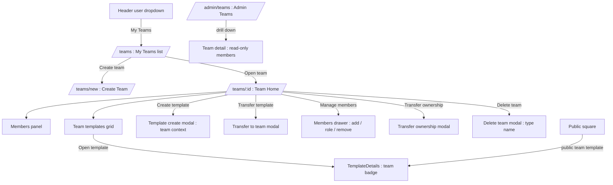
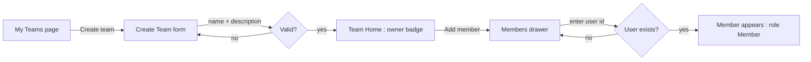
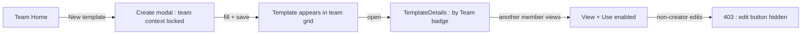
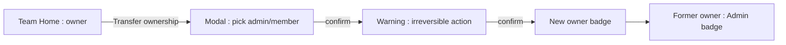

# Team Collaboration — UI/UX Design

- **Feature ID:** team-collaboration
- **Version:** 1.0
- **Status:** Proposed (for architecture review)
- **Author:** ui-ux-agent
- **Date:** 2026-10-12
- **Companion doc:** `team-collaboration-requirements.md`

## 1. Design Principles

1. **A team is a space, not a new product.** Team pages reuse the Aurora design system, template cards, and page shells users already know; only ownership semantics change.
2. **Role clarity over permission matrices.** Three roles with badge-level visibility; every destructive action states who can do it.
3. **Personal work stays personal.** Nothing moves into a team without an explicit action; the default template context remains personal.
4. **Invite by id, not ceremony.** Adding a member is one field + one click; no email flows, no codes.

## 2. Information Architecture



| Surface | Route | Audience | Purpose |
|---|---|---|---|
| My Teams | `/teams` | Any user | List teams I belong to; create team |
| Create Team | `/teams/new` | Any user | Name + description form |
| Team Home | `/teams/{id}` | Team members | Members, team templates, management actions |
| Members drawer | overlay on Team Home | Owner/Admin | Add by user id, change role, remove |
| Transfer ownership | modal on Team Home | Owner | Hand over owner role |
| Delete team | modal on Team Home | Owner | Typed-name confirmation |
| Admin Teams | `/admin/teams` | Platform admins | Read-only team list + member drill-down |

## 3. User Flows

### 3.1 Create team and invite first member



### 3.2 Member contributes a template



### 3.3 Transfer ownership



## 4. Page Layouts

### 4.1 My Teams — `/teams` (desktop)

```
+----------------------------------------------------------------------+
|  Header  [logo]  [search]  [themes]  [user dropdown: My Teams ▾]     |
+----------------------------------------------------------------------+
|                                                                      |
|  My Teams                                          [+ Create Team]   |
|  +------------------------------------------------+  +------------+  |
|  | Team card                                      |  | Create     |  |
|  | [avatar] Prompt Guild          [Owner badge]   |  | team card  |  |
|  | 12 members · 34 templates · updated 2h ago     |  | (dashed)   |  |
|  +------------------------------------------------+  +------------+  |
|  | [avatar] Dev Crew             [Admin badge]    |                  |
|  | 5 members · 18 templates · updated yesterday   |                  |
|  +------------------------------------------------+                  |
|  (empty state: "No teams yet — create one for your group")           |
+----------------------------------------------------------------------+
```

Mobile: single column; team cards stack; Create Team becomes a full-width button below the list.

### 4.2 Team Home — `/teams/{id}` (desktop)

```
+----------------------------------------------------------------------+
|  ← My Teams                                                          |
+----------------------------------------------------------------------+
|  [team avatar]  Prompt Guild              [Owner badge]              |
|  Shared prompt library for the support team                          |
|  12 members · 34 templates                                           |
|  [Members] [Settings] [⋯ : Transfer ownership / Delete team]         |
+----------------------------------------------------------------------+
|  Team Templates                              [+ New] [Transfer in]   |
|  +----------+  +----------+  +----------+  +----------+              |
|  | card     |  | card     |  | card     |  | card     |              |
|  | by alice |  | by bob   |  | by alice |  | by carol |              |
|  | [Public] |  | [Private]|  | [Public] |  | [Private]|              |
|  +----------+  +----------+  +----------+  +----------+              |
|  (pagination)                                                        |
+----------------------------------------------------------------------+
|  Members (12)                                        [Manage]        |
|  [avatar] alice   [Owner]   [avatar] bob    [Admin]                  |
|  [avatar] carol   [Member]  [avatar] dave   [Member]                 |
|  (+ 8 more)                                                          |
+----------------------------------------------------------------------+
```

Mobile: header stacks (avatar above name); template grid 1–2 columns; Members section collapses into an expandable panel.

### 4.3 Members drawer (Owner/Admin)

```
+--------------------------------------+
|  Members · Prompt Guild         [×]  |
|  +--------------------------------+  |
|  | Add member                     |  |
|  | [ user id input          ] [Add]|  |
|  | hint: the id shown on profiles |  |
|  +--------------------------------+  |
|  [avatar] alice    [Owner]           |
|  [avatar] bob      [Admin]  [⋯ role] |
|  [avatar] carol    [Member] [⋯ role] |
|    ┌ role menu: Member / Admin       |
|    │            Remove from team     |
+--------------------------------------+
```

### 4.4 Admin Teams — `/admin/teams` (desktop)

```
+----------------------------------------------------------------------+
|  Admin sidebar: Dashboard · Users · Templates · Teams · Audit Log    |
+----------------------------------------------------------------------+
|  Teams                                        [search by name 🔍]    |
|  | Team          | Owner    | Members | Templates | Created   |      |
|  | Prompt Guild  | alice    | 12      | 34        | 2026-08-01| [View]|
|  | Dev Crew      | bob      | 5       | 18        | 2026-09-12| [View]|
|  (pagination)                                                        |
+----------------------------------------------------------------------+
|  Drill-down (View): team header + read-only member table             |
+----------------------------------------------------------------------+
```

## 5. Component Specs

| Component | Behavior | States |
|---|---|---|
| TeamCard | Avatar, name, role badge, member/template counts, updated time; click → Team Home | Default / hover (elevate) |
| RoleBadge | Text + color: Owner (gold), Admin (blue), Member (gray); text always present (a11y) | 3 variants |
| CreateTeamForm | Name (required, ≤80), description (≤500, optional); inline validation | Empty / error / submitting |
| MembersDrawer | Right-side drawer; add-by-id input with existence validation; role menu per member (permission-gated) | Loading / loaded / error |
| TeamTemplateCard | Existing TemplateCard + creator line ("by {user}") + visibility chip | Existing + team additions |
| TransferOwnershipModal | Member picker (admins/members), explicit warning, confirm button disabled until acknowledged | Default / warning / submitting |
| DeleteTeamModal | Typed-name confirmation ("type 'Prompt Guild' to confirm"); explains content survival (FR-10) | Default / mismatch / submitting |
| TransferToTeamModal | From personal template context: pick team (user's teams), confirm; explains attribution change | Default / no-teams / submitting |
| AdminTeamsTable | Reuses admin list pattern: search, sortable columns, pagination, View drill-down | Loading / empty / error |

## 6. Interaction Details

1. **Create Team** submits name+description; on success the user lands on Team Home with an owner badge and an empty-templates state that suggests inviting a member first.
2. **Add member** validates the user id client-side (format) and server-side (exists, not banned, not already a member); errors render inline under the input; success appends the member row with a brief highlight.
3. **Role menu** appears only for actors permitted to change that member (owner: anyone but self; admin: members only). Choosing a role shows a confirm popover ("Make bob an Admin?").
4. **Remove member** asks for confirmation and states the consequence ("Their team templates stay with the team").
5. **Transfer ownership** requires selecting a member, acknowledging the warning, and typing nothing (button-gated); the actor's badge changes to Admin immediately on success.
6. **Delete team** requires typing the exact team name; the modal copy explains that templates revert to their creators as private.
7. **New template in team context** opens the existing create modal with a locked "Team: {name}" context chip; saving creates a team-owned template.
8. **Transfer in** (personal → team) lists the user's teams; after transfer the template disappears from personal templates and appears in the team grid with "by {user}" creator line.
9. **Leave team** lives in the ⋯ menu for members/admins; owner sees it disabled with a tooltip ("Transfer ownership or delete the team first").
10. **Team badge on TemplateDetails** shows "by {team name}" for public team templates, with "created by {user}" secondary line; the follow button follows the team (deferred to follow-creators integration).
11. **Admin Teams** View opens a read-only drill-down; no mutation controls exist anywhere on the page.

## 7. States Summary

| Surface | Loading | Empty | Error |
|---|---|---|---|
| My Teams | Skeleton cards | "No teams yet" + Create CTA | Toast + retry |
| Team Home | Skeleton header + grid | Empty-templates state with invite hint | 404 (non-member) / toast |
| Members drawer | Row skeletons | n/a (team always has ≥1 member) | Inline add-member errors |
| Team grid | Card skeletons | "No templates yet — create the first one" | Toast + retry |
| Admin Teams | Table skeleton | "No teams match" | Toast + retry |

## 8. i18n

| Key (EN) | ZH |
|---|---|
| teams.title / My Teams | 我的团队 |
| teams.create / Create Team | 创建团队 |
| teams.members / Members | 成员 |
| teams.role.owner / Owner | 所有者 |
| teams.role.admin / Admin | 管理员 |
| teams.role.member / Member | 成员 |
| teams.addMember / Add member | 添加成员 |
| teams.addMember.hint / Enter the user id shown on their profile | 输入对方资料页展示的用户 ID |
| teams.transferOwnership / Transfer ownership | 转移所有权 |
| teams.delete / Delete team | 删除团队 |
| teams.delete.confirm / Type the team name to confirm | 输入团队名称以确认 |
| teams.leave / Leave team | 退出团队 |
| teams.templates / Team templates | 团队模板 |
| teams.transferIn / Transfer in | 转入模板 |
| teams.byTeam / by {{team}} | 来自 {{team}} |
| teams.empty / No teams yet | 还没有团队 |
| admin.teams.title / Teams | 团队 |

All copy flows through i18next `teams.*` / `admin.teams.*` namespaces; role names never hardcoded.

## 9. Accessibility

- RoleBadge conveys role by text first (color is secondary), meeting WCAG contrast in both themes.
- Members drawer and all modals trap focus; Esc closes; return focus to the trigger.
- Role menus and remove actions are keyboard operable (arrow keys, Enter, Esc) using existing dropdown patterns.
- Team grid reuses the accessible template-card pattern (name as link, counts as text).
- Typed-name delete input has an accessible description of the expected value.

## 10. Analytics (optional)

- `team_created`, `member_added`, `template_created_in_team`, `template_transferred_to_team`, `team_ownership_transferred`, `team_deleted` — standard product analytics events; no tracking beyond product usage.

## 11. Out of Scope

- Email invitations, invite links, join codes.
- Team collections/chains, team API keys, team activity feeds.
- Per-template granular permissions beyond the three roles.
- Any monetization (team tiers, seat pricing, paid plans) — permanently excluded.
