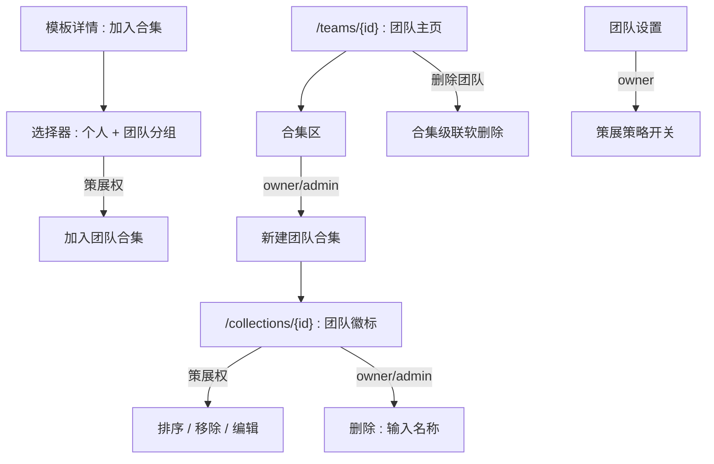
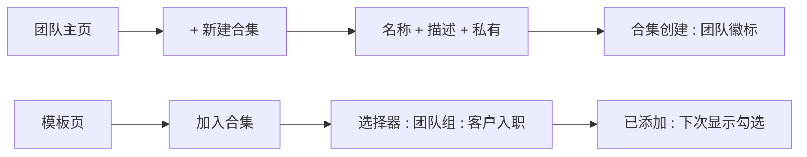
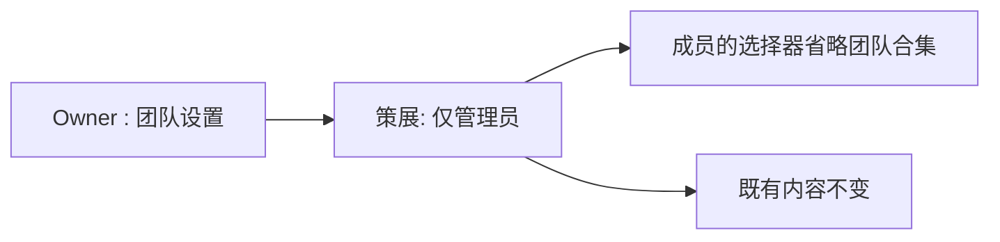

# 团队合集 — UI/UX 设计

- **功能 ID：** team-collections
- **版本：** 1.0
- **状态：** Proposed（待架构评审）
- **作者：** ui-ux-agent
- **日期：** 2026-10-13
- **配套文档：** `team-collections-requirements-zh-CN.md`

## 1. 设计原则

1. **同一产物，新主体。** 团队合集的外观与行为与个人合集完全一致 —— 唯一新信号是团队徽标。
2. **在上下文中策展。** 从模板页把模板加入团队合集，与个人合集共用同一选择器。
3. **所有权可见。** 每个团队合集界面都带团队徽标；"我的合集"绝不混合两者。
4. **审慎破坏。** 删除共享工作需输入名称。

## 2. 信息架构



| 界面 | 位置 | 受众 | 目的 |
|---|---|---|---|
| 团队主页合集区 | /teams/{id} | 成员（全部）/ 访客（公开） | 列表 + 创建入口 |
| 团队合集页 | /collections/{id} | 按可见性 | 浏览 + 策展 |
| 加入合集选择器 | 模板页/卡片 | 有权限的用户 | 添加模板 |
| 策展策略开关 | 团队设置 | Owner | member_curation vs admins_only |
| 删除弹窗 | 合集页 | Owner/admin | 输入名称确认 |

## 3. 用户流程

### 3.1 创建与策展



### 3.2 策略变更



## 4. 页面布局

### 4.1 团队主页 — 合集区

```
+----------------------------------------------------------------------+
|  Acme Team                                            [设置]           |
|  成员 (6) · 模板 (23)                                                 |
+----------------------------------------------------------------------+
|  合集                                                 [+ 新建]         |
|  ┌----------------┐  ┌----------------┐  ┌----------------┐           |
|  | 客户入职        |  | 代码审查        |  | 入门必备        |           |
|  | 12 个模板       |  | 8 个模板        |  | 5 个模板        |           |
|  └----------------┘  └----------------┘  └----------------┘           |
+----------------------------------------------------------------------+
```

### 4.2 团队合集页

```
+----------------------------------------------------------------------+
|  ← Acme Team / 合集                                                   |
|  客户入职                                              [编辑] [⋯]       |
|  🛡 Acme Team · private · 12 个模板 · 由 Alice 创建                    |
+----------------------------------------------------------------------+
|  （有序模板卡片 —— 与个人合集完全一致）                                   |
+----------------------------------------------------------------------+
```

### 4.3 加入合集选择器（分组）

```
+--------------------------------------+
|  加入合集                              |
|  ──────────────────────────────────── |
|  个人                                  |
|   ☐ 我的收藏                           |
|   ☐ 草稿想法                           |
|  团队                                  |
|   🛡 Acme Team                        |
|     ☑ 客户入职                         |
|     ☐ 代码审查提示词                    |
|   🛡 Beta Team（仅管理员）              |
|     🔒 没有你可以编辑的合集              |
+--------------------------------------+
```

### 4.4 策展策略（团队设置）

```
+----------------------------------------------------------------------+
|  团队设置                                                              |
|  …                                                                   |
|  合集策展                                                              |
|  ( ) 所有成员可添加、移除和排序                                         |
|  ( ) 仅 owner 和管理员                                                 |
+----------------------------------------------------------------------+
```

### 4.5 移动端

团队主页合集区变为横向滚动卡片行；合集页与个人合集移动布局一致另加徽标；选择器变为底部抽屉，团队组可折叠。

## 5. 组件规格

| 组件 | 行为 | 状态 |
|---|---|---|
| TeamCollectionsSection | 团队合集卡片网格 + 新建按钮（按权限） | 空态 / 有合集 / 无权限（新建隐藏） |
| TeamBadge | 团队头像 + 名称，链接团队主页 | 合集页、选择器分组 |
| AddToCollectionPicker | 分组列表（个人 / 各团队）；已有勾选；按权限过滤 | 加载中 / 空态 / 已加载 |
| CollectionCurateBar | 按策展权的编辑/排序/移除入口 | 可策展 / 只读 |
| DeleteCollectionModal | 输入名称确认（owner/admin） | 空闲 / 不匹配 / 提交中 |
| CurationPolicyRadio | 团队设置中的双选 radio（仅 owner） | member_curation / admins_only |

## 6. 交互细节

1. **创建：** 新建按钮（owner/admin）打开与个人合集相同的创建表单；成功后卡片带徽标出现在团队区。
2. **选择器分组：** 个人组在前，随后按用户所属团队各一组；用户无策展权的团队渲染为折叠并带锁说明，而非其合集。
3. **幂等添加：** 已包含该模板的合集显示勾选并禁用；点击为无操作（与个人一致）。
4. **策展栏：** 有权限者可见编辑（名称/描述/可见性）、拖拽排序与逐卡移除；其他人不可见。
5. **排序：** 拖拽 + 键盘替代（卡片溢出菜单中上移/下移）；顺序对所有人持久。
6. **删除：** 仅 owner/admin；输入名称弹窗；软删除后对所有成员从团队区消失。
7. **策略开关：** 设置中仅 owner 可用的 radio；变更立即在下次获取时重新把关选择器与策展栏；说明文字解释影响。
8. **团队删除级联：** 团队被删除时，其合集 URL 渲染标准"不再可用"页。
9. **活动：** 策展操作出现在团队活动面，含操作者 + 动作 + 目标（v1 仅审计，无通知）。

## 7. 状态汇总

| 界面 | 加载中 | 空态 | 错误 |
|---|---|---|---|
| TeamCollectionsSection | 卡片骨架 | "暂无合集" + 新建（如有权限） | 重试 |
| 团队合集页 | 骨架 | "此合集暂无模板" | 重试 / 404（非成员，私有） |
| AddToCollectionPicker | 骨架 | "没有你可以添加到的合集" | 重试 |
| DeleteCollectionModal | — | — | 行内错误，保持打开 |
| CurationPolicyRadio | — | — | 保存失败 toast |

## 8. 国际化（i18n）

| Key | 中文 | 英文 |
|---|---|---|
| `teamcol.section.title` | 合集 | Collections |
| `teamcol.section.new` | 新建合集 | New collection |
| `teamcol.section.empty` | 暂无合集 | No collections yet |
| `teamcol.badge.team` | 团队合集 | Team collection |
| `teamcol.picker.personal` | 个人 | Personal |
| `teamcol.picker.teams` | 团队 | Teams |
| `teamcol.picker.locked` | 没有你可以编辑的合集 | No collections you can edit |
| `teamcol.picker.empty` | 没有你可以添加到的合集 | No collections you can add to |
| `teamcol.page.createdBy` | 由 {{name}} 创建 | created by {{name}} |
| `teamcol.page.empty` | 此合集暂无模板 | No templates in this collection yet |
| `teamcol.curate.edit` | 编辑 | Edit |
| `teamcol.curate.reorder` | 排序 | Reorder |
| `teamcol.curate.remove` | 移除 | Remove |
| `teamcol.delete.title` | 删除此合集？ | Delete this collection? |
| `teamcol.delete.typeName` | 输入合集名称以确认 | Type the collection name to confirm |
| `teamcol.policy.title` | 合集策展 | Collection curation |
| `teamcol.policy.members` | 所有成员可添加、移除和排序 | All members can add, remove, and reorder |
| `teamcol.policy.admins` | 仅 owner 和管理员 | Only owner and admins |
| `teamcol.policy.caption` | 适用于该团队的所有合集。 | Applies to all of this team's collections. |
| `teamcol.limit.collections` | 该团队已达合集上限（50） | This team has reached its collection limit (50) |
| `teamcol.limit.templates` | 此合集已达模板上限（100） | This collection has reached its template limit (100) |
| `teamcol.gone` | 此合集不再可用 | This collection is no longer available |

## 9. 无障碍

- 选择器是带分组列表（每团队 `role=group`）的带标签对话框；勾选状态以文字（"已添加"）传达，非仅颜色。
- 拖拽排序有键盘替代；排序控件是带描述性名称的按钮（"上移 Cold Email Template"）。
- 删除弹窗的输入确认框有显式标签与 `aria-describedby` 规则；不匹配时按钮保持 `aria-disabled`。
- 策展策略 radio 组使用 fieldset legend；说明文字通过 `aria-describedby` 绑定。
- 团队徽标是带描述性可访问名称的链接（"Acme Team —— 团队合集所有者"）。

## 10. 数据埋点（可选）

- `teamcol_created`、`teamcol_template_added`（选择器 vs 卡片）、`teamcol_policy_changed` —— 仅产品使用事件。

## 11. 不在范围内

- 按合集的策略；外部协作者；团队链；合集关注；团队合集分析。
- 任何形式的变现 —— 本产品永久不做。
