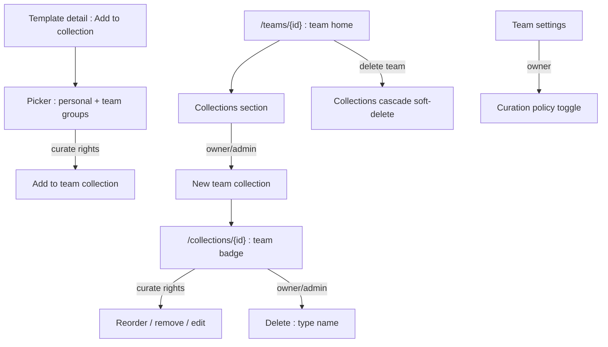
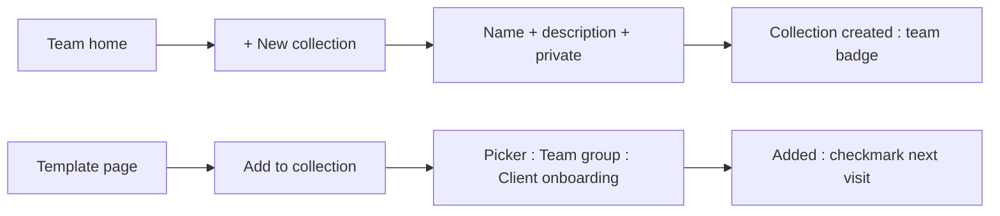
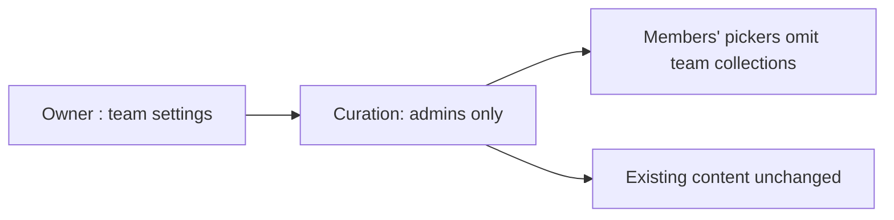

# Team Collections — UI/UX Design

- **Feature ID:** team-collections
- **Version:** 1.0
- **Status:** Proposed (for architecture review)
- **Author:** ui-ux-agent
- **Date:** 2026-10-13
- **Companion doc:** `team-collections-requirements.md`

## 1. Design Principles

1. **Same artifact, new principal.** Team collections look and behave exactly like personal ones — the only new signal is the team badge.
2. **Curate in context.** Adding to a team collection happens from the template page, in the same picker as personal collections.
3. **Ownership is visible.** Every team collection surface carries the team badge; "My collections" never mixes the two.
4. **Deliberate destruction.** Deleting shared work requires typing the name.

## 2. Information Architecture



| Surface | Location | Audience | Purpose |
|---|---|---|---|
| Team home Collections section | /teams/{id} | Members (all) / visitors (public) | List + create entry |
| Team collection page | /collections/{id} | Per visibility | Browse + curate |
| Add-to-collection picker | Template page/card | Users with rights | Add template |
| Curation policy toggle | Team settings | Owner | member_curation vs admins_only |
| Delete modal | Collection page | Owner/admin | Type-name confirm |

## 3. User Flows

### 3.1 Create and curate



### 3.2 Policy change



## 4. Page Layouts

### 4.1 Team home — Collections section

```
+----------------------------------------------------------------------+
|  Acme Team                                          [Settings]        |
|  Members (6) · Templates (23)                                        |
+----------------------------------------------------------------------+
|  Collections                                          [+ New]        |
|  ┌----------------┐  ┌----------------┐  ┌----------------┐           |
|  | Client         |  | Code review    |  | Onboarding     |           |
|  | onboarding     |  | prompts        |  | essentials     |           |
|  | 12 templates   |  | 8 templates    |  | 5 templates    |           |
|  └----------------┘  └----------------┘  └----------------┘           |
+----------------------------------------------------------------------+
```

### 4.2 Team collection page

```
+----------------------------------------------------------------------+
|  ← Acme Team / Collections                                           |
|  Client onboarding                                    [Edit] [⋯]      |
|  🛡 Acme Team · private · 12 templates · created by Alice            |
+----------------------------------------------------------------------+
|  (ordered template cards — identical to personal collections)        |
+----------------------------------------------------------------------+
```

### 4.3 Add-to-collection picker (grouped)

```
+--------------------------------------+
|  Add to collection                    |
|  ──────────────────────────────────── |
|  Personal                             |
|   ☐ My favorites                      |
|   ☐ Draft ideas                       |
|  Teams                                |
|   🛡 Acme Team                        |
|     ☑ Client onboarding               |
|     ☐ Code review prompts             |
|   🛡 Beta Team  (admins only)         |
|     🔒 No collections you can edit    |
+--------------------------------------+
```

### 4.4 Curation policy (team settings)

```
+----------------------------------------------------------------------+
|  Team settings                                                        |
|  …                                                                   |
|  Collection curation                                                  |
|  ( ) All members can add, remove, and reorder                        |
|  ( ) Only owner and admins                                           |
+----------------------------------------------------------------------+
```

### 4.5 Mobile

The team home Collections section becomes a horizontally scrollable card row; the collection page matches the personal-collection mobile layout plus the badge; the picker becomes a bottom sheet with collapsible team groups.

## 5. Component Specs

| Component | Behavior | States |
|---|---|---|
| TeamCollectionsSection | Card grid of the team's collections + New button (rights-gated) | empty / has-collections / no-rights (New hidden) |
| TeamBadge | Team avatar + name linking to team home | on collection page, picker groups |
| AddToCollectionPicker | Grouped list (Personal / per-team); checkmarks for existing; rights-filtered | loading / empty / loaded |
| CollectionCurateBar | Edit/reorder/remove affordances per curate rights | curate / read-only |
| DeleteCollectionModal | Type-the-name confirm (owner/admin) | idle / mismatch / submitting |
| CurationPolicyRadio | Two-option radio in team settings (owner-only) | member_curation / admins_only |

## 6. Interaction Details

1. **Create:** the New button (owner/admin) opens the same create form as personal collections; on success the card appears in the team section with the badge.
2. **Picker grouping:** Personal group first, then one group per team the user belongs to; teams where the user lacks curate rights render collapsed with a lock note instead of their collections.
3. **Idempotent add:** collections already containing the template show a checkmark and are disabled; clicking is a no-op (parity with personal).
4. **Curate bar:** users with rights see Edit (name/description/visibility), drag-reorder, and per-card Remove; others see none of these.
5. **Reorder:** drag-and-drop with keyboard alternative (move up/down in card overflow); order persists for everyone.
6. **Delete:** owner/admin only; type-the-name modal; soft-delete removes it from the team section for all members.
7. **Policy toggle:** owner-only radio in settings; changing it immediately re-gates pickers and curate bars on next fetch; a caption explains the effect.
8. **Team deletion cascade:** when the team is deleted, its collection URLs render the standard "no longer available" page.
9. **Activity:** curation actions appear in the team's activity surface with actor + action + target (audit-only, no notifications in v1).

## 7. States Summary

| Surface | Loading | Empty | Error |
|---|---|---|---|
| TeamCollectionsSection | Card skeletons | "No collections yet" + New (if rights) | Retry |
| Team collection page | Skeleton | "No templates in this collection yet" | Retry / 404 (non-member, private) |
| AddToCollectionPicker | Skeleton | "No collections you can add to" | Retry |
| DeleteCollectionModal | — | — | Inline error, stay open |
| CurationPolicyRadio | — | — | Toast on save failure |

## 8. i18n

| Key | EN | ZH |
|---|---|---|
| `teamcol.section.title` | Collections | 合集 |
| `teamcol.section.new` | New collection | 新建合集 |
| `teamcol.section.empty` | No collections yet | 暂无合集 |
| `teamcol.badge.team` | Team collection | 团队合集 |
| `teamcol.picker.personal` | Personal | 个人 |
| `teamcol.picker.teams` | Teams | 团队 |
| `teamcol.picker.locked` | No collections you can edit | 没有你可以编辑的合集 |
| `teamcol.picker.empty` | No collections you can add to | 没有你可以添加到的合集 |
| `teamcol.page.createdBy` | created by {{name}} | 由 {{name}} 创建 |
| `teamcol.page.empty` | No templates in this collection yet | 此合集暂无模板 |
| `teamcol.curate.edit` | Edit | 编辑 |
| `teamcol.curate.reorder` | Reorder | 排序 |
| `teamcol.curate.remove` | Remove | 移除 |
| `teamcol.delete.title` | Delete this collection? | 删除此合集？ |
| `teamcol.delete.typeName` | Type the collection name to confirm | 输入合集名称以确认 |
| `teamcol.policy.title` | Collection curation | 合集策展 |
| `teamcol.policy.members` | All members can add, remove, and reorder | 所有成员可添加、移除和排序 |
| `teamcol.policy.admins` | Only owner and admins | 仅 owner 和管理员 |
| `teamcol.policy.caption` | Applies to all of this team's collections. | 适用于该团队的所有合集。 |
| `teamcol.limit.collections` | This team has reached its collection limit (50) | 该团队已达合集上限（50） |
| `teamcol.limit.templates` | This collection has reached its template limit (100) | 此合集已达模板上限（100） |
| `teamcol.gone` | This collection is no longer available | 此合集不再可用 |

## 9. Accessibility

- The picker is a labelled dialog with grouped lists (`role=group` per team); checkmark state is conveyed with text ("Added"), not color alone.
- Drag-reorder has a keyboard alternative; reorder controls are buttons with descriptive names ("Move Cold Email Template up").
- The delete modal's type-to-confirm input has an explicit label and `aria-describedby` rule; mismatch keeps the button `aria-disabled`.
- The curation policy radio group uses a fieldset legend; the caption is tied via `aria-describedby`.
- Team badges are links with descriptive accessible names ("Acme Team — team collection owner").

## 10. Analytics (optional)

- `teamcol_created`, `teamcol_template_added` (via picker vs card), `teamcol_policy_changed` — product usage events only.

## 11. Out of Scope

- Per-collection policies; outside collaborators; team chains; collection following; team-collection analytics.
- Monetization of any kind — permanently out of scope for this product.
