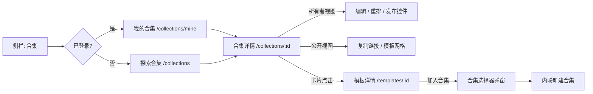
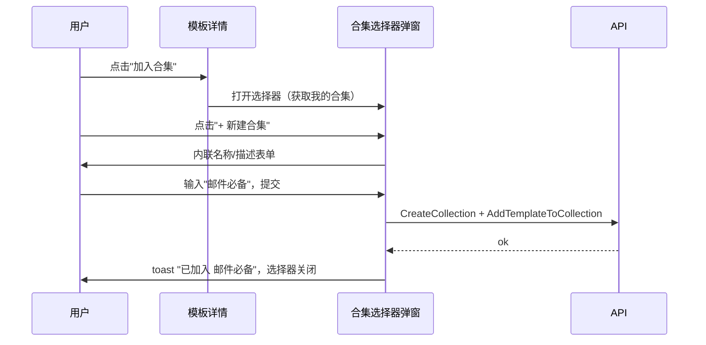
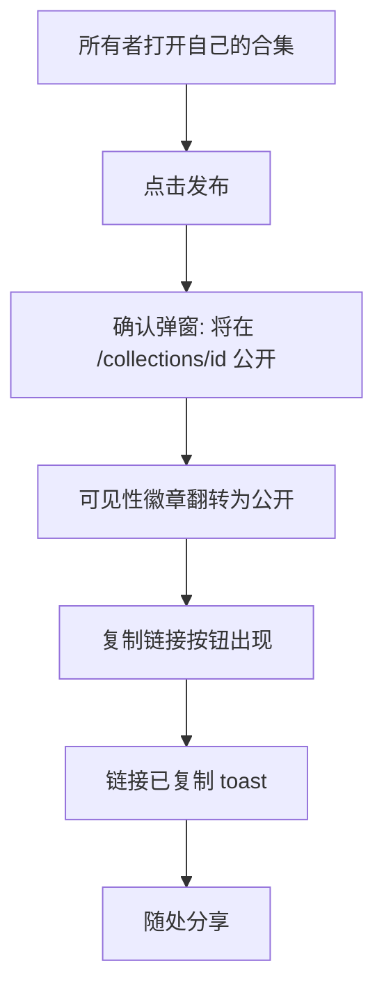
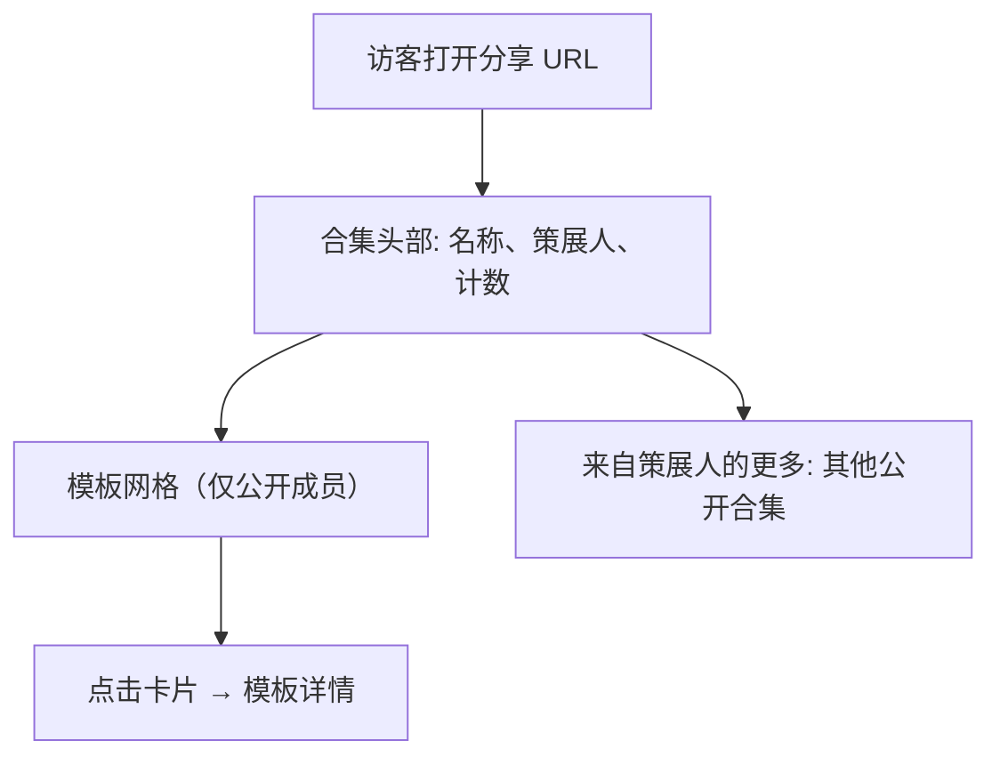

# 模板合集与分享 — UI/UX 设计

- **功能标识:** template-collections
- **版本:** 1.0
- **状态:** 已提案（待架构评审）
- **作者:** ui-ux-agent
- **日期:** 2025-06-25
- **配套文档:** `template-collections-requirements-zh-CN.md`

## 1. 设计原则

1. **播放列表式熟悉感。** 交互模型镜像 Spotify/YouTube 播放列表：创建 → 添加 → 发布 → 分享。零学习成本。
2. **随处收藏。** 模板出现的任何地方（卡片、详情页）都可以加入合集 —— 一键，无需跳转。
3. **默认私有。** 发布是显式、有仪式感的动作（独立按钮 + 确认）；策展人不说公开就绝不公开。
4. **Aurora 原生。** 复用 Layout、PromptCard、Modal、Field、Spinner、NotificationContext、tokens、亮/暗主题。
5. **合集看起来像内容。** 公开合集页像一个策展的迷你广场：带身份信息的头部，然后是熟悉的模板网格。

## 2. 信息架构



**新路由:**

| 路由 | 访问 | 用途 |
|---|---|---|
| `/collections` | 公开 | 探索公开合集（网格、排序） |
| `/collections/mine` | 认证 | 我的合集（所有者视图，含私有） |
| `/collections/:id` | 按可见性 | 合集详情（公开视图或所有者视图） |

## 3. 用户流程

### 3.1 创建合集并添加模板



### 3.2 发布与分享



### 3.3 访客浏览分享的合集



## 4. 页面布局

### 4.1 探索合集（`/collections`）

```text
┌──────────────────────────────────────────────────────────────────────┐
│ Header（既有）                                                        │
├────────────┬─────────────────────────────────────────────────────────┤
│ 侧栏       │  探索合集                                       [最新 ▾] │
│ （+ 合集   │  ┌──────────┐ ┌──────────┐ ┌──────────┐                  │
│  导航项）  │  │ ▦▦▦▦    │ │ ▦▦▦▦    │ │ ▦▦▦▦    │                  │
│            │  │ 邮件    │ │ 写作    │ │ DevOps   │                  │
│            │  │ 必备    │ │ 工具箱  │ │ 提示词   │                  │
│            │  │ Alice 策展│ │ Bob 策展 │ │ Carol 策展│               │
│            │  │ 12 个   │ │ 8 个    │ │ 24 个    │                  │
│            │  └──────────┘ └──────────┘ └──────────┘                  │
│            │  … 分页网格 …                                            │
└────────────┴─────────────────────────────────────────────────────────┘
```

### 4.2 我的合集（`/collections/mine`）

同款网格并增加：右上"+ 新建合集"主按钮；每张卡片显示可见性徽章（私有 🔒 / 公开 🌐）、模板计数、更新日期；卡片溢出菜单：编辑 / 发布-取消发布 / 删除。

### 4.3 合集详情 — 公开视图（`/collections/:id`）

```text
┌──────────────────────────────────────────────────────────────────────┐
│ Header（既有）                                                        │
├──────────────────────────────────────────────────────────────────────┤
│  ▦▦▦▦  邮件必备                                     [复制链接 ⧉]    │
│  （封面拼贴）  Alice 策展 · 12 个模板 · 更新于 6月20日                │
│  "六个久经考验的冷启动外联、跟进邮件提示词…"                          │
├──────────────────────────────────────────────────────────────────────┤
│  ┌─────┐ ┌─────┐ ┌─────┐ ┌─────┐                                      │
│  │     │ │     │ │     │ │     │  （既有 PromptCard 网格）           │
│  └─────┘ └─────┘ └─────┘ └─────┘                                      │
├──────────────────────────────────────────────────────────────────────┤
│  来自 Alice 的更多:  [写作工具箱] [冷启动外联包]                      │
└──────────────────────────────────────────────────────────────────────┘
```

### 4.4 合集详情 — 所有者视图（自己的合集）

在头部与网格之间增加所有者工具栏：

```text
│  [编辑 ✎] [发布 🌐 / 取消发布 🔒] [重排 ⇅] [删除 🗑]                 │
```

重排模式下，每张卡片显示 ↑ ↓ 按钮与位置编号；网格变为单列列表。私有成员显示 🔒 徽章；不再公开的成员显示 ⚠"不再公开"徽章。

### 4.5 加入合集选择器（弹窗，来自模板详情/卡片）

```text
┌──────────────────────────────────────┐
│ 加入合集                          ✕  │
│ ┌──────────────────────────────────┐ │
│ │ 🔍 筛选我的合集…                 │ │
│ └──────────────────────────────────┘ │
│ ☑ 邮件必备                12 个      │
│ ☐ 写作工具箱               8 个      │
│ ☐ DevOps 提示词           24 个      │
│ ──────────────────────────────────── │
│ + 新建合集…                          │
│                    [取消] [加入]      │
└──────────────────────────────────────┘
```

## 5. 组件规格

### 5.1 CollectionCard

| 方面 | 规格 |
|---|---|
| 内容 | 封面拼贴（前 4 个成员的强调色块 2×2 网格带首字母；回退：单块显示合集首字母）、名称（16px，`--text-1`，单行省略）、策展人显示名（13px `--text-2`）、模板计数、可见性徽章（仅所有者场景） |
| 行为 | 整卡可点击 → 合集详情；所有者场景的溢出菜单（⋯）：编辑 / 发布-取消发布 / 删除 |
| 样式 | `--surface-2`、`--border`、`--radius-12`，hover: `--surface-3` + `--shadow-md`；拼贴块用不同旋转的 `--gradient-brand` 制造视觉变化 |
| 无障碍 | 卡片是链接；菜单按钮 `aria-label`；徽章文本不依赖颜色 |

### 5.2 CollectionHeader

| 方面 | 规格 |
|---|---|
| 内容 | 拼贴（更大，96px）、名称（24px）、策展人（链接样式，`--text-2`）、模板计数 + 更新日期、描述（14px `--text-2`，2 行截断）、复制链接按钮（仅公开） |
| 所有者附加 | 头部下方的所有者工具栏（编辑 / 发布 / 重排 / 删除） |
| 样式 | `--surface-2` 卡片、`--radius-18`、内边距 24px；名称 `--text-1`；徽章遵循既有模式 |

### 5.3 CollectionPicker（弹窗）

| 方面 | 规格 |
|---|---|
| 触发 | "加入合集"按钮（模板详情操作行；卡片悬停覆盖层） |
| 内容 | 筛选输入（客户端）、我的合集复选框列表（名称 + 计数；勾选 = 已包含）、"+ 新建合集…"行展开内联表单（名称必填，描述可选） |
| 行为 | 勾选/取消勾选暂存变更；加入按钮提交（加入勾选的、从取消勾选的移除 —— 按 FR-8 幂等）；新建合集先创建再加入 |
| 限制 | 已有 50 个时新建 → 内联错误（FR-4）；加入已满合集 → 该行内联错误 |
| 无障碍 | 既有 Modal（焦点陷阱、Escape）；复选框是真实输入；内联表单字段有标签 |

### 5.4 ReorderList（所有者，重排模式）

| 方面 | 规格 |
|---|---|
| 内容 | 成员卡片的单列列表，带 ↑ ↓ 按钮 + 位置编号 + 移除（✕） |
| 行为 | ↑/↓ 本地交换位置；出现保存条（"3 处变更 — 保存 / 放弃"）；保存用完整位置列表调用 ReorderCollectionTemplates |
| 无障碍 | 按钮 `aria-label`（"上移 邮件写手"）；列表 `aria-describedby` 说明模式；全程可键盘操作 |

### 5.5 PublishToggle 与 CopyLink

| 方面 | 规格 |
|---|---|
| 发布 | 带地球图标的按钮；确认弹窗（"将此合集公开？任何拥有链接的人都可以查看。"）→ UpdateCollection visibility |
| 取消发布 | 带锁图标的按钮；确认弹窗（"设为私有？现有链接将失效。"） |
| 复制链接 | 带链接图标的 ghost 按钮；`navigator.clipboard` + 回退；成功 toast；仅公开时可见 |

### 5.6 侧栏导航项

| 方面 | 规格 |
|---|---|
| 标签 | 登录："My Collections" / "我的合集"（链接 `/collections/mine`）；匿名："Explore Collections" / "探索合集"（链接 `/collections`） |
| 图标 | 网格/合集图标（Icons.jsx 新增） |
| 位置 | "我的收藏"下方、分类上方（与数据分析导航项同组） |

### 5.7 空状态

| 场景 | 内容 |
|---|---|
| 我的合集（无） | 插图 + "还没有合集" + "合集让你把模板分组，并用一个链接分享。" + CTA"创建你的第一个合集" |
| 合集详情（空） | 所有者："此合集为空。去 Prompt Square 浏览并添加模板。" + CTA；公开空合集："此合集为空。" |
| 探索（无公开合集） | "还没有公开合集。成为第一个发布的人吧！" |

## 6. 交互细节

1. **从卡片加入:** PromptCard 悬停覆盖层显示小"+"按钮（右上）打开选择器；移动端：长按或卡片页脚 ⋯ 菜单。
2. **选择器暂存:** 变更在点击加入时生效，而非每次勾选；未点加入就关闭（Escape/✕/遮罩点击）即放弃。
3. **发布流程:** 发布 → 确认弹窗 → 徽章乐观翻转 → API 调用；失败回滚 + 错误 toast。
4. **重排:** 保存前保持本地状态；放弃恢复；有未保存变更离开页面时用既有导航守卫模式提示（若无，v1 用简单 beforeunload 亦可）。
5. **复制链接:** 绝对 URL（`window.location.origin + /collections/{id}`）；toast 确认。
6. **删除:** 确认弹窗回显合集名称；软删除；导航回我的合集。
7. **所有者视图徽章:** 🔒 私有成员；⚠ 不再公开成员（FR-15）；各有 tooltip 解释。
8. **分页:** 探索页用既有无限滚动模式；我的合集单页（≤50）。
9. **路由守卫:** `/collections/mine` 匿名重定向 → 登录；`/collections/:id` 对私有/不存在渲染 404 页（不可区分）。

## 7. 状态汇总

| 状态 | 触发 | UI |
|---|---|---|
| 加载中 | 页面/弹窗取数 | 骨架卡片（网格）/ spinner（弹窗列表） |
| 空（各场景） | 无数据 | §5.7 空状态 |
| 错误 | API 失败 | 错误横幅 + 重试（页面）；toast（变更操作） |
| 达到限制 | 第 51 个合集 / 第 101 个成员 | 选择器/弹窗内联错误 |
| 发布中 | 发布确认 → API | 按钮 spinner；成功后徽章翻转 |
| 重排模式 | 所有者点击重排 | 列表视图 + 保存条 |
| 未找到 | 错误 id / 私有 | 404 页（既有模式） |

## 8. 视觉风格（Aurora 合规）

- **CollectionCard:** `--surface-2` + `--border` + `--radius-12`；拼贴块：`--gradient-brand`（通过 CSS filter 或 4 个品牌 token 预设渐变旋转色相）；名称 `--text-1`；元信息 `--text-2`。
- **CollectionHeader:** `--surface-2`、`--radius-18`；复制链接 = `.btn-ghost`；发布 = `.btn-primary`；删除 = `.btn-danger`（ghost 变体）。
- **徽章:** 既有徽章模式 —— 私有：`--surface-3` 背景 + `--text-2` + 🔒；公开：`--accent`-soft 背景 + `--accent` 文本 + 🌐；⚠ 警告：`--warning`-soft + `--warning`。
- **选择器:** 既有 Modal；行 hover `--surface-3`；复选框 accent `--accent`。
- **ReorderList:** 行 `--surface-2`；按钮 ghost；保存条底部吸顶带 `--shadow-lg`。
- **暗/亮主题:** 仅 token；两个主题自动。

## 9. 国际化考量（EN/ZH）

新增命名空间 `collections.*`：

```json
{
  "collections": {
    "nav_mine": "My Collections",
    "nav_explore": "Explore Collections",
    "explore_title": "Explore Collections",
    "mine_title": "My Collections",
    "new": "New collection",
    "items": "{{count}} templates",
    "by": "Curated by {{name}}",
    "updated": "Updated {{date}}",
    "copy_link": "Copy link",
    "link_copied": "Link copied to clipboard",
    "publish": "Publish",
    "unpublish": "Make private",
    "publish_confirm": "Make this collection public? Anyone with the link can view it.",
    "unpublish_confirm": "Make this collection private? Existing links will stop working.",
    "edit": "Edit collection",
    "reorder": "Reorder",
    "delete": "Delete collection",
    "delete_confirm": "Delete \"{{name}}\"? This cannot be undone.",
    "add_to": "Add to collection",
    "picker": { "title": "Add to collection", "filter": "Filter my collections…", "new": "New collection…", "name": "Name", "description": "Description (optional)", "create_and_add": "Create and add", "add": "Add", "cancel": "Cancel", "limit": "You've reached the maximum of 50 collections.", "full": "This collection is full (100 templates)." },
    "member_badge": { "private": "Private", "no_longer_public": "No longer public" },
    "more_from": "More from {{name}}",
    "empty": {
      "mine_title": "No collections yet",
      "mine_body": "Collections let you group templates and share them with one link.",
      "mine_cta": "Create your first collection",
      "collection_owner": "This collection is empty. Browse the Prompt Square and add templates.",
      "collection_public": "This collection is empty.",
      "explore": "No public collections yet. Be the first to publish one!"
    },
    "error": { "fetch": "Failed to load collections.", "mutate": "Something went wrong. Please try again.", "retry": "Retry" }
  }
}
```

中文镜像：

```json
{
  "collections": {
    "nav_mine": "我的合集",
    "nav_explore": "探索合集",
    "explore_title": "探索合集",
    "mine_title": "我的合集",
    "new": "新建合集",
    "items": "{{count}} 个模板",
    "by": "由 {{name}} 策展",
    "updated": "更新于 {{date}}",
    "copy_link": "复制链接",
    "link_copied": "链接已复制到剪贴板",
    "publish": "发布",
    "unpublish": "设为私有",
    "publish_confirm": "将此合集公开？任何拥有链接的人都可以查看。",
    "unpublish_confirm": "将此合集设为私有？现有链接将失效。",
    "edit": "编辑合集",
    "reorder": "重排",
    "delete": "删除合集",
    "delete_confirm": "删除\"{{name}}\"？此操作不可撤销。",
    "add_to": "加入合集",
    "picker": { "title": "加入合集", "filter": "筛选我的合集…", "new": "新建合集…", "name": "名称", "description": "描述（可选）", "create_and_add": "创建并加入", "add": "加入", "cancel": "取消", "limit": "已达到 50 个合集的上限。", "full": "该合集已满（100 个模板）。" },
    "member_badge": { "private": "私有", "no_longer_public": "不再公开" },
    "more_from": "来自 {{name}} 的更多",
    "empty": {
      "mine_title": "还没有合集",
      "mine_body": "合集让你把模板分组，并用一个链接分享。",
      "mine_cta": "创建你的第一个合集",
      "collection_owner": "此合集为空。去 Prompt Square 浏览并添加模板。",
      "collection_public": "此合集为空。",
      "explore": "还没有公开合集。成为第一个发布的人吧！"
    },
    "error": { "fetch": "加载合集失败。", "mutate": "出错了，请重试。", "retry": "重试" }
  }
}
```

说明: 合集名称/描述是用户内容 —— 绝不翻译；UI 框架完全本地化。日期使用共享的 locale 感知格式化器。`{{count}}` 复数化在 EN 中使用 i18next `_other`；ZH 使用单一形式。

## 10. 无障碍

- CollectionCard: 单一链接目标（无嵌套链接）；溢出菜单按钮有 `aria-label` 并打开焦点受限的菜单。
- 选择器弹窗: 既有 Modal 焦点陷阱；复选框行是包裹真实输入的 `<label>`；筛选输入有标签；"新建合集"展开带标签字段的表单；错误通过 `aria-live` 播报。
- ReorderList: ↑/↓ 按钮带描述性 `aria-label`；播报位置；保存条按钮可达；Escape 退出重排模式（有未保存确认）。
- 发布/删除确认: 既有 Modal 语义；危险操作清晰标注。
- 复制链接: 成功通过 toast 播报（NotificationContext 是 aria-live）。
- 徽章: 文本 + 图标，绝不仅靠颜色。
- 所有流程可键盘完成；焦点可见（Aurora 环）；两个主题对比度 AA。

## 11. 给开发者的实现说明

1. **路由:** 在 App.js 添加 `/collections`、`/collections/mine`、`/collections/:id`（懒加载）；用既有认证模式守卫 `/collections/mine`。
2. **API 客户端:** 在 services/api.js 新增：`listPublicCollections`、`listMyCollections`、`getCollection`、`createCollection`、`updateCollection`、`deleteCollection`、`addTemplatesToCollection`、`removeTemplateFromCollection`、`reorderCollectionTemplates`、`listCollectionsForTemplate`。
3. **组件:** CollectionCard、CollectionHeader、CollectionPicker（包装 Modal）、ReorderList、PublishToggle、CopyLinkButton；成员复用 PromptCard。
4. **封面拼贴:** 纯 CSS 2×2 网格；块颜色来自品牌 token 派生的 4 个预设渐变；首字母取自模板标题；不获取图片。
5. **状态:** 局部组件状态 + 既有模式（无需新增 Redux；合集是页面级作用域）。"已在合集"检查在模板详情挂载时用 `listCollectionsForTemplate`。
6. **卡片悬停操作:** 为 PromptCard 增加可选 `onAddToCollection` prop；覆盖层按钮在触屏隐藏（改用 ⋯ 菜单）。
7. **测试:** CollectionPicker（暂存、限制、内联创建）、ReorderList（交换逻辑、保存/放弃）、CollectionCard（菜单操作）的组件测试；探索/我的/详情页（加载、空、错误）的页面测试；i18n 键一致性测试。
8. **后端:** 表按 D-1；RPC 按 FR-22；复用所有权中间件；模板删除时通过 collection_templates.template_id 的 FK ON DELETE CASCADE 级联移除（FR-16）。
