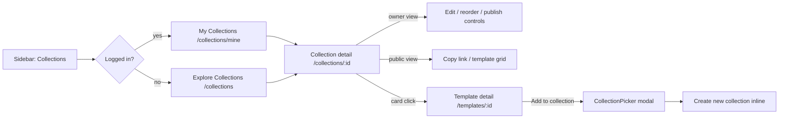
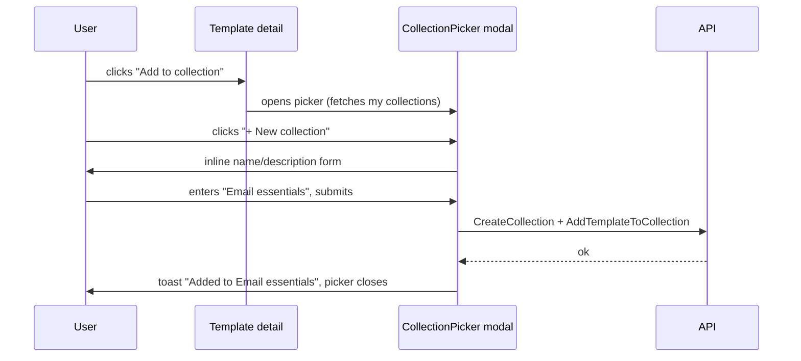
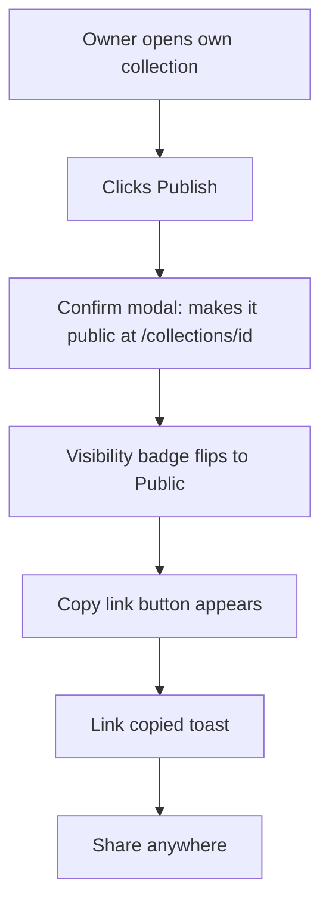

# Template Collections & Sharing — UI/UX Design

- **Feature ID:** template-collections
- **Version:** 1.0
- **Status:** Proposed (for architecture review)
- **Author:** ui-ux-agent
- **Date:** 2025-06-25
- **Companion doc:** `template-collections-requirements.md`

## 1. Design Principles

1. **Playlist-familiar.** The interaction model mirrors Spotify/YouTube playlists: create → add → publish → share. Zero learning curve.
2. **Collect anywhere.** Adding to a collection is available wherever a template appears (card, detail page) — one click, no navigation.
3. **Private by default.** Publishing is an explicit, celebrated action (distinct button + confirmation); nothing is public until the curator says so.
4. **Aurora-native.** Reuse Layout, PromptCard, Modal, Field, Spinner, NotificationContext, tokens, light/dark themes.
5. **Collections look like content.** A public collection page feels like a curated mini-square: header with identity, then the familiar template grid.

## 2. Information Architecture



**New routes:**

| Route | Access | Purpose |
|---|---|---|
| `/collections` | public | Explore public collections (grid, sorted) |
| `/collections/mine` | auth | My collections (owner view, private ones included) |
| `/collections/:id` | per visibility | Collection detail (public view or owner view) |

## 3. User Flows

### 3.1 Create a collection and add templates



### 3.2 Publish and share



### 3.3 Visitor browses a shared collection

```mermaid
flowchart TD
    A[Visitor opens shared URL] --> B[Collection header: name, curator, count]
    B --> C[Template grid (public members only)]
    C --> D[Click card → template detail]
    B --> E[More from curator: other public collections]
```

## 4. Page Layouts

### 4.1 Explore Collections (`/collections`)

```text
┌──────────────────────────────────────────────────────────────────────┐
│ Header (existing)                                                    │
├────────────┬─────────────────────────────────────────────────────────┤
│ Sidebar    │  Explore Collections                    [Newest ▾]      │
│ (+ Collect-│  ┌──────────┐ ┌──────────┐ ┌──────────┐                  │
│  ions nav) │  │ ▦▦▦▦    │ │ ▦▦▦▦    │ │ ▦▦▦▦    │                  │
│            │  │ Email    │ │ Writing  │ │ DevOps   │                  │
│            │  │ essentials│ │ toolkit │ │ prompts  │                  │
│            │  │ by Alice │ │ by Bob   │ │ by Carol │                  │
│            │  │ 12 items │ │ 8 items  │ │ 24 items │                  │
│            │  └──────────┘ └──────────┘ └──────────┘                  │
│            │  … paginated grid …                                     │
└────────────┴─────────────────────────────────────────────────────────┘
```

### 4.2 My Collections (`/collections/mine`)

Same grid plus: "+ New collection" primary button (top right), each card shows visibility badge (Private 🔒 / Public 🌐), template count, updated date; card overflow menu: Edit / Publish-Unpublish / Delete.

### 4.3 Collection detail — public view (`/collections/:id`)

```text
┌──────────────────────────────────────────────────────────────────────┐
│ Header (existing)                                                    │
├──────────────────────────────────────────────────────────────────────┤
│  ▦▦▦▦  Email essentials                              [Copy link ⧉]   │
│  (cover collage)  Curated by Alice · 12 templates · Updated Jun 20   │
│  "Six battle-tested prompts for cold outreach, follow-ups…"          │
├──────────────────────────────────────────────────────────────────────┤
│  ┌─────┐ ┌─────┐ ┌─────┐ ┌─────┐                                      │
│  │     │ │     │ │     │ │     │  (existing PromptCard grid)         │
│  └─────┘ └─────┘ └─────┘ └─────┘                                      │
├──────────────────────────────────────────────────────────────────────┤
│  More from Alice:  [Writing toolkit] [Cold outreach pack]            │
└──────────────────────────────────────────────────────────────────────┘
```

### 4.4 Collection detail — owner view (own collection)

Adds an owner toolbar between header and grid:

```text
│  [Edit ✎] [Publish 🌐 / Unpublish 🔒] [Reorder ⇅] [Delete 🗑]        │
```

In Reorder mode, each card shows ↑ ↓ buttons and a position number; grid becomes a single column list. Private members show a 🔒 badge; members no longer public show a ⚠ "no longer public" badge.

### 4.5 Add-to-collection picker (modal, from template detail/card)

```text
┌──────────────────────────────────────┐
│ Add to collection                 ✕  │
│ ┌──────────────────────────────────┐ │
│ │ 🔍 Filter my collections…        │ │
│ └──────────────────────────────────┘ │
│ ☑ Email essentials        12 items   │
│ ☐ Writing toolkit          8 items   │
│ ☐ DevOps prompts          24 items   │
│ ──────────────────────────────────── │
│ + New collection…                    │
│                    [Cancel] [Add]     │
└──────────────────────────────────────┘
```

## 5. Component Specifications

### 5.1 CollectionCard

| Aspect | Spec |
|---|---|
| Content | Cover collage (2×2 grid of first 4 members' accent-colored tiles with initials; fallback: single tile with collection initial), name (16px, `--text-1`, 1-line ellipsis), curator display name (13px `--text-2`), template count, visibility badge (owner contexts only) |
| Behavior | Whole card clickable → collection detail; overflow menu (⋯) in owner contexts: Edit / Publish-Unpublish / Delete |
| Styling | `--surface-2`, `--border`, `--radius-12`, hover: `--surface-3` + `--shadow-md`; collage tiles use `--gradient-brand` at varying rotations for visual variety |
| A11y | Card is a link; menu button `aria-label`; badge text not color-only |

### 5.2 CollectionHeader

| Aspect | Spec |
|---|---|
| Content | Collage (larger, 96px), name (24px), curator (link-styled, `--text-2`), template count + updated date, description (14px `--text-2`, 2-line clamp), Copy link button (public only) |
| Owner extras | Owner toolbar (Edit / Publish / Reorder / Delete) below the header |
| Styling | `--surface-2` card, `--radius-18`, padding 24px; name `--text-1`; badges per existing patterns |

### 5.3 CollectionPicker (modal)

| Aspect | Spec |
|---|---|
| Trigger | "Add to collection" button (template detail actions row; card hover overlay) |
| Content | Filter input (client-side), checkbox list of my collections (name + count; checked = already contains), "+ New collection…" row expanding an inline form (name required, description optional) |
| Behavior | Checking/unchecking stages changes; Add button commits (add to checked, remove from unchecked — idempotent per FR-8); New collection creates then adds |
| Limits | Creating when at 50 → inline error (FR-4); adding to a full collection → inline error on that row |
| A11y | Existing Modal (focus trap, Escape); checkboxes real inputs; inline form fields labeled |

### 5.4 ReorderList (owner, reorder mode)

| Aspect | Spec |
|---|---|
| Content | Single-column list of member cards with ↑ ↓ buttons + position number + remove (✕) |
| Behavior | ↑/↓ swaps positions locally; Save bar appears ("3 changes — Save / Discard"); Save calls ReorderCollectionTemplates with the full position list |
| A11y | Buttons `aria-label` ("Move Email writer up"); list `aria-describedby` explaining mode; keyboard operable end-to-end |

### 5.5 PublishToggle & CopyLink

| Aspect | Spec |
|---|---|
| Publish | Button with globe icon; confirmation modal ("Make this collection public? Anyone with the link can view it.") → UpdateCollection visibility |
| Unpublish | Button with lock icon; confirmation modal ("Make private? Existing links will stop working.") |
| Copy link | Ghost button with link icon; `navigator.clipboard` + fallback; success toast; visible only when public |

### 5.6 Sidebar nav item

| Aspect | Spec |
|---|---|
| Label | Logged in: "My Collections" / "我的合集" (links `/collections/mine`); anonymous: "Explore Collections" / "探索合集" (links `/collections`) |
| Icon | Grid/collection icon (Icons.jsx addition) |
| Placement | Below "My Favorites", above Categories (same group as analytics nav item) |

### 5.7 Empty states

| Context | Content |
|---|---|
| My Collections (none) | Illustration + "No collections yet" + "Collections let you group templates and share them with one link." + CTA "Create your first collection" |
| Collection detail (empty) | Owner: "This collection is empty. Browse the Prompt Square and add templates." + CTA; Public empty collection: "This collection is empty." |
| Explore (no public collections) | "No public collections yet. Be the first to publish one!" |

## 6. Interaction Details

1. **Add from card:** hover overlay on PromptCard shows a small "+" button (top-right) opening the picker; mobile: long-press or ⋯ menu in card footer.
2. **Picker staging:** changes apply on Add, not per-check; closing without Add discards (Escape/✕/overlay click all discard).
3. **Publish flow:** Publish → confirm modal → optimistic badge flip → API call; failure reverts + error toast.
4. **Reorder:** local state until Save; Discard restores; leaving the page with unsaved changes prompts via existing navigation guard patterns (if none exist, a simple beforeunload is acceptable v1).
5. **Copy link:** absolute URL (`window.location.origin + /collections/{id}`); toast confirms.
6. **Delete:** confirmation modal with collection name echoed; soft delete; navigates back to My Collections.
7. **Badges in owner view:** 🔒 private member; ⚠ no-longer-public member (FR-15); tooltips explain each.
8. **Pagination:** Explore page uses existing infinite-scroll pattern; My Collections is a single page (≤50).
9. **Routing guards:** `/collections/mine` redirects anonymous → login; `/collections/:id` renders 404 page for private/nonexistent (indistinguishable).

## 7. States Summary

| State | Trigger | UI |
|---|---|---|
| Loading | Page/modal fetch | Skeleton cards (grid) / spinner (modal list) |
| Empty (various) | No data | §5.7 empty states |
| Error | API failure | Error banner + Retry (pages); toast (mutations) |
| Limit reached | 51st collection / 101st member | Inline error in picker/modal |
| Publishing | Publish confirm → API | Button spinner; badge flips on success |
| Reorder mode | Owner clicks Reorder | List view + save bar |
| Not found | Bad id / private | 404 page (existing pattern) |

## 8. Visual Style (Aurora compliance)

- **CollectionCard:** `--surface-2` + `--border` + `--radius-12`; collage tiles: `--gradient-brand` (rotated hues via CSS filter or 4 preset gradients from brand tokens); name `--text-1`; meta `--text-2`.
- **CollectionHeader:** `--surface-2`, `--radius-18`; Copy link = `.btn-ghost`; Publish = `.btn-primary`; Delete = `.btn-danger` (ghost variant).
- **Badges:** existing badge pattern — Private: `--surface-3` bg + `--text-2` + 🔒; Public: `--accent`-soft bg + `--accent` text + 🌐; ⚠ warning: `--warning`-soft + `--warning`.
- **Picker:** existing Modal; rows hover `--surface-3`; checkbox accent `--accent`.
- **ReorderList:** rows `--surface-2`; buttons ghost; save bar sticky bottom with `--shadow-lg`.
- **Dark/light:** token-only; both themes automatic.

## 9. i18n Considerations (EN/ZH)

New namespace `collections.*`:

```json
{
  "collections": {
    "nav_mine": "My Collections",
    "nav_explore": "Explore Collections",
    "explore_title": "Explore Collections",
    "mine_title": "My Collections",
    "new": "New collection",
    "items": "{{count}} templates",
    "by": "Curated by {{name}}",
    "updated": "Updated {{date}}",
    "copy_link": "Copy link",
    "link_copied": "Link copied to clipboard",
    "publish": "Publish",
    "unpublish": "Make private",
    "publish_confirm": "Make this collection public? Anyone with the link can view it.",
    "unpublish_confirm": "Make this collection private? Existing links will stop working.",
    "edit": "Edit collection",
    "reorder": "Reorder",
    "delete": "Delete collection",
    "delete_confirm": "Delete \"{{name}}\"? This cannot be undone.",
    "add_to": "Add to collection",
    "picker": { "title": "Add to collection", "filter": "Filter my collections…", "new": "New collection…", "name": "Name", "description": "Description (optional)", "create_and_add": "Create and add", "add": "Add", "cancel": "Cancel", "limit": "You've reached the maximum of 50 collections.", "full": "This collection is full (100 templates)." },
    "member_badge": { "private": "Private", "no_longer_public": "No longer public" },
    "more_from": "More from {{name}}",
    "empty": {
      "mine_title": "No collections yet",
      "mine_body": "Collections let you group templates and share them with one link.",
      "mine_cta": "Create your first collection",
      "collection_owner": "This collection is empty. Browse the Prompt Square and add templates.",
      "collection_public": "This collection is empty.",
      "explore": "No public collections yet. Be the first to publish one!"
    },
    "error": { "fetch": "Failed to load collections.", "mutate": "Something went wrong. Please try again.", "retry": "Retry" }
  }
}
```

ZH mirror:

```json
{
  "collections": {
    "nav_mine": "我的合集",
    "nav_explore": "探索合集",
    "explore_title": "探索合集",
    "mine_title": "我的合集",
    "new": "新建合集",
    "items": "{{count}} 个模板",
    "by": "由 {{name}} 策展",
    "updated": "更新于 {{date}}",
    "copy_link": "复制链接",
    "link_copied": "链接已复制到剪贴板",
    "publish": "发布",
    "unpublish": "设为私有",
    "publish_confirm": "将此合集公开？任何拥有链接的人都可以查看。",
    "unpublish_confirm": "将此合集设为私有？现有链接将失效。",
    "edit": "编辑合集",
    "reorder": "重排",
    "delete": "删除合集",
    "delete_confirm": "删除\"{{name}}\"？此操作不可撤销。",
    "add_to": "加入合集",
    "picker": { "title": "加入合集", "filter": "筛选我的合集…", "new": "新建合集…", "name": "名称", "description": "描述（可选）", "create_and_add": "创建并加入", "add": "加入", "cancel": "取消", "limit": "已达到 50 个合集的上限。", "full": "该合集已满（100 个模板）。" },
    "member_badge": { "private": "私有", "no_longer_public": "不再公开" },
    "more_from": "来自 {{name}} 的更多",
    "empty": {
      "mine_title": "还没有合集",
      "mine_body": "合集让你把模板分组，并用一个链接分享。",
      "mine_cta": "创建你的第一个合集",
      "collection_owner": "此合集为空。去 Prompt Square 浏览并添加模板。",
      "collection_public": "此合集为空。",
      "explore": "还没有公开合集。成为第一个发布的人吧！"
    },
    "error": { "fetch": "加载合集失败。", "mutate": "出错了，请重试。", "retry": "重试" }
  }
}
```

Notes: collection names/descriptions are user content — never translated; the UI chrome is fully localized. Dates use the shared locale-aware formatter. The `{{count}}` pluralization uses i18next `_other` in EN; ZH uses one form.

## 10. Accessibility

- CollectionCard: single link target (no nested links); overflow menu button has `aria-label` and opens a focus-trapped menu.
- Picker modal: existing Modal focus trap; checkbox rows are `<label>` wrapping real inputs; filter input labeled; "New collection" expands a form with labeled fields; errors announced via `aria-live`.
- ReorderList: ↑/↓ buttons with descriptive `aria-label`s; position announced; save bar buttons reachable; Escape exits reorder mode (with unsaved-changes confirm).
- Publish/Delete confirmations: existing Modal semantics; danger actions clearly labeled.
- Copy link: success announced via toast (NotificationContext is aria-live).
- Badges: text + icon, never color-only.
- All flows keyboard-complete; focus visible (Aurora ring); contrast AA in both themes.

## 11. Implementation Notes for Developer

1. **Routes:** add `/collections`, `/collections/mine`, `/collections/:id` (lazy) to App.js; guard `/collections/mine` with the existing auth pattern.
2. **API client:** new functions in services/api.js: `listPublicCollections`, `listMyCollections`, `getCollection`, `createCollection`, `updateCollection`, `deleteCollection`, `addTemplatesToCollection`, `removeTemplateFromCollection`, `reorderCollectionTemplates`, `listCollectionsForTemplate`.
3. **Components:** CollectionCard, CollectionHeader, CollectionPicker (wraps Modal), ReorderList, PublishToggle, CopyLinkButton; reuse PromptCard for members.
4. **Cover collage:** pure CSS 2×2 grid; tiles colored from 4 preset gradients derived from brand tokens; initials from template titles; no images fetched.
5. **State:** local component state + existing patterns (no Redux additions needed; collections are page-scoped). The "already in collection" check uses `listCollectionsForTemplate` on template detail mount.
6. **Card hover action:** extend PromptCard with an optional `onAddToCollection` prop; overlay button hidden on touch (use ⋯ menu instead).
7. **Testing:** component tests for CollectionPicker (staging, limits, inline create), ReorderList (swap logic, save/discard), CollectionCard (menu actions); page tests for explore/mine/detail (loading, empty, error); i18n key parity test.
8. **Backend:** tables per D-1; RPCs per FR-22; ownership middleware reuse; cascade delete on template removal (FR-16) via FK ON DELETE CASCADE on collection_templates.template_id.
