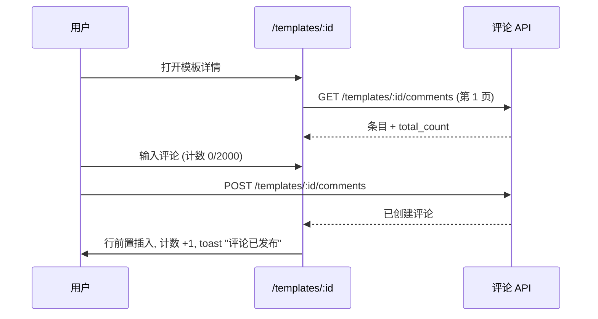
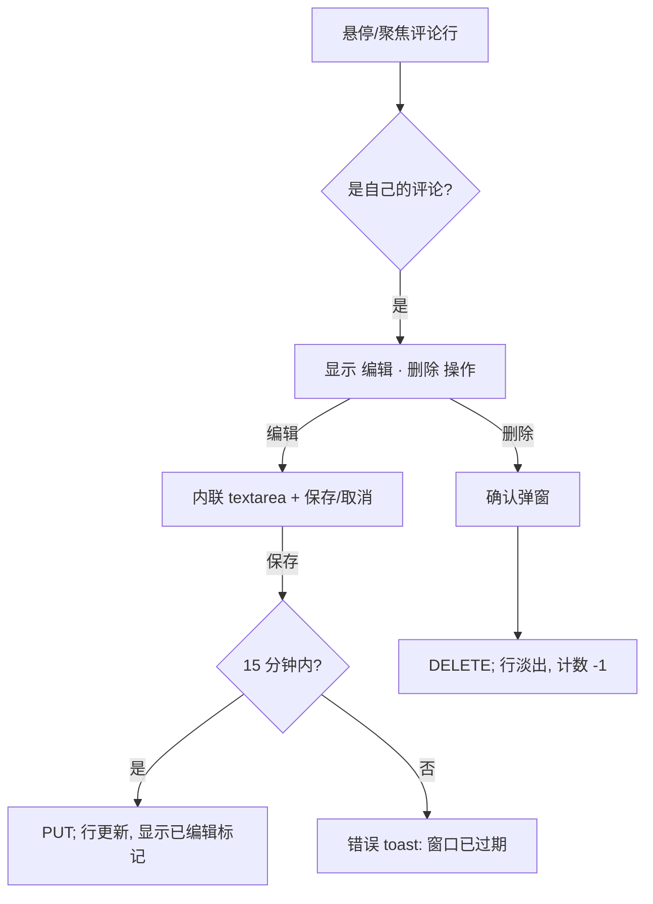

# 模板评论 — UI/UX 设计

- **功能标识:** template-comments
- **版本:** 1.0
- **状态:** 已提案（待架构评审）
- **作者:** ui-ux-agent
- **日期:** 2026-10-12
- **配套文档:** `template-comments-requirements-zh-CN.md`

## 1. 设计原则

1. **评论是模板页的一部分，而非独立目的地。** 区块位于 `/templates/:id` 社交统计之下；普通用户不新增路由。阅读零额外点击。
2. **信任优先的呈现。** 作者身份（头像 + 显示名）、相对时间、"已编辑"标记、高亮的创作者徽章让反馈可扫读、可信。
3. **Aurora 原生。** 复用既有 token、卡片面、按钮、Modal、Spinner、空状态、toast（`NotificationContext`）与明暗主题。不引入新视觉语言。
4. **审核 = 确认 + 理由。** 所有者/管理员删除始终走既有确认弹窗模式；管理员删除增加必填理由字段（与封禁/解封一致），保证审计可信。
5. **优雅降级。** 评论区独立失败：API 错误显示内联错误 + 重试，绝不拖垮模板详情页。

## 2. 信息架构

```mermaid
flowchart LR
    A[/templates/:id] --> B[评论区]
    B --> C[列表: 最新在前, 分页]
    B --> D[输入框: 仅登录]
    D -->|发布| C
    C -->|作者: 编辑 / 删除| C
    C -->|所有者: 删除任意| C
    E[/admin/comments] --> F[筛选: q / 模板 / 作者]
    F --> G[表格 + 分页]
    G -->|删除| H[理由弹窗] --> I[审计日志]
    J[/admin/templates/:id] --> K[评论面板: 同款删除]
```

**界面清单:**

| 界面 | 访问 | 内容 |
|---|---|---|
| `/templates/:id` 评论区 | 公开可读；登录可发 | 计数、列表、输入框、逐条操作 |
| `/admin/comments` | 仅管理员 | 全站评论审核列表 |
| `/admin/templates/:id` 评论面板 | 仅管理员 | 单模板评论 + 带理由删除 |

## 3. 用户流程

### 3.1 阅读与发布（普通用户）



### 3.2 编辑 / 删除自己的评论



### 3.3 所有者审核

```mermaid
flowchart TD
    A[所有者查看自己的模板] --> B[每条评论均有删除操作]
    B --> C[确认弹窗: "删除这条评论?"] --> D[DELETE /comments/:id] --> E[行移除, 计数 -1]
```

### 3.4 管理员审核

```mermaid
flowchart TD
    A[/admin/comments] --> B[应用筛选 q/模板/作者]
    B --> C[分页表格]
    C --> D[删除] --> E[理由弹窗: 3-500 字符, 必填]
    E --> F[DELETE /admin/comments/:id] --> G[行移除; 写入审计日志]
    C --> H[打开模板] --> I[/admin/templates/:id]
```

## 4. 页面布局

### 4.1 模板详情 — 评论区（社交统计之下）

```text
┌──────────────────────────────────────────────────────────────┐
│ 评论 (12)                                                     │
├──────────────────────────────────────────────────────────────┤
│ ┌──────────────────────────────────────────────────────────┐ │
│ │ [输入卡片]                                                │ │
│ │ [头像] ┌────────────────────────────────────────────┐    │ │
│ │        │ 分享反馈、提出问题…                          │    │ │
│ │        │ (textarea, 默认 4 行)                       │    │ │
│ │        └────────────────────────────────────────────┘    │ │
│ │                                   128 / 2000  [发布]      │ │
│ └──────────────────────────────────────────────────────────┘ │
│ ┌──────────────────────────────────────────────────────────┐ │
│ │ [头像] Alice · 2小时前                    [编辑] [删除]    │ │
│ │        在 GPT-4o 上效果很好 —— JSON 输出终于稳定了。       │ │
│ │        谢谢！                                             │ │
│ ├──────────────────────────────────────────────────────────┤ │
│ │ [头像] Bob [创作者] · 1天前                    [删除]      │ │
│ │        v2 已处理你提到的边界情况。                        │ │
│ ├──────────────────────────────────────────────────────────┤ │
│ │ [头像] Carol · 3天前                                       │ │
│ │        (已编辑) 这个模板推荐用什么模型？                   │ │
│ └──────────────────────────────────────────────────────────┘ │
│                    [ 加载更多评论 ]                           │
└──────────────────────────────────────────────────────────────┘
```

- 匿名访客：输入卡片替换为登录提示行："登录后参与讨论" + `[登录]` 按钮（跳转 `/login`，经既有重定向行为返回）。
- `[创作者]` 徽章：当 `comment.user_id === template.owner_id` 时显示在显示名旁的小实心 chip（使用强调色 token，形状与既有徽章一致）。
- 自己评论的操作（`编辑`/`删除`）在悬停/聚焦可见时出现；所有者在所有行可见 `删除`；其他人无操作。
- "加载更多"追加下一页（按钮而非无限滚动 —— 与管理列表模式一致，键盘/读屏行为更简单）。

### 4.2 评论行状态

| 状态 | 呈现 |
|---|---|
| 发布中 | `发布` 按钮 → 转圈并禁用；textarea 锁定 |
| 编辑中 | 内容切换为预填 textarea；`保存`/`取消`；Esc 取消 |
| 删除中 | 确认弹窗（既有 Modal 组件）；成功后行淡出 |
| 限速 (429) | 输入框下内联错误："评论太快啦 —— 请 N 秒后再试。" 草稿保留 |
| 校验错误 | textarea 下红色字段提示；0 或 > 2000 字符时 `发布` 禁用 |
| 列表加载 | 区块骨架（3 行微光） |
| 列表错误 | 内联错误卡片 + `重试` 按钮；页面不受影响 |
| 空 | 友好空状态："还没有评论 —— 来抢沙发分享反馈吧" |

### 4.3 管理控制台 — `/admin/comments`

```text
┌──────────────────────────────────────────────────────────────────────┐
│ ← 返回 │ 评论                                            [刷新]       │
├──────────────────────────────────────────────────────────────────────┤
│ [搜索内容…            ] [模板 ID…] [作者 ID…]      [筛选] [重置]      │
├──────────────────────────────────────────────────────────────────────┤
│ 内容                        │ 模板           │ 作者      │ 时间   │ ⋯ │
├─────────────────────────────┼────────────────┼───────────┼────────┼───┤
│ "在 GPT-4o 上效果很好…"     │ Email writer   │ Alice     │ 2小时前 │ 🗑 │
│ "这个提示词是垃圾广告…"     │ SQL helper     │ Mallory   │ 5小时前 │ 🗑 │
│ …                                                                    │
├──────────────────────────────────────────────────────────────────────┤
│ 共 1,204 条            ‹ 上一页  第 2 / 61 页  下一页 ›               │
└──────────────────────────────────────────────────────────────────────┘
```

- 内容单元格：最多 2 行截断，完整文本在 `title` 提示中；点击模板名打开 `/admin/templates/:id`。
- 删除（`🗑`）打开理由弹窗（下文）。表格/分页/筛选外观与 `UsersPage`/`TemplatesPage` 一致。

### 4.4 管理员理由弹窗（复用封禁/解封模式）

```text
┌──────────────────────────────────────────────┐
│ 删除评论                                      │
├──────────────────────────────────────────────┤
│ "这个提示词是垃圾广告…"                       │
│ 位于 "SQL helper" · 作者 Mallory · 5小时前    │
│                                              │
│ 理由（必填，3–500 字符）                      │
│ ┌──────────────────────────────────────────┐ │
│ │ 推广外部服务的垃圾信息                    │ │
│ └──────────────────────────────────────────┘ │
│                          [取消] [删除]        │
└──────────────────────────────────────────────┘
```

### 4.5 管理员模板详情 — 评论面板

在 `/admin/templates/:id` 既有模板信息下方增加"评论 (N)"面板，列出该模板评论（行样式同 §4.3），带同样的带理由删除操作。只读上下文（模板标题、作者、时间戳）已在页面上。

## 5. 组件规格

| 组件 | 说明 |
|---|---|
| `CommentsSection` | TemplateDetails 上的容器；持有列表状态、分页、计数；经 api service 取数 |
| `CommentComposer` | 头像 + textarea + 字数计数 + `发布`；禁用逻辑；429/校验状态 |
| `CommentItem` | 头像、显示名、创作者徽章、相对时间、已编辑标记、内容（whitespace-pre-wrap）、悬停操作 |
| `CommentEditForm` | 内联 textarea + 保存/取消；客户端 15 分钟窗口检查，服务端为最终权威 |
| `AdminCommentsPage` | 筛选 + 表格 + 分页（镜像 TemplatesPage 结构） |
| `DeleteReasonModal` | 管理评论页与管理模板详情共用；理由 3–500 字符，必填 |

所有新 i18n 键位于 `comments.*` 与 `admin.comments.*` 命名空间，同时进入 `en` 与 `zh` 翻译文件。

## 6. 交互细节

- **发布:** 不使用乐观挂起行（避免失败产生孤儿行）；按钮转圈，列表以 POST 响应刷新。成功 toast；失败内联错误并保留草稿。
- **计数同步:** 模板响应中的 `comment_count` 为初值；发布/删除成功后本地加减，无需重新拉取模板。
- **编辑窗口:** 15 分钟后 UI 隐藏 `编辑`（客户端时钟），但服务端权威执行；过期客户端会收到 403 文案 toast。
- **键盘:** 输入框有标签（`aria-label`）；操作为真实按钮；Esc 关闭编辑态与弹窗；弹窗关闭后焦点回到该行的删除触发器（既有 Modal 行为）。
- **长内容:** 评论正文视觉上约 8 行截断并提供"展开"（纯文本，服务端不截断）。

## 7. 状态汇总

| 场景 | 加载 | 空 | 错误 |
|---|---|---|---|
| 评论列表 | 3 行骨架 | "还没有评论" 插图 + 文案 | 内联错误 + 重试 |
| 发布 | 按钮转圈 | 无 | 内联错误，草稿保留 |
| 管理列表 | 表格骨架 | "没有符合筛选条件的评论" | 错误横幅 + 重试 |
| 删除 | 弹窗内按钮转圈 | 无 | 弹窗内错误信息，保持打开 |

## 8. 国际化考量（中/英）

- 所有界面文案本地化：区块标题（"Comments" / "评论"）、输入框占位符（"Share feedback, ask a question…" / "分享反馈、提出问题…"）、操作、空/错误态、校验文案、管理台标签。
- 用户评论内容绝不翻译或修改；`whitespace-pre-wrap` 在两种语言下保留作者换行。
- 相对时间用共享工具（"2h ago" / "2小时前"）；"已编辑"标记与"创作者"徽章均本地化。
- 字数计数用本地化数字格式；2000 上限与语言无关（CJK 每字符信息量更大 —— 无需单独限额）。
- 中文排版：评论正文与模板描述使用相同字体栈；无需字距调整。

## 9. 无障碍

- 评论列表为 `<ul>`/`<li>` 结构（或 `role="list"`）；每条的操作在 Tab 序列内。
- 输入框：textarea 带 `<label>` 或 `aria-label`；字数计数以 polite 方式播报；`发布` 的禁用态可被感知（`aria-disabled`）。
- 弹窗聚焦圈闭并在关闭时归还焦点（既有 Modal）；删除结果经 toast 播报（既有模式）。
- 颜色绝非唯一信号：创作者区分使用徽章文字而非仅颜色；错误态图标 + 文字成对出现。
- 纯键盘路径：发布、编辑、删除、加载更多、管理台筛选、理由弹窗全部无需鼠标可操作。

## 10. 数据分析（可选，若分析功能上线）

- `comment_posted`、`comment_deleted_self`、`comment_deleted_owner`、`comment_deleted_admin` 事件；模板详情页区块滚动深度。v1 不新增埋点基础设施 —— 仅当 prompt-analytics 功能的管道存在时。

## 11. 不做范围（与需求 §8 一致）

嵌套、提及、回应、Markdown、投票、置顶、编辑历史、软删除占位、匿名评论、邮件摘要、自动审核，以及任何与变现相关的界面。
