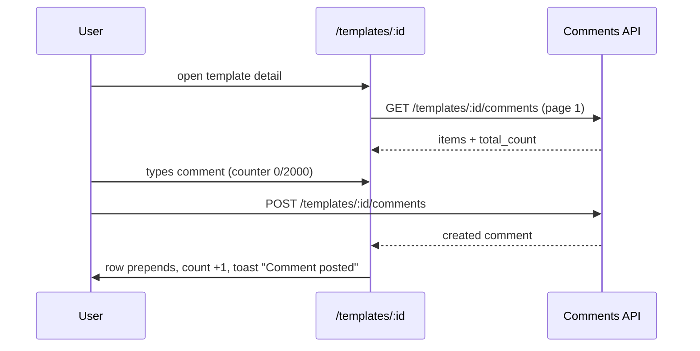
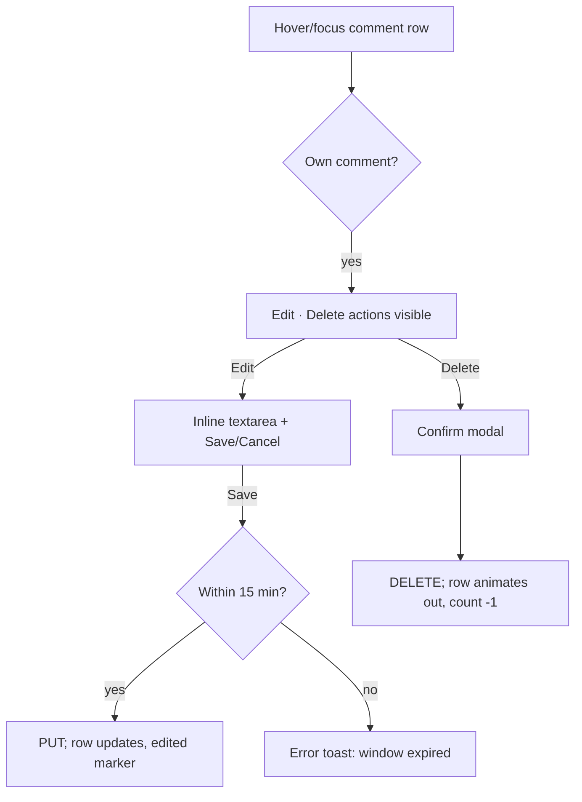

# Template Comments — UI/UX Design

- **Feature ID:** template-comments
- **Version:** 1.0
- **Status:** Proposed (for architecture review)
- **Author:** ui-ux-agent
- **Date:** 2026-10-12
- **Companion doc:** `template-comments-requirements.md`

## 1. Design Principles

1. **Comments are part of the template page, not a destination.** The section lives below the social stats on `/templates/:id`; no new route for regular users. Reading requires zero clicks past the page itself.
2. **Trust-first presentation.** Author identity (avatar + display name), relative time, "edited" marker, and a highlighted creator badge make feedback scannable and credible.
3. **Aurora-native.** Reuse existing tokens, card surfaces, buttons, Modal, Spinner, empty states, toasts (`NotificationContext`), and light/dark themes. No new visual language.
4. **Moderation is confirm + reason.** Owner/admin deletion always goes through the existing confirm-modal pattern; admin deletion adds the mandatory reason field (same as ban/unban), keeping the audit trail honest.
5. **Graceful degradation.** The comments section fails independently: API errors show an inline error + Retry and never take down the template detail page.

## 2. Information Architecture

```mermaid
flowchart LR
    A[/templates/:id] --> B[Comments section]
    B --> C[List: newest-first, paginated]
    B --> D[Composer: auth only]
    D -->|post| C
    C -->|author: Edit / Delete| C
    C -->|owner: Delete any| C
    E[/admin/comments] --> F[Filters: q / template / author]
    F --> G[Table + pagination]
    G -->|Delete| H[Reason modal] --> I[audit log]
    J[/admin/templates/:id] --> K[Comments panel: same delete]
```

**Surfaces:**

| Surface | Access | Content |
|---|---|---|
| Comments section on `/templates/:id` | public read; auth to post | Counter, list, composer, per-item actions |
| `/admin/comments` | admin only | Platform-wide comment moderation list |
| `/admin/templates/:id` comments panel | admin only | Per-template comments with delete-with-reason |

## 3. User Flows

### 3.1 Read & post (regular user)



### 3.2 Edit / delete own comment



### 3.3 Owner moderation

```mermaid
flowchart TD
    A[Owner views own template] --> B[Delete action on every comment]
    B --> C[Confirm modal: "Delete this comment?"] --> D[DELETE /comments/:id] --> E[Row removed, count -1]
```

### 3.4 Admin moderation

```mermaid
flowchart TD
    A[/admin/comments] --> B[Apply filters q/template/author]
    B --> C[Paginated table]
    C --> D[Delete] --> E[Reason modal: 3-500 chars, mandatory]
    E --> F[DELETE /admin/comments/:id] --> G[Row removed; audit log written]
    C --> H[Open template] --> I[/admin/templates/:id]
```

## 4. Page Layouts

### 4.1 Template detail — comments section (below social stats)

```text
┌──────────────────────────────────────────────────────────────┐
│ Comments (12)                                                │
├──────────────────────────────────────────────────────────────┤
│ ┌──────────────────────────────────────────────────────────┐ │
│ │ [composer card]                                          │ │
│ │ [avatar] ┌────────────────────────────────────────────┐  │ │
│ │          │ Share feedback, ask a question…            │  │ │
│ │          │ (textarea, autos 4 rows)                   │  │ │
│ │          └────────────────────────────────────────────┘  │ │
│ │                                   128 / 2000  [Post]     │ │
│ └──────────────────────────────────────────────────────────┘ │
│ ┌──────────────────────────────────────────────────────────┐ │
│ │ [av] Alice · 2h ago                    [Edit] [Delete]   │ │
│ │      Works great with GPT-4o — the JSON output is        │ │
│ │      finally stable. Thanks!                             │ │
│ ├──────────────────────────────────────────────────────────┤ │
│ │ [av] Bob [CREATOR] · 1d ago                 [Delete]     │ │
│ │      v2 now handles the edge case you mentioned.         │ │
│ ├──────────────────────────────────────────────────────────┤ │
│ │ [av] Carol · 3d ago                                       │ │
│ │      (edited) What model do you recommend for this?      │ │
│ └──────────────────────────────────────────────────────────┘ │
│                   [ Load more comments ]                     │
└──────────────────────────────────────────────────────────────┘
```

- Anonymous visitors: composer card replaced by a login prompt row: "Log in to join the discussion" + `[Log in]` button (routes to `/login`, returns via existing redirect behavior).
- `[CREATOR]` badge: small filled chip next to the display name when `comment.user_id === template.owner_id` (uses the accent token; same shape as existing badges).
- Own-comment actions (`Edit`/`Delete`) appear on hover/focus-visible; owner sees `Delete` on all rows; everyone else sees no actions.
- "Load more" appends the next page (button, not infinite scroll — matches admin list patterns and keeps keyboard/SR behavior simple).

### 4.2 Comment row states

| State | Presentation |
|---|---|
| Posting | `Post` button → spinner, disabled; textarea locked |
| Editing | Content swaps to textarea prefilled; `Save`/`Cancel`; Esc cancels |
| Deleting | Confirm modal (existing Modal component); row fades out on success |
| Rate-limited (429) | Inline error under composer: "You're commenting too quickly — try again in Ns." Draft preserved |
| Validation error | Field-level red hint under textarea; `Post` disabled at 0 or > 2000 chars |
| List loading | Section skeleton (3 shimmer rows) |
| List error | Inline error card + `Retry` button; page unaffected |
| Empty | Friendly empty state: "No comments yet — be the first to share feedback" |

### 4.3 Admin console — `/admin/comments`

```text
┌──────────────────────────────────────────────────────────────────────┐
│ ← Back │ Comments                                        [Refresh]    │
├──────────────────────────────────────────────────────────────────────┤
│ [Search content…        ] [Template ID…] [Author ID…]  [Filter] [Reset]│
├──────────────────────────────────────────────────────────────────────┤
│ Content                    │ Template        │ Author     │ Posted │ ⋯│
├────────────────────────────┼─────────────────┼────────────┼────────┼──┤
│ "Works great with GPT-4o…" │ Email writer    │ Alice      │ 2h ago │ 🗑│
│ "This prompt is spam…"     │ SQL helper      │ Mallory    │ 5h ago │ 🗑│
│ …                                                                  │
├──────────────────────────────────────────────────────────────────────┤
│ Total 1,204        ‹ Prev  Page 2 / 61  Next ›                      │
└──────────────────────────────────────────────────────────────────────┘
```

- Content cell: clamped to 2 lines with full text in `title` tooltip; clicking the template name opens `/admin/templates/:id`.
- Delete (`🗑`) opens the reason modal (below). Same table/pagination/filter chrome as `UsersPage`/`TemplatesPage`.

### 4.4 Admin reason modal (reuse pattern from ban/unban)

```text
┌──────────────────────────────────────────────┐
│ Delete comment                               │
├──────────────────────────────────────────────┤
│ "This prompt is spam…"                       │
│ on "SQL helper" by Mallory · 5h ago          │
│                                              │
│ Reason (required, 3–500 chars)               │
│ ┌──────────────────────────────────────────┐ │
│ │ Spam promotion of external service       │ │
│ └──────────────────────────────────────────┘ │
│                          [Cancel] [Delete]   │
└──────────────────────────────────────────────┘
```

### 4.5 Admin template detail — comments panel

On `/admin/templates/:id`, a "Comments (N)" panel below the existing template info, listing that template's comments (same row shape as §4.3) with the same delete-with-reason action. Read-only context (template title, author, timestamps) is already on the page.

## 5. Component Specs

| Component | Notes |
|---|---|
| `CommentsSection` | Container on TemplateDetails; owns list state, pagination, counter; fetches via api service |
| `CommentComposer` | Avatar + textarea + char counter + `Post`; disabled logic; 429/validation states |
| `CommentItem` | Avatar, display name, CREATOR badge, relative time, edited marker, content (whitespace-pre-wrap), hover actions |
| `CommentEditForm` | Inline textarea + Save/Cancel; client-side 15-min window check with server as source of truth |
| `AdminCommentsPage` | Filters + table + pagination (mirrors TemplatesPage structure) |
| `DeleteReasonModal` | Shared by admin comments page and admin template detail; reason 3–500 chars, mandatory |

All new i18n keys live under `comments.*` and `admin.comments.*` namespaces in both `en` and `zh` translation files.

## 6. Interaction Details

- **Posting:** optimistic pending row is NOT used (avoid orphan rows on failure); the button shows a spinner and the list refreshes from the POST response. Toast on success; inline error on failure with draft preserved.
- **Counter sync:** `comment_count` from the template response is the initial value; local +/- on successful post/delete keeps it in sync without refetching the template.
- **Edit window:** the UI hides `Edit` after 15 minutes (client clock) but the server enforces it authoritatively; a stale client gets the 403 message toast.
- **Keyboard:** composer textarea labeled (`aria-label`); actions are real buttons; Esc closes edit mode and modals; focus returns to the row's Delete trigger after modal close (existing Modal behavior).
- **Long content:** comment body clamps visually at ~8 lines with "Show more" expansion (plain text, no truncation server-side).

## 7. States Summary

| Context | Loading | Empty | Error |
|---|---|---|---|
| Comments list | 3-row skeleton | "No comments yet" illustration + copy | Inline error + Retry |
| Post | Button spinner | n/a | Inline error, draft preserved |
| Admin list | Table skeleton | "No comments match your filters" | Error banner + Retry |
| Delete | Button spinner in modal | n/a | Modal error message, stays open |

## 8. i18n Considerations (EN/ZH)

- All chrome strings localized: section title ("Comments" / "评论"), composer placeholder ("Share feedback, ask a question…" / "分享反馈、提出问题…"), actions, empty/error states, validation messages, admin labels.
- User comment content is never translated or modified; `whitespace-pre-wrap` preserves the author's line breaks in both languages.
- Relative times via the shared util ("2h ago" / "2小时前"); the "edited" marker ("edited" / "已编辑") and CREATOR badge ("Creator" / "创作者") are localized.
- Char counter uses locale-aware number formatting; the 2000 limit is language-independent (CJK content fits far more information per char — no separate limit).
- ZH typography: comment body uses the same font stack as template descriptions; no letter-spacing adjustments needed.

## 9. Accessibility

- Comment list is a `<ul>`/`<li>` structure (or `role="list"`); each item's actions are in the tab order.
- Composer: `<label>` or `aria-label` on textarea; live char counter announced politely; `Post` disabled state is conveyed (`aria-disabled`).
- Modals trap focus and return it on close (existing Modal); delete confirmations announce result via toast (existing pattern).
- Color is never the only signal: unread/creator distinction uses badge text, not color alone; error states pair icon + text.
- Keyboard-only path: post, edit, delete, load more, admin filters, and reason modal are all operable without a mouse.

## 10. Analytics (optional, if analytics feature ships)

- `comment_posted`, `comment_deleted_self`, `comment_deleted_owner`, `comment_deleted_admin` events; section scroll depth on template detail. No new instrumentation infrastructure in v1 — only if the prompt-analytics feature's pipeline exists.

## 11. Out of Scope (mirrors requirements §8)

Threading, mentions, reactions, Markdown, voting, pinned comments, edit history, soft-delete placeholders, anonymous comments, email digests, automated moderation, and any monetization-adjacent surface.
