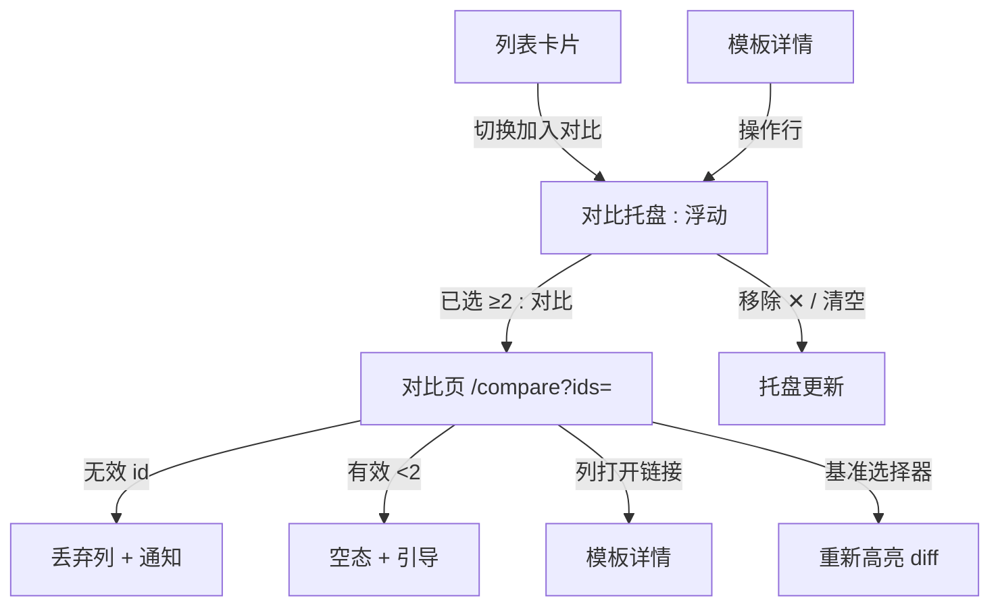
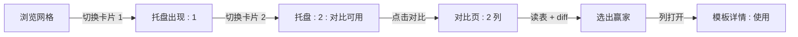
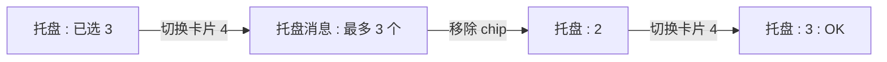
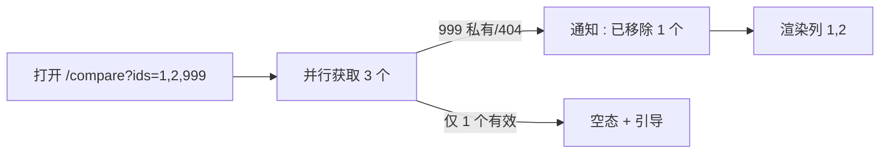

# 模板对比视图 — UI/UX 设计

- **功能 ID：** template-compare
- **版本：** 1.0
- **状态：** 已提案（待架构评审）
- **作者：** ui-ux-agent
- **日期：** 2026-10-13
- **配套文档：** `template-compare-requirements-zh-CN.md`

## 1. 设计原则

1. **浏览时收集，按需对比。** 托盘绝不打断浏览；它在底部等待，直到用户准备好。
2. **对齐行优于分散标签页。** 每个属性、变量和内容行都位于跨列的同一水平带 —— 眼睛垂直比较，绝不斜向比较。
3. **Diff 是透镜，不是墙。** 高亮是细微的（词级、柔和颜色）；图例解释它们；"无"始终一键可达。
4. **复用一切。** 列表的卡片模式、template-versioning DiffModal 的 diff 高亮、现有设计的空态和 toast 惯例。

## 2. 信息架构



| 界面 | 位置 | 受众 | 目的 |
|---|---|---|---|
| 对比切换 | 列表中的模板卡片；详情操作行 | 所有用户 | 收集候选 |
| 对比托盘 | 浮动，视口底部 | 有 ≥1 选择的用户 | 管理选择、发起对比 |
| 对比页 | `/compare?ids=` | 对比 2–3 个模板的用户 | 对齐的属性表 + diff 窗格 |
| 基准选择器 | 对比页工具栏 | 对比页查看者 | 控制 diff 参考 |

## 3. 用户流程

### 3.1 收集并对比



### 3.2 上限处理



### 3.3 含不可访问模板的分享链接



## 4. 页面布局

### 4.1 对比托盘（浮动，桌面）

```
+----------------------------------------------------------------------+
|  （页面内容，托盘打开时底部内边距 +80px）                                |
+----------------------------------------------------------------------+
|  ⚖ 对比（2）  [chip: Cold Email v2 ✕] [chip: Cold Email Pro ✕]      |
|                                    [清空]  [ 对比 → ]                 |
+----------------------------------------------------------------------+
```

收起状态：角落药丸 `⚖ 2`（右下）；点击展开。

### 4.2 对比页（桌面，2 个模板）

```
+----------------------------------------------------------------------+
|  ← 返回    对比模板          基准: [Template A ▾] [同步 ⧉]             |
+----------------------------------------------------------------------+
|  属性           |  Cold Email v2          |  Cold Email Pro          |
|----------------|-------------------------|--------------------------|
|  作者           |  alice                  |  bob                     |
|  分类           |  Marketing              |  Marketing               |
|  标签           |  email, outreach        |  email, b2b  ← 不同      |
|  语言           |  EN                     |  EN                      |
|  可见性         |  Public                 |  Public                  |
|  版本数         |  5                      |  2                       |
|  更新时间       |  2026-10-01             |  2026-10-10              |
|  点赞           |  128                    |  96                      |
|  收藏           |  44                     |  51                      |
|  浏览 / 使用    |  1.2k / 210             |  980 / 187               |
+----------------------------------------------------------------------+
|  变量（2）      |  tone, language         |  tone, audience, length  |
+----------------------------------------------------------------------+
|  内容           |  Write a {+cold+} email |  Write a cold email      |
|  （diff 窗格）  |  in {-formal-} tone ... |  in a {-casual-} tone... |
|                 |  （同步滚动）            |  （同步滚动）              |
+----------------------------------------------------------------------+
|  [ 打开 → ]     |  [ 打开 → ]             |  [ 打开 → ]              |
+----------------------------------------------------------------------+
|  图例：{+相对基准新增+}  {-相对基准移除-}                                 |
+----------------------------------------------------------------------+
```

- 3 列时卡片宽度收缩；窄屏上属性标签移入每列的头部行。
- Diff 高亮：相对所选基准列，新增 `+word+` 绿色调，移除 `-word-` 红色调。

### 4.3 对比页（移动端）

移动端对比降级为**标签式单视图**：每个模板一个标签（可滑动），属性行堆叠为标签/值对，diff 替换为"差异"摘要列表（每节新增/移除词计数）。托盘变为底部抽屉。理由：480px 以下 3 个并排窗格不可读。

```
+---------------------------+
|  ← 对比                    |
|  [A] [B] [C]  ← 标签       |
+---------------------------+
|  Cold Email v2            |
|  作者 alice · Marketing   |
|  标签 email, outreach     |
|  变量: tone, lang         |
|  [与 A 的差异: ▸]          |
|  内容（纯文本）             |
|  [ 打开 → ]                |
+---------------------------+
```

## 5. 组件规格

| 组件 | 行为 | 状态 |
|---|---|---|
| CompareToggle | 卡片上的图标按钮（⚖）；切换选择；aria-pressed | 关 / 开 / 禁用（达上限，尝试时显示消息） |
| CompareTray | 固定底栏；chips、清空、对比；可折叠为药丸 | 隐藏（0）/ 展开 / 收起 / 上限消息 |
| ComparePage | 路由 `/compare`；并行获取；列布局 | 加载中（骨架列）/ 已加载 / 部分（通知）/ 空 / 错误（重试） |
| AttributeTable | 对齐行；不同的值被强调（加粗或色调） | 已加载；数据缺失时省略行 |
| VariableList | chips + 计数徽章；按字母排序 | 已加载 / 无（"无变量"） |
| DiffPanes | 并排内容；相对基准的词级高亮；同步滚动开关 | 基准模式 / 无模式 / 超预算（纯文本 + 通知） |
| BaseSelector | 被对比模板的下拉 + "无" | 已选 / 变更（重新高亮） |
| DropNotice | 列出被丢弃模板的内联横幅 | 可见 / 已关闭 |

## 6. 交互细节

1. **卡片切换：** 悬停/聚焦时卡片角落显示 ⚖；点击切换而不导航（stopPropagation）；状态即时反映到托盘。键盘：Tab 到 ⚖，Enter/Space 切换。
2. **托盘启动：** ≥2 时对比按钮启用；按 id 选择顺序导航到 `/compare?ids=`（最左 = 默认基准）。
3. **基准切换：** 更改基准就地重新高亮（< 100ms，不重新获取）；窗格保持滚动位置。
4. **同步滚动：** 默认开启；关闭后每个窗格自由滚动；开关是带标签的开关，而非仅图标控件。
5. **属性强调：** 跨列不同的值获得细微的色调背景；相同的值保持朴素 —— 差异突出，共性退后。
6. **超预算内容：** > 64KB 渲染纯文本并显示通知（"内容过长，无法高亮 —— 显示纯文本"）。
7. **URL 分享：** id 是规范的（去重、保序）；复制 URL 分享确切对比（按查看者执行可见性，FR-13）。
8. **返回导航：** ← 返回到上一个列表，托盘选择保留（localStorage）。
9. **托盘与页面移除：** 在托盘中移除 chip 更新 localStorage；在对比页移除列（列头 ✕）也通过 replaceState 更新 URL。

## 7. 状态汇总

| 界面 | 加载中 | 空 | 错误 |
|---|---|---|---|
| 对比切换 | — | — | 添加失败 → toast，切换回滚 |
| 对比托盘 | — | 隐藏（选 0） | —（仅客户端） |
| 对比页 | 骨架列 ×N | 有效 id <2 → 引导 + "浏览模板" CTA | 获取失败 → 错误横幅 + 重试 |
| 属性行 | 骨架行 | 数据缺失（浏览/使用）→ 省略行 | — |
| Diff 窗格 | 骨架内容 | 空内容 → "无内容" | 超预算 → 纯文本 + 通知 |

## 8. 国际化

| 键 | EN | ZH |
|---|---|---|
| `compare.toggle.add` | Add to compare | 加入对比 |
| `compare.toggle.remove` | Remove from compare | 从对比中移除 |
| `compare.tray.title` | Compare ({{count}}) | 对比（{{count}}） |
| `compare.tray.clear` | Clear | 清空 |
| `compare.tray.compare` | Compare | 对比 |
| `compare.tray.capMessage` | Compare up to 3 templates — remove one first | 最多对比 3 个模板 —— 请先移除一个 |
| `compare.page.title` | Compare templates | 对比模板 |
| `compare.page.base` | Base | 基准 |
| `compare.page.baseNone` | None (no highlighting) | 无（不高亮） |
| `compare.page.sync` | Synchronized scrolling | 同步滚动 |
| `compare.attr.author` | Author | 作者 |
| `compare.attr.category` | Category | 分类 |
| `compare.attr.tags` | Tags | 标签 |
| `compare.attr.language` | Language | 语言 |
| `compare.attr.visibility` | Visibility | 可见性 |
| `compare.attr.versions` | Versions | 版本数 |
| `compare.attr.updated` | Updated | 更新时间 |
| `compare.attr.likes` | Likes | 点赞 |
| `compare.attr.favorites` | Favorites | 收藏 |
| `compare.attr.views` | Views | 浏览 |
| `compare.attr.uses` | Uses | 使用 |
| `compare.variables.title` | Variables ({{count}}) | 变量（{{count}}） |
| `compare.variables.none` | No variables | 无变量 |
| `compare.content.title` | Content | 内容 |
| `compare.legend.added` | Added vs base | 相对基准新增 |
| `compare.legend.removed` | Removed vs base | 相对基准移除 |
| `compare.notice.dropped` | {{count}} template(s) removed: not visible to you | 已移除 {{count}} 个模板：对你不可见 |
| `compare.notice.overBudget` | Content too long for highlighting — showing plain text | 内容过长，无法高亮 —— 显示纯文本 |
| `compare.empty.title` | Choose templates to compare | 选择要对比的模板 |
| `compare.empty.body` | Add 2–3 templates from any listing, then open the compare tray. | 从任意列表添加 2–3 个模板，然后打开对比托盘。 |
| `compare.empty.cta` | Browse templates | 浏览模板 |
| `compare.error.loadFailed` | Couldn't load comparison. Please try again. | 无法加载对比，请重试。 |
| `compare.aria.toggle` | Add {{title}} to compare | 将 {{title}} 加入对比 |
| `compare.aria.tray` | Compare selection tray | 对比选择托盘 |
| `compare.aria.column` | Column: {{title}} | 列：{{title}} |

分类、标签和模板名为专有名词，不翻译。

## 9. 无障碍

- 对比切换是带 `aria-pressed` 反映选择的 `button`；标签包含模板标题（`compare.aria.toggle`）。
- 托盘是带 `aria-label` 的 `role=region`；chips 是可移除按钮；收起的药丸播报计数。
- 属性表使用真实 `<table>`，属性标签为 `<th scope=row>` —— 屏幕阅读器逐行导航，这正是对比的心智模型。
- Diff 高亮仅是视觉的；移动端"差异"摘要提供文本替代，图例通过 `aria-describedby` 程序化关联。
- 同步滚动不移动焦点；每个窗格是带 `tabindex=0` 和可访问名称的可滚动区域。
- 键盘：Tab 顺序为工具栏 → 属性表 → 变量 → 内容窗格 → 打开链接；页面上的 Esc 将焦点返回到返回按钮。
- 颜色绝不是唯一信号：新增/移除还通过下划线样式区分（实线 vs 虚线）。

## 10. 分析（可选）

- `compare_toggle_used`、`compare_tray_opened`、`compare_page_viewed`（count）、`compare_base_changed`、`compare_column_opened` —— 仅产品使用事件。

## 11. 范围之外

- 版本对比较 UI（template-versioning 拥有）；超过 3 个模板；URL 之外的保存/分享对比列表。
- 语义相似度评分；对被对比模板的合并/组合操作。
- 管理员对比界面；对比的导出/打印。
- 任何形式的变现 —— 本产品永久超出范围。
