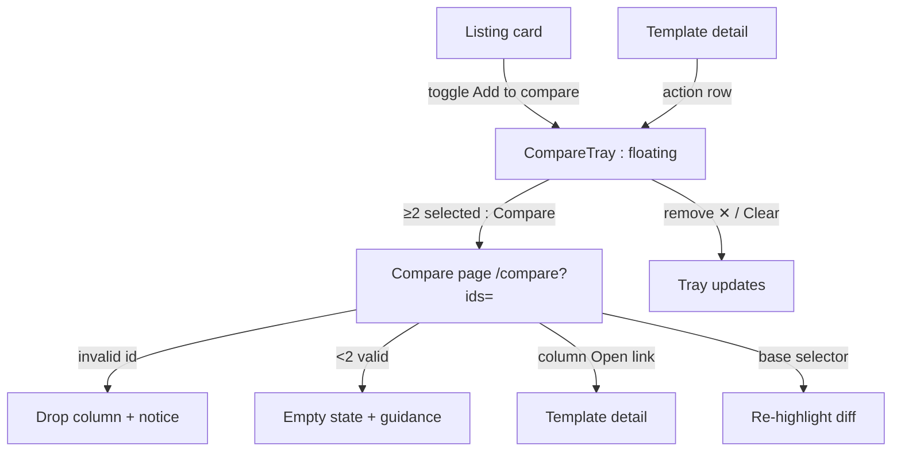
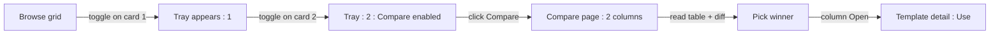
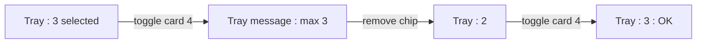
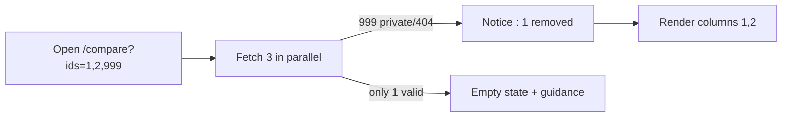

# Template Compare View — UI/UX Design

- **Feature ID:** template-compare
- **Version:** 1.0
- **Status:** Proposed (for architecture review)
- **Author:** ui-ux-agent
- **Date:** 2026-10-13
- **Companion doc:** `template-compare-requirements.md`

## 1. Design Principles

1. **Collect while browsing, compare on demand.** The tray never interrupts browsing; it waits at the bottom until the user is ready.
2. **Aligned rows over scattered tabs.** Every attribute, variable, and content line sits in the same horizontal band across columns — the eye compares vertically, never diagonally.
3. **Diff is a lens, not a wall.** Highlights are subtle (word-level, soft colors); a legend explains them; "None" is always one click away.
4. **Reuse everything.** Card patterns from listings, diff highlighting from template-versioning's DiffModal, empty-state and toast conventions from existing designs.

## 2. Information Architecture



| Surface | Location | Audience | Purpose |
|---|---|---|---|
| Compare toggle | Template cards in listings; detail action row | All users | Collect candidates |
| Compare tray | Floating, bottom of viewport | Users with ≥1 selection | Manage selection, launch compare |
| Compare page | `/compare?ids=` | Users comparing 2–3 templates | Aligned attribute table + diff panes |
| Base selector | Compare page toolbar | Compare page viewers | Control diff reference |

## 3. User Flows

### 3.1 Collect and compare



### 3.2 Cap handling



### 3.3 Shared link with inaccessible template



## 4. Page Layouts

### 4.1 Compare tray (floating, desktop)

```
+----------------------------------------------------------------------+
|  (page content, bottom padding +80px while tray open)                |
+----------------------------------------------------------------------+
|  ⚖ Compare (2)   [chip: Cold Email v2 ✕] [chip: Cold Email Pro ✕]   |
|                                    [Clear]  [ Compare → ]            |
+----------------------------------------------------------------------+
```

Collapsed state: corner pill `⚖ 2` (bottom-right); click expands.

### 4.2 Compare page (desktop, 2 templates)

```
+----------------------------------------------------------------------+
|  ← Back    Compare templates          Base: [Template A ▾] [Sync ⧉]  |
+----------------------------------------------------------------------+
|  Attribute      |  Cold Email v2          |  Cold Email Pro          |
|----------------|-------------------------|--------------------------|
|  Author         |  alice                  |  bob                     |
|  Category       |  Marketing              |  Marketing               |
|  Tags           |  email, outreach        |  email, b2b  ← differs   |
|  Language       |  EN                     |  EN                      |
|  Visibility     |  Public                 |  Public                  |
|  Versions       |  5                      |  2                       |
|  Updated        |  2026-10-01             |  2026-10-10              |
|  Likes          |  128                    |  96                      |
|  Favorites      |  44                     |  51                      |
|  Views / Uses   |  1.2k / 210             |  980 / 187               |
+----------------------------------------------------------------------+
|  Variables (2)  |  tone, language         |  tone, audience, length  |
+----------------------------------------------------------------------+
|  Content        |  Write a {+cold+} email |  Write a cold email      |
|  (diff panes)   |  in {-formal-} tone ... |  in a {-casual-} tone... |
|                 |  (synced scroll)        |  (synced scroll)         |
+----------------------------------------------------------------------+
|  [ Open → ]     |  [ Open → ]             |  [ Open → ]              |
+----------------------------------------------------------------------+
|  Legend: {+added vs base+}  {-removed vs base-}                       |
+----------------------------------------------------------------------+
```

- 3 columns shrink card width; attribute labels move into each column header row on narrow screens.
- Diff highlights: additions `+word+` green-tint, removals `-word-` red-tint, relative to the selected base column.

### 4.3 Compare page (mobile)

Mobile comparison degrades to a **tabbed single view**: one template per tab (swipeable), attribute rows stacked as label/value pairs, diff replaced by a "Differences" summary list (added/removed word counts per section). The tray becomes a bottom sheet. Rationale: 3 side-by-side panes are unreadable under 480px.

```
+---------------------------+
|  ← Compare                |
|  [A] [B] [C]  ← tabs      |
+---------------------------+
|  Cold Email v2            |
|  Author alice · Marketing |
|  Tags email, outreach     |
|  Variables: tone, lang    |
|  [Differences vs A: ▸]    |
|  Content (plain)          |
|  [ Open → ]               |
+---------------------------+
```

## 5. Component Specs

| Component | Behavior | States |
|---|---|---|
| CompareToggle | Icon button (⚖) on cards; toggles selection; aria-pressed | Off / on / disabled (cap reached, shows message on attempt) |
| CompareTray | Fixed bottom bar; chips, Clear, Compare; collapsible to pill | Hidden (0) / expanded / collapsed / cap-message |
| ComparePage | Route `/compare`; parallel fetch; column layout | Loading (skeleton columns) / loaded / partial (notice) / empty / error (retry) |
| AttributeTable | Aligned rows; differing values emphasized (bold or tint) | Loaded; rows omitted when data missing |
| VariableList | Chips + count badge; alphabetical | Loaded / none ("No variables") |
| DiffPanes | Side-by-side content; word-level highlight vs base; synced scroll toggle | Base mode / none mode / over-budget (plain + notice) |
| BaseSelector | Dropdown of compared templates + "None" | Selected / changed (re-highlight) |
| DropNotice | Inline banner listing dropped templates | Visible / dismissed |

## 6. Interaction Details

1. **Card toggle:** hover/focus reveals ⚖ on the card corner; click toggles without navigating (stopPropagation); state reflected instantly in the tray. Keyboard: Tab to ⚖, Enter/Space toggles.
2. **Tray launch:** Compare button enabled at ≥2; navigates to `/compare?ids=` in id-selection order (leftmost = default base).
3. **Base switching:** changing the base re-runs highlighting in place (< 100ms, no refetch); panes keep scroll position.
4. **Sync scroll:** on by default; toggling off frees each pane; the toggle is a labeled switch, not an icon-only control.
5. **Attribute emphasis:** values that differ across columns get a subtle tint background; identical values stay plain — differences pop, commonalities recede.
6. **Over-budget content:** > 64KB renders plain text with a notice ("Content too long for highlighting — showing plain text").
7. **URL sharing:** ids are canonical (deduped, order preserved); copying the URL shares the exact comparison (visibility enforced per viewer, FR-13).
8. **Back navigation:** ← Back returns to the previous listing with tray selection intact (localStorage).
9. **Tray vs page removal:** removing a chip in the tray updates localStorage; removing a column on the compare page (column header ✕) also updates the URL via replaceState.

## 7. States Summary

| Surface | Loading | Empty | Error |
|---|---|---|---|
| Compare toggle | — | — | Add failure → toast, toggle reverts |
| Compare tray | — | Hidden (0 selected) | — (client-only) |
| Compare page | Skeleton columns ×N | <2 valid ids → guidance + "Browse templates" CTA | Fetch failure → error banner + retry |
| Attribute rows | Skeleton rows | Missing data (views/uses) → row omitted | — |
| Diff panes | Skeleton content | Empty content → "No content" | Over budget → plain + notice |

## 8. i18n

| Key | EN | ZH |
|---|---|---|
| `compare.toggle.add` | Add to compare | 加入对比 |
| `compare.toggle.remove` | Remove from compare | 从对比中移除 |
| `compare.tray.title` | Compare ({{count}}) | 对比（{{count}}） |
| `compare.tray.clear` | Clear | 清空 |
| `compare.tray.compare` | Compare | 对比 |
| `compare.tray.capMessage` | Compare up to 3 templates — remove one first | 最多对比 3 个模板 —— 请先移除一个 |
| `compare.page.title` | Compare templates | 对比模板 |
| `compare.page.base` | Base | 基准 |
| `compare.page.baseNone` | None (no highlighting) | 无（不高亮） |
| `compare.page.sync` | Synchronized scrolling | 同步滚动 |
| `compare.attr.author` | Author | 作者 |
| `compare.attr.category` | Category | 分类 |
| `compare.attr.tags` | Tags | 标签 |
| `compare.attr.language` | Language | 语言 |
| `compare.attr.visibility` | Visibility | 可见性 |
| `compare.attr.versions` | Versions | 版本数 |
| `compare.attr.updated` | Updated | 更新时间 |
| `compare.attr.likes` | Likes | 点赞 |
| `compare.attr.favorites` | Favorites | 收藏 |
| `compare.attr.views` | Views | 浏览 |
| `compare.attr.uses` | Uses | 使用 |
| `compare.variables.title` | Variables ({{count}}) | 变量（{{count}}） |
| `compare.variables.none` | No variables | 无变量 |
| `compare.content.title` | Content | 内容 |
| `compare.legend.added` | Added vs base | 相对基准新增 |
| `compare.legend.removed` | Removed vs base | 相对基准移除 |
| `compare.notice.dropped` | {{count}} template(s) removed: not visible to you | 已移除 {{count}} 个模板：对你不可见 |
| `compare.notice.overBudget` | Content too long for highlighting — showing plain text | 内容过长，无法高亮 —— 显示纯文本 |
| `compare.empty.title` | Choose templates to compare | 选择要对比的模板 |
| `compare.empty.body` | Add 2–3 templates from any listing, then open the compare tray. | 从任意列表添加 2–3 个模板，然后打开对比托盘。 |
| `compare.empty.cta` | Browse templates | 浏览模板 |
| `compare.error.loadFailed` | Couldn't load comparison. Please try again. | 无法加载对比，请重试。 |
| `compare.aria.toggle` | Add {{title}} to compare | 将 {{title}} 加入对比 |
| `compare.aria.tray` | Compare selection tray | 对比选择托盘 |
| `compare.aria.column` | Column: {{title}} | 列：{{title}} |

Category, tag, and template names are proper nouns and are not translated.

## 9. Accessibility

- Compare toggle is a `button` with `aria-pressed` reflecting selection; label includes the template title (`compare.aria.toggle`).
- The tray is a `role=region` with `aria-label`; chips are removable buttons; the collapsed pill announces the count.
- The attribute table uses a real `<table>` with `<th scope=row>` attribute labels — screen readers navigate row by row, which is exactly the comparison mental model.
- Diff highlights are visual only; a text alternative exists in the mobile "Differences" summary, and the legend is programmatically associated (`aria-describedby`).
- Synced scrolling does not move focus; each pane is a scrollable region with `tabindex=0` and an accessible name.
- Keyboard: Tab order is toolbar → attribute table → variables → content panes → Open links; Esc on the page returns focus to the Back button.
- Color is never the only signal: additions/removals also differ by underline style (solid vs dashed).

## 10. Analytics (optional)

- `compare_toggle_used`, `compare_tray_opened`, `compare_page_viewed` (count), `compare_base_changed`, `compare_column_opened` — product usage events only.

## 11. Out of Scope

- Version-pair comparison UI (template-versioning owns it); >3 templates; saved/shared comparison lists beyond the URL.
- Semantic similarity scores; merge/combine actions on compared templates.
- Admin compare surfaces; export/print of comparisons.
- Monetization of any kind — permanently out of scope for this product.
