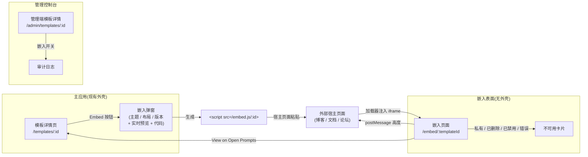
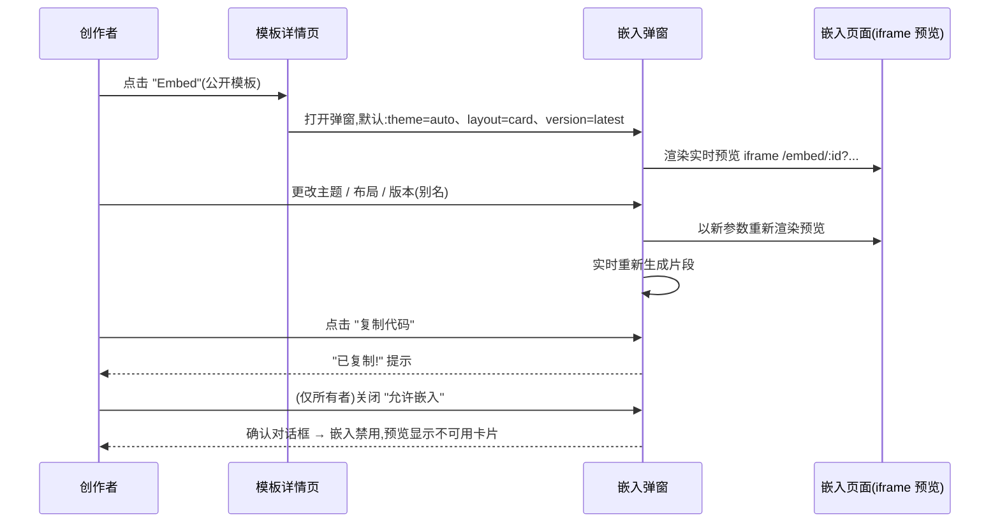
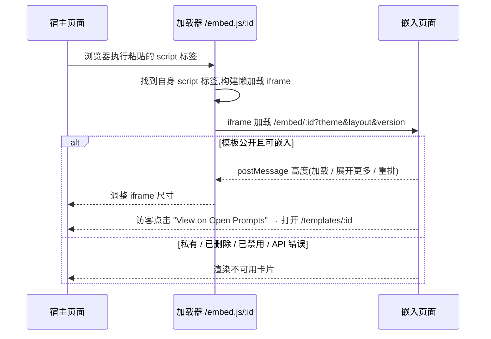
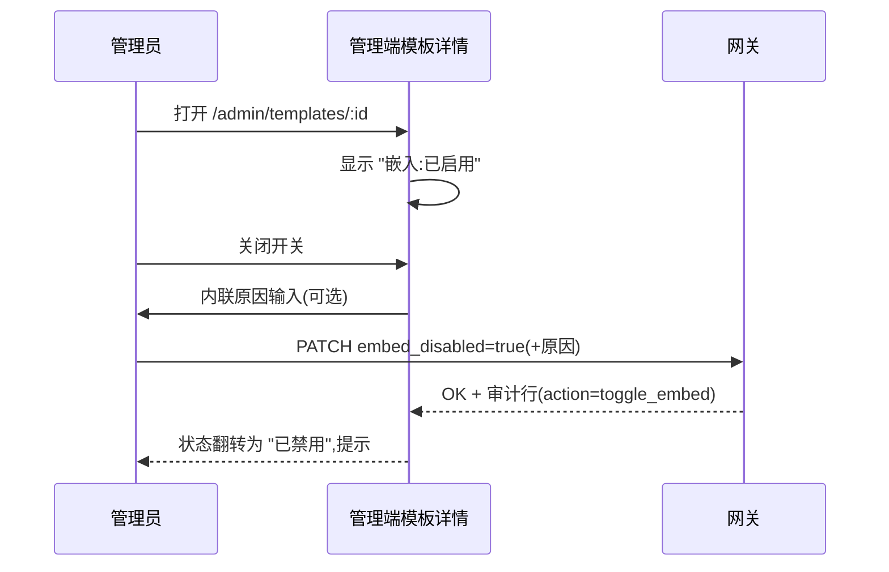

# 模板嵌入挂件(Template Embedding Widget)— UI/UX 设计

- **功能 ID:** template-embedding-widget
- **版本:** 1.0
- **状态:** 已提议(待架构评审)
- **作者:** ui-ux-agent
- **日期:** 2026-10-12
- **相关需求文档:** [template-embedding-widget-requirements-zh-CN.md](./template-embedding-widget-requirements-zh-CN.md)

## 1. 设计原则

1. **宿主零成本。** 一个 script 标签、无依赖、自动尺寸。只要宿主能粘贴 HTML,就能嵌入。
2. **处处优雅。** 私有/已删除/已禁用/离线 → 同一个友好的 "不可用" 卡片。宿主页面绝不因我们而看起来损坏。
3. **品牌克制。** 创作者内容居中;Open Prompts 品牌只有一行小署名 —— 足以成为发现渠道,而非广告牌。
4. **与站内风格一致。** 嵌入卡片复用 `PromptCard` 的视觉语言(圆角、标签芯片、作者行),使嵌入卡片一眼可辨认为 Open Prompts 内容。
5. **渐进披露。** 卡片布局做预览;全文布局展示全部;弹窗在提交前实时预览。

## 2. 信息架构



新增表面:**嵌入弹窗**(主应用)、**嵌入页面**(无外壳路由)、**加载脚本**(静态 JS)、以及管理端模板详情页的**嵌入开关**。其余一律不动。

## 3. 用户流程

### 3.1 创作者生成嵌入代码



### 3.2 宿主页面访客查看嵌入



### 3.3 管理员禁用嵌入



## 4. 页面布局(线框图)

### 4.1 嵌入弹窗(模板详情页上)

```
┌──────────────────────────────────────────────────────────────┐
│  嵌入模板                                            [×]     │
├──────────────────────────────────────────────────────────────┤
│  ┌─ 选项 ───────────────────────────────────────────────┐   │
│  │ 主题    ( ) 自动   ( ) 浅色   ( ) 深色                │   │
│  │ 布局    ( ) 卡片   ( ) 全文                            │   │
│  │ 版本    [ 最新 ▾ ]   ← 本模板的别名列表                │   │
│  └───────────────────────────────────────────────────────┘   │
│                                                              │
│  ┌─ 实时预览 ────────────────────────────────────────────┐   │
│  │   ┌─────────────────────────────────────────────┐    │   │
│  │   │  (iframe: /embed/:id?theme=auto&layout=card)│    │   │
│  │   │  …实际嵌入卡片在此渲染…                      │    │   │
│  │   └─────────────────────────────────────────────┘    │   │
│  └───────────────────────────────────────────────────────┘   │
│                                                              │
│  ┌─ 嵌入代码 ──────────────────────────────── [复制] ──┐   │
│  │ <script async src="https://openprompts.example/     │   │
│  │   embed.js/abc123?theme=auto&layout=card"></script> │   │
│  └──────────────────────────────────────────────────────┘   │
│  或使用链接:  https://openprompts.example/templates/abc     │
│                                                              │
│  ── 仅所有者 ────────────────────────────────────────────    │
│  [✓] 允许嵌入此模板                                          │
├──────────────────────────────────────────────────────────────┤
│                                        [ 关闭 ]              │
└──────────────────────────────────────────────────────────────┘
```

### 4.2 嵌入页面 — 卡片布局(默认)

```
┌───────────────────────────────┐  ← 最大宽度 480px,卡片
│ ✦ 模板标题                    │     圆角/阴影与 PromptCard 一致
│                               │
│ 👤 作者名      •  v7          │
│                               │
│ 一行描述文本,                  │
│ 可能换行到两行…                │
│                               │
│ ┌──────┐ ┌──────┐ ┌──────┐   │
│ │ 标签1 │ │ 标签2 │ │ 标签3 │   │
│ └──────┘ └──────┘ └──────┘   │
│                               │
│ ┌─ 内容预览 ──────────────┐  │
│ │ 你是一位资深代码审查…    │  │
│ │ 给定以下代码…            │  │
│ └─────────────────────────┘  │
│                    展开更多 ▾ │
│                               │
│ ⚡ Open Prompts    查看 →     │  ← 署名行
└───────────────────────────────┘
```

### 4.3 嵌入页面 — 全文布局

相同的头部(标题/作者/描述/标签),但内容区渲染**完整**模板正文(转义、可选等宽字体),无 "展开更多";iframe 自动调整到渲染高度。

### 4.4 嵌入页面 — 不可用卡片

```
┌───────────────────────────────┐
│        (插图)                 │
│   该模板无法嵌入。             │
│                               │
│   浏览 Open Prompts →         │
└───────────────────────────────┘
```

### 4.5 管理端模板详情 — 嵌入区块

```
┌─ 嵌入 ─────────────────────────────────────────────────┐
│ 状态:  ● 已启用                                        │
│                                                         │
│ [ 切换嵌入 ]      ← 确认 + 可选原因                      │
│ 最后变更:2026-10-12 由 admin@…(审计轨迹)              │
└─────────────────────────────────────────────────────────┘
```

## 5. 组件规格

### 5.1 `EmbedModal`(frontend/src/components/embed/EmbedModal.js)

| Prop | 类型 | 说明 |
|---|---|---|
| `templateId` | string | 必填 |
| `template` | object | 用于标题/别名列表;所有者判断 |
| `aliases` | array | 来自现有别名服务;版本选择器选项 |
| `onClose` | func | — |

行为:本地状态 `{theme:'auto', layout:'card', version:'latest'}`;片段 = `&lt;script async src="{origin}/embed.js/{id}?{params}"&gt;&lt;/script&gt;`;预览 iframe `src=/embed/{id}?{params}&preview=1`;复制使用 `navigator.clipboard` 并以 `document.execCommand('copy')` 降级;仅所有者可见的 "允许嵌入" 开关调用切换端点,禁用时预览翻转为不可用卡片。

### 5.2 `EmbedPage`(frontend/src/pages/EmbedPage.js — 无外壳)

读取路由参数 + 查询(`theme`、`layout`、`version`、`lang`);获取模板(公开端点);渲染 `EmbedCard` / `EmbedFull` / `UnavailableCard`;在挂载时、展开更多切换时、主题重排时(ResizeObserver)通过 `postMessage` 上报高度;设置 `document.title` 为 `{template.title} — Open Prompts embed`。

### 5.3 `EmbedCard` / `EmbedFull` / `UnavailableCard`(frontend/src/components/embed/)

纯展示组件;主题通过根元素 `data-theme` 属性(light/dark),样式限定在 `embed.scss`(不依赖主应用主题变量);所有用户文本转义(现有规则);署名行链接到 `/templates/{id}`。

### 5.4 加载脚本(`/embed.js/:id`,静态)

原生 JS(约 2 KB):定位自身 `<script>` 标签 → 构建 iframe(`title` 来自 `data-title` 或 "Open Prompts embed",`loading="lazy"`,同源无需 `sandbox`)→ 转发参数 → `window.addEventListener('message')` 接收 `{type:'op-embed-height', height}` → 设置 `iframe.style.height`。防抖调整;忽略来自其他来源的消息。

### 5.5 管理端 `EmbedToggleSection`(frontend/src/components/admin/)

从模板记录读取 `embed_disabled`;开关 → 带可选原因输入的确认弹层 → API 调用 → 乐观更新并在出错时回滚;渲染最近一条审计条目(谁/何时)。

## 6. 交互细节

1. **片段实时重新生成。** 任何选项变化立即更新预览 iframe `src` 和代码块(无 "应用" 步骤)。
2. **复制反馈。** 按钮文案翻转为 "已复制!" 2 秒(并有 `aria-live` 播报);剪贴板失败时,代码块获得焦点并提示 "全选"。
3. **版本选择器**列出 "最新" + 该模板的所有别名(名称 + 固定版本号);选择即固定嵌入(FR-2/AC-5)。
4. **展开更多**在*卡片布局内*将预览展开为完整内容(仍在 iframe 内以 ~2000 字符为上限并内部滚动)并上报新高度。
5. **所有者禁用流程。** 关闭 "允许嵌入" 显示确认对话框("已嵌入此模板的外部页面将显示 '不可用'");实时预览立即演示不可用卡片。
6. **theme=auto** 在 iframe 内使用 `matchMedia('(prefers-color-scheme: dark)')`;加载器自身不传任何主题样式。
7. **键盘。** 弹窗使用焦点陷阱(现有弹窗模式);嵌入页面本身是普通文档 —— 完全可键盘导航,无陷阱。
8. **署名链接**以 `target="_blank" rel="noopener"` 打开。

## 7. 状态汇总

| 表面 | 加载 | 空态 | 错误 | 成功 |
|---|---|---|---|---|
| 嵌入弹窗 | 预览 iframe 显示骨架卡片 | 不适用(别名为空 → 版本选择器仅显示 "最新") | 预览错误 → 内联 "预览不可用" 提示;片段仍会生成 | 代码已复制提示 |
| 嵌入页面 | 骨架卡片(标题/描述微光) | 不适用 | 不可用卡片(API 错误、私有、已删除、已禁用) | 卡片/全文渲染;高度已上报 |
| 加载器 | — | — | 静默无操作(宿主不受影响) | iframe 注入并调整尺寸 |
| 管理端开关 | — | — | 回滚 + 错误提示 | 状态翻转 + 提示 + 审计行 |

## 8. 国际化字符串表

命名空间:`embed.*`(嵌入页面 + 弹窗)、`admin.embed.*`(管理控制台)。键添加到 `frontend/src/locales/{en,zh}/translation.json`。

| 键 / 中文文案 | 英文 |
|---|---|
| `embed.action` / "嵌入" | "Embed" |
| `embed.modalTitle` / "嵌入模板" | "Embed template" |
| `embed.theme` / "主题" | "Theme" |
| `embed.themeAuto` / "自动" | "Auto" |
| `embed.themeLight` / "浅色" | "Light" |
| `embed.themeDark` / "深色" | "Dark" |
| `embed.layout` / "布局" | "Layout" |
| `embed.layoutCard` / "卡片" | "Card" |
| `embed.layoutFull` / "全文" | "Full" |
| `embed.version` / "版本" | "Version" |
| `embed.versionLatest` / "最新" | "Latest" |
| `embed.preview` / "实时预览" | "Live preview" |
| `embed.previewUnavailable` / "预览不可用" | "Preview unavailable" |
| `embed.code` / "嵌入代码" | "Embed code" |
| `embed.copy` / "复制代码" | "Copy code" |
| `embed.copied` / "已复制!" | "Copied!" |
| `embed.copyFailed` / "复制失败 —— 请手动选择代码" | "Copy failed — select the code manually" |
| `embed.orLink` / "或使用链接" | "Or use a link" |
| `embed.allow` / "允许嵌入此模板" | "Allow embedding for this template" |
| `embed.disableTitle` / "禁用嵌入?" | "Disable embedding?" |
| `embed.disableBody` / "已嵌入此模板的外部页面将显示"不可用"。" | "External pages already embedding this template will show 'not available'." |
| `embed.showMore` / "展开更多" | "show more" |
| `embed.showLess` / "收起" | "show less" |
| `embed.viewOn` / "在 Open Prompts 查看" | "View on Open Prompts" |
| `embed.unavailable` / "该模板无法嵌入。" | "This template is not available for embedding." |
| `embed.browse` / "浏览 Open Prompts" | "Browse Open Prompts" |
| `embed.iframeTitle` / "Open Prompts 嵌入" | "Open Prompts embed" |
| `admin.embed.section` / "嵌入" | "Embedding" |
| `admin.embed.status` / "状态" | "Status" |
| `admin.embed.enabled` / "已启用" | "Enabled" |
| `admin.embed.disabled` / "已禁用" | "Disabled" |
| `admin.embed.toggle` / "切换嵌入" | "Toggle embedding" |
| `admin.embed.reasonLabel` / "原因(可选)" | "Reason (optional)" |
| `admin.embed.lastChanged` / "最后变更:{{date}} 由 {{actor}}" | "Last changed {{date}} by {{actor}}" |

## 9. 无障碍说明

1. **嵌入页面是真实文档:** 一个 `h1`(标题),作者/描述/标签为文本,内容位于带 `aria-label` 的 `region`;"展开更多" 是带 `aria-expanded` 的 `button`。
2. **加载器 iframe** 获得 `title="{模板标题} — Open Prompts embed"`(缺省回退到通用 `embed.iframeTitle`)。
3. **对比度:** 两种主题均满足 WCAG AA(文本 4.5:1);署名行样式为次要文本但保持 ≥ 4.5:1。
4. **弹窗:** 焦点陷阱、`Escape` 关闭、初始焦点在主题单选组;所有控件有标签。
5. **复制按钮**通过 `aria-live="polite"` 区域播报成功。
6. **嵌入页面无键盘陷阱**;链接是真实链接(可聚焦,两种主题下均有可见焦点环)。
7. **减少动态:** `prefers-reduced-motion` 下禁用骨架微光动画。

## 10. 响应式行为

1. **嵌入卡片**自适应:`max-width: 480px; width: 100%` —— iframe 填满宿主容器至 480px;低于 320px 时卡片标签行降级为单行可滚动。
2. **全文布局**为 `width: 100%` 且高度自动调整;长代码行换行(iframe 内无横向滚动)。
3. **嵌入弹窗**遵循现有弹窗响应式模式(视口低于 480px 时全屏面板)。
4. **管理端区块**在窄屏垂直堆叠(标签在控件上方)。
5. 加载器绝不设置固定高度 —— 仅在首条高度消息到达前设 `min-height: 120px`。

## 11. 分析事件(可选,若分析已上线)

- `embed_code_copied` {template_id, theme, layout, version}
- `embed_viewed` {template_id, layout, theme} —— 服务端,source=embed(FR-13)
- `embed_disabled` / `embed_enabled` {template_id, actor_role}

## 12. 不在范围内(UI)

- 宿主页面来源仪表板、自定义颜色/品牌 UI、多模板嵌入构建器、oEmbed 设置界面、WordPress 插件配置页。
