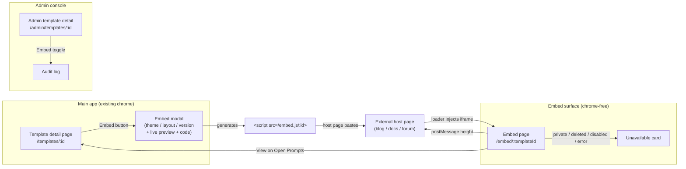
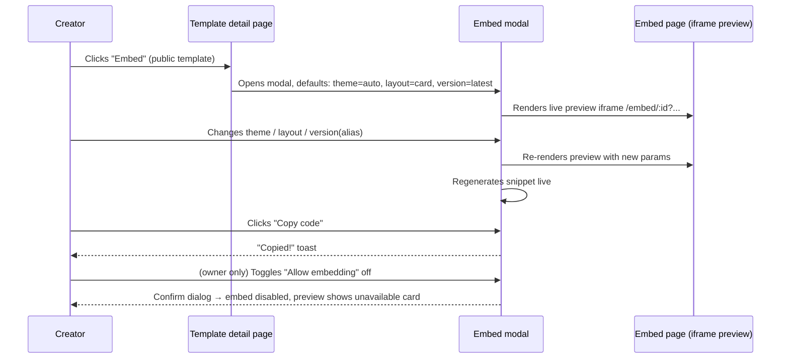
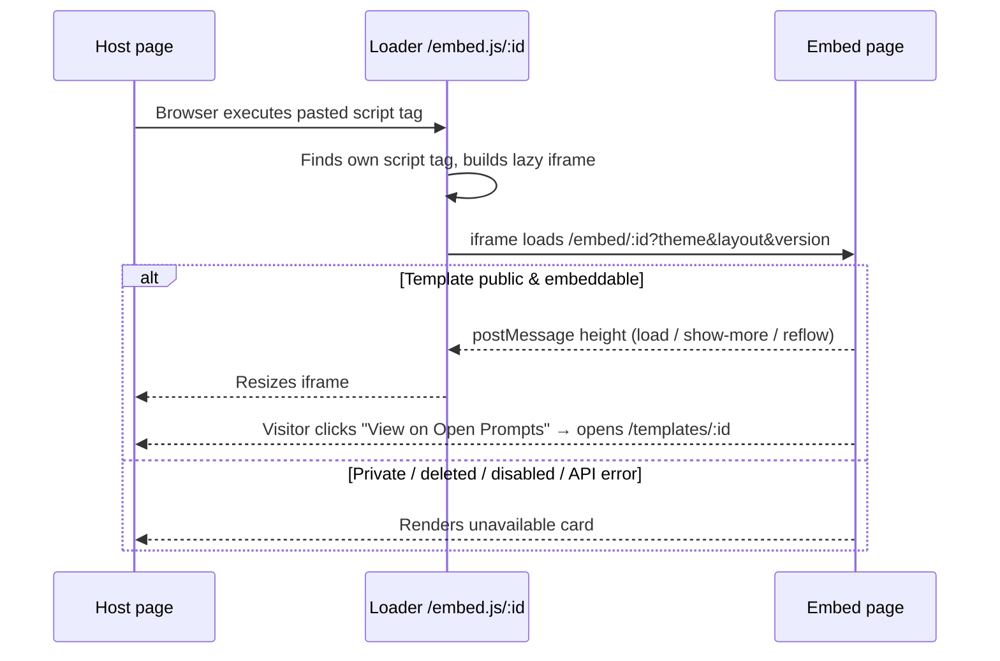
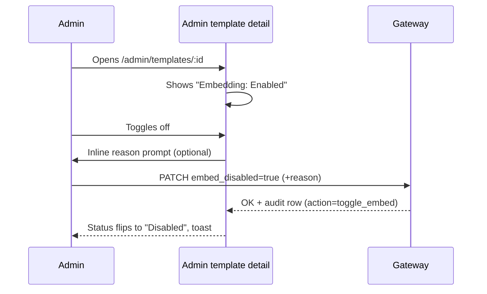

# Template Embedding Widget — UI/UX Design

- **Feature ID:** template-embedding-widget
- **Version:** 1.0
- **Status:** Proposed (for architecture review)
- **Author:** ui-ux-agent
- **Date:** 2026-10-12
- **Related requirements:** [template-embedding-widget-requirements.md](./template-embedding-widget-requirements.md)

## 1. Design Principles

1. **Zero-effort for hosts.** One script tag, no dependencies, auto-sizing. If the host can paste HTML, they can embed.
2. **Graceful everywhere.** Private/deleted/disabled/offline → the same friendly "not available" card. A host page must never look broken because of us.
3. **Brand-quiet.** The card is the creator's content front and center; Open Prompts branding is one small attribution line — enough to be a discovery channel, not a billboard.
4. **Consistent with the house style.** The embed card reuses the visual language of `PromptCard` (radius, tag chips, author row) so embedded cards are instantly recognizable as Open Prompts content.
5. **Progressive disclosure.** Card layout previews; full layout shows everything; the modal previews live before you commit.

## 2. Information Architecture



New surfaces: the **embed modal** (main app), the **embed page** (chrome-free route), the **loader script** (static JS), and an **embed toggle** on the admin template detail page. Everything else is untouched.

## 3. User Flows

### 3.1 Creator generates embed code



### 3.2 Host-page visitor views an embed



### 3.3 Admin disables embedding



## 4. Page Layouts (Wireframes)

### 4.1 Embed modal (on template detail page)

```
┌──────────────────────────────────────────────────────────────┐
│  Embed template                                    [×]       │
├──────────────────────────────────────────────────────────────┤
│  ┌─ Options ─────────────────────────────────────────────┐  │
│  │ Theme    ( ) Auto   ( ) Light   ( ) Dark              │  │
│  │ Layout   ( ) Card   ( ) Full                          │  │
│  │ Version  [ Latest ▾ ]   ← aliases of this template    │  │
│  └───────────────────────────────────────────────────────┘  │
│                                                              │
│  ┌─ Live preview ────────────────────────────────────────┐  │
│  │   ┌─────────────────────────────────────────────┐    │  │
│  │   │  (iframe: /embed/:id?theme=auto&layout=card)│    │  │
│  │   │  …actual embed card renders here…            │    │  │
│  │   └─────────────────────────────────────────────┘    │  │
│  └───────────────────────────────────────────────────────┘  │
│                                                              │
│  ┌─ Embed code ──────────────────────────────── [Copy] ┐   │
│  │ <script async src="https://openprompts.example/     │   │
│  │   embed.js/abc123?theme=auto&layout=card"></script> │   │
│  └──────────────────────────────────────────────────────┘   │
│  Or use a link:  https://openprompts.example/templates/abc  │
│                                                              │
│  ── Owner only ──────────────────────────────────────────   │
│  [✓] Allow embedding for this template                      │
├──────────────────────────────────────────────────────────────┤
│                                        [ Close ]             │
└──────────────────────────────────────────────────────────────┘
```

### 4.2 Embed page — card layout (default)

```
┌───────────────────────────────┐  ← max-width 480px, card
│ ✦ Title of the Template       │     radius/shadow match PromptCard
│                               │
│ 👤 Author Name   •  v7        │
│                               │
│ One-line description text     │
│ that may wrap to two lines…   │
│                               │
│ ┌──────┐ ┌──────┐ ┌──────┐   │
│ │ tag1 │ │ tag2 │ │ tag3 │   │
│ └──────┘ └──────┘ └──────┘   │
│                               │
│ ┌─ Content preview ────────┐ │
│ │ You are a senior code    │ │
│ │ reviewer. Given the fol… │ │
│ └──────────────────────────┘ │
│                    show more ▾│
│                               │
│ ⚡ Open Prompts    View →     │  ← attribution row
└───────────────────────────────┘
```

### 4.3 Embed page — full layout

Same header (title/author/description/tags) but the content area renders the **entire** template body (escaped, monospace optional) with no "show more"; the iframe auto-resizes to the rendered height.

### 4.4 Embed page — unavailable card

```
┌───────────────────────────────┐
│        (illustration)         │
│   This template is not        │
│   available for embedding.    │
│                               │
│   Browse Open Prompts →       │
└───────────────────────────────┘
```

### 4.5 Admin template detail — embed section

```
┌─ Embedding ────────────────────────────────────────────┐
│ Status:  ● Enabled                                      │
│                                                         │
│ [ Toggle embedding ]      ← confirm + optional reason   │
│ Last changed: 2026-10-12 by admin@… (audit trail)      │
└─────────────────────────────────────────────────────────┘
```

## 5. Component Specifications

### 5.1 `EmbedModal` (frontend/src/components/embed/EmbedModal.js)

| Prop | Type | Notes |
|---|---|---|
| `templateId` | string | Required |
| `template` | object | For title/aliases list; owner check |
| `aliases` | array | From existing alias service; version selector options |
| `onClose` | func | — |

Behavior: local state `{theme:'auto', layout:'card', version:'latest'}`; snippet = `&lt;script async src="{origin}/embed.js/{id}?{params}"&gt;&lt;/script&gt;`; preview iframe `src=/embed/{id}?{params}&preview=1`; Copy uses `navigator.clipboard` with `document.execCommand('copy')` fallback; owner-only "Allow embedding" switch calls the toggle endpoint and flips the preview to the unavailable card when disabled.

### 5.2 `EmbedPage` (frontend/src/pages/EmbedPage.js — chrome-free)

Reads route params + query (`theme`, `layout`, `version`, `lang`); fetches template (public endpoint); renders `EmbedCard` / `EmbedFull` / `UnavailableCard`; posts height via `postMessage` on mount, on show-more toggle, and on theme reflow (ResizeObserver); sets `document.title` to `{template.title} — Open Prompts embed`.

### 5.3 `EmbedCard` / `EmbedFull` / `UnavailableCard` (frontend/src/components/embed/)

Presentational; theme via a `data-theme` attribute on the root (light/dark), styles scoped in `embed.scss` (no dependency on main-app theme variables); all user text escaped (existing rule); attribution row links to `/templates/{id}`.

### 5.4 Loader script (`/embed.js/:id`, static)

Vanilla JS (~2 KB): locate own `<script>` tag → build iframe (`title` from `data-title` or "Open Prompts embed", `loading="lazy"`, `sandbox` not required since same-origin) → forward params → `window.addEventListener('message')` for `{type:'op-embed-height', height}` → set `iframe.style.height`. Debounced resize; ignores messages from other origins.

### 5.5 Admin `EmbedToggleSection` (frontend/src/components/admin/)

Reads `embed_disabled` from the template record; toggle → confirm popover with optional reason input → API call → optimistic update with rollback on error; renders last audit entry (who/when).

## 6. Interaction Details

1. **Snippet regenerates live.** Any option change instantly updates both the preview iframe `src` and the code block (no "Apply" step).
2. **Copy feedback.** Button label flips to "Copied!" for 2s (plus `aria-live` announcement); on clipboard failure, the code block gets focus with "Select all" hint.
3. **Version selector** lists "Latest" + all aliases of the template (name + pinned version number); choosing one pins the embed (FR-2/AC-5).
4. **Show more** expands the preview to the full content *within the card layout* (still capped at ~2000 chars with scroll inside the iframe) and posts the new height.
5. **Owner disable flow.** Toggling "Allow embedding" off shows a confirm dialog ("External pages already embedding this template will show 'not available'"); the live preview immediately demonstrates the unavailable card.
6. **Theme=auto** uses `matchMedia('(prefers-color-scheme: dark)')` inside the iframe; the loader passes no theme styling of its own.
7. **Keyboard.** Modal traps focus (existing modal pattern); the embed page itself is a normal document — fully keyboard-navigable, no traps.
8. **Attribution link** opens with `target="_blank" rel="noopener"`.

## 7. States Summary

| Surface | Loading | Empty | Error | Success |
|---|---|---|---|---|
| Embed modal | Preview iframe shows skeleton card | n/a (aliases empty → version selector shows only "Latest") | Preview error → inline "Preview unavailable" note; snippet still generated | Code copied toast |
| Embed page | Skeleton card (title/desc shimmer) | n/a | Unavailable card (API error, private, deleted, disabled) | Card/full renders; height posted |
| Loader | — | — | Silent no-op (host unaffected) | iframe injected + resized |
| Admin toggle | — | — | Rollback + error toast | Status flips + toast + audit row |

## 8. i18n String Table

Namespace: `embed.*` (embed page + modal), `admin.embed.*` (admin console). Keys added to `frontend/src/locales/{en,zh}/translation.json`.

| Key / EN text | ZH |
|---|---|
| `embed.action` / "Embed" | "嵌入" |
| `embed.modalTitle` / "Embed template" | "嵌入模板" |
| `embed.theme` / "Theme" | "主题" |
| `embed.themeAuto` / "Auto" | "自动" |
| `embed.themeLight` / "Light" | "浅色" |
| `embed.themeDark` / "Dark" | "深色" |
| `embed.layout` / "Layout" | "布局" |
| `embed.layoutCard` / "Card" | "卡片" |
| `embed.layoutFull` / "Full" | "全文" |
| `embed.version` / "Version" | "版本" |
| `embed.versionLatest` / "Latest" | "最新" |
| `embed.preview` / "Live preview" | "实时预览" |
| `embed.previewUnavailable` / "Preview unavailable" | "预览不可用" |
| `embed.code` / "Embed code" | "嵌入代码" |
| `embed.copy` / "Copy code" | "复制代码" |
| `embed.copied` / "Copied!" | "已复制!" |
| `embed.copyFailed` / "Copy failed — select the code manually" | "复制失败 —— 请手动选择代码" |
| `embed.orLink` / "Or use a link" | "或使用链接" |
| `embed.allow` / "Allow embedding for this template" | "允许嵌入此模板" |
| `embed.disableTitle` / "Disable embedding?" | "禁用嵌入?" |
| `embed.disableBody` / "External pages already embedding this template will show 'not available'." | "已嵌入此模板的外部页面将显示"不可用"。" |
| `embed.showMore` / "show more" | "展开更多" |
| `embed.showLess` / "show less" | "收起" |
| `embed.viewOn` / "View on Open Prompts" | "在 Open Prompts 查看" |
| `embed.unavailable` / "This template is not available for embedding." | "该模板无法嵌入。" |
| `embed.browse` / "Browse Open Prompts" | "浏览 Open Prompts" |
| `embed.iframeTitle` / "Open Prompts embed" | "Open Prompts 嵌入" |
| `admin.embed.section` / "Embedding" | "嵌入" |
| `admin.embed.status` / "Status" | "状态" |
| `admin.embed.enabled` / "Enabled" | "已启用" |
| `admin.embed.disabled` / "Disabled" | "已禁用" |
| `admin.embed.toggle` / "Toggle embedding" | "切换嵌入" |
| `admin.embed.reasonLabel` / "Reason (optional)" | "原因(可选)" |
| `admin.embed.lastChanged` / "Last changed {{date}} by {{actor}}" | "最后变更:{{date}} 由 {{actor}}" |

## 9. Accessibility Notes

1. **Embed page is a real document:** one `h1` (title), author/description/tags as text, content in a `region` with `aria-label`; "show more" is a `button` with `aria-expanded`.
2. **Loader iframe** gets `title="{template title} — Open Prompts embed"` (falls back to the generic `embed.iframeTitle`).
3. **Contrast:** both themes meet WCAG AA (4.5:1 text); the attribution row is styled as secondary text but stays ≥ 4.5:1.
4. **Modal:** focus trap, `Escape` closes, initial focus on the theme radio group; all controls labeled.
5. **Copy button** announces success via `aria-live="polite"` region.
6. **No keyboard traps** in the embed page; links are real links (focusable, visible focus ring in both themes).
7. **Reduced motion:** skeleton shimmer disabled under `prefers-reduced-motion`.

## 10. Responsive Behavior

1. **Embed card** is fluid: `max-width: 480px; width: 100%` — the iframe fills the host's container up to 480px; below 320px the card drops the tag row to a single scrollable line.
2. **Full layout** is `width: 100%` and height auto-resized; long code lines wrap (no horizontal scroll inside the iframe).
3. **Embed modal** follows the existing modal responsive pattern (full-screen sheet below 480px viewport).
4. **Admin section** stacks vertically on narrow screens (label above control).
5. The loader never sets a fixed height — only `min-height: 120px` before first height message arrives.

## 11. Analytics Events (optional, if analytics shipped)

- `embed_code_copied` {template_id, theme, layout, version}
- `embed_viewed` {template_id, layout, theme} — server-side, source=embed (FR-13)
- `embed_disabled` / `embed_enabled` {template_id, actor_role}

## 12. Out of Scope (UI)

- Host-page referrer dashboards, custom colors/branding UI, multi-template embed builder, oEmbed settings UI, WordPress plugin configuration screens.
