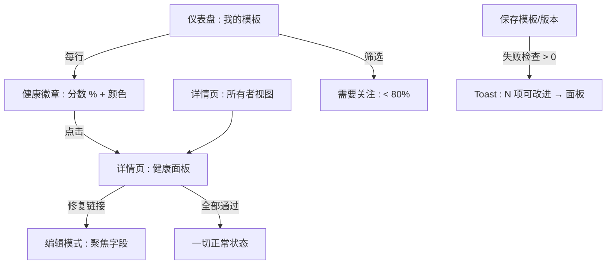
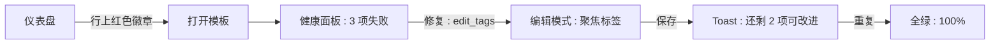
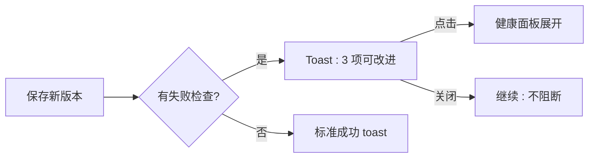

# 模板健康度提示 — UI/UX 设计

- **功能 ID：** template-health-hints
- **版本：** 1.0
- **状态：** Proposed（待架构评审）
- **作者：** ui-ux-agent
- **日期：** 2026-10-13
- **配套文档：** `template-health-hints-requirements-zh-CN.md`

## 1. 设计原则

1. **教练而非裁判。** 健康度是创作者的私人教练 —— 建议式语气、一键修复、绝不公开羞辱。
2. **每条提示都有去处。** 没有修复链接的失败检查就是噪音；每一行都链接到确切的编辑界面。
3. **克制地融入。** 仪表盘上的小徽章、详情页的可折叠面板、保存后的可关闭 toast —— 不新增页面、不用模态框打断工作。
4. **可解释的分数。** 权重与规则在面板中可见，不做黑盒。

## 2. 信息架构



| 界面 | 位置 | 受众 | 目的 |
|---|---|---|---|
| 健康徽章 | 仪表盘模板行 | 所有者 | 一眼可见的注意力信号 |
| 健康面板 | 模板详情页，仅所有者，可折叠 | 所有者 | 完整清单与修复入口 |
| 保存后 toast | 创建/保存版本后 | 所有者 | 在注意力高峰时刻提示问题 |
| 需要关注筛选 | 仪表盘列表控件 | 所有者 | 分流低健康度模板 |

## 3. 用户流程

### 3.1 分流与修复



### 3.2 保存后提醒



## 4. 页面布局

### 4.1 带徽章的仪表盘行

```
+----------------------------------------------------------------------+
|  我的模板                              [需要关注 ▾]  [排序 ▾]         |
+----------------------------------------------------------------------+
|  Cold Email v3   Marketing   ★128   v5   2026-10-10   [ 92% ● ]     |
|  Old Intro       —           ★12    v2   2026-03-02   [ 41% ● ]     |
+----------------------------------------------------------------------+
```

徽章：分数 + 彩色圆点（● 绿/黄/红）；悬浮提示列出失败检查名称。

### 4.2 健康面板（详情页，仅所有者）

```
+----------------------------------------------------------------------+
|  ▸ 模板健康度                                           92%  ● 黄      |
+----------------------------------------------------------------------+
|  （展开）                                                             |
|  ✓ 描述              15/15   "Professional cold email for..."       |
|  ✓ 标签 (3)         15/15   email, outreach, b2b                   |
|  ✓ 分类             10/10   Marketing                              |
|  ⚠ 变量             10/20   近重复: Name / name          [修复 →]   |
|  ✓ 内容长度         10/10   1,240 字符                             |
|  ✓ 变更说明         5/5     "tightened opener"                     |
|  ○ 近期更新         10/10   3 天前                                 |
|  – 语言未设置       0/5     [设置语言 →]                            |
|  ─────────────────────────────────────────────────────────────────   |
|  评分规则：每项检查有权重；未通过错误级检查时分数上限为 49%。          |
|                                                    [了解更多]         |
+----------------------------------------------------------------------+
```

行状态：✓ 通过（绿色对勾）、⚠ 警告（黄色三角）、✕ 错误（红色叉）、– 信息缺失（灰色短横）、○ 通过（信息项）。

### 4.3 保存后 toast

```
+------------------------------------------+
|  ✓ 已保存。有 3 项可改进                  |
|  [查看清单]                          [×]  |
+------------------------------------------+
```

### 4.4 移动端

仪表盘徽章缩为彩色圆点 + 分数（最小 44×44px 点击区域，点击打开面板）。健康面板行垂直堆叠，修复链接为每行的全宽次级按钮。toast 横跨底部。

## 5. 组件规格

| 组件 | 行为 | 状态 |
|---|---|---|
| HealthBadge | 分数 % + 严重度圆点；悬浮提示显示失败检查名；点击跳转详情面板 | 绿 / 黄 / 红 / 加载中 |
| HealthPanel | 可折叠区块；清单行含状态图标、名称、权重、详情、修复链接；底部评分说明 | 折叠 / 展开 / 全部通过 / 加载中 / 错误（重试） |
| CheckRow | 图标 + 名称 + 权重 + 值详情 + 修复链接（失败时） | 通过 / 警告 / 错误 / 信息缺失 |
| PostSaveToast | 成功 + 失败数 + 查看清单链接；6 秒自动消失 | 显示 / 已关闭 |
| NeedsAttentionFilter | 仪表盘列表筛选 chip（健康度 < 80%） | 关 / 开 |

## 6. 交互细节

1. **徽章提示：** 悬浮/聚焦列出失败检查名（最多 3 项 + "+N 更多"）；点击进入模板详情并预展开面板（`#health` 锚点）。
2. **修复链接：** 跳转到编辑模式并聚焦目标字段（`fix_action` → 路由 + 聚焦目标）；保存后回到详情页，面板展开，修复的行动画变绿。
3. **面板记忆：** 展开/折叠状态按用户持久化（localStorage），默认折叠。
4. **全部通过状态：** 面板显示一句友好文案（"一切正常 —— 100%"），清单折叠在其下。
5. **Toast 行为：** 仅在失败检查 > 0 时出现；最多同时一个；点击"查看"打开面板；6 秒自动消失；关闭绝不阻断保存流程。
6. **筛选：** "需要关注"是仪表盘列表控件中的开关 chip；与现有排序组合（与其他筛选一样同步到 URL）。
7. **重算反馈：** 保存后面板/tost 反映*新*状态（读取时服务端重算，FR-10）—— 不出现过期计数。
8. **严重度颜色：** 复用现有语义色板（success/warning/danger）；圆点绝不是唯一信号（分数数字 + 提示文字）。

## 7. 状态汇总

| 界面 | 加载中 | 空态 | 错误 |
|---|---|---|---|
| HealthBadge | 骨架圆点 | —（始终可计算） | 灰点 + "—"（点击重试） |
| HealthPanel | 骨架行 | 全部通过状态 | 错误横幅 + 重试 |
| CheckRow | — | 信息缺失（灰色短横） | — |
| PostSaveToast | — | 不显示（0 项失败） | 标准保存错误（现有） |
| 筛选 | — | "没有需要关注的模板 🎉" | — |

## 8. 国际化（i18n）

| Key | 中文 | 英文 |
|---|---|---|
| `health.badge.aria` | 健康度 {{score}}% | Health {{score}} percent |
| `health.panel.title` | 模板健康度 | Template health |
| `health.panel.howScoring` | 评分规则 | How scoring works |
| `health.panel.explainer` | 每项检查有权重；未通过错误级检查时分数上限为 49%。 | Each check has a weight; failing an error-level check caps the score at 49%. |
| `health.panel.allGood` | 一切正常 —— 100% | Everything looks good — 100% |
| `health.check.has_description` | 描述 | Description |
| `health.check.has_tags` | 标签 | Tags |
| `health.check.has_category` | 分类 | Category |
| `health.check.variable_quality` | 变量 | Variables |
| `health.check.content_length` | 内容长度 | Content length |
| `health.check.has_change_note` | 变更说明 | Change note |
| `health.check.recently_updated` | 近期更新 | Recently updated |
| `health.check.has_language` | 语言 | Language |
| `health.explain.has_description.empty` | 添加描述，让搜索能找到这个模板。 | Add a description so search can find this template. |
| `health.explain.has_description.short` | 少于 20 字符的描述通常说不清模板用途。 | Descriptions under 20 characters rarely explain the template. |
| `health.explain.has_tags.none` | 至少添加一个标签；三个或更多最好。 | Add at least one tag; three or more is best. |
| `health.explain.has_tags.few` | 一两个标签会限制可发现性。 | One or two tags limits discoverability. |
| `health.explain.has_category.unset` | 选择分类，让浏览者能找到它。 | Pick a category so browsers can find it. |
| `health.explain.variable_quality.invalid` | 部分变量名无效（为空、未闭合或含空白）。 | Some variables have invalid names (empty, unclosed, or whitespace). |
| `health.explain.variable_quality.caseDup` | 近重复的变量名仅大小写不同。 | Near-duplicate variable names differ only by case. |
| `health.explain.content_length.out` | 内容不在 50–20,000 字符的理想区间。 | Content is outside the 50–20,000 character sweet spot. |
| `health.explain.has_change_note.missing` | 最新版本没有变更说明。 | The latest version has no change note. |
| `health.explain.recently_updated.stale` | 超过 180 天未更新。 | Not updated in over 180 days. |
| `health.explain.has_language.unset` | 设置模板语言。 | Set the template language. |
| `health.fix.edit_description` | 添加描述 | Add description |
| `health.fix.edit_tags` | 编辑标签 | Edit tags |
| `health.fix.edit_category` | 设置分类 | Set category |
| `health.fix.edit_content` | 修复变量 | Fix variables |
| `health.fix.add_change_note` | 添加变更说明 | Add change note |
| `health.fix.edit_language` | 设置语言 | Set language |
| `health.toast.improvements` | 有 {{count}} 项可改进 | {{count}} improvements available |
| `health.toast.viewChecklist` | 查看清单 | View checklist |
| `health.filter.needsAttention` | 需要关注 | Needs attention |
| `health.filter.empty` | 没有需要关注的模板 🎉 | No templates need attention 🎉 |
| `health.state.pass` | 通过 | Pass |
| `health.state.warning` | 警告 | Warning |
| `health.state.error` | 错误 | Error |
| `health.state.info` | 可选项 | Optional |

## 9. 无障碍

- 徽章是带可访问名称的链接（`health.badge.aria`）；圆点为装饰性（`aria-hidden`）—— 分数数字承载信息。
- 面板是带 `h3` 的 `<section>`；行为列表项，状态由文字（`health.state.*`）加图标传达，绝不只靠颜色。
- 修复链接是标准锚点，具有描述性可访问名称；到达后焦点移到目标字段。
- toast 使用 `role=status`（polite）；其链接可到达，且 toast 绝不抢焦点。
- 可折叠面板头部按钮带 `aria-expanded`；键盘 Enter/Space 切换。
- 提示内容可通过聚焦访问（不只在悬浮时出现），并可用 Esc 关闭。

## 10. 数据埋点（可选）

- `health_panel_opened`、`health_fix_clicked`（check_id）、`health_filter_used`、`post_save_toast_shown`（count）—— 仅产品使用事件。

## 11. 不在范围内

- 公开的健康徽章/分数；健康度作为排序信号；自动修复。
- 健康度历史；管理员审核联动；邮件摘要。
- 任何形式的变现 —— 本产品永久不做。
