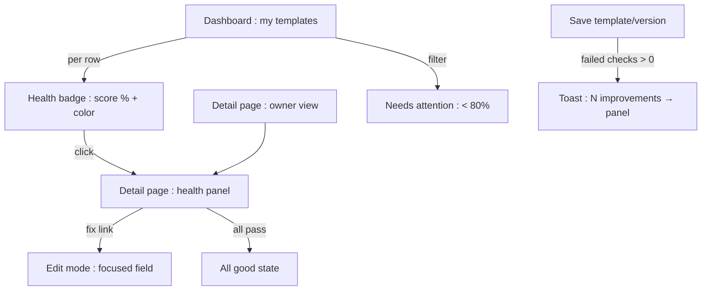
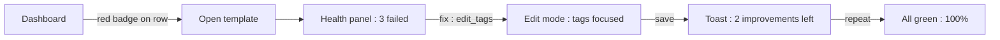
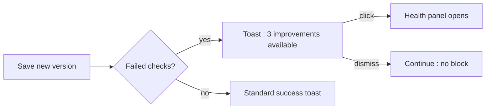

# Template Health Hints — UI/UX Design

- **Feature ID:** template-health-hints
- **Version:** 1.0
- **Status:** Proposed (for architecture review)
- **Author:** ui-ux-agent
- **Date:** 2026-10-13
- **Companion doc:** `template-health-hints-requirements.md`

## 1. Design Principles

1. **Coach, don't grade.** Health is a private coach for the owner — advisory tone, one-click fixes, zero public shaming.
2. **Every hint has a destination.** A failed check without a fix link is noise; each row links to the exact editor surface.
3. **Calm integration.** A small badge on the dashboard, a collapsible panel on the detail page, a dismissible toast after save — no new pages, no modals blocking work.
4. **Explainable score.** Weights and rules are visible in the panel; nothing is a black box.

## 2. Information Architecture



| Surface | Location | Audience | Purpose |
|---|---|---|---|
| Health badge | Dashboard template rows | Owner | At-a-glance attention signal |
| Health panel | Template detail, owner-only, collapsible | Owner | Full checklist with fixes |
| Post-save toast | After create/version save | Owner | Surface issues at moment of attention |
| Needs attention filter | Dashboard list controls | Owner | Triage low-health templates |

## 3. User Flows

### 3.1 Triage and fix



### 3.2 Post-save nudge



## 4. Page Layouts

### 4.1 Dashboard row with badge

```
+----------------------------------------------------------------------+
|  My templates                        [Needs attention ▾]  [Sort ▾]   |
+----------------------------------------------------------------------+
|  Cold Email v3   Marketing   ★128   v5   2026-10-10   [ 92% ● ]     |
|  Old Intro       —           ★12    v2   2026-03-02   [ 41% ● ]     |
+----------------------------------------------------------------------+
```

Badge: score + colored dot (● green/amber/red); tooltip lists failed check names.

### 4.2 Health panel (detail page, owner-only)

```
+----------------------------------------------------------------------+
|  ▸ Template health                                    92%  ● amber    |
+----------------------------------------------------------------------+
|  (expanded)                                                          |
|  ✓ Description        15/15   "Professional cold email for..."       |
|  ✓ Tags (3)           15/15   email, outreach, b2b                   |
|  ✓ Category           10/10   Marketing                              |
|  ⚠ Variables          10/20   near-duplicate: Name / name  [Fix →]   |
|  ✓ Content length     10/10   1,240 chars                            |
|  ✓ Change note        5/5     "tightened opener"                     |
|  ○ Recently updated   10/10   3 days ago                             |
|  – Language unset     0/5     [Set language →]                       |
|  ─────────────────────────────────────────────────────────────────   |
|  How scoring works: each check has a weight; failing an error-level  |
|  check caps the score at 49%.                     [Learn more]       |
+----------------------------------------------------------------------+
```

Row states: ✓ pass (green check), ⚠ warning (amber triangle), ✕ error (red cross), – info-missing (gray dash), ○ pass-info.

### 4.3 Post-save toast

```
+------------------------------------------+
|  ✓ Saved. 3 improvements available        |
|  [View checklist]                    [×]  |
+------------------------------------------+
```

### 4.4 Mobile

The dashboard badge shrinks to the colored dot + score (min 44×44px tap target opening the panel). The health panel stacks rows vertically with the fix link as a full-width secondary button per row. The toast spans the bottom.

## 5. Component Specs

| Component | Behavior | States |
|---|---|---|
| HealthBadge | Score % + severity dot; tooltip with failed check names; click navigates to detail panel | Green / amber / red / loading |
| HealthPanel | Collapsible section; checklist rows with state icon, name, weight, detail, fix link; scoring explainer footer | Collapsed / expanded / all-pass / loading / error (retry) |
| CheckRow | Icon + name + weight + value detail + fix link (when failed) | pass / warning / error / info-missing |
| PostSaveToast | Success + failed count + View checklist link; auto-dismiss 6s | Shown / dismissed |
| NeedsAttentionFilter | Dashboard list filter chip (health < 80%) | Off / on |

## 6. Interaction Details

1. **Badge tooltip:** hover/focus lists failed check names (up to 3 + "+N more"); click goes to the template detail with the panel pre-expanded (`#health` anchor).
2. **Fix links:** each navigates to edit mode with the target field focused (`fix_action` → route + focus target); after save, the user lands back on the detail page with the panel expanded and the fixed row animating to green.
3. **Panel persistence:** expanded/collapsed state persists per user (localStorage); default collapsed.
4. **All-pass state:** panel shows a single friendly line ("Everything looks good — 100%") with the checklist collapsed beneath.
5. **Toast behavior:** appears only when failed checks > 0; never stacks more than one; clicking View opens the panel; auto-dismiss 6s; dismissal never blocks the save flow.
6. **Filter:** "Needs attention" is a toggle chip in the dashboard list controls; combined with existing sort (URL-synced like other filters).
7. **Recompute feedback:** after a save, the panel/toast reflects the *new* state (server recompute on read, FR-10) — no stale counts.
8. **Severity colors:** reuse the existing semantic palette (success/warning/danger); the dot is never the only signal (score number + tooltip text).

## 7. States Summary

| Surface | Loading | Empty | Error |
|---|---|---|---|
| HealthBadge | Skeleton dot | — (always computable) | Gray dot + "—" (retry on click) |
| HealthPanel | Skeleton rows | All-pass state | Error banner + retry |
| CheckRow | — | info-missing (gray dash) | — |
| PostSaveToast | — | Not shown (0 failed) | Standard save error (existing) |
| Filter | — | "No templates need attention 🎉" | — |

## 8. i18n

| Key | EN | ZH |
|---|---|---|
| `health.badge.aria` | Health {{score}} percent | 健康度 {{score}}% |
| `health.panel.title` | Template health | 模板健康度 |
| `health.panel.howScoring` | How scoring works | 评分规则 |
| `health.panel.explainer` | Each check has a weight; failing an error-level check caps the score at 49%. | 每项检查有权重；未通过错误级检查时分数上限为 49%。 |
| `health.panel.allGood` | Everything looks good — 100% | 一切正常 —— 100% |
| `health.check.has_description` | Description | 描述 |
| `health.check.has_tags` | Tags | 标签 |
| `health.check.has_category` | Category | 分类 |
| `health.check.variable_quality` | Variables | 变量 |
| `health.check.content_length` | Content length | 内容长度 |
| `health.check.has_change_note` | Change note | 变更说明 |
| `health.check.recently_updated` | Recently updated | 近期更新 |
| `health.check.has_language` | Language | 语言 |
| `health.explain.has_description.empty` | Add a description so search can find this template. | 添加描述，让搜索能找到这个模板。 |
| `health.explain.has_description.short` | Descriptions under 20 characters rarely explain the template. | 少于 20 字符的描述通常说不清模板用途。 |
| `health.explain.has_tags.none` | Add at least one tag; three or more is best. | 至少添加一个标签；三个或更多最好。 |
| `health.explain.has_tags.few` | One or two tags limits discoverability. | 一两个标签会限制可发现性。 |
| `health.explain.has_category.unset` | Pick a category so browsers can find it. | 选择分类，让浏览者能找到它。 |
| `health.explain.variable_quality.invalid` | Some variables have invalid names (empty, unclosed, or whitespace). | 部分变量名无效（为空、未闭合或含空白）。 |
| `health.explain.variable_quality.caseDup` | Near-duplicate variable names differ only by case. | 近重复的变量名仅大小写不同。 |
| `health.explain.content_length.out` | Content is outside the 50–20,000 character sweet spot. | 内容不在 50–20,000 字符的理想区间。 |
| `health.explain.has_change_note.missing` | The latest version has no change note. | 最新版本没有变更说明。 |
| `health.explain.recently_updated.stale` | Not updated in over 180 days. | 超过 180 天未更新。 |
| `health.explain.has_language.unset` | Set the template language. | 设置模板语言。 |
| `health.fix.edit_description` | Add description | 添加描述 |
| `health.fix.edit_tags` | Edit tags | 编辑标签 |
| `health.fix.edit_category` | Set category | 设置分类 |
| `health.fix.edit_content` | Fix variables | 修复变量 |
| `health.fix.add_change_note` | Add change note | 添加变更说明 |
| `health.fix.edit_language` | Set language | 设置语言 |
| `health.toast.improvements` | {{count}} improvements available | 有 {{count}} 项可改进 |
| `health.toast.viewChecklist` | View checklist | 查看清单 |
| `health.filter.needsAttention` | Needs attention | 需要关注 |
| `health.filter.empty` | No templates need attention 🎉 | 没有需要关注的模板 🎉 |
| `health.state.pass` | Pass | 通过 |
| `health.state.warning` | Warning | 警告 |
| `health.state.error` | Error | 错误 |
| `health.state.info` | Optional | 可选项 |

## 9. Accessibility

- The badge is a link with an accessible name (`health.badge.aria`); the dot is decorative (`aria-hidden`) — the score number carries the information.
- The panel is a `<section>` with an `h3`; rows are list items with state conveyed by text (`health.state.*`) plus icon, never color alone.
- Fix links are standard anchors with descriptive accessible names; focus moves to the target field on arrival.
- The toast uses `role=status` (polite); its link is reachable and the toast never steals focus.
- The collapsible panel uses `aria-expanded` on its header button; keyboard toggling with Enter/Space.
- Tooltip content is available on focus (not hover-only) and dismissible via Esc.

## 10. Analytics (optional)

- `health_panel_opened`, `health_fix_clicked` (check_id), `health_filter_used`, `post_save_toast_shown` (count) — product usage events only.

## 11. Out of Scope

- Public health badges/scores; health as ranking signal; automated fixes.
- Health history; admin moderation integration; email digests.
- Monetization of any kind — permanently out of scope for this product.
