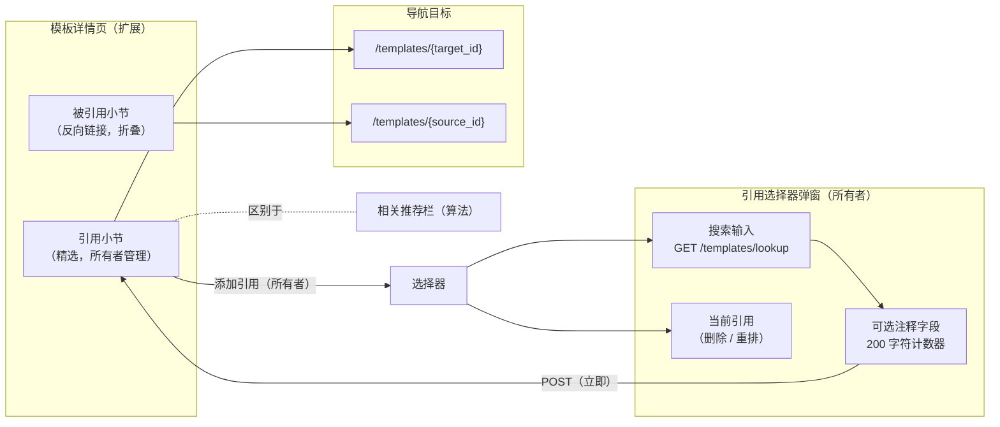
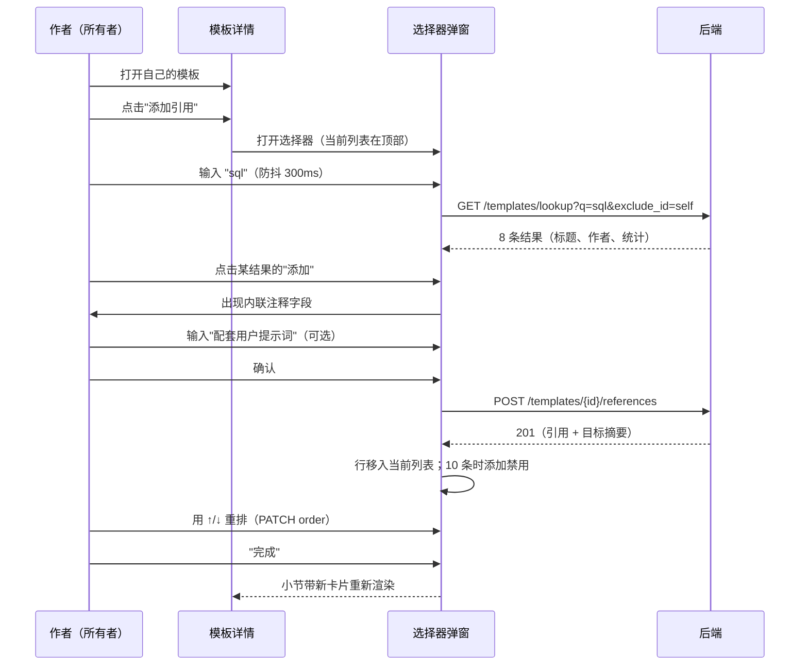
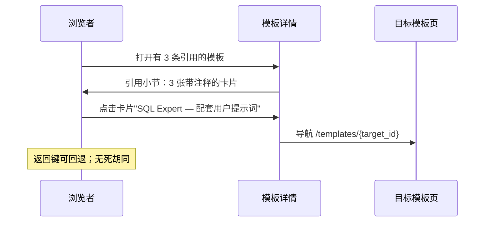
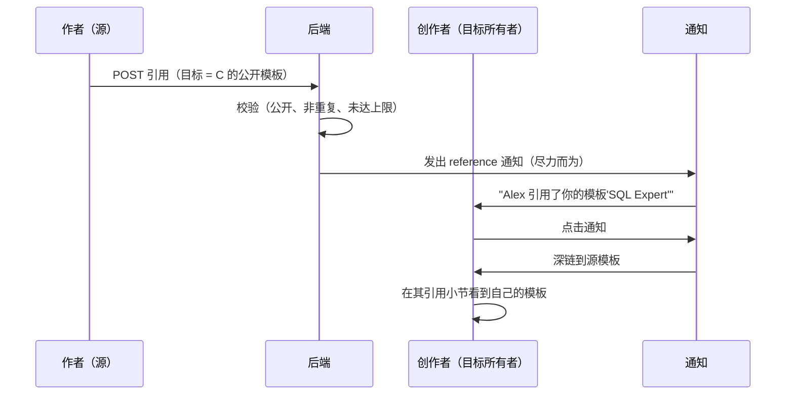
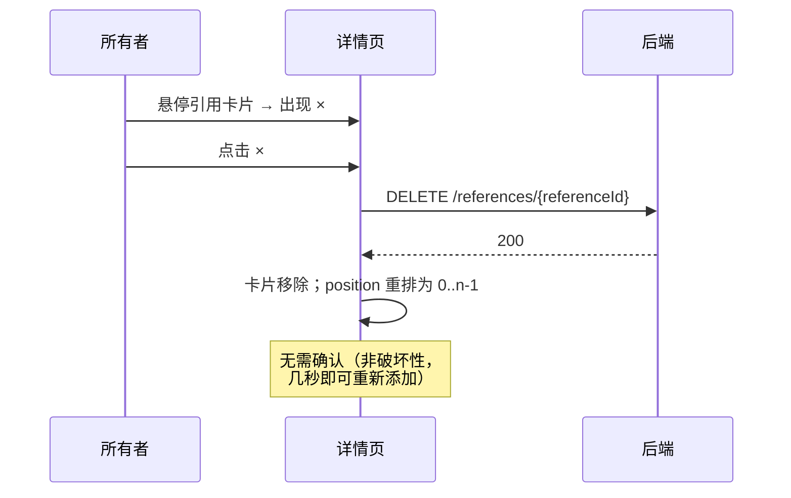

# 模板链接与引用（Template Linking & References）— UI/UX 设计

- **Feature ID:** template-linking-references
- **Version:** 1.0
- **Status:** Proposed（待架构评审）
- **Author:** ui-ux-agent
- **Date:** 2026-10-12
- **相关文档：** [需求](./template-linking-references-requirements-zh-CN.md) · [UI/UX Design (EN)](./template-linking-references-ui-ux-design.md)

## 1. 设计原则

1. **作者意图即产品。** 小节可见地呈现精选感（"由作者挑选"）—— 与算法推荐栏样式区分，注释作为一等内容渲染。
2. **精选只需几秒。** 搜索 → 点击 → 可选注释 → 完成。选择器绝不因完整表单而阻塞；每个操作立即持久化。
3. **死胡同是 bug。** 每张引用卡片可导航；被删目标干净消失；反向链接闭合发现闭环。
4. **隐私不可见。** 他人的私有模板与不存在的模板不可区分 —— 选择器干脆不提供它们。
5. **十条足矣。** 上限保持小节精选；UI 优雅地执行（禁用添加、清晰提示），在服务端之前。

## 2. 信息架构



## 3. 用户流程

### 3.1 作者精选引用



### 3.2 浏览者遍历引用



### 3.3 创作者发现被引用



### 3.4 删除与清理



## 4. 页面布局（线框图）

### 4.1 引用小节（浏览者，2 条引用）

```
┌──────────────────────────────────────────────────────────────┐
│  引用                                        已链接 2 条       │
│  ────────────────────────────────────────────────────────────│
│  ┌────────────────────────────────────────────────────────┐ │
│  │ SQL Expert — User Prompt              Alex Chen        │ │
│  │ "此系统提示词的配套用户提示词"                             │ │
│  │ ♥ 128  ⑂ 42                                            │ │
│  └────────────────────────────────────────────────────────┘ │
│  ┌────────────────────────────────────────────────────────┐ │
│  │ SQL Expert — Streaming Variant         Alex Chen        │ │
│  │ ♥ 64  ⑂ 12                                              │ │
│  └────────────────────────────────────────────────────────┘ │
│                                                              │
│  ⓘ 由作者精选                                                │
└──────────────────────────────────────────────────────────────┘
```

### 4.2 引用小节（所有者，带管理控件）

```
┌──────────────────────────────────────────────────────────────┐
│  引用                                        2 / 10           │
│  ────────────────────────────────────────────────────────────│
│  ┌────────────────────────────────────────────────────────┐ │
│  │ ↑ ↓  SQL Expert — User Prompt          Alex Chen   ×   │ │
│  │      "配套用户提示词…"                  ♥ 128  ⑂ 42      │ │
│  └────────────────────────────────────────────────────────┘ │
│  ┌────────────────────────────────────────────────────────┐ │
│  │ ↑ ↓  SQL Expert — Streaming Variant    Alex Chen   ×   │ │
│  │      ♥ 64  ⑂ 12                                         │ │
│  └────────────────────────────────────────────────────────┘ │
│                                                              │
│  [ + 添加引用 ]                                               │
└──────────────────────────────────────────────────────────────┘
  空状态（所有者）："暂无引用 —— 链接相关模板，让用户找到配套
  作品。" + 添加按钮
```

### 4.3 被引用小节（折叠，显示计数）

```
┌──────────────────────────────────────────────────────────────┐
│  ▸ 被引用                                              3      │
└──────────────────────────────────────────────────────────────┘
  展开后：
┌──────────────────────────────────────────────────────────────┐
│  ▾ 被引用                                              3      │
│  ────────────────────────────────────────────────────────────│
│  • Prompt Chaining Starter Kit（Sam）—— "用作第 1 步"        │
│  • SQL Coach System Prompt（Alex）                            │
│  • Data Analysis Bundle（Kim）—— "搭配使用效果好"             │
└──────────────────────────────────────────────────────────────┘
```

### 4.4 引用选择器弹窗

```
┌──────────────────────────────────────────────────────────────┐
│  添加引用                                            [×]      │
│  ────────────────────────────────────────────────────────────│
│  当前引用（2/10）                                             │
│  1. SQL Expert — User Prompt                        [×]     │
│  2. SQL Expert — Streaming Variant                  [×]     │
│  ────────────────────────────────────────────────────────────│
│  ┌──────────────────────────────────────────────────────┐   │
│  │ 🔍 按标题搜索模板…                                    │   │
│  └──────────────────────────────────────────────────────┘   │
│                                                              │
│  "sql" 的结果：                                              │
│  ┌──────────────────────────────────────────────────────┐   │
│  │ SQL Expert Prompt          Alex Chen    ♥ 128  [添加] │   │
│  │ SQL Coach System           Sam Wu       ♥ 96   [添加] │   │
│  │ 我的私有 SQL 草稿          你  [私有]    ♥ 3    [添加] │   │
│  │ …                                                     │   │
│  └──────────────────────────────────────────────────────┘   │
│                                                              │
│  正在添加"SQL Coach System"：                                 │
│  ┌──────────────────────────────────────────────────────┐   │
│  │ 注释（可选）                                          │   │
│  │ ┌──────────────────────────────────────────────────┐ │   │
│  │ │ 适合辅导类工作流搭配使用                          │ │   │
│  │ └──────────────────────────────────────────────────┘ │   │
│  │ 28 / 200                            [取消] [添加]     │   │
│  └──────────────────────────────────────────────────────┘   │
│                                                              │
│  ⚠ 已达上限 10 条 —— 删除一条后再添加。                       │
│                                              [ 完成 ]         │
└──────────────────────────────────────────────────────────────┘
```

## 5. 组件规格

| 组件 | 基于 | Props / 行为 |
|---|---|---|
| `TemplateReferencesSection` | 新建（详情页小节） | `{templateId, isOwner}`；请求 `GET /references`；渲染有序 `ReferenceCard`；所有者控件（重排 ↑/↓、删除 ×、添加按钮）；所有者空状态；非所有者为空时隐藏；"由作者精选"脚注。 |
| `ReferenceCard` | PromptCard 衍生紧凑行 | `{reference, isOwner}`；标题（链接）、作者显示名、注释（弱化、可选）、点赞/fork 数；所有者悬停显示 ↑/↓/× 控件；键盘等价操作始终可用。 |
| `ReferencedBySection` | 新建（折叠展开） | `{templateId}`；请求 `GET /references/inbound`；带计数的 `<button aria-expanded>` 头部；展开的来源链接 + 注释列表；为空时隐藏。 |
| `ReferencePickerModal` | TemplateAliasManager 模式 | `{templateId, current, onAdded, onRemoved, onReordered}`；防抖搜索（300ms，最少 1 字符）→ `/templates/lookup`；带添加的结果行；带 200 字符计数器的内联注释字段；每次添加立即 POST；带删除的当前列表；10 条时上限提示；完成关闭。 |
| `ReferenceNoteInput` | ChangeNoteInput 衍生 | `{value, onChange, maxLength=200}`；实时计数器；无必填校验（设计上可选）。 |
| `ReferenceNotification` | 互动通知项 | 类型 `reference`；文案"«actor» 引用了你的模板«title»"；深链到源模板。 |

## 6. 交互细节

1. **小节可见性：** 非所有者仅在 ≥ 1 条引用时看到引用小节（浏览者无空小节）；所有者始终看到，带空状态 + 添加按钮。
2. **选择器搜索：** 防抖 300ms；最少 1 字符；空查询不显示任何内容（不是完整目录）；Enter 选中第一条结果；结果上限 10 条，存在更多时显示"优化搜索"提示。
3. **添加流程：** 点击添加 → 行下展开内联注释字段 → 确认立即 POST → 行动画进入"当前引用" → 搜索结果保留以便继续添加。全程无页面刷新。
4. **注释字段：** 可选；200 字符实时计数器；超限禁用确认并内联提示；Enter 确认，Escape 取消回到结果行。
5. **重排：** ↑/↓ 按钮交换相邻位置并 PATCH 完整顺序；列表边缘按钮禁用；拖放不在范围（箭头对键盘和触屏友好）。
6. **删除：** × 立即删除（无确认对话框 —— 重新添加只需几秒）；卡片动画退出；position 重排。
7. **上限执行：** 10 条引用时选择器禁用所有添加按钮并显示上限提示；服务端 400 是兜底，同样内联显示该提示。
8. **重复处理：** 添加已引用的模板 → 409 在行内显示"已引用"；该行的添加按钮变为对勾。
9. **反向链接展开：** 默认折叠只显示计数；展开即时（数据随小节获取）；折叠按会话记忆。
10. **通知点击：** 导航到源模板并滚动到其引用小节（URL hash `#references`）。

## 7. 状态汇总

| 状态 | 触发 | UI |
|---|---|---|
| 引用已加载 | 详情页加载 | 有序卡片（浏览者）/ 卡片 + 控件（所有者） |
| 引用为空（所有者） | 0 条引用 | 空状态 + 添加按钮 |
| 引用为空（浏览者） | 0 条引用 | 小节隐藏 |
| 选择器搜索中 | 输入（防抖） | 结果区转圈 |
| 选择器无结果 | 0 匹配 | "未找到 'x' 的模板" |
| 选择器最少字符 | 空查询 | "输入以搜索"提示 |
| 添加中 | 确认点击 | 按钮转圈 → 行移入当前列表 |
| 重复 | 409 | 行内"已引用" |
| 达到上限 | 10 条 / 400 | 添加禁用 + 上限提示 |
| 注释超限 | >200 字符 | 计数器变红，确认禁用 |
| 重排已保存 | PATCH 200 | 位置静默更新 |
| 已删除 | DELETE 200 | 卡片动画退出 |
| 反向链接为空 | 0 入站 | 小节隐藏 |
| 反向链接已加载 | ≥1 入站 | 带计数的折叠展开 |
| 加载错误 | 网络/5xx | 小节错误状态 + 重试 |

## 8. i18n 字符串表

命名空间：`references`（新增）。

| 键 / 中文 | 英文 |
|---|---|
| `references.section_title` / 引用 | References |
| `references.linked_count` / 已链接 {{count}} 条 | {{count}} linked |
| `references.curated_by` / 由作者精选 | Curated by the author |
| `references.empty_owner` / 暂无引用 —— 链接相关模板，让用户找到配套作品。 | No references yet — link related templates so users can find companion pieces. |
| `references.add` / 添加引用 | Add reference |
| `references.remove` / 删除引用 | Remove reference |
| `references.move_up` / 上移 | Move up |
| `references.move_down` / 下移 | Move down |
| `references.count_of_limit` / {{count}} / {{limit}} | {{count}} / {{limit}} |
| `references.picker_title` / 添加引用 | Add reference |
| `references.picker_search_placeholder` / 按标题搜索模板… | Search templates by title… |
| `references.picker_current` / 当前引用（{{count}}/{{limit}}） | Current references ({{count}}/{{limit}}) |
| `references.picker_results` / "{{query}}" 的结果 | Results for "{{query}}" |
| `references.picker_type_to_search` / 输入以搜索 | Type to search |
| `references.picker_no_results` / 未找到 "{{query}}" 的模板 | No templates found for "{{query}}" |
| `references.picker_refine` / 优化搜索以查看更多 | Refine your search to see more |
| `references.note_label` / 注释（可选） | Note (optional) |
| `references.note_counter` / {{count}} / {{max}} | {{count}} / {{max}} |
| `references.note_too_long` / 注释不能超过 200 字符 | Note must be 200 characters or fewer |
| `references.confirm_add` / 添加 | Add |
| `references.done` / 完成 | Done |
| `references.limit_reached` / 已达上限 {{limit}} 条 —— 删除一条后再添加。 | Limit reached at {{limit}} — remove one to add another. |
| `references.already_referenced` / 已引用 | Already referenced |
| `references.referenced_by` / 被引用 | Referenced by |
| `references.error_load` / 无法加载引用 | Couldn't load references |
| `references.error_add` / 无法添加引用 | Couldn't add reference |
| `references.retry` / 重试 | Retry |
| `references.private_badge` / 私有 | Private |
| `references.notification_reference` / {{actor}} 引用了你的模板"{{title}}" | {{actor}} referenced your template "{{title}}" |

## 9. 无障碍说明

- 引用列表是链接的 `<ul>`；每张卡片的标题即链接（可辨识名称 = 标题 + 作者）。
- 所有者控件（↑/↓/×）是带 `aria-label` 的真实按钮（上移 / 下移 / 删除引用）；可键盘到达，非仅悬停（悬停只是视觉显现）。
- 选择器的搜索输入是带标签的组合框：`role="combobox"` 带 `aria-expanded`、结果列表上的 `aria-controls`；结果是聚焦时播报的 `option`；Enter 添加聚焦的结果。
- 注释字段有可见标签、实时计数器（`aria-describedby`）和通过 `aria-invalid` 关联的错误文字。
- "被引用"是带 `aria-expanded` 和 `aria-controls` 的展开按钮；计数在按钮的可访问名称内（"被引用，3"）。
- 焦点管理：选择器锁定焦点、Escape 关闭、焦点返回"添加引用"；被删卡片将焦点移到下一张卡片的控件。
- 卡片绝不只靠颜色：私有徽章有文字；注释通过排版而非仅颜色区分。

## 10. 响应式行为

- **桌面（≥1024px）：** 引用卡片全宽行；选择器弹窗 560px 居中；所有者控件行悬停显示。
- **平板（768–1023px）：** 布局相同；选择器 90% 宽；控件始终可见（触屏无悬停）。
- **手机（<768px）：** 卡片单列；统计数据折行到标题下；选择器变为全屏 sheet，搜索吸顶、完成按钮吸底；↑/↓/× 控件作为紧凑图标行始终可见；反向链接列表单列。
- "由作者精选"脚注在窄屏折行到卡片下方。

## 11. 分析事件（可选，若 analytics 已上线）

- `references_section_viewed` `{count}`
- `reference_added` `{has_note}`
- `reference_removed` / `references_reordered`
- `reference_card_clicked` `{position}`
- `backlinks_expanded` `{count}`
- `reference_notification_clicked`

## 12. 不做范围（UI）

- 拖放重排（仅箭头）。
- 引用类型徽章（"取代"、"变体"）。
- 批量添加/删除。
- 点击分析界面。
- 选择器内的算法建议。
- 原地编辑注释（删除 + 重新添加）。
