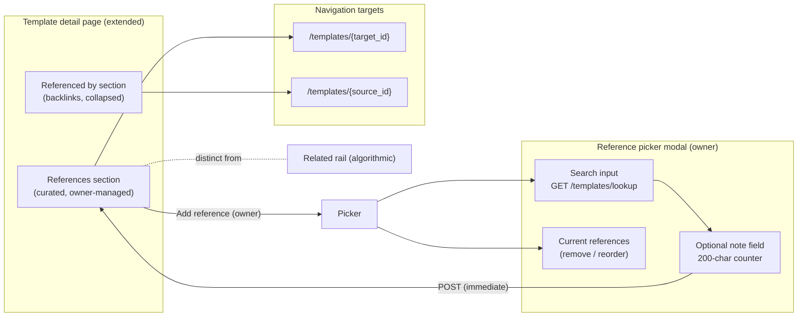
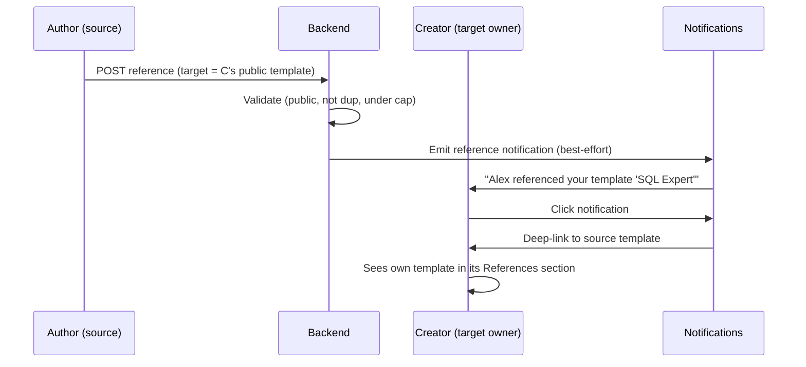

# Template Linking & References — UI/UX Design

- **Feature ID:** template-linking-references
- **Version:** 1.0
- **Status:** Proposed (for architecture review)
- **Author:** ui-ux-agent
- **Date:** 2026-10-12
- **Related docs:** [Requirements](./template-linking-references-requirements.md) · [中文 UI/UX 设计](./template-linking-references-ui-ux-design-zh-CN.md)

## 1. Design Principles

1. **Author intent is the product.** The section is visibly curated ("picked by the author") — distinct styling from the algorithmic rail, notes rendered as first-class content.
2. **Seconds to curate.** Search → click → optional note → done. The picker never blocks on a full form; every action persists immediately.
3. **Dead ends are bugs.** Every reference card navigates; deleted targets vanish cleanly; backlinks close the discovery loop.
4. **Privacy is invisible.** Others' private templates are indistinguishable from nonexistent ones — the picker simply doesn't offer them.
5. **Ten is plenty.** The cap keeps the section curated; the UI enforces it gracefully (disabled Add, clear message) before the server has to.

## 2. Information Architecture



## 3. User Flows

### 3.1 Author curates references

```mermaid
sequenceDiagram
    participant A as Author (owner)
    participant TD as Template detail
    participant PK as Picker modal
    participant BE as Backend
    A->>TD: Open own template
    A->>TD: Click "Add reference"
    TD->>PK: Open picker (current list on top)
    A->>PK: Type "sql" (debounced 300ms)
    PK->>BE: GET /templates/lookup?q=sql&exclude_id=self
    BE-->>PK: 8 results (title, owner, stats)
    A->>PK: Click "Add" on a result
    PK->>A: Inline note field appears
    A->>PK: Type "Companion user prompt" (optional)
    A->>PK: Confirm
    PK->>BE: POST /templates/{id}/references
    BE-->>PK: 201 (reference + target summary)
    PK->>PK: Row moves to current list; Add disabled at 10
    A->>PK: Reorder with ↑/↓ (PATCH order)
    A->>PK: "Done"
    PK-->>TD: Section re-renders with new card
```

### 3.2 Viewer traverses references

```mermaid
sequenceDiagram
    participant V as Viewer
    participant TD as Template detail
    participant TGT as Target template page
    V->>TD: Open template with 3 references
    TD->>V: References section: 3 cards with notes
    V->>TD: Click card "SQL Expert — companion user prompt"
    TD->>TGT: Navigate /templates/{target_id}
    Note over V: Back button returns; no dead ends
```

### 3.3 Creator discovers a citation



### 3.4 Removal and cleanup

```mermaid
sequenceDiagram
    participant A as Owner
    participant TD as Detail page
    participant BE as Backend
    A->>TD: Hover reference card → × appears
    A->>TD: Click ×
    TD->>BE: DELETE /references/{referenceId}
    BE-->>TD: 200
    TD->>TD: Card removed; positions renumbered 0..n-1
    Note over TD: No confirmation needed (non-destructive,<br/>re-addable in seconds)
```

## 4. Page Layouts (Wireframes)

### 4.1 References section (viewer, 2 references)

```
┌──────────────────────────────────────────────────────────────┐
│  References                                    2 linked      │
│  ────────────────────────────────────────────────────────────│
│  ┌────────────────────────────────────────────────────────┐ │
│  │ SQL Expert — User Prompt              Alex Chen        │ │
│  │ "Companion user prompt for this system prompt"          │ │
│  │ ♥ 128  ⑂ 42                                            │ │
│  └────────────────────────────────────────────────────────┘ │
│  ┌────────────────────────────────────────────────────────┐ │
│  │ SQL Expert — Streaming Variant         Alex Chen        │ │
│  │ ♥ 64  ⑂ 12                                              │ │
│  └────────────────────────────────────────────────────────┘ │
│                                                              │
│  ⓘ Curated by the author                                    │
└──────────────────────────────────────────────────────────────┘
```

### 4.2 References section (owner, with manage controls)

```
┌──────────────────────────────────────────────────────────────┐
│  References                                    2 / 10        │
│  ────────────────────────────────────────────────────────────│
│  ┌────────────────────────────────────────────────────────┐ │
│  │ ↑ ↓  SQL Expert — User Prompt          Alex Chen   ×   │ │
│  │      "Companion user prompt…"          ♥ 128  ⑂ 42      │ │
│  └────────────────────────────────────────────────────────┘ │
│  ┌────────────────────────────────────────────────────────┐ │
│  │ ↑ ↓  SQL Expert — Streaming Variant    Alex Chen   ×   │ │
│  │      ♥ 64  ⑂ 12                                         │ │
│  └────────────────────────────────────────────────────────┘ │
│                                                              │
│  [ + Add reference ]                                         │
└──────────────────────────────────────────────────────────────┘
  Empty state (owner): "No references yet — link related
  templates so users can find companion pieces." + Add button
```

### 4.3 Referenced by section (collapsed, count shown)

```
┌──────────────────────────────────────────────────────────────┐
│  ▸ Referenced by                                    3        │
└──────────────────────────────────────────────────────────────┘
  Expanded:
┌──────────────────────────────────────────────────────────────┐
│  ▾ Referenced by                                    3        │
│  ────────────────────────────────────────────────────────────│
│  • Prompt Chaining Starter Kit (Sam) — "uses this as step 1" │
│  • SQL Coach System Prompt (Alex)                            │
│  • Data Analysis Bundle (Kim) — "pairs well"                 │
└──────────────────────────────────────────────────────────────┘
```

### 4.4 Reference picker modal

```
┌──────────────────────────────────────────────────────────────┐
│  Add reference                                          [×]  │
│  ────────────────────────────────────────────────────────────│
│  Current references (2/10)                                  │
│  1. SQL Expert — User Prompt                        [×]     │
│  2. SQL Expert — Streaming Variant                  [×]     │
│  ────────────────────────────────────────────────────────────│
│  ┌──────────────────────────────────────────────────────┐   │
│  │ 🔍 Search templates by title…                        │   │
│  └──────────────────────────────────────────────────────┘   │
│                                                              │
│  Results for "sql":                                         │
│  ┌──────────────────────────────────────────────────────┐   │
│  │ SQL Expert Prompt          Alex Chen    ♥ 128  [Add] │   │
│  │ SQL Coach System           Sam Wu       ♥ 96   [Add] │   │
│  │ My private SQL draft       You  [私有]   ♥ 3    [Add] │   │
│  │ …                                                     │   │
│  └──────────────────────────────────────────────────────┘   │
│                                                              │
│  Adding "SQL Coach System":                                  │
│  ┌──────────────────────────────────────────────────────┐   │
│  │ Note (optional)                                      │   │
│  │ ┌──────────────────────────────────────────────────┐ │   │
│  │ │ Pairs well for coaching workflows                │ │   │
│  │ └──────────────────────────────────────────────────┘ │   │
│  │ 28 / 200                          [Cancel] [Add]     │   │
│  └──────────────────────────────────────────────────────┘   │
│                                                              │
│  ⚠ Limit reached at 10 — remove one to add another.         │
│                                              [ Done ]        │
└──────────────────────────────────────────────────────────────┘
```

## 5. Component Specifications

| Component | Based on | Props / Behavior |
|---|---|---|
| `TemplateReferencesSection` | new (detail page section) | `{templateId, isOwner}`; fetches `GET /references`; renders ordered `ReferenceCard`s; owner controls (reorder ↑/↓, remove ×, Add button); empty state for owner; hidden for non-owners when empty; "Curated by the author" footnote. |
| `ReferenceCard` | PromptCard-derived compact row | `{reference, isOwner}`; title (link), owner display name, note (muted, optional), like/fork counts; owner hover reveals ↑/↓/× controls; keyboard equivalents always available. |
| `ReferencedBySection` | new (collapsed disclosure) | `{templateId}`; fetches `GET /references/inbound`; `<button aria-expanded>` header with count; expanded list of source links + notes; hidden when empty. |
| `ReferencePickerModal` | TemplateAliasManager pattern | `{templateId, current, onAdded, onRemoved, onReordered}`; debounced search (300 ms, min 1 char) → `/templates/lookup`; result rows with Add; inline note field with 200-char counter; immediate POST per add; current list with remove; limit message at 10; Done closes. |
| `ReferenceNoteInput` | ChangeNoteInput-derived | `{value, onChange, maxLength=200}`; live counter; no required validation (optional by design). |
| `ReferenceNotification` | engagement notification item | Type `reference`; text "«actor» referenced your template «title»"; deep-link to source template. |

## 6. Interaction Details

1. **Section visibility:** non-owners see References only when ≥ 1 exists (no empty sections for viewers); owners always see it with the empty state + Add button.
2. **Picker search:** debounce 300 ms; min 1 char; empty query shows nothing (not the full catalog); Enter selects the first result; results capped at 10 with "refine your search" hint when more exist.
3. **Add flow:** click Add → inline note field expands under the row → Confirm POSTs immediately → row animates into "Current references" → search results stay for further adds. No page reload at any point.
4. **Note field:** optional; 200-char live counter; over-limit disables Confirm with inline message; Enter confirms, Escape cancels back to the result row.
5. **Reorder:** ↑/↓ buttons swap adjacent positions and PATCH the full order; buttons disable at list edges; drag-and-drop is out of scope (arrows are keyboard- and touch-friendly).
6. **Remove:** × deletes immediately (no confirm dialog — re-adding takes seconds); card animates out; positions renumber.
7. **Limit enforcement:** at 10 references the picker disables all Add buttons and shows the limit message; server 400 is the backstop and surfaces the same message inline.
8. **Duplicate handling:** adding an already-referenced template → 409 surfaces as "Already referenced" inline on the row; the row's Add button becomes a checkmark.
9. **Backlinks disclosure:** collapsed by default showing only the count; expanding is instant (data fetched with the section); collapsing persists per session.
10. **Notification click:** navigates to the source template and scrolls to its References section (URL hash `#references`).

## 7. States Summary

| State | Trigger | UI |
|---|---|---|
| References loaded | detail page load | Ordered cards (viewer) / cards + controls (owner) |
| References empty (owner) | 0 references | Empty state + Add button |
| References empty (viewer) | 0 references | Section hidden |
| Picker searching | typing (debounced) | Spinner in results area |
| Picker no results | 0 matches | "No templates found for 'x'" |
| Picker min chars | empty query | "Type to search" hint |
| Adding | Confirm click | Button spinner → row moves to current list |
| Duplicate | 409 | "Already referenced" inline on row |
| Limit reached | 10 refs / 400 | Add disabled + limit message |
| Note over limit | >200 chars | Counter red, Confirm disabled |
| Reorder saved | PATCH 200 | Positions update silently |
| Removed | DELETE 200 | Card animates out |
| Backlinks empty | 0 inbound | Section hidden |
| Backlinks loaded | ≥1 inbound | Collapsed disclosure with count |
| Load error | network/5xx | Section error state + retry |

## 8. i18n String Table

Namespace: `references` (new).

| Key / EN | ZH |
|---|---|
| `references.section_title` / References | 引用 |
| `references.linked_count` / {{count}} linked | 已链接 {{count}} 条 |
| `references.curated_by` / Curated by the author | 由作者精选 |
| `references.empty_owner` / No references yet — link related templates so users can find companion pieces. | 暂无引用 —— 链接相关模板，让用户找到配套作品。 |
| `references.add` / Add reference | 添加引用 |
| `references.remove` / Remove reference | 删除引用 |
| `references.move_up` / Move up | 上移 |
| `references.move_down` / Move down | 下移 |
| `references.count_of_limit` / {{count}} / {{limit}} | {{count}} / {{limit}} |
| `references.picker_title` / Add reference | 添加引用 |
| `references.picker_search_placeholder` / Search templates by title… | 按标题搜索模板… |
| `references.picker_current` / Current references ({{count}}/{{limit}}) | 当前引用（{{count}}/{{limit}}） |
| `references.picker_results` / Results for "{{query}}" | "{{query}}" 的结果 |
| `references.picker_type_to_search` / Type to search | 输入以搜索 |
| `references.picker_no_results` / No templates found for "{{query}}" | 未找到 "{{query}}" 的模板 |
| `references.picker_refine` / Refine your search to see more | 优化搜索以查看更多 |
| `references.note_label` / Note (optional) | 注释（可选） |
| `references.note_counter` / {{count}} / {{max}} | {{count}} / {{max}} |
| `references.note_too_long` / Note must be 200 characters or fewer | 注释不能超过 200 字符 |
| `references.confirm_add` / Add | 添加 |
| `references.done` / Done | 完成 |
| `references.limit_reached` / Limit reached at {{limit}} — remove one to add another. | 已达上限 {{limit}} 条 —— 删除一条后再添加。 |
| `references.already_referenced` / Already referenced | 已引用 |
| `references.referenced_by` / Referenced by | 被引用 |
| `references.error_load` / Couldn't load references | 无法加载引用 |
| `references.error_add` / Couldn't add reference | 无法添加引用 |
| `references.retry` / Retry | 重试 |
| `references.private_badge` / Private | 私有 |
| `references.notification_reference` / {{actor}} referenced your template "{{title}}" | {{actor}} 引用了你的模板"{{title}}" |

## 9. Accessibility Notes

- The references list is a `<ul>` of links; each card's title is the link (discernible name = title + owner).
- Owner controls (↑/↓/×) are real buttons with `aria-label`s (Move up / Move down / Remove reference); they are keyboard-reachable, not hover-only (hover merely reveals them visually).
- The picker's search input is a labeled combobox: `role="combobox"` with `aria-expanded`, `aria-controls` on the results list; results are `option`s announced on focus; Enter adds the focused result.
- The note field has a visible label, live counter (`aria-describedby`), and error text tied via `aria-invalid`.
- "Referenced by" is a disclosure button with `aria-expanded` and `aria-controls`; the count is inside the button's accessible name ("Referenced by, 3").
- Focus management: picker traps focus, Escape closes, focus returns to "Add reference"; removed cards move focus to the next card's controls.
- Cards never rely on color alone: private badge has text; notes are visually distinct via typography, not just color.

## 10. Responsive Behavior

- **Desktop (≥1024px):** reference cards full-width rows; picker modal 560px centered; owner controls revealed on row hover.
- **Tablet (768–1023px):** identical layout; picker 90% width; controls always visible (no hover on touch).
- **Mobile (<768px):** cards single column; stats wrap under the title; picker becomes a full-screen sheet with sticky search on top and Done at the bottom; ↑/↓/× controls always visible as a compact icon row; backlinks list single column.
- The "Curated by the author" footnote wraps below the cards on narrow screens.

## 11. Analytics Events (optional, if analytics ships)

- `references_section_viewed` `{count}`
- `reference_added` `{has_note}`
- `reference_removed` / `references_reordered`
- `reference_card_clicked` `{position}`
- `backlinks_expanded` `{count}`
- `reference_notification_clicked`

## 12. Out of Scope (UI)

- Drag-and-drop reordering (arrows only).
- Reference type badges ("supersedes", "variant").
- Bulk add/remove.
- Click-through analytics surfaces.
- Algorithmic suggestions in the picker.
- Editing notes in place (remove + re-add).
