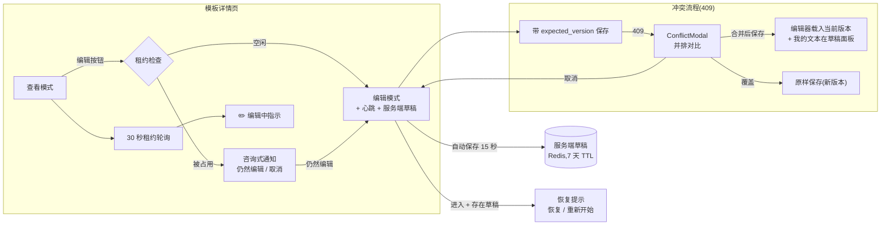
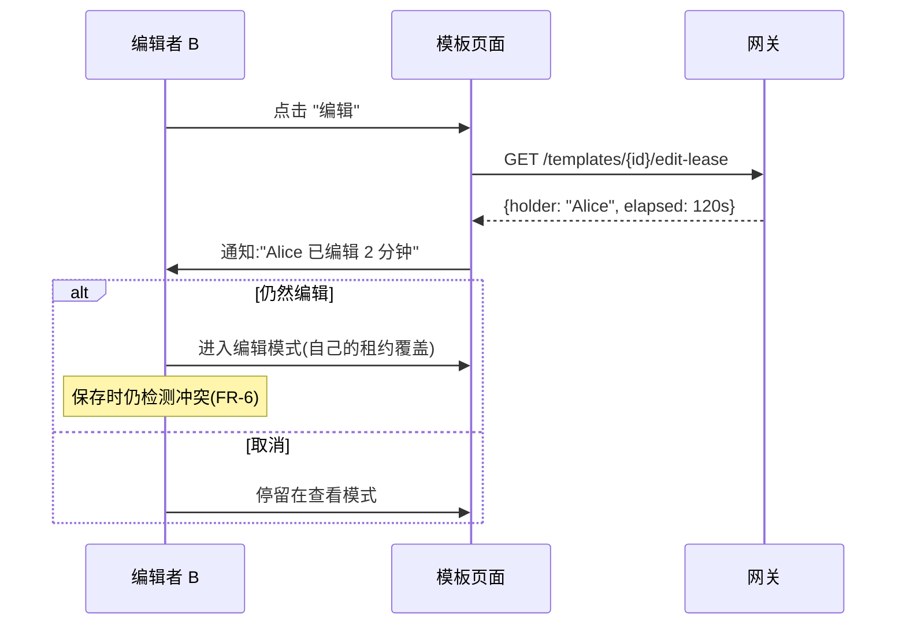
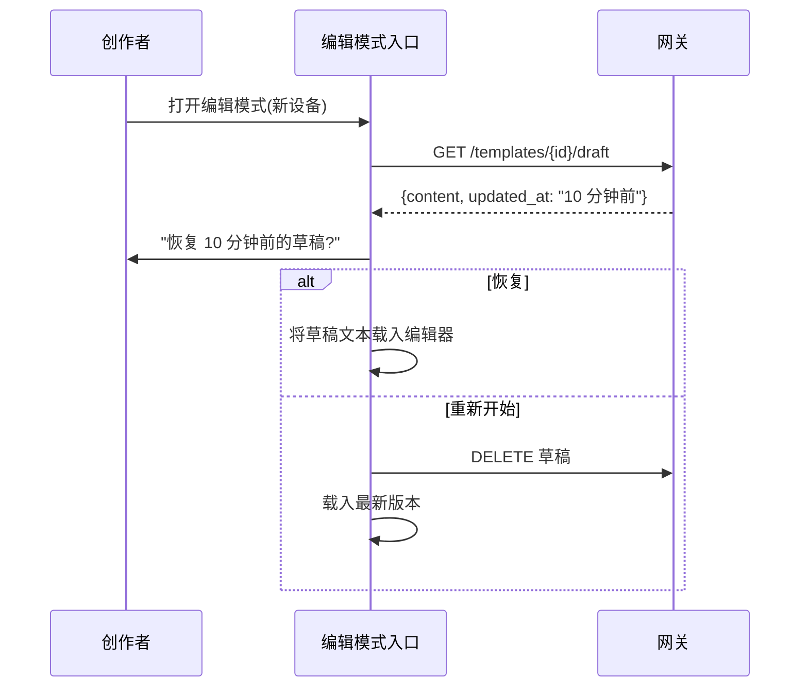

# 模板锁与草稿(并发编辑保护)— UI/UX 设计

- **功能 ID:** template-locks-drafts
- **版本:** 1.0
- **状态:** 已提议(待架构评审)
- **作者:** ui-ux-agent
- **日期:** 2026-10-12
- **相关需求文档:** [template-locks-drafts-requirements-zh-CN.md](./template-locks-drafts-requirements-zh-CN.md)

## 1. 设计原则

1. **正确性在无关紧要时不可见。** 冲突检查是静默管道;只有当它把用户的工作从丢失中拯救出来时才被看到。
2. **Presence 是低语,不是高墙。** 租约通知和 "正在编辑" 指示微妙、非阻塞、且总有出路("仍然编辑")。
3. **绝不丢失任何一方。** 冲突中,双方文本保持可见和可恢复,直到用户显式解决。
4. **草稿是环境性的。** 自动保存状态是一行安静的状态栏;恢复提示只在有值得恢复的内容时出现。
5. **静默降级。** Redis 宕机时,编辑体验与今天完全相同 —— 无错误、无缺功能抱怨。

## 2. 信息架构



## 3. 用户流程

### 3.1 第二个编辑者遇到活跃租约



### 3.2 保存冲突(核心流程)

```mermaid
sequenceDiagram
    participant A as 编辑者(标签页 B)
    participant E as 编辑器 UI
    participant API as 网关
    A->>E: 编辑文本(加载于 v7),点击保存
    E->>API: UpdateTemplate(content, expected_version=7)
    Note over API: 最新已是 v8(他人先保存)
    API-->>E: 409 + 当前版本信息
    E->>E: 获取 v8 内容
    E->>A: ConflictModal:我的编辑(左)vs 当前 v8(右)
    alt 合并后保存
        E->>A: 编辑器载入 v8;我的文本保留在草稿面板
        A->>E: 手工合并,保存(expected_version=8)
        API-->>E: 200 → 创建 v9
    else 覆盖
        E->>API: 保存我的文本(expected_version=8)
        API-->>E: 200 → v9(主动覆盖)
    else 取消
        E->>A: 返回编辑;草稿完好
    end
```

### 3.3 跨设备草稿恢复



## 4. 页面布局(线框图)

### 4.1 咨询式通知(第二个编辑者)

```
┌────────────────────────────────────────────────────────────┐
│ ⚠  Alice 已编辑此模板 2 分钟。                              │
│    你可以等对方完成,或仍然编辑 ——                           │
│    如果你们都保存,我们会帮你合并。                          │
│                                                            │
│                    [ 仍然编辑 ]   [ 取消 ]                 │
└────────────────────────────────────────────────────────────┘
```

### 4.2 "正在编辑" 指示(查看模式,所有查看者)

```
┌────────────────────────────────────────────────────────────┐
│ 代码审查助手                                 [编辑] [Fork]… │
│ ✏️ Alice 正在编辑 · 刚刚                                   │
│ …模板页面其余部分…                                         │
└────────────────────────────────────────────────────────────┘
```

### 4.3 冲突弹窗(并排)

```
┌────────────────────────────────────────────────────────────────────┐
│  ⚠ 你的更改与较新版本冲突                            [×]        │
├────────────────────────────────────────────────────────────────────┤
│  此模板在你编辑期间被更新(v7 → v8)。两个版本都保留在下方。        │
│                                                                    │
│  ┌─ 我的编辑 ───────────────┐  ┌─ 当前(v8)──────────────┐    │
│  │ 你是一位资深代码审查…    │  │ 你是一位资深代码审查…    │    │
│  │ 给定以下代码,检查:      │  │ 给定以下代码,检查 bug 和 │    │
│  │ - bug                    │  │ 安全问题。重点关注        │    │
│  │ - 性能                   │  │ 注入风险。                │    │
│  │                          │  │                          │    │
│  │ (你的未保存文本)         │  │ (由 Alice 保存,2 分钟前) │    │
│  └──────────────────────────┘  └──────────────────────────┘    │
│                                                                    │
│  [ 复制我的文本 ]  [ 将当前版本载入编辑器 ]                       │
├────────────────────────────────────────────────────────────────────┤
│      [ 取消 ]  [ 用我的覆盖 ]  [ 合并后保存 ]                    │
└────────────────────────────────────────────────────────────────────┘
```

### 4.4 带草稿状态 + 草稿面板的编辑器(合并模式)

```
┌────────────────────────────────────────────────────────────┐
│ 编辑中 · v8                              草稿已保存 · 12:04 │
├────────────────────────────────────────────────────────────┤
│ ┌─ 编辑器(已载入当前 v8)────────────────────────────┐   │
│ │ 你是一位资深代码审查员。给定以下代码,                │   │
│ │ 检查 bug 和安全问题…                                 │   │
│ └───────────────────────────────────────────────────────┘   │
│                                                            │
│ ┌─ 我之前的文本(草稿面板,已折叠)───────────── [▸] ──┐   │
│ │  解决期间可用于复制合并                                │   │
│ └───────────────────────────────────────────────────────┘   │
│                                                            │
│                          [ 取消 ]  [ 保存为 v9 ]            │
└────────────────────────────────────────────────────────────┘
```

### 4.5 草稿恢复提示

```
┌────────────────────────────────────────────────────────────┐
│  恢复你的草稿?                                   [×]      │
├────────────────────────────────────────────────────────────┤
│  你有一份 10 分钟前的未保存草稿,                            │
│  与最新版本不同。                                           │
│                                                            │
│                     [ 重新开始 ]  [ 恢复草稿 ]             │
└────────────────────────────────────────────────────────────┘
```

## 5. 组件规格

### 5.1 `useEditLease` hook(frontend/src/hooks/useEditLease.js)

```js
const { leaseInfo, acquire, release, startHeartbeat } = useEditLease(templateId);
// acquire():POST 租约(被占用时覆盖 —— 咨询式)
// startHeartbeat():20 秒间隔续期;保存/取消/卸载时停止
// release():保存/取消/卸载时尽力 DEL
// leaseInfo:{holder, elapsed} | null —— 用于咨询式通知
```

失败开放:所有错误吞掉(仅 console.warn);UI 视租约为不存在。

### 5.2 `useServerDraft` hook(frontend/src/hooks/useServerDraft.js)

```js
const { draft, saveDraft, deleteDraft, lastSavedAt } = useServerDraft(templateId);
// saveDraft(content, metadata):脏状态时 15 秒防抖(FR-8)
// draft:{content, updated_at} | null —— 编辑模式入口时检查(FR-9)
```

### 5.3 `ConflictModal`(frontend/src/components/locks/ConflictModal.js)

| Prop | 类型 | 说明 |
|---|---|---|
| `open` | bool | — |
| `myContent` | string | 用户的未保存文本 |
| `currentVersion` | object | 来自 409 的 `{number, content, savedBy, savedAt}` |
| `onMerge` | func | 将当前版本载入编辑器;我的文本保留在草稿面板 |
| `onOverwrite` | func | 以当前 expected_version 保存我的文本 |
| `onCancel` | func | 返回编辑 |

并排窗格以 "双版本" 模式复用版本 diff 渲染器(版本化功能);"复制我的文本" 使用嵌入弹窗的剪贴板模式;弹窗遵循标准无障碍契约(焦点陷阱、Escape = 取消)。

### 5.4 `LeaseNotice`(frontend/src/components/locks/LeaseNotice.js)

编辑模式入口存在租约时显示的内联横幅(非弹窗);两个操作;绝不自动消失(必须显式选择);持有者是同一用户(另一标签页)时文案为 "你在另一个标签页打开了此模板"。

### 5.5 `EditingIndicator`(frontend/src/components/locks/EditingIndicator.js)

查看模式下模板标题下的小内联行;每 30 秒轮询;渲染 "✏️ {name} 正在编辑 · {相对时间}";`aria-live="polite"`;无租约时完全隐藏(无布局偏移 —— 仅在可见时占高)。

### 5.6 `DraftResumePrompt`(frontend/src/components/locks/DraftResumePrompt.js)

编辑模式入口存在服务端草稿且与之不同时的小弹窗;恢复 / 重新开始;与 advanced-editor 的 localStorage 提示组合(服务端草稿更新时优先 —— 先检查)。

### 5.7 编辑器集成(TemplateDetails 编辑模式)

保存处理器发送 `expected_version`(编辑模式开始时加载的版本);409 → 获取当前版本 → 打开 `ConflictModal`;成功 → 释放租约、删除草稿、退出编辑模式(现有流程)。"草稿已保存 · {time}" 状态行取代 localStorage 自动保存指示(localStorage 按 FR-13 保留为离线回退)。

## 5a. 通知偏好交互

无 —— 无新通知类型。Presence 是拉取式(轮询),非推送。

## 6. 交互细节

1. **租约获取时机:** 编辑模式入口(编辑器渲染前),以便通知在任何输入前出现。
2. **心跳生命周期:** 随编辑模式开始;保存/取消/卸载时停止;页面隐藏(标签页后台)时心跳继续(setInterval 继续)—— 60 秒 TTL 仅在标签页关闭/崩溃时过期。
3. **冲突弹窗 diff:** 两个窗格均为只读;选择合并后才编辑(编辑器载入当前文本)—— 弹窗绝不承载编辑器。
4. **"复制我的文本"** 将用户完整未保存文本复制到剪贴板(带提示),以便手工合并期间粘贴到任何地方。
5. **覆盖是主动行为:** 按钮样式为次要危险操作并带明确标签("用我的覆盖");无键入确认(并排对比已让风险可见)。
6. **草稿面板**(合并模式)可折叠、等宽、只读、带复制按钮;用户保存或取消后消失。
7. **相对时间**("刚刚"、"2 分钟前")使用现有 time-ago 辅助函数;已本地化。
8. **限流反馈:** 心跳/草稿保存的 429 静默(下个周期重试);租约读取的 429 隐藏指示直到下次轮询。
9. **beforeunload 守卫**(来自 advanced-editor)在脏状态时仍然生效;二者组合(服务端草稿 + 守卫同时激活)。

## 7. 状态汇总

| 表面 | 加载 | 空态 | 错误 | 成功 |
|---|---|---|---|---|
| LeaseNotice | — | 无租约 → 无通知 | Redis 宕机 → 无通知(失败开放) | 做出选择 → 继续/取消 |
| EditingIndicator | — | 无租约 → 隐藏 | 轮询错误 → 隐藏 | 显示持有者 + 时间 |
| ConflictModal | 获取当前版本 → 窗格骨架 | — | 获取失败 → 弹窗内重试行 | 执行解决 |
| DraftResumePrompt | — | 无草稿 → 无提示 | 获取失败 → 无提示(失败开放) | 选择恢复/重新开始 |
| 草稿状态行 | 保存中… | 从未脏 → 隐藏 | 保存失败 → "已本地保存" 回退文案 | "草稿已保存 · 12:04" |

## 8. 国际化字符串表

命名空间:`locks.*`。键添加到 `frontend/src/locales/{en,zh}/translation.json`。

| 键 / 中文文案 | 英文 |
|---|---|
| `locks.noticeTitle` / "{{name}} 已编辑此模板 {{duration}}" | "{{name}} has been editing this template for {{duration}}" |
| `locks.noticeBody` / "你可以等对方完成,或仍然编辑 —— 如果你们都保存,我们会帮你合并。" | "You can wait for them to finish, or edit anyway — if you both save, we'll help you merge." |
| `locks.noticeSelf` / "你在另一个标签页打开了此模板" | "You have this template open in another tab" |
| `locks.editAnyway` / "仍然编辑" | "Edit anyway" |
| `locks.cancelEdit` / "取消" | "Cancel" |
| `locks.indicator` / "{{name}} 正在编辑" | "{{name}} is editing" |
| `locks.conflictTitle` / "你的更改与较新版本冲突" | "Your changes conflict with a newer version" |
| `locks.conflictBody` / "此模板在你编辑期间被更新(v{{old}} → v{{new}})。两个版本都保留在下方。" | "This template was updated while you were editing (v{{old}} → v{{new}}). Both versions are preserved below." |
| `locks.myEdits` / "我的编辑" | "My edits" |
| `locks.currentVersion` / "当前(v{{number}})" | "Current (v{{number}})" |
| `locks.savedBy` / "由 {{name}} 保存,{{time}}前" | "saved by {{name}}, {{time}} ago" |
| `locks.copyMyText` / "复制我的文本" | "Copy my text" |
| `locks.loadCurrent` / "将当前版本载入编辑器" | "Load current into editor" |
| `locks.overwrite` / "用我的覆盖" | "Overwrite with mine" |
| `locks.mergeSave` / "合并后保存" | "Merge and save" |
| `locks.draftPanel` / "我之前的文本" | "My previous text" |
| `locks.draftSaved` / "草稿已保存 · {{time}}" | "Draft saved · {{time}}" |
| `locks.draftSaving` / "保存中…" | "Saving…" |
| `locks.draftLocal` / "已本地保存" | "Saved locally" |
| `locks.resumeTitle` / "恢复你的草稿?" | "Resume your draft?" |
| `locks.resumeBody` / "你有一份 {{time}}前的未保存草稿,与最新版本不同。" | "You have an unsaved draft from {{time}} ago that differs from the latest version." |
| `locks.resumeDraft` / "恢复草稿" | "Resume draft" |
| `locks.startFresh` / "重新开始" | "Start fresh" |
| `locks.justNow` / "刚刚" | "just now" |
| `locks.minutesAgo` / "{{count}} 分钟前" | "{{count}}m ago" |

## 9. 无障碍说明

1. `LeaseNotice` 是带显式操作的 `role="alertdialog"` 式横幅;出现时焦点移到横幅;Escape = 取消。
2. `EditingIndicator` 出现在 `aria-live="polite"` 区域内;铅笔图标是装饰性的(`aria-hidden`),文本承载含义。
3. `ConflictModal` 遵循标准弹窗契约:焦点陷阱、Escape = 取消、初始焦点在 "合并后保存"(最安全的操作);两个窗格是带标签的区域(`aria-label` = 我的编辑 / 当前)。
4. diff 窗格是带 `tabindex=0` 的可滚动区域且可键盘滚动;文本是真实文本(可选择、屏幕阅读器可读),不是图片。
5. 草稿状态行是 `aria-live="polite"` 但有节流(自动保存期间最多每分钟播报一次,避免嘈杂)。
6. 所有按钮有可见焦点环;危险操作("用我的覆盖")额外通过 `aria-describedby` 关联冲突正文。
7. 颜色绝不是唯一信号:冲突状态使用图标 + 文本,而非仅红色边框。

## 10. 响应式行为

1. **冲突弹窗并排**在 720px 以下垂直堆叠(我的编辑在上,当前在下)—— 两个窗格保持完全可读;操作行固定在底部。
2. **LeaseNotice / EditingIndicator** 是全宽行;文本自然换行。
3. **草稿面板**在移动端默认折叠(手风琴)以节省纵向空间。
4. **草稿状态行**与版本标签同行;窄屏时降到编辑器上方自己的行。
5. **DraftResumePrompt** 遵循标准低于 480px 全屏面板的弹窗模式。

## 11. 分析事件(可选,若分析已上线)

- `edit_lease_conflict_shown` {template_id, holder_self: bool}
- `edit_conflict_detected` {template_id, old_version, new_version}
- `edit_conflict_resolution` {template_id, resolution: merge|overwrite|cancel}
- `draft_resumed` {template_id, age_minutes}

## 12. 不在范围内(UI)

- 实时 presence 列表(带光标的多个同时编辑者)、三方合并编辑器、元数据并排冲突解决(v1 复用同一弹窗并列出元数据字段)、管理端租约管理 UI、草稿历史浏览器。
