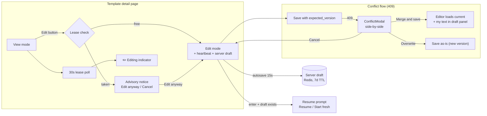
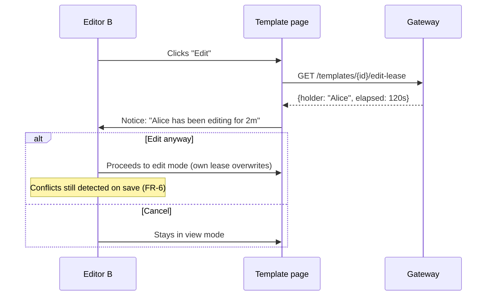
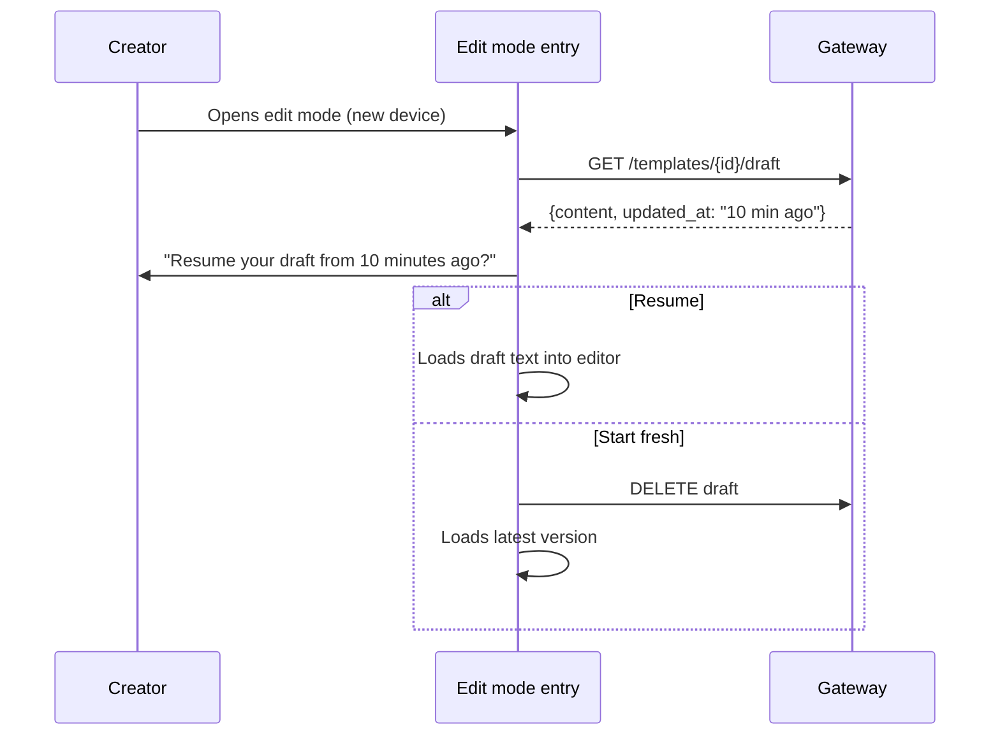

# Template Locks & Drafts (Concurrent Edit Protection) — UI/UX Design

- **Feature ID:** template-locks-drafts
- **Version:** 1.0
- **Status:** Proposed (for architecture review)
- **Author:** ui-ux-agent
- **Date:** 2026-10-12
- **Related requirements:** [template-locks-drafts-requirements.md](./template-locks-drafts-requirements.md)

## 1. Design Principles

1. **Correctness is invisible until it matters.** The conflict check is silent plumbing; users only see it when it saves their work from being lost.
2. **Presence is a whisper, not a wall.** The lease notice and "being edited" indicator are subtle, non-blocking, and always escapable ("Edit anyway").
3. **Never lose either side.** In a conflict, both texts remain visible and recoverable until the user explicitly resolves.
4. **Drafts are ambient.** Autosave status is a quiet status line; resume prompts appear only when there's something meaningful to resume.
5. **Degrade silently.** If Redis is down, the editing experience is exactly today's — no errors, no missing-feature complaints.

## 2. Information Architecture



## 3. User Flows

### 3.1 Second editor meets an active lease



### 3.2 Save conflict (the core flow)

```mermaid
sequenceDiagram
    participant A as Editor (tab B)
    participant E as Editor UI
    participant API as Gateway
    A->>E: Edits text (loaded at v7), clicks Save
    E->>API: UpdateTemplate(content, expected_version=7)
    Note over API: Latest is now v8 (someone saved first)
    API-->>E: 409 + current version info
    E->>E: Fetches v8 content
    E->>A: ConflictModal: My edits (left) vs Current v8 (right)
    alt Merge and save
        E->>A: Editor loads v8; my text kept in draft panel
        A->>E: Merges manually, saves (expected_version=8)
        API-->>E: 200 → v9 created
    else Overwrite
        E->>API: Save my text (expected_version=8)
        API-->>E: 200 → v9 (deliberate overwrite)
    else Cancel
        E->>A: Back to editing; draft intact
    end
```

### 3.3 Draft resume across devices



## 4. Page Layouts (Wireframes)

### 4.1 Advisory notice (second editor)

```
┌────────────────────────────────────────────────────────────┐
│ ⚠  Alice has been editing this template for 2 minutes.     │
│    You can wait for them to finish, or edit anyway —       │
│    if you both save, we'll help you merge.                 │
│                                                            │
│                    [ Edit anyway ]   [ Cancel ]            │
└────────────────────────────────────────────────────────────┘
```

### 4.2 "Being edited" indicator (view mode, all viewers)

```
┌────────────────────────────────────────────────────────────┐
│ Code Review Buddy                          [Edit] [Fork]…  │
│ ✏️ Alice is editing · just now                             │
│ …rest of template page…                                    │
└────────────────────────────────────────────────────────────┘
```

### 4.3 Conflict modal (side-by-side)

```
┌────────────────────────────────────────────────────────────────────┐
│  ⚠ Your changes conflict with a newer version              [×]     │
├────────────────────────────────────────────────────────────────────┤
│  This template was updated while you were editing (v7 → v8).       │
│  Both versions are preserved below.                                │
│                                                                    │
│  ┌─ My edits ────────────────┐  ┌─ Current (v8) ─────────────┐   │
│  │ You are a senior code     │  │ You are a senior code      │   │
│  │ reviewer. Given the       │  │ reviewer. Given the code   │   │
│  │ code below, check for:    │  │ below, check for bugs and  │   │
│  │ - bugs                    │  │ SECURITY issues. Focus on  │   │
│  │ - performance             │  │ injection risks.           │   │
│  │                           │  │                            │   │
│  │ (your unsaved text)       │  │ (saved by Alice, 2m ago)   │   │
│  └───────────────────────────┘  └────────────────────────────┘   │
│                                                                    │
│  [ Copy my text ]  [ Load current into editor ]                   │
├────────────────────────────────────────────────────────────────────┤
│      [ Cancel ]  [ Overwrite with mine ]  [ Merge and save ]      │
└────────────────────────────────────────────────────────────────────┘
```

### 4.4 Editor with draft status + draft panel (merge mode)

```
┌────────────────────────────────────────────────────────────┐
│ Editing · v8                          Draft saved · 12:04  │
├────────────────────────────────────────────────────────────┤
│ ┌─ Editor (current v8 loaded) ──────────────────────────┐ │
│ │ You are a senior code reviewer. Given the code below, │ │
│ │ check for bugs and SECURITY issues…                   │ │
│ └───────────────────────────────────────────────────────┘ │
│                                                            │
│ ┌─ My previous text (draft panel, collapsed) ────── [▸] ┐ │
│ │  available for copy-merge while resolving             │ │
│ └───────────────────────────────────────────────────────┘ │
│                                                            │
│                          [ Cancel ]  [ Save as v9 ]        │
└────────────────────────────────────────────────────────────┘
```

### 4.5 Draft resume prompt

```
┌────────────────────────────────────────────────────────────┐
│  Resume your draft?                               [×]      │
├────────────────────────────────────────────────────────────┤
│  You have an unsaved draft from 10 minutes ago that        │
│  differs from the latest version.                          │
│                                                            │
│                     [ Start fresh ]  [ Resume draft ]      │
└────────────────────────────────────────────────────────────┘
```

## 5. Component Specifications

### 5.1 `useEditLease` hook (frontend/src/hooks/useEditLease.js)

```js
const { leaseInfo, acquire, release, startHeartbeat } = useEditLease(templateId);
// acquire(): POST lease (overwrites if taken — advisory)
// startHeartbeat(): 20s interval renew; stops on unmount/save/cancel
// release(): best-effort DEL on save/cancel/unmount
// leaseInfo: {holder, elapsed} | null — for the advisory notice
```

Fail-open: all errors swallowed (console.warn only); UI treats lease as absent.

### 5.2 `useServerDraft` hook (frontend/src/hooks/useServerDraft.js)

```js
const { draft, saveDraft, deleteDraft, lastSavedAt } = useServerDraft(templateId);
// saveDraft(content, metadata): debounced 15s when dirty (FR-8)
// draft: {content, updated_at} | null — checked on edit-mode entry (FR-9)
```

### 5.3 `ConflictModal` (frontend/src/components/locks/ConflictModal.js)

| Prop | Type | Notes |
|---|---|---|
| `open` | bool | — |
| `myContent` | string | The user's unsaved text |
| `currentVersion` | object | `{number, content, savedBy, savedAt}` from the 409 |
| `onMerge` | func | Load current into editor; keep my text in draft panel |
| `onOverwrite` | func | Save my text with current expected_version |
| `onCancel` | func | Back to editing |

Side-by-side panes reuse the version-diff renderer (versioning feature) in "two versions" mode; "Copy my text" uses the clipboard pattern from the embed modal; modal follows the standard a11y contract (focus trap, Escape = Cancel).

### 5.4 `LeaseNotice` (frontend/src/components/locks/LeaseNotice.js)

Inline banner (not modal) shown at edit-mode entry when a lease exists; two actions; auto-dismisses never (explicit choice required); if the holder is the same user (another tab), the copy reads "You have this open in another tab".

### 5.5 `EditingIndicator` (frontend/src/components/locks/EditingIndicator.js)

Small inline row under the template title (view mode); polls every 30s; renders "✏️ {name} is editing · {relative time}"; `aria-live="polite"`; hidden entirely when no lease (no layout shift — reserved height only while visible).

### 5.6 `DraftResumePrompt` (frontend/src/components/locks/DraftResumePrompt.js)

Small modal on edit-mode entry when a server draft exists and differs; Resume / Start fresh; composes with the advanced-editor's localStorage prompt (server draft wins when newer — checked first).

### 5.7 Editor integration (TemplateDetails edit mode)

Save handler sends `expected_version` (the version loaded when edit mode started); on 409 → fetch current version → open `ConflictModal`; on success → release lease, delete draft, exit edit mode (existing flow). The "Draft saved · {time}" status line replaces the localStorage autosave indicator (localStorage remains the offline fallback per FR-13).

## 5a. Notification-Preferences Interaction

None — no new notification types. Presence is pull-based (poll), not push.

## 6. Interaction Details

1. **Lease acquisition timing:** on edit-mode entry (before the editor renders), so the notice appears before any typing.
2. **Heartbeat lifecycle:** starts with edit mode; stops on save/cancel/unmount; page-hidden (tab backgrounded) keeps the heartbeat running (setInterval continues) — the 60s TTL only expires when the tab is closed/crashed.
3. **Conflict modal diff:** both panes are read-only; editing happens after choosing Merge (editor loads current text) — the modal never hosts an editor.
4. **"Copy my text"** copies the user's full unsaved text to the clipboard (with toast) so they can paste it anywhere during manual merge.
5. **Overwrite is deliberate:** the button is styled as a secondary danger action with explicit label ("Overwrite with mine"); no typed confirmation (the side-by-side already makes the stakes visible).
6. **Draft panel** (merge mode) is collapsible, monospace, read-only, with a copy button; it disappears once the user saves or cancels.
7. **Relative times** ("just now", "2m ago") use the existing time-ago helper; localized.
8. **Rate-limit feedback:** 429 on heartbeat/draft-save is silent (retry next tick); 429 on lease-read hides the indicator until the next poll.
9. **beforeunload guard** (from advanced-editor) still applies while dirty; it composes (server draft + guard both active).

## 7. States Summary

| Surface | Loading | Empty | Error | Success |
|---|---|---|---|---|
| LeaseNotice | — | No lease → no notice | Redis down → no notice (fail-open) | Choice made → proceed/cancel |
| EditingIndicator | — | No lease → hidden | Poll error → hidden | Shows holder + time |
| ConflictModal | Fetching current version → pane skeleton | — | Fetch fail → retry row in modal | Resolution executes |
| DraftResumePrompt | — | No draft → no prompt | Fetch fail → no prompt (fail-open) | Resume/fresh chosen |
| Draft status line | Saving… | Never dirty → hidden | Save fail → "Saved locally" fallback text | "Draft saved · 12:04" |

## 8. i18n String Table

Namespace: `locks.*`. Keys added to `frontend/src/locales/{en,zh}/translation.json`.

| Key / EN text | ZH |
|---|---|
| `locks.noticeTitle` / "{{name}} has been editing this template for {{duration}}" | "{{name}} 已编辑此模板 {{duration}}" |
| `locks.noticeBody` / "You can wait for them to finish, or edit anyway — if you both save, we'll help you merge." | "你可以等对方完成,或仍然编辑 —— 如果你们都保存,我们会帮你合并。" |
| `locks.noticeSelf` / "You have this template open in another tab" | "你在另一个标签页打开了此模板" |
| `locks.editAnyway` / "Edit anyway" | "仍然编辑" |
| `locks.cancelEdit` / "Cancel" | "取消" |
| `locks.indicator` / "{{name}} is editing" | "{{name}} 正在编辑" |
| `locks.conflictTitle` / "Your changes conflict with a newer version" | "你的更改与较新版本冲突" |
| `locks.conflictBody` / "This template was updated while you were editing (v{{old}} → v{{new}}). Both versions are preserved below." | "此模板在你编辑期间被更新(v{{old}} → v{{new}})。两个版本都保留在下方。" |
| `locks.myEdits` / "My edits" | "我的编辑" |
| `locks.currentVersion` / "Current (v{{number}})" | "当前(v{{number}})" |
| `locks.savedBy` / "saved by {{name}}, {{time}} ago" | "由 {{name}} 保存,{{time}}前" |
| `locks.copyMyText` / "Copy my text" | "复制我的文本" |
| `locks.loadCurrent` / "Load current into editor" | "将当前版本载入编辑器" |
| `locks.overwrite` / "Overwrite with mine" | "用我的覆盖" |
| `locks.mergeSave` / "Merge and save" | "合并后保存" |
| `locks.draftPanel` / "My previous text" | "我之前的文本" |
| `locks.draftSaved` / "Draft saved · {{time}}" | "草稿已保存 · {{time}}" |
| `locks.draftSaving` / "Saving…" | "保存中…" |
| `locks.draftLocal` / "Saved locally" | "已本地保存" |
| `locks.resumeTitle` / "Resume your draft?" | "恢复你的草稿?" |
| `locks.resumeBody` / "You have an unsaved draft from {{time}} ago that differs from the latest version." | "你有一份 {{time}}前的未保存草稿,与最新版本不同。" |
| `locks.resumeDraft` / "Resume draft" | "恢复草稿" |
| `locks.startFresh` / "Start fresh" | "重新开始" |
| `locks.justNow` / "just now" | "刚刚" |
| `locks.minutesAgo` / "{{count}}m ago" | "{{count}} 分钟前" |

## 9. Accessibility Notes

1. `LeaseNotice` is a `role="alertdialog"`-style banner with explicit actions; focus moves to the banner on appearance; Escape = Cancel.
2. `EditingIndicator` appears inside an `aria-live="polite"` region; the pencil icon is decorative (`aria-hidden`) with the text carrying meaning.
3. `ConflictModal` follows the standard modal contract: focus trap, Escape = Cancel, initial focus on "Merge and save" (the safest action); the two panes are labelled regions (`aria-label` = My edits / Current).
4. The diff panes are scrollable regions with `tabindex=0` and keyboard-scrollable; text is real text (selectable, screen-reader readable), not an image.
5. Draft status line is `aria-live="polite"` but throttled (announces at most once per minute to avoid chatter during autosave).
6. All buttons have visible focus rings; danger action ("Overwrite with mine") is additionally marked `aria-describedby` with the conflict body.
7. Color is never the only signal: the conflict state uses icon + text, not just red borders.

## 10. Responsive Behavior

1. **Conflict modal side-by-side** stacks vertically below 720px (My edits above, Current below) — both panes remain fully readable; the action row stays pinned at the bottom.
2. **LeaseNotice / EditingIndicator** are full-width rows; text wraps naturally.
3. **Draft panel** collapses by default on mobile (accordion) to save vertical space.
4. **Draft status line** sits inline with the version label; on narrow screens it drops to its own row above the editor.
5. **DraftResumePrompt** follows the standard full-screen-sheet-below-480px modal pattern.

## 11. Analytics Events (optional, if analytics shipped)

- `edit_lease_conflict_shown` {template_id, holder_self: bool}
- `edit_conflict_detected` {template_id, old_version, new_version}
- `edit_conflict_resolution` {template_id, resolution: merge|overwrite|cancel}
- `draft_resumed` {template_id, age_minutes}

## 12. Out of Scope (UI)

- Realtime presence list (multiple simultaneous editors with cursors), three-way merge editor, conflict resolution for metadata side-by-side (v1 reuses the same modal with metadata fields listed), admin lease management UI, draft history browser.
