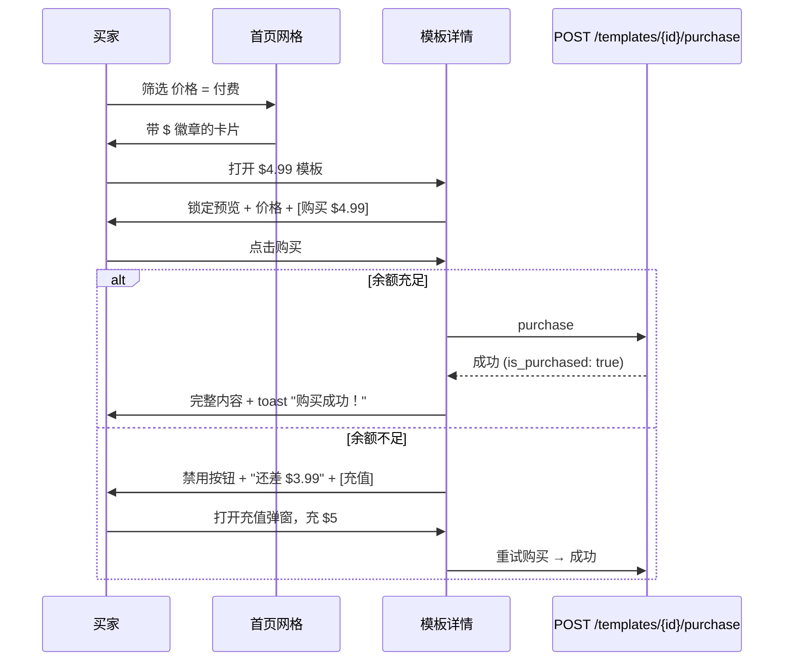
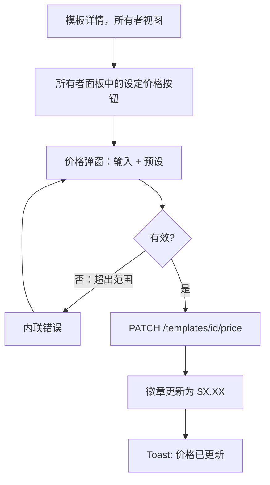

# 模板变现 — UI/UX 设计

- **功能标识:** template-monetization
- **版本:** 1.0
- **状态:** 已提案（待架构评审）
- **作者:** ui-ux-agent
- **日期:** 2025-06-25
- **配套文档:** `template-monetization-requirements-zh-CN.md`

## 1. 设计原则

1. **市场清晰性优先于装饰。** 价格是一等信号：模板出现的每个界面都一致地显示免费/付费状态（卡片、列表行、详情头部、弹窗）。
2. **购买前建立信任。** 门控预览展示真实内容（前 200 字符）—— 绝不用假占位符 —— 加上标题、描述、标签和社交证明（点赞/收藏）。买家始终知道自己买的是什么类型的东西。
3. **一键购买，零意外。** 购买按钮标明确切价格；余额不足时解释差额并提供内联充值；成功是即时的，通过导航 + toast 确认。
4. **Aurora 原生。** 复用 Layout/Sidebar/Header、PromptCard、Modal、徽章、Spinner、NotificationContext、tokens、亮/暗主题。资金 UI 使用既有徽章/按钮模式 —— 不引入新视觉语言。
5. **卖家也是用户。** 定价和收益位于既有工作区/仪表盘界面内，不是独立的"卖家门户" —— 一个产品，一个外壳。

## 2. 信息架构

```mermaid
flowchart LR
    subgraph Browsing[浏览]
        A[首页网格] -->|价格徽章 + 筛选| B[模板详情]
        B -->|锁定预览| C[购买面板]
        C -->|余额不足| D[充值弹窗]
        C -->|成功| B2[详情：完整内容]
    end
    subgraph Workspace[工作区]
        E[/dashboard] --> F[/dashboard/purchased 已购]
        E --> G[/dashboard/earnings 收益]
        E --> H[钱包页 /wallet]
    end
    subgraph Creator[创作者]
        B -->|所有者| I[设定价格控件]
        I --> J[改价弹窗]
    end
    D --> H
    H --> B
```

**新路由:**

| 路由 | 访问 | 内容 |
|---|---|---|
| `/wallet` | 认证 | 余额、充值、交易历史 |
| `/dashboard/purchased` | 认证 | 已购模板库 |
| `/dashboard/earnings` | 认证 | 卖家收益：总计、按模板、销售动态 |

**修改的界面:** PromptCard（价格徽章）、首页筛选栏（价格筛选）、TemplateDetails（购买面板 / 设定价格控件）、Header（钱包余额 chip）、Sidebar（钱包导航项）、DashboardNav（已购、收益标签 —— 按 D-10 特性检测）。

## 3. 用户流程

### 3.1 买家：发现 → 购买



### 3.2 创作者：设定价格



### 3.3 卖家：查看收益

```mermaid
flowchart TD
    A[/dashboard] --> B[/dashboard/earnings]
    B --> C[总收益卡片]
    B --> D[按模板表格：销量、毛收入、净收入]
    B --> E[最近销售动态]
    B --> F[钱包余额 chip → /wallet]
```

## 4. 页面布局

### 4.1 模板详情 — 未购买者（锁定）

```text
┌────────────────────────────────────────────────────────────────────┐
│ ← 返回      邮件写手  [公开][用户]              ❤ 42 ★ 17          │
│ 营销 · email, outreach · EN                                         │
├────────────────────────────────────────────────────────────────────┤
│ ┌──────────────────────────────────────────────┐ ┌──────────────┐ │
│ │ （预览，前 200 字符，可读）                   │ │  $4.99       │ │
│ │ "写一封专业的邮件，语气…"                     │ │              │ │
│ │ ░░░░░░░░░░░░░░░░░░░░░░░░░░░░░░░░░░░░░░░░░░░ │ │ [购买]       │ │
│ │ ░░░░░░░░░░░░░░░░░░░░░░░░░░░░░░░░░░░░░░░░░░░ │ │              │ │
│ │ 🔒 完整内容 — 1,240 字符                      │ │ 余额         │ │
│ │    购买后解锁                                 │ │ $5.01        │ │
│ └──────────────────────────────────────────────┘ └──────────────┘ │
└────────────────────────────────────────────────────────────────────┘
```

### 4.2 模板详情 — 所有者（设定价格）

```text
│ 所有者面板（既有）                                                  │
│ [编辑] [分享] [Fork] [删除]                                         │
│ ─────────────────────────────────────────────                       │
│ 价格：免费   [设定价格]                                             │
│   → 弹窗：$ [4.99]  预设：$0.99 $2.99 $4.99 $9.99                   │
│   → 设置后：价格：$4.99   [修改] [设为免费]                          │
```

### 4.3 钱包（`/wallet`）

```text
┌────────────────────────────────────────────────────────────────────┐
│ 钱包                                                                │
│ ┌────────────────────────┐  ┌────────────────────────────────────┐ │
│ │ 余额                   │  │ 充值                               │ │
│ │ $25.01                 │  │ [$5] [$10] [$20]  自定义：$[  ]     │ │
│ │                        │  │              [充值]                │ │
│ └────────────────────────┘  └────────────────────────────────────┘ │
│ 交易记录                                      [全部][充值][…]      │
│ ┌────────────────────────────────────────────────────────────────┐ │
│ │ +$5.00  充值                  simulated   2025-06-24  $25.01   │ │
│ │ −$4.99  购买了"邮件写手"                  2025-06-24  $20.01   │ │
│ │ +$3.99  售出："代码审查"                   2025-06-23  $25.00   │ │
│ └────────────────────────────────────────────────────────────────┘ │
│ ‹ 1 2 ›                                                             │
└────────────────────────────────────────────────────────────────────┘
```

### 4.4 已购库（`/dashboard/purchased`）

```text
│ 已购                                                                │
│ ┌──────────┐ ┌──────────┐ ┌──────────┐                             │
│ │邮件写手  │ │代码审查  │ │SQL 助手  │   （PromptCard 网格，       │
│ │$4.99 · 6/24│ │$2.99 · 6/20│ │免费 · 6/18│    已购徽章）           │
│ └──────────┘ └──────────┘ └──────────┘                             │
```

### 4.5 收益（`/dashboard/earnings`）

```text
│ 收益                                                                │
│ ┌──────────────┐ ┌──────────────┐ ┌──────────────┐                 │
│ │ 总收益       │ │ 销量         │ │ 平均净收入   │                 │
│ │ $128.50      │ │ 37           │ │ $3.47        │                 │
│ └──────────────┘ └──────────────┘ └──────────────┘                 │
│ 按模板                                        [最新][最多]         │
│ ┌────────────────────────────────────────────────────────────────┐ │
│ │ 邮件写手      12 笔销售   毛收入 $59.88   净收入 $47.90          │ │
│ │ 代码审查       9 笔销售   毛收入 $26.91   净收入 $21.53          │ │
│ └────────────────────────────────────────────────────────────────┘ │
│ 最近销售                                                            │
│ • "邮件写手" 售出 $4.99（净 $3.99）— 2小时前                        │
│ • "代码审查" 售出 $2.99（净 $2.39）— 昨天                           │
```

### 4.6 充值弹窗

```text
┌──────────────────────────────────────────────┐
│ 钱包充值                                   ✕  │
│ 当前余额：$5.01                               │
│ 选择金额：                                    │
│ ( ) $5   ( ) $10   ( ) $20   ( ) 自定义 $[ ] │
│ 充值后余额：$10.01                            │
│                    [取消] [充值 $5.00]        │
└──────────────────────────────────────────────┘
```

## 5. 组件规格

### 5.1 PriceBadge

| 方面 | 规格 |
|---|---|
| 内容 | 付费："$4.99" 带小锁图标；免费："Free"/"免费" |
| 位置 | PromptCard 头部（可见性徽章旁）；列表行；详情头部 |
| 样式 | 付费：`--warning`-soft 背景 + `--warning` 文字 + 12px 锁图标；免费：`--surface-3` 背景 + `--text-2` 文字；`--radius-pill`、11px、600 字重 |
| 无障碍 | 文字即标签（"4.99 美元，付费模板"）；锁图标 `aria-hidden` |

### 5.2 PurchasePanel（详情页，未购买者）

| 方面 | 规格 |
|---|---|
| 内容 | 价格（24px `--text-1`）、购买按钮（`.btn-primary`，全宽，文案"购买 · $4.99"）、余额行（"余额 $5.01"）、不足状态（"还差 $3.99" + "充值"链接 → 弹窗） |
| 行为 | 点击 → POST 购买 → 成功：重新拉取详情、成功 toast、面板消失（渲染完整内容）；失败：错误 toast 带服务端原因 |
| 状态 | 加载中（按钮 spinner）、不足（禁用 + 原因）、错误（重试） |
| 无障碍 | 价格和余额是文本；按钮 `aria-label` 含金额 |

### 5.3 LockedPreview

| 方面 | 规格 |
|---|---|
| 内容 | 真实前 200 字符预览（可读，`--text-1`），随后渐变淡出 + 模糊区（CSS `backdrop-filter: blur` 叠在重复内容层上）、锁图标 + "完整内容 — {n} 字符 · 购买后解锁" |
| 行为 | 整块不可交互（模糊区不可复制、`user-select: none` —— 可读预览保持可选择） |
| 样式 | 容器 `--surface-2` + `--border` + `--radius-12`；淡出用 `--surface-2` 渐变 |
| 无障碍 | 模糊区 `aria-hidden`（装饰）；真实预览文本可访问；视觉锁对屏幕阅读器以文字说明替代 |

### 5.4 SetPriceControl（所有者面板）

| 方面 | 规格 |
|---|---|
| 内容 | 当前状态（"价格：免费" / "价格：$4.99"）+ 操作：[设定价格]（免费时）或 [修改] + [设为免费]（已定价时） |
| 行为 | 打开 PriceModal；保存 → PATCH 价格 → 徽章/状态更新 + toast |
| 样式 | 既有所有者面板中的内联行；按钮为小号 `.btn-ghost` |

### 5.5 PriceModal

| 方面 | 规格 |
|---|---|
| 内容 | 金额输入（数字，2 位小数，最小 0.99 最大 99.00）、预设 chips（$0.99/$2.99/$4.99/$9.99）、内联校验错误、说明"已购买的买家保留访问权" |
| 行为 | 保存 → PATCH；无效输入禁用保存并显示内联错误 |
| 复用 | 既有 Modal + Field 组件 |
| 无障碍 | 输入有标签；错误通过 `aria-live` 播报 |

### 5.6 TopUpModal

| 方面 | 规格 |
|---|---|
| 内容 | 当前余额、单选预设（$5/$10/$20）+ 自定义输入（$1–$500）、实时计算的"充值后余额：$X"、带金额的确认按钮（"充值 $5.00"） |
| 行为 | 确认 → POST 充值 → 余额在所有位置更新（头部 chip、钱包页）+ toast |
| 说明 | "模拟充值 —— v1 不接入真实支付"说明（低调，`--text-3`） |
| 无障碍 | radiogroup；计算余额 `aria-live` |

### 5.7 WalletBalanceChip（Header）

| 方面 | 规格 |
|---|---|
| 内容 | 钱包图标 + "$25.01"；点击 → `/wallet` |
| 位置 | Header，头像旁（仅已登录） |
| 样式 | `--surface-3` pill、`--text-1`、13px；hover `--shadow-sm` |
| 无障碍 | `aria-label` "钱包余额 25.01 美元，打开钱包" |

### 5.8 TransactionRow / TransactionList

| 方面 | 规格 |
|---|---|
| 内容 | 带符号金额（+绿色 `--success` / −`--text-1`）、类型标签（充值 / 购买了"X" / 售出："X" / 退款）、日期、`balance_after` 流水 |
| 行为 | 筛选 chips（全部 / 充值 / 购买 / 销售）；分页（20/页） |
| 样式 | 复用 user-dashboard 的行模式（彼处 §5.5）：`--surface-2`、`--border` 分隔、hover `--surface-3` |

### 5.9 EarningsView

| 方面 | 规格 |
|---|---|
| 内容 | 3 张统计卡（总收益、销量、平均净收入）、按模板表格（标题、销量、毛收入、净收入；排序 最新/最多）、最近销售动态（10 条） |
| 数据 | `GET /api/v1/earnings` 单次调用 |
| 样式 | 统计卡复用 user-dashboard StatCard 模式；表格行按 §5.8 |

### 5.10 PricingFilter（首页筛选栏）

| 方面 | 规格 |
|---|---|
| 内容 | 分段控件：全部 / 免费 / 付费 |
| 行为 | 设置 ListTemplates 的 `pricing` 参数（D-9）；与其他筛选一样持久化到 localStorage |
| 样式 | 与既有筛选栏控件一致 |

## 6. 交互细节

1. **购买点击:** 按钮显示 spinner；单次 POST；成功 → 重新拉取模板详情（内容已完整）、toast "购买成功，尽情使用！"、PurchasePanel 卸载。请求期间禁用按钮防双击。
2. **余额不足:** 按钮禁用，`--text-3` 文案"还差 $X"；"充值"链接打开 TopUpModal；充值后面板重新检查余额并启用。
3. **充值:** 弹窗实时计算新余额；确认后 POST 并乐观更新头部 chip（失败回滚 + toast）。
4. **设定价格（所有者）:** PriceModal 客户端 + 服务端双重校验；成功后立即更新卡片徽章和详情头部（不整页刷新）。
5. **设为免费:** 确认弹窗（"已购买的买家保留访问权；模板对所有人免费"）→ PATCH 价格 0 → 徽章切换为"免费"。
6. **已购库:** PromptCard 网格带"已购"徽章和购买日期；点击打开正常详情页（按授权显示完整内容）。
7. **收益:** 挂载时单次拉取；按模板排序 v1 客户端切换（数据集小）；销售动态链接到已售模板。
8. **钱包页:** 余额卡 + 充值卡并排（移动端堆叠）；交易分页带筛选 chips；每行显示 `balance_after` 以便审计。
9. **头部 chip:** 随 profile 拉取（或登录时轻量 GET `/wallet`）；任何资金变动后通过共享钱包 context/事件刷新。
10. **免费模板:** 除"免费"徽章（FR-20）外零 UI 变化 —— 无面板、无锁、无门控。
11. **特性检测:** 若 user-dashboard 未落地，`/dashboard/purchased` 和 `/dashboard/earnings` 渲染带自己头部的独立页面（不依赖 DashboardNav）；Sidebar"钱包"入口与两者都无关。

## 7. 状态汇总

| 状态 | 触发 | UI |
|---|---|---|
| 加载中 | 购买/充值/改价 PATCH 进行中 | 按钮 spinner，输入禁用 |
| 购买成功 | 200 | 完整内容、toast、面板卸载 |
| 余额不足 | 价格 > 余额 | 禁用按钮 + 差额 + 充值链接 |
| 购买错误 | 4xx/5xx | 错误 toast 带原因；按钮重新启用 |
| 价格无效 | 超出范围 | 弹窗内联错误；保存禁用 |
| 已购为空 | 无购买 | 空状态 + "去广场浏览" CTA |
| 收益为空 | 无销售 | 空状态 + "为模板设定价格" CTA |
| 交易为空 | 新钱包 | 空状态 + "充值" CTA |
| 匿名看定价详情 | 无 token | 锁定预览 + "登录后购买"（登录后跳回） |

## 8. 视觉风格（Aurora 合规）

- **PriceBadge（付费）:** `--warning`-soft 背景、`--warning` 文字、锁图标 —— 与可见性徽章（accent/中性）区分，使价格读作独立维度。
- **PriceBadge（免费）:** `--surface-3` 背景、`--text-2` —— 安静、不抢焦点。
- **PurchasePanel:** `--surface-2` 卡片、`--border`、`--radius-12`；价格 24px `--text-1`；全宽 `.btn-primary` 主按钮。
- **LockedPreview:** 可读预览 `--text-1` 于 `--surface-2`；模糊区用 `--surface-2`→透明 渐变；锁图标 `--text-3`。
- **资金颜色:** 贷记（+）`--success`；借记（−）`--text-1`（不用 danger —— 消费不是错误）；退款 `--info`。
- **WalletBalanceChip:** `--surface-3` pill、`--text-1`；图标 `--text-2`。
- **统计卡 / 行 / 表格:** 复用 user-dashboard 模式（`--surface-2`、`--border`、hover `--surface-3`、`--radius-12`）。
- **暗/亮主题:** 仅 token 样式；两个主题下徽章/pill 文字均验证 AA 对比度。

## 9. 国际化考量（EN/ZH）

新命名空间 `monetization.*`：

```json
{
  "monetization": {
    "badge": { "free": "Free", "paid": "${{price}}" },
    "purchase": {
      "button": "Purchase · ${{price}}",
      "balance": "Balance: ${{balance}}",
      "need_more": "Need ${{amount}} more",
      "top_up_link": "Top up",
      "success": "Purchased — enjoy!",
      "sign_in": "Sign in to purchase",
      "locked": "Full content — {{chars}} chars · available after purchase"
    },
    "price_modal": {
      "title": "Set price",
      "label": "Price (USD)",
      "presets": "$0.99 / $2.99 / $4.99 / $9.99",
      "note": "Buyers who already purchased keep access.",
      "invalid": "Enter a price between $0.99 and $99.00, or 0 for free.",
      "make_free_confirm": "Make this template free? Buyers keep access."
    },
    "wallet": {
      "title": "Wallet",
      "balance": "Balance",
      "top_up": "Top up",
      "add_funds": "Add ${{amount}}",
      "custom": "Custom",
      "new_balance": "New balance would be: ${{balance}}",
      "simulated_note": "Simulated top-up — no real payment in v1.",
      "transactions": "Transactions",
      "filter": { "all": "All", "topups": "Top-ups", "purchases": "Purchases", "sales": "Sales" },
      "type": { "topup": "Top up", "purchase_debit": "Purchased \"{{title}}\"", "sale_credit": "Sale: \"{{title}}\"", "refund": "Refund" }
    },
    "purchased": {
      "title": "Purchased",
      "empty": "You haven't purchased any templates yet.",
      "empty_cta": "Browse the Prompt Square",
      "badge": "Purchased",
      "bought_on": "Bought {{date}}"
    },
    "earnings": {
      "title": "Earnings",
      "total": "Total earned",
      "sales": "Sales",
      "avg_net": "Avg. net",
      "per_template": "Per template",
      "units": "{{count}} sales",
      "gross": "gross ${{amount}}",
      "net": "net ${{amount}}",
      "recent": "Recent sales",
      "empty": "No sales yet — set a price on one of your templates.",
      "empty_cta": "Go to my templates"
    },
    "filter": { "all": "All", "free": "Free", "paid": "Paid" }
  }
}
```

中文镜像：

```json
{
  "monetization": {
    "badge": { "free": "免费", "paid": "${{price}}" },
    "purchase": {
      "button": "购买 · ${{price}}",
      "balance": "余额：${{balance}}",
      "need_more": "还差 ${{amount}}",
      "top_up_link": "充值",
      "success": "购买成功，尽情使用！",
      "sign_in": "登录后购买",
      "locked": "完整内容共 {{chars}} 字符 · 购买后解锁"
    },
    "price_modal": {
      "title": "设定价格",
      "label": "价格（美元）",
      "presets": "$0.99 / $2.99 / $4.99 / $9.99",
      "note": "已购买的买家将保留访问权。",
      "invalid": "请输入 $0.99 到 $99.00 之间的价格，或 0 表示免费。",
      "make_free_confirm": "确定将此模板设为免费？已购买的买家保留访问权。"
    },
    "wallet": {
      "title": "钱包",
      "balance": "余额",
      "top_up": "充值",
      "add_funds": "充值 ${{amount}}",
      "custom": "自定义",
      "new_balance": "充值后余额：${{balance}}",
      "simulated_note": "模拟充值 —— v1 不接入真实支付。",
      "transactions": "交易记录",
      "filter": { "all": "全部", "topups": "充值", "purchases": "购买", "sales": "销售" },
      "type": { "topup": "充值", "purchase_debit": "购买了\"{{title}}\"", "sale_credit": "售出：\"{{title}}\"", "refund": "退款" }
    },
    "purchased": {
      "title": "已购",
      "empty": "你还没有购买任何模板。",
      "empty_cta": "去 Prompt Square 浏览",
      "badge": "已购",
      "bought_on": "购买于 {{date}}"
    },
    "earnings": {
      "title": "收益",
      "total": "总收益",
      "sales": "销量",
      "avg_net": "平均净收入",
      "per_template": "按模板",
      "units": "{{count}} 笔销售",
      "gross": "毛收入 ${{amount}}",
      "net": "净收入 ${{amount}}",
      "recent": "最近销售",
      "empty": "还没有销售 —— 为你的模板设定价格吧。",
      "empty_cta": "前往我的模板"
    },
    "filter": { "all": "全部", "free": "免费", "paid": "付费" }
  }
}
```

说明: 价格在两个 locale 下都渲染为 `$4.99`（USD 符号通用）；金额在需要本地化格式时用 `Intl.NumberFormat`（`en-US`/`zh-CN`）。交易标签中的模板标题是用户内容（绝不翻译）。`{{price}}`/`{{balance}}` 插值接收已格式化的字符串。

## 10. 无障碍

- PriceBadge: 文字标签承载含义（"4.99 美元，付费模板"）；锁图标 `aria-hidden`。
- PurchasePanel: 按钮文案含金额；禁用状态有 `aria-disabled` + 可见的原因文字（不只用颜色）。
- LockedPreview: 模糊区是 `aria-hidden` 装饰；可读预览和"完整内容 — n 字符"说明是可访问的事实；无键盘陷阱。
- TopUpModal/PriceModal: 既有 Modal 焦点陷阱；输入有标签；校验错误 `aria-live="polite"`；计算的新余额会被播报。
- TransactionList: 带符号金额有明确文字（通过 `aria-label` 或可见 +/- 加 `sr-only` 文字"加 5 美元"）；行不是链接（无导航）—— 纯文本行。
- EarningsView: 统计卡和表格用真实文本；排序控件是带 `aria-pressed` 的按钮。
- PricingFilter: radiogroup 语义；可键盘切换。
- 所有新颜色在两个主题中满足 AA；所有交互元素焦点环可见。

## 11. 给开发者的实现说明

1. **路由:** `/wallet`、`/dashboard/purchased`、`/dashboard/earnings`（懒加载）+ 认证守卫；若 dashboard 功能缺失，purchased/earnings 渲染独立页面（D-10）—— 实现为自包含页面，DashboardLayout 存在时可选嵌入。
2. **API 客户端:** 新方法 `setTemplatePrice`、`getWallet`、`topUpWallet`、`listWalletTransactions`、`purchaseTemplate`、`listPurchasedTemplates`、`getEarnings`；模板列表/详情映射器扩展 `price_cents`、`is_purchased`、`preview_truncated`。
3. **门控在服务端:** 客户端纯粹根据 `preview_truncated`/`is_purchased` 标志渲染锁定 UI —— 绝不做客户端截断完整内容（服务端不得发送完整内容；NFR-3）。
4. **钱包状态:** 应用根挂载的小型 WalletContext（余额 + 刷新），供已登录用户使用；头部 chip 和购买面板消费它；资金变动触发刷新。
5. **PromptCard:** 在可见性徽章旁加 PriceBadge；无布局偏移（徽章通过 min-width 预留空间）。
6. **首页筛选:** 把 `pricing` 加入筛选状态 + localStorage 持久化模式（与 visibility/category/tags 相同）。
7. **TemplateDetails:** 按 `is_purchased || owner || price_cents === 0` 分支 → 正常视图；否则 LockedPreview + PurchasePanel；所有者面板加 SetPriceControl。
8. **金额格式化:** 共享工具 `formatUSD(cents)` → "$4.99"；所有界面的单一来源。
9. **测试:** 单元 —— formatUSD、价格校验、新余额计算；组件 —— PriceBadge、PurchasePanel（充足/不足/成功/错误）、TopUpModal、PriceModal、TransactionList 筛选；页面 —— wallet/purchased/earnings（加载/空/错误/认证）；集成 —— mock API 的购买流程；i18n 键一致性测试。
10. **后端:** 按 D-1 的新表；按 FR-10/26 的购买事务（行锁、幂等）；按 FR-18 在 `templateModelToProto`/列表组装中脱敏（需要调用者上下文：userID + is_purchased 集合）；ListTemplates 的 `pricing` 筛选参数（D-9）；按 D-8 从环境变量读佣金。
