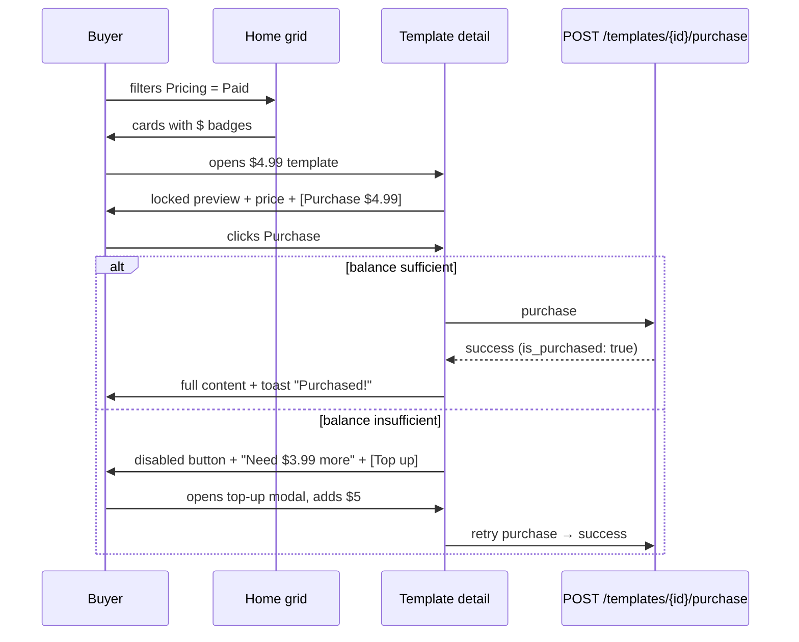
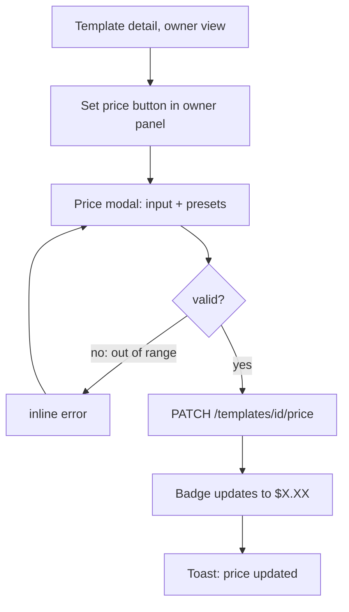

# Template Monetization — UI/UX Design

- **Feature ID:** template-monetization
- **Version:** 1.0
- **Status:** Proposed (for architecture review)
- **Author:** ui-ux-agent
- **Date:** 2025-06-25
- **Companion doc:** `template-monetization-requirements.md`

## 1. Design Principles

1. **Marketplace clarity over decoration.** Price is a first-class signal: every surface where a template appears shows free/paid state consistently (card, list row, detail header, modal).
2. **Trust before the buy.** The gated preview shows real content (first 200 chars) — never a fake placeholder — plus title, description, tags, and social proof (likes/favorites). The buyer always knows what kind of thing they're buying.
3. **One-click purchase, zero surprises.** The purchase button states the exact price; insufficient balance explains the shortfall and offers top-up inline; success is instant and confirmed by navigation + toast.
4. **Aurora native.** Reuse Layout/Sidebar/Header, PromptCard, Modal, badges, Spinner, NotificationContext, tokens, light/dark themes. Money UI uses existing badge/button patterns — no new visual language.
5. **Sellers are users too.** Pricing and earnings live inside the existing workspace/dashboard surfaces, not a separate "seller portal" — one product, one shell.

## 2. Information Architecture

```mermaid
flowchart LR
    subgraph Browsing
        A[Home grid] -->|price badge + filter| B[Template detail]
        B -->|locked preview| C[Purchase panel]
        C -->|insufficient| D[Top-up modal]
        C -->|success| B2[Detail: full content]
    end
    subgraph Workspace
        E[/dashboard] --> F[/dashboard/purchased 已购]
        E --> G[/dashboard/earnings 收益]
        E --> H[Wallet page /wallet]
    end
    subgraph Creator
        B -->|owner| I[Set price control]
        I --> J[Price change modal]
    end
    D --> H
    H --> B
```

**New routes:**

| Route | Access | Content |
|---|---|---|
| `/wallet` | Auth | Balance, top-up, transaction history |
| `/dashboard/purchased` | Auth | Purchased templates library |
| `/dashboard/earnings` | Auth | Seller earnings: totals, per-template, sales feed |

**Modified surfaces:** PromptCard (price badge), Home filter bar (Pricing filter), TemplateDetails (purchase panel / set-price control), Header (wallet balance chip), Sidebar (Wallet nav item), DashboardNav (Purchased, Earnings tabs — feature-detected per D-10).

## 3. User Flows

### 3.1 Buyer: discover → purchase



### 3.2 Creator: set a price



### 3.3 Seller: check earnings

```mermaid
flowchart TD
    A[/dashboard] --> B[/dashboard/earnings]
    B --> C[Total earned card]
    B --> D[Per-template table: units, gross, net]
    B --> E[Recent sales feed]
    B --> F[Wallet balance chip → /wallet]
```

## 4. Page Layouts

### 4.1 Template detail — non-purchaser (locked)

```text
┌────────────────────────────────────────────────────────────────────┐
│ ← Back        Email Writer  [Public] [User]        ❤ 42 ★ 17      │
│ Marketing · email, outreach · EN                                    │
├────────────────────────────────────────────────────────────────────┤
│ ┌──────────────────────────────────────────────┐ ┌──────────────┐ │
│ │ (preview, first 200 chars, readable)         │ │  $4.99       │ │
│ │ "Write a professional email that…"           │ │              │ │
│ │ ░░░░░░░░░░░░░░░░░░░░░░░░░░░░░░░░░░░░░░░░░░░░ │ │ [Purchase]   │ │
│ │ ░░░░░░░░░░░░░░░░░░░░░░░░░░░░░░░░░░░░░░░░░░░░ │ │              │ │
│ │ 🔒 Full content — 1,240 chars                 │ │ Balance      │ │
│ │    available after purchase                   │ │ $5.01        │ │
│ └──────────────────────────────────────────────┘ └──────────────┘ │
└────────────────────────────────────────────────────────────────────┘
```

### 4.2 Template detail — owner (set price)

```text
│ Owner panel (existing)                                              │
│ [Edit] [Share] [Fork] [Delete]                                      │
│ ─────────────────────────────────────────────                       │
│ Price: Free   [Set price]                                           │
│   → modal: $ [4.99]  presets: $0.99 $2.99 $4.99 $9.99               │
│   → after set: Price: $4.99   [Change] [Make free]                  │
```

### 4.3 Wallet (`/wallet`)

```text
┌────────────────────────────────────────────────────────────────────┐
│ Wallet                                                              │
│ ┌────────────────────────┐  ┌────────────────────────────────────┐ │
│ │ Balance                │  │ Top up                             │ │
│ │ $25.01                 │  │ [$5] [$10] [$20]  Custom: $[  ]    │ │
│ │                        │  │              [Add funds]           │ │
│ └────────────────────────┘  └────────────────────────────────────┘ │
│ Transactions                                    [All][Topups][…]  │
│ ┌────────────────────────────────────────────────────────────────┐ │
│ │ +$5.00  Top up                simulated   2025-06-24  $25.01   │ │
│ │ −$4.99  Purchased "Email Writer"          2025-06-24  $20.01   │ │
│ │ +$3.99  Sale: "Code Review"               2025-06-23  $25.00   │ │
│ └────────────────────────────────────────────────────────────────┘ │
│ ‹ 1 2 ›                                                             │
└────────────────────────────────────────────────────────────────────┘
```

### 4.4 Purchased library (`/dashboard/purchased`)

```text
│ Purchased                                                           │
│ ┌──────────┐ ┌──────────┐ ┌──────────┐                             │
│ │Email Wr. │ │Code Rev. │ │SQL Helper│   (PromptCard grid,         │
│ │$4.99 · 6/24│ │$2.99 · 6/20│ │Free · 6/18│    purchased badge)     │
│ └──────────┘ └──────────┘ └──────────┘                             │
```

### 4.5 Earnings (`/dashboard/earnings`)

```text
│ Earnings                                                            │
│ ┌──────────────┐ ┌──────────────┐ ┌──────────────┐                 │
│ │ Total earned │ │ Sales        │ │ Avg. net     │                 │
│ │ $128.50      │ │ 37           │ │ $3.47        │                 │
│ └──────────────┘ └──────────────┘ └──────────────┘                 │
│ Per template                                     [Newest][Top]     │
│ ┌────────────────────────────────────────────────────────────────┐ │
│ │ Email Writer   12 sales   gross $59.88   net $47.90            │ │
│ │ Code Review     9 sales   gross $26.91   net $21.53            │ │
│ └────────────────────────────────────────────────────────────────┘ │
│ Recent sales                                                        │
│ • "Email Writer" sold for $4.99 (net $3.99) — 2h ago               │
│ • "Code Review" sold for $2.99 (net $2.39) — yesterday             │
```

### 4.6 Top-up modal

```text
┌──────────────────────────────────────────────┐
│ Top up wallet                             ✕  │
│ Current balance: $5.01                       │
│ Choose amount:                               │
│ ( ) $5   ( ) $10   ( ) $20   ( ) Custom $[ ] │
│ New balance would be: $10.01                 │
│                    [Cancel] [Add $5.00]      │
└──────────────────────────────────────────────┘
```

## 5. Component Specifications

### 5.1 PriceBadge

| Aspect | Spec |
|---|---|
| Content | Paid: "$4.99" with a small lock glyph; Free: "Free" |
| Placement | PromptCard header (next to visibility badge); list rows; detail header |
| Style | Paid: `--warning`-soft bg + `--warning` text + lock icon 12px; Free: `--surface-3` bg + `--text-2` text; `--radius-pill`, 11px, 600 weight |
| A11y | Text is the label ("4.99 USD, paid template"); lock icon `aria-hidden` |

### 5.2 PurchasePanel (detail page, non-purchaser)

| Aspect | Spec |
|---|---|
| Content | Price (24px `--text-1`), Purchase button (`.btn-primary`, full width, label "Purchase · $4.99"), balance line ("Balance $5.01"), insufficient state ("Need $3.99 more" + "Top up" link → modal) |
| Behavior | Click → POST purchase → on success: refetch detail, toast success, panel disappears (full content renders); on failure: error toast with server reason |
| States | Loading (button spinner), insufficient (disabled + reason), error (retry) |
| A11y | Price and balance are text; button `aria-label` includes amount |

### 5.3 LockedPreview

| Aspect | Spec |
|---|---|
| Content | Real first-200-chars preview (readable, `--text-1`), then a gradient-fade + blur zone (CSS `backdrop-filter: blur` over a repeated-content layer), lock icon + "Full content — {n} chars · available after purchase" |
| Behavior | Entire block is non-interactive (no copy, no selection via `user-select: none` on the blurred zone only — the readable preview stays selectable) |
| Style | Container `--surface-2` + `--border` + `--radius-12`; fade uses `--surface-2` gradient |
| A11y | Blur zone `aria-hidden` (decorative); the real preview text is accessible; a text note replaces the visual lock for screen readers |

### 5.4 SetPriceControl (owner panel)

| Aspect | Spec |
|---|---|
| Content | Current state ("Price: Free" / "Price: $4.99") + actions: [Set price] (free) or [Change] + [Make free] (priced) |
| Behavior | Opens PriceModal; on save → PATCH price → badge/state updates + toast |
| Style | Inline row in the existing owner panel; buttons `.btn-ghost` small |

### 5.5 PriceModal

| Aspect | Spec |
|---|---|
| Content | Amount input (number, 2 decimals, min 0.99 max 99.00), preset chips ($0.99/$2.99/$4.99/$9.99), validation errors inline, note "Buyers who already purchased keep access" |
| Behavior | Save → PATCH; invalid input disables save with inline error |
| Reuse | Existing Modal + Field components |
| A11y | Input labeled; errors announced (`aria-live`) |

### 5.6 TopUpModal

| Aspect | Spec |
|---|---|
| Content | Current balance, radio presets ($5/$10/$20) + custom input ($1–$500), computed "New balance would be: $X", confirm button labeled with the amount ("Add $5.00") |
| Behavior | Confirm → POST topup → balance updates everywhere (header chip, wallet page) + toast |
| Note | "Simulated top-up — no real payment in v1" caption (subtle, `--text-3`) |
| A11y | Radiogroup; computed balance `aria-live` |

### 5.7 WalletBalanceChip (Header)

| Aspect | Spec |
|---|---|
| Content | Wallet icon + "$25.01"; click → `/wallet` |
| Placement | Header, next to avatar (logged-in only) |
| Style | `--surface-3` pill, `--text-1`, 13px; hover `--shadow-sm` |
| A11y | `aria-label` "Wallet balance 25.01 USD, open wallet" |

### 5.8 TransactionRow / TransactionList

| Aspect | Spec |
|---|---|
| Content | Signed amount (+green `--success` / −`--text-1`), type label (Top up / Purchased "X" / Sale: "X" / Refund), date, running `balance_after` |
| Behavior | Filter chips (All / Top-ups / Purchases / Sales); paginated (20/page) |
| Style | Row pattern from user-dashboard (§5.5 there): `--surface-2`, `--border` separators, hover `--surface-3` |

### 5.9 EarningsView

| Aspect | Spec |
|---|---|
| Content | 3 stat cards (Total earned, Sales, Avg. net), per-template table (title, units, gross, net; sort Newest/Top), recent sales feed (10) |
| Data | `GET /api/v1/earnings` single call |
| Style | Stat cards reuse user-dashboard StatCard pattern; table rows per §5.8 |

### 5.10 PricingFilter (Home filter bar)

| Aspect | Spec |
|---|---|
| Content | Segmented control: All / Free / Paid |
| Behavior | Sets `pricing` param on ListTemplates (D-9); persists in localStorage like other filters |
| Style | Matches existing filter bar controls |

## 6. Interaction Details

1. **Purchase click:** button shows spinner; single POST; success → refetch template detail (content now full), toast "Purchased — enjoy!", PurchasePanel unmounts. Double-click guarded by disabled-during-flight.
2. **Insufficient balance:** button disabled with `--text-3` label "Need $X more"; "Top up" link opens TopUpModal; after top-up the panel re-checks balance and enables.
3. **Top-up:** modal computes new balance live; confirm posts and updates the header chip optimistically (rollback + toast on failure).
4. **Set price (owner):** PriceModal validates range client-side and server-side; success updates the card badge and detail header immediately (no full reload).
5. **Make free:** confirmation modal ("Buyers keep access; the template becomes free for everyone") → PATCH price 0 → badges switch to "Free".
6. **Purchased library:** grid of PromptCards with a "Purchased" badge and purchase date; clicking opens the normal detail page (full content per entitlement).
7. **Earnings:** single fetch on mount; per-template sort toggles client-side (v1 data set is small); sales feed links to the sold template.
8. **Wallet page:** balance card + top-up card side by side (stack on mobile); transactions paginated with filter chips; each row shows `balance_after` for auditability.
9. **Header chip:** fetched with profile (or a lightweight `/wallet` GET on login); updates after any money mutation via a shared wallet context/event.
10. **Free templates:** zero UI change beyond the "Free" badge (FR-20) — no panel, no lock, no gating.
11. **Feature detection:** if user-dashboard hasn't landed, `/dashboard/purchased` and `/dashboard/earnings` render standalone pages with their own header (no DashboardNav dependency); Sidebar "Wallet" entry is independent of both.

## 7. States Summary

| State | Trigger | UI |
|---|---|---|
| Loading | purchase/topup/price PATCH in flight | Button spinner, inputs disabled |
| Purchase success | 200 | Full content, toast, panel unmount |
| Insufficient balance | price > balance | Disabled button + shortfall + top-up link |
| Purchase error | 4xx/5xx | Error toast with reason; button re-enabled |
| Price invalid | out of range | Inline modal error; save disabled |
| Empty purchased | no purchases | Empty state + "Browse the square" CTA |
| Empty earnings | no sales | Empty state + "Set a price on a template" CTA |
| Empty transactions | new wallet | Empty state + "Top up" CTA |
| Anonymous on priced detail | no token | Locked preview + "Sign in to purchase" (login redirect back) |

## 8. Visual Style (Aurora compliance)

- **PriceBadge (paid):** `--warning`-soft bg, `--warning` text, lock glyph — distinct from visibility badges (accent/neutral) so price reads as its own dimension.
- **PriceBadge (free):** `--surface-3` bg, `--text-2` — quiet, non-competing.
- **PurchasePanel:** `--surface-2` card, `--border`, `--radius-12`; price 24px `--text-1`; primary button full-width `.btn-primary`.
- **LockedPreview:** readable preview `--text-1` on `--surface-2`; blur zone with `--surface-2`→transparent gradient; lock icon `--text-3`.
- **Money colors:** credits (+) `--success`; debits (−) `--text-1` (not danger — spending is not an error); refunds `--info`.
- **WalletBalanceChip:** `--surface-3` pill, `--text-1`; icon `--text-2`.
- **Stat cards / rows / tables:** reuse user-dashboard patterns (`--surface-2`, `--border`, hover `--surface-3`, `--radius-12`).
- **Dark/light:** token-only styling; both themes verified for AA contrast on badge/pill text.

## 9. i18n Considerations (EN/ZH)

New namespace `monetization.*`:

```json
{
  "monetization": {
    "badge": { "free": "Free", "paid": "${{price}}" },
    "purchase": {
      "button": "Purchase · ${{price}}",
      "balance": "Balance: ${{balance}}",
      "need_more": "Need ${{amount}} more",
      "top_up_link": "Top up",
      "success": "Purchased — enjoy!",
      "sign_in": "Sign in to purchase",
      "locked": "Full content — {{chars}} chars · available after purchase"
    },
    "price_modal": {
      "title": "Set price",
      "label": "Price (USD)",
      "presets": "$0.99 / $2.99 / $4.99 / $9.99",
      "note": "Buyers who already purchased keep access.",
      "invalid": "Enter a price between $0.99 and $99.00, or 0 for free.",
      "make_free_confirm": "Make this template free? Buyers keep access."
    },
    "wallet": {
      "title": "Wallet",
      "balance": "Balance",
      "top_up": "Top up",
      "add_funds": "Add ${{amount}}",
      "custom": "Custom",
      "new_balance": "New balance would be: ${{balance}}",
      "simulated_note": "Simulated top-up — no real payment in v1.",
      "transactions": "Transactions",
      "filter": { "all": "All", "topups": "Top-ups", "purchases": "Purchases", "sales": "Sales" },
      "type": { "topup": "Top up", "purchase_debit": "Purchased \"{{title}}\"", "sale_credit": "Sale: \"{{title}}\"", "refund": "Refund" }
    },
    "purchased": {
      "title": "Purchased",
      "empty": "You haven't purchased any templates yet.",
      "empty_cta": "Browse the Prompt Square",
      "badge": "Purchased",
      "bought_on": "Bought {{date}}"
    },
    "earnings": {
      "title": "Earnings",
      "total": "Total earned",
      "sales": "Sales",
      "avg_net": "Avg. net",
      "per_template": "Per template",
      "units": "{{count}} sales",
      "gross": "gross ${{amount}}",
      "net": "net ${{amount}}",
      "recent": "Recent sales",
      "empty": "No sales yet — set a price on one of your templates.",
      "empty_cta": "Go to my templates"
    },
    "filter": { "all": "All", "free": "Free", "paid": "Paid" }
  }
}
```

Chinese mirror:

```json
{
  "monetization": {
    "badge": { "free": "免费", "paid": "${{price}}" },
    "purchase": {
      "button": "购买 · ${{price}}",
      "balance": "余额：${{balance}}",
      "need_more": "还差 ${{amount}}",
      "top_up_link": "充值",
      "success": "购买成功，尽情使用！",
      "sign_in": "登录后购买",
      "locked": "完整内容共 {{chars}} 字符 · 购买后解锁"
    },
    "price_modal": {
      "title": "设定价格",
      "label": "价格（美元）",
      "presets": "$0.99 / $2.99 / $4.99 / $9.99",
      "note": "已购买的买家将保留访问权。",
      "invalid": "请输入 $0.99 到 $99.00 之间的价格，或 0 表示免费。",
      "make_free_confirm": "确定将此模板设为免费？已购买的买家保留访问权。"
    },
    "wallet": {
      "title": "钱包",
      "balance": "余额",
      "top_up": "充值",
      "add_funds": "充值 ${{amount}}",
      "custom": "自定义",
      "new_balance": "充值后余额：${{balance}}",
      "simulated_note": "模拟充值 —— v1 不接入真实支付。",
      "transactions": "交易记录",
      "filter": { "all": "全部", "topups": "充值", "purchases": "购买", "sales": "销售" },
      "type": { "topup": "充值", "purchase_debit": "购买了\"{{title}}\"", "sale_credit": "售出：\"{{title}}\"", "refund": "退款" }
    },
    "purchased": {
      "title": "已购",
      "empty": "你还没有购买任何模板。",
      "empty_cta": "去 Prompt Square 浏览",
      "badge": "已购",
      "bought_on": "购买于 {{date}}"
    },
    "earnings": {
      "title": "收益",
      "total": "总收益",
      "sales": "销量",
      "avg_net": "平均净收入",
      "per_template": "按模板",
      "units": "{{count}} 笔销售",
      "gross": "毛收入 ${{amount}}",
      "net": "净收入 ${{amount}}",
      "recent": "最近销售",
      "empty": "还没有销售 —— 为你的模板设定价格吧。",
      "empty_cta": "前往我的模板"
    },
    "filter": { "all": "全部", "free": "免费", "paid": "付费" }
  }
}
```

Notes: prices render as `$4.99` in both locales (USD symbol is universal); amounts use `Intl.NumberFormat` with the `en-US`/`zh-CN` locale for any localized formatting. Template titles inside transaction labels are user content (never translated). The `{{price}}`/`{{balance}}` interpolations receive pre-formatted strings.

## 10. Accessibility

- PriceBadge: text label carries the meaning ("4.99 USD, paid"); lock glyph `aria-hidden`.
- PurchasePanel: button label includes the amount; disabled state has `aria-disabled` + visible reason text (not color-only).
- LockedPreview: the blurred zone is `aria-hidden` decorative; the readable preview and the "Full content — n chars" note are the accessible truth; no keyboard trap.
- TopUpModal/PriceModal: existing Modal focus trap; inputs labeled; validation errors `aria-live="polite"`; computed new balance announced.
- TransactionList: signed amounts have explicit text ("Plus 5 dollars" via `aria-label` or visible +/− with `sr-only` words); rows are not links (no nav) — plain rows with text.
- EarningsView: stat cards and table use real text; sort controls are buttons with `aria-pressed`.
- PricingFilter: radiogroup semantics; keyboard-switchable.
- All new colors meet AA in both themes; focus rings visible on all interactive elements.

## 11. Implementation Notes for Developer

1. **Routes:** `/wallet`, `/dashboard/purchased`, `/dashboard/earnings` (lazy) + auth guard; purchased/earnings render standalone if the dashboard feature is absent (D-10) — implement as self-contained pages that optionally embed in DashboardLayout when it exists.
2. **API client:** new methods `setTemplatePrice`, `getWallet`, `topUpWallet`, `listWalletTransactions`, `purchaseTemplate`, `listPurchasedTemplates`, `getEarnings`; extend template list/detail mappers with `price_cents`, `is_purchased`, `preview_truncated`.
3. **Gating is server-side:** the client renders the lock UI purely from `preview_truncated`/`is_purchased` flags — never from client-side truncation of full content (the server must not send full content; NFR-3).
4. **Wallet state:** a small WalletContext (balance + refresh) mounted at the app root for logged-in users; header chip and purchase panel consume it; money mutations trigger a refresh.
5. **PromptCard:** add PriceBadge next to the visibility badge; no layout shift (badge reserves space via min-width).
6. **Home filter:** add `pricing` to the filter state + localStorage persistence pattern (same as visibility/category/tags).
7. **TemplateDetails:** branch on `is_purchased || owner || price_cents === 0` → normal view; else LockedPreview + PurchasePanel; owner panel gains SetPriceControl.
8. **Money formatting:** shared util `formatUSD(cents)` → "$4.99"; single source for all surfaces.
9. **Tests:** unit — formatUSD, price validation, new-balance computation; component — PriceBadge, PurchasePanel (sufficient/insufficient/success/error), TopUpModal, PriceModal, TransactionList filters; page — wallet/purchased/earnings (loading/empty/error/auth); integration — purchase flow with mocked API; i18n key parity test.
10. **Backend:** new tables per D-1; purchase transaction per FR-10/26 (row locks, idempotency); redaction in `templateModelToProto`/list assembly per FR-18 (needs caller context: userID + is_purchased set); `pricing` filter param in ListTemplates (D-9); commission from env per D-8.
