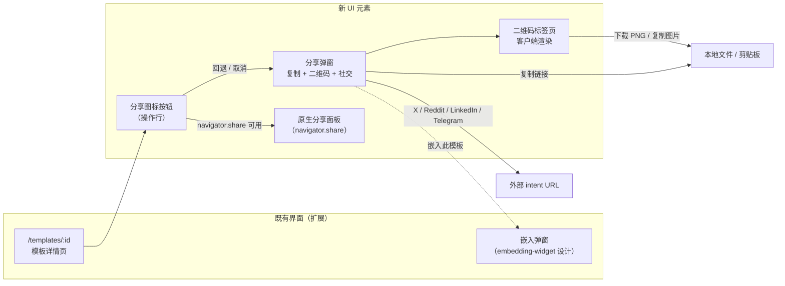
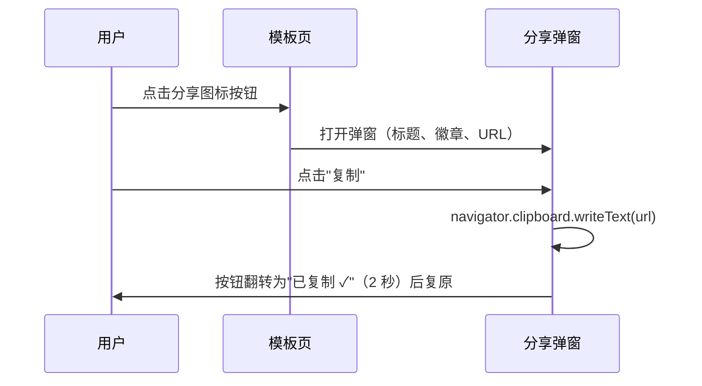
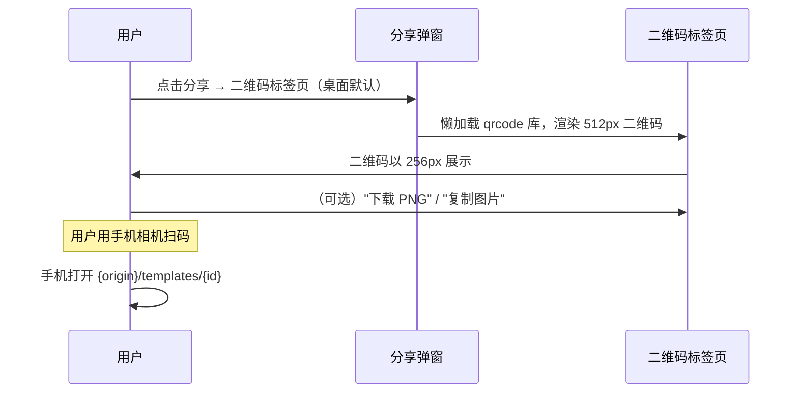
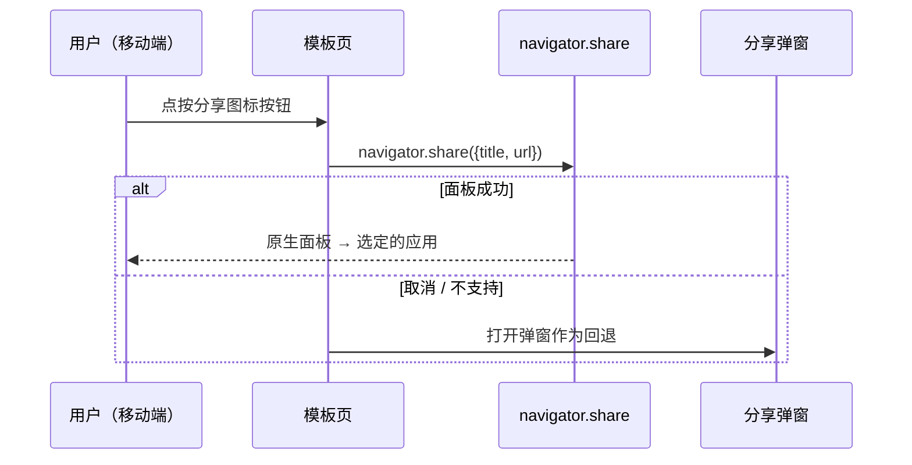
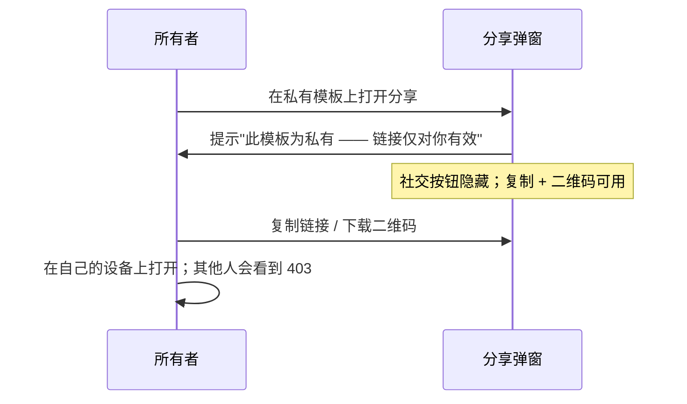

# 模板二维码分享（Template QR Share）— UI/UX 设计

- **Feature ID:** template-qr-share
- **Version:** 1.0
- **Status:** Proposed（待架构评审）
- **Author:** ui-ux-agent
- **Date:** 2026-10-12
- **相关文档：** [需求](./template-qr-share-requirements-zh-CN.md) · [需求 (EN)](./template-qr-share-requirements.md) · [UI/UX (EN)](./template-qr-share-ui-ux-design.md)

## 1. 设计原则

1. **分享就是分享。** 分享按钮分发链接；可见性变更用诚实的名字（"设为公开/私有"）。
2. **一个弹窗，所有渠道。** 复制、二维码、社交、原生面板 —— 一个界面，无需四处寻找。
3. **纯客户端。** 二维码生成、剪贴板、深链 —— 用户分享之前没有任何东西离开浏览器。
4. **接力场景二维码优先。** 二维码标签页是桌面默认，因为桌面→手机是杀手级流程；移动端优先原生面板。
5. **私有要诚实。** 私有模板直说，并且不提供广播一个 403 的选项。

## 2. 信息架构



## 3. 用户流程

### 3.1 桌面：复制链接（基线）



### 3.2 桌面：二维码接力到手机



### 3.3 移动端：原生分享面板



### 3.4 私有模板分享



## 4. 页面布局（线框图）

### 4.1 模板详情页 — 操作行（扩展）

```
┌──────────────────────────────────────────────────────────────┐
│  SQL Expert Prompt                            [公开]          │
│  作者 Alex Chen · 2026年10月12日                               │
│                                                              │
│  ♥ 128    ★ 96   ⑂ 42    ⤴ 分享    ⧉ 嵌入    ⋮              │
│  点赞    收藏   fork   分享    嵌入   （所有者：设为私有）        │
└──────────────────────────────────────────────────────────────┘
```

- 分享图标按钮（`⤴`）位于 Fork 之后、Embed 之前；尺寸/悬停与同级一致。
- 仅所有者可见：旧的"Share"可见性按钮改名为**"设为公开"** / **"设为私有"**，并移入 `⋮` 所有者菜单（它是设置动作，不是分发动作）。

### 4.2 分享弹窗 — 链接标签页（无原生分享时移动端默认）

```
┌──────────────────────────────────────────────────────────────┐
│  分享模板                                                [×]  │
│  ────────────────────────────────────────────────────────────│
│  ┌────────────────────────────────────────────────────────┐ │
│  │ SQL Expert Prompt                        [公开]         │ │
│  │ 作者 Alex Chen                                          │ │
│  └────────────────────────────────────────────────────────┘ │
│                                                              │
│  ┌─ 链接 ──────────────────────────────────── [复制] ──┐   │
│  │ https://openprompts.example/templates/abc123…       │   │
│  └──────────────────────────────────────────────────────┘   │
│  别名链接（若存在）：/t/sql-expert                [复制]      │
│                                                              │
│  分享到：                                                    │
│  [ X ]  [ Reddit ]  [ LinkedIn ]  [ Telegram ]              │
│                                                              │
│  ────────────────────────────────────────────────────────────│
│  ⧉ 嵌入此模板 · ⚠ 私有提示（若为私有）                        │
└──────────────────────────────────────────────────────────────┘
```

### 4.3 分享弹窗 — 二维码标签页（桌面默认）

```
┌──────────────────────────────────────────────────────────────┐
│  分享模板                                                [×]  │
│  ────────────────────────────────────────────────────────────│
│  [ 链接 ] [ ● 二维码 ]                                       │
│  ────────────────────────────────────────────────────────────│
│                                                              │
│              ┌───────────────────────┐                       │
│              │ ░░░░░░░░░░░░░░░░░░░░░ │                       │
│              │ ░ ▓▓▓ ▓▓ ▓▓▓▓ ▓▓ ▓▓░ │                       │
│              │ ░ ▓ ▓▓▓▓▓▓▓▓▓▓▓▓ ▓░ │                       │
│              │ ░ ▓▓▓▓▓▓▓▓▓▓▓▓▓▓▓▓░ │   扫码在手机上         │
│              │ ░ ▓▓▓▓▓▓▓▓▓▓▓▓▓▓▓▓░ │   打开此模板           │
│              │ ░ ▓▓▓▓▓▓▓▓▓▓▓▓▓▓▓▓░ │                       │
│              │ ░ ▓▓▓▓▓▓▓▓▓▓▓▓▓▓▓▓░ │                       │
│              │ ░ ▓▓▓▓▓▓▓▓▓▓▓▓▓▓▓▓░ │                       │
│              │ ░░░░░░░░░░░░░░░░░░░░ │                       │
│              └───────────────────────┘                       │
│              256px 展示 · 512px 渲染                          │
│                                                              │
│         [ ⬇ 下载 PNG ]   [ 📋 复制图片 ]                     │
│                                                              │
│  编码的 URL：https://openprompts.example/templates/abc…      │
└──────────────────────────────────────────────────────────────┘
```

### 4.4 分享弹窗 — 私有模板状态

```
┌──────────────────────────────────────────────────────────────┐
│  分享模板                                                [×]  │
│  ────────────────────────────────────────────────────────────│
│  ┌────────────────────────────────────────────────────────┐ │
│  │ 我的草稿 prompt                        [私有]           │ │
│  └────────────────────────────────────────────────────────┘ │
│                                                              │
│  ⚠ 此模板为私有 —— 链接仅对你有效。                            │
│    设为公开即可分享给其他人。                    [设为公开]     │
│                                                              │
│  ┌─ 链接 ──────────────────────────────────── [复制] ──┐   │
│  │ https://openprompts.example/templates/def456…       │   │
│  └──────────────────────────────────────────────────────┘   │
│                                                              │
│  （社交按钮隐藏）                                              │
└──────────────────────────────────────────────────────────────┘
```

## 5. 组件规格

| 组件 | 基于 | Props / 行为 |
|---|---|---|
| `ShareButton` | 新建 | 图标按钮（`⤴`）；`onClick`：若 `navigator.share` → `navigator.share({title, text, url})`，静默捕获 AbortError，其他错误 → 打开弹窗；否则直接打开弹窗。`aria-label` = t('share.button_label')。 |
| `ShareModal` | 既有 Modal | `{template}`；两个标签页（链接/二维码）；头部卡片（标题、可见性徽章、作者）；底部链接（嵌入、私有提示）。焦点锁定、Escape、焦点返回。 |
| `ShareLinkRow` | 新建 | 只读输入框 + URL + 复制按钮；复制 → clipboard 写入带 execCommand 回退；标签"复制"→"已复制 ✓"翻转 2 秒；存在 `template.public_alias` 时显示次要别名行。 |
| `QRCodePanel` | 新建 | 挂载时懒 `import('qrcode')`；`QRCode.toCanvas(canvas, url, {width: 512, margin: 4, errorCorrectionLevel: 'M'})`；CSS 控制 256px 展示；`alt` = URL；操作：下载 PNG（canvas.toBlob → object URL → `a[download]`）、复制图片（ClipboardItem，特性检测）。 |
| `SocialShareButtons` | 新建 | `{url, title, visibility}`；私有时隐藏；渲染 4 个带 intent URL 的锚点按钮，`target="_blank" rel="noopener noreferrer"`，品牌色图标 + 可见名称。 |
| `PrivateShareNotice` | 新建 | 琥珀色信息横幅 + 内联"设为公开"按钮（仅所有者），触发既有的可见性更新流程。 |
| `VisibilityMenuItems` | 扩展所有者 `⋮` 菜单 | "设为公开"/"设为私有"条目取代旧的 Share 标签按钮；同样的 `updateTemplate` 调用，新 i18n 键。 |

## 6. 交互细节

1. **按钮行为矩阵：** 存在 `navigator.share` → 优先原生面板（仅取消/失败时弹窗）；缺失 → 直接弹窗。按设备自动选择，无用户设置。
2. **标签页默认：** 桌面（pointer: fine / 视口 ≥ 768px）默认打开二维码；移动端默认链接。标签选择按会话记忆（不持久化到存储）。
3. **复制反馈：** 复制按钮标签翻转为"已复制 ✓"带对勾图标 2 秒后复原；不用 toast（内联更安静）；屏幕阅读器通过 `aria-live="polite"` 获得播报。
4. **二维码懒加载：** 首次打开二维码标签页触发动态 import；150ms 骨架（灰色方块）覆盖间隙；后续打开即时（模块已缓存）。
5. **下载：** 文件名 `openprompts-{slug 化标题}.png`；slug = 小写、非字母数字→连字符、修剪、最长 40 字符、回退 `template`。
6. **复制图片：** `navigator.clipboard.write([new ClipboardItem({'image/png': blob})])`；当 `typeof ClipboardItem !== 'undefined'` 为假时隐藏按钮（Safari/Chrome 支持；Firefox 桌面不支持）。
7. **社交 intent：** URL 编码的 `url` 与 `title`；模板的 OG 标签（seo-landing 设计）让分享卡片丰富 —— 此处无需额外工作。
8. **私有流程：** 提示 + 隐藏社交；内联"设为公开"按钮调用既有可见性更新并将弹窗重渲染为公开状态（徽章翻转、社交出现、提示消失）。
9. **Embed 交叉链接：** 底部链接打开嵌入弹窗；先关闭分享弹窗（绝不堆叠弹窗）。
10. **键盘：** 标签页是真正的 tablist 语义（方向键切换）；复制/下载/复制图片是标准按钮；任意位置 Escape 关闭弹窗。

## 7. 状态汇总

| 状态 | 触发 | UI |
|---|---|---|
| 弹窗打开 | 分享点击（无原生分享） | 即时渲染；零网络 |
| 原生面板 | 分享点击（navigator.share） | 系统面板；成功时弹窗不打开 |
| 已复制 | 复制点击 | 标签"已复制 ✓" 2 秒 + polite live region |
| 复制失败 | 剪贴板错误 | 行下方内联错误；全选手动复制提示 |
| 二维码加载中 | 首次打开二维码标签页 | 灰色方块骨架 ≤ 150ms |
| 二维码已渲染 | 库加载完成 | 256px 二维码 + 操作 |
| 二维码错误 | 库加载失败 | "二维码不可用" + 链接标签页仍可用 |
| 已下载 | 下载点击 | 文件保存；按钮闪烁"已下载 ✓" |
| 图片已复制 | 复制图片点击 | 按钮闪烁"已复制 ✓" |
| 私有 | template.visibility 私有 | 提示 + 隐藏社交 + 设为公开 CTA |
| 已设为公开 | 内联 CTA 点击 | 徽章 → 公开、社交出现、提示消失 |
| 存在别名 | 有公开别名 | 次要别名行带独立复制按钮 |

## 8. i18n 字符串表

命名空间：`share`（新增）+ `template_details`（扩展）。

| 键 / 中文 | 英文 |
|---|---|
| `share.button_label` / 分享 | Share |
| `share.modal_title` / 分享模板 | Share template |
| `share.tab_link` / 链接 | Link |
| `share.tab_qr` / 二维码 | QR code |
| `share.copy` / 复制 | Copy |
| `share.copied` / 已复制 ✓ | Copied ✓ |
| `share.copy_failed` / 复制失败 —— 请手动选中链接复制。 | Copy failed — select the link and copy manually. |
| `share.alias_link` / 别名链接 | Alias link |
| `share.qr_alt` / 指向 {{url}} 的二维码 | QR code linking to {{url}} |
| `share.qr_hint` / 扫码在手机上打开此模板 | Scan to open this template on your phone |
| `share.qr_download` / 下载 PNG | Download PNG |
| `share.qr_downloaded` / 已下载 ✓ | Downloaded ✓ |
| `share.qr_copy_image` / 复制图片 | Copy image |
| `share.qr_unavailable` / 二维码不可用 | QR code unavailable |
| `share.encoded_url` / 编码的 URL | Encoded URL |
| `share.share_to` / 分享到 | Share to |
| `share.private_notice` / 此模板为私有 —— 链接仅对你有效。 | This template is private — the link works only for you. |
| `share.private_hint` / 设为公开即可分享给其他人。 | Make it public to share it with others. |
| `share.embed_link` / 嵌入此模板 | Embed this template |
| `template_details.make_public` / 设为公开 | Make public |
| `template_details.make_private` / 设为私有 | Make private |

## 9. 无障碍说明

- 弹窗复用应用对话框模式：焦点锁定、`aria-modal`、Escape 关闭、焦点返回分享按钮。
- 二维码 canvas/图片带 `alt` = 完整 URL（t('share.qr_alt', {url})）—— 屏幕阅读器用户即使无法扫码也能获得链接。
- 标签页使用 `role="tablist"`/``tab``/`tabpanel`，方向键导航与 `aria-selected`。
- 复制反馈通过 `aria-live="polite"` 播报；视觉翻转是补充。
- 社交按钮有可见文本标签（非仅图标）—— 品牌名即其可访问名称。
- 私有提示使用 `role="note"`；其中的"设为公开" CTA 是 tab 顺序中的真实按钮。
- 颜色对比度：徽章与提示颜色满足 4.5:1；二维码本身纯黑底白（最大扫描对比度）。

## 10. 响应式行为

- **桌面（≥1024px）：** 弹窗宽 480px；默认二维码标签页；二维码 256px 展示；社交按钮单行。
- **平板（768–1023px）：** 弹窗 90% 宽；默认二维码标签页；社交按钮折为 2×2。
- **手机（<768px）：** 通常有 `navigator.share` → 原生面板是主路径；回退弹窗为全宽底部 sheet；默认链接标签页；二维码 220px 展示（仍可扫描）；下载/复制图片纵向堆叠。
- 操作行中的分享图标按钮在 480px 以下收起为仅图标（tooltip），与同级按钮一致。

## 11. 分析事件（可选，若 analytics 已上线）

- `share_modal_opened` `{visibility, default_tab}`
- `link_copied` `{target: 'canonical' | 'alias'}`
- `qr_tab_opened` / `qr_downloaded` / `qr_image_copied`
- `social_share_clicked` `{target}`
- `native_share_invoked` / `native_share_completed`

## 12. 不做范围（UI）

- 二维码自定义（颜色、logo、边框）。
- 分享计数或"最多分享"界面。
- 非模板页面（个人主页、合集）的分享面板。
- 微信专属分享卡片预览。
- 复制为 Markdown/HTML 变体。
