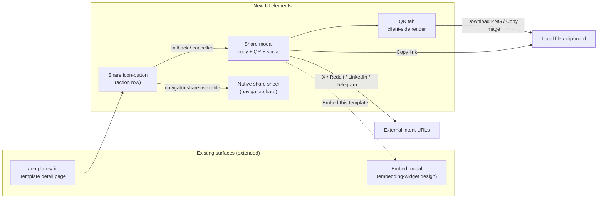
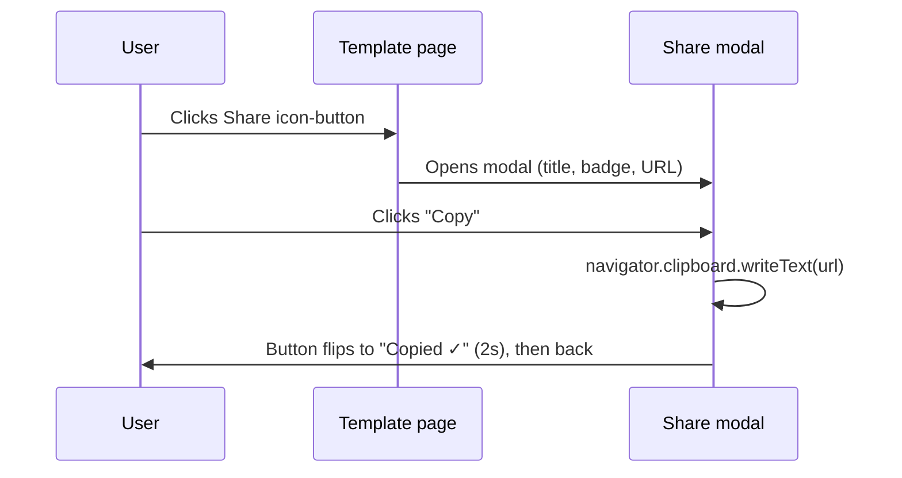
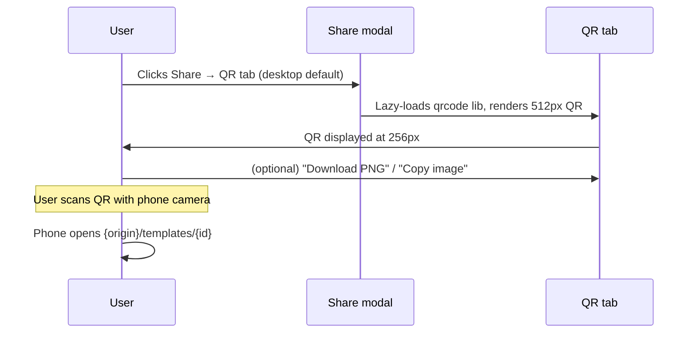
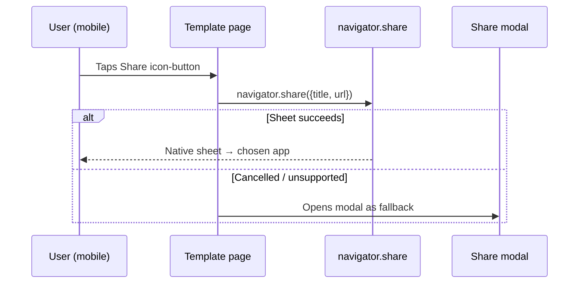

# Template QR Share — UI/UX Design

- **Feature ID:** template-qr-share
- **Version:** 1.0
- **Status:** Proposed (for architecture review)
- **Author:** ui-ux-agent
- **Date:** 2026-10-12
- **Related docs:** [Requirements](./template-qr-share-requirements.md) · [Requirements (ZH)](./template-qr-share-requirements-zh-CN.md) · [UI/UX (ZH)](./template-qr-share-ui-ux-design-zh-CN.md)

## 1. Design Principles

1. **Share means share.** The Share button distributes a link; visibility changes live under their honest names ("Make public/private").
2. **One modal, every channel.** Copy, QR, social, native sheet — one surface, no hunting.
3. **Client-side only.** QR generation, clipboard, deep links — nothing leaves the browser until the user shares.
4. **QR first for handoff.** The QR tab is the desktop default because desktop→phone is the killer flow; mobile gets the native sheet first.
5. **Private is honest.** Private templates say so plainly and don't offer to broadcast a 403.

## 2. Information Architecture



## 3. User Flows

### 3.1 Desktop: copy link (baseline)



### 3.2 Desktop: QR handoff to phone



### 3.3 Mobile: native share sheet



### 3.4 Private template share

```mermaid
sequenceDiagram
    participant U as Owner
    participant SM as Share modal
    U->>SM: Opens Share on private template
    SM->>U: Notice "This template is private — link works only for you"
    Note over SM: Social buttons hidden; Copy + QR available
    U->>SM: Copies link / downloads QR
    U->>U: Opens on own devices; others would see 403
```

## 4. Page Layouts (Wireframes)

### 4.1 Template detail page — action row (extended)

```
┌──────────────────────────────────────────────────────────────┐
│  SQL Expert Prompt                            [Public]       │
│  by Alex Chen · Oct 12, 2026                                 │
│                                                              │
│  ♥ 128    ★ 96   ⑂ 42    ⤴ Share    ⧉ Embed    ⋮            │
│  like   favorite fork  SHARE   embed   (owner: Make private) │
└──────────────────────────────────────────────────────────────┘
```

- Share icon-button (`⤴`) sits after Fork, before Embed; same size/hover as siblings.
- Owner-only: the old "Share" visibility button is renamed **"Make public"** / **"Make private"** and moved into the `⋮` owner menu (it is a settings action, not a distribution action).

### 4.2 Share modal — Link tab (mobile default when no native share)

```
┌──────────────────────────────────────────────────────────────┐
│  Share template                                         [×]  │
│  ────────────────────────────────────────────────────────────│
│  ┌────────────────────────────────────────────────────────┐ │
│  │ SQL Expert Prompt                        [Public]      │ │
│  │ by Alex Chen                                           │ │
│  └────────────────────────────────────────────────────────┘ │
│                                                              │
│  ┌─ Link ──────────────────────────────────── [Copy] ──┐   │
│  │ https://openprompts.example/templates/abc123…       │   │
│  └──────────────────────────────────────────────────────┘   │
│  Alias link (if exists):  /t/sql-expert        [Copy]       │
│                                                              │
│  Share to:                                                  │
│  [ X ]  [ Reddit ]  [ LinkedIn ]  [ Telegram ]              │
│                                                              │
│  ────────────────────────────────────────────────────────────│
│  ⧉ Embed this template · ⚠ Private notice (if private)      │
└──────────────────────────────────────────────────────────────┘
```

### 4.3 Share modal — QR tab (desktop default)

```
┌──────────────────────────────────────────────────────────────┐
│  Share template                                         [×]  │
│  ────────────────────────────────────────────────────────────│
│  [ Link ] [ ● QR code ]                                      │
│  ────────────────────────────────────────────────────────────│
│                                                              │
│              ┌───────────────────────┐                       │
│              │ ░░░░░░░░░░░░░░░░░░░░░ │                       │
│              │ ░ ▓▓▓ ▓▓ ▓▓▓▓ ▓▓ ▓▓░ │                       │
│              │ ░ ▓ ▓▓▓▓▓▓▓▓▓▓▓▓ ▓░ │                       │
│              │ ░ ▓▓▓▓▓▓▓▓▓▓▓▓▓▓▓▓░ │   Scan to open        │
│              │ ░ ▓▓▓▓▓▓▓▓▓▓▓▓▓▓▓▓░ │   this template       │
│              │ ░ ▓▓▓▓▓▓▓▓▓▓▓▓▓▓▓▓░ │   on your phone       │
│              │ ░ ▓▓▓▓▓▓▓▓▓▓▓▓▓▓▓▓░ │                       │
│              │ ░ ▓▓▓▓▓▓▓▓▓▓▓▓▓▓▓▓░ │                       │
│              │ ░░░░░░░░░░░░░░░░░░░░ │                       │
│              └───────────────────────┘                       │
│              256px display · 512px render                    │
│                                                              │
│         [ ⬇ Download PNG ]   [ 📋 Copy image ]              │
│                                                              │
│  Encoded URL: https://openprompts.example/templates/abc…    │
└──────────────────────────────────────────────────────────────┘
```

### 4.4 Share modal — private template state

```
┌──────────────────────────────────────────────────────────────┐
│  Share template                                         [×]  │
│  ────────────────────────────────────────────────────────────│
│  ┌────────────────────────────────────────────────────────┐ │
│  │ My draft prompt                        [Private]       │ │
│  └────────────────────────────────────────────────────────┘ │
│                                                              │
│  ⚠ This template is private — the link works only for you.  │
│    Make it public to share it with others.   [Make public]  │
│                                                              │
│  ┌─ Link ──────────────────────────────────── [Copy] ──┐   │
│  │ https://openprompts.example/templates/def456…       │   │
│  └──────────────────────────────────────────────────────┘   │
│                                                              │
│  (social buttons hidden)                                     │
└──────────────────────────────────────────────────────────────┘
```

## 5. Component Specifications

| Component | Based on | Props / behavior |
|---|---|---|
| `ShareButton` | new | Icon-button (`⤴`); `onClick`: if `navigator.share` → `navigator.share({title, text, url})`, catch AbortError silently, other errors → open modal; else open modal. `aria-label` = t('share.button_label'). |
| `ShareModal` | existing Modal | `{template}`; two tabs (Link / QR); header card (title, visibility badge, author); footer links (Embed, private notice). Focus trap, Escape, focus return. |
| `ShareLinkRow` | new | Read-only input with URL + Copy button; Copy → clipboard write with execCommand fallback; label flips "Copy" → "Copied ✓" for 2s; secondary alias row when `template.public_alias` exists. |
| `QRCodePanel` | new | Lazy `import('qrcode')` on mount; `QRCode.toCanvas(canvas, url, {width: 512, margin: 4, errorCorrectionLevel: 'M'})`; display 256px via CSS; `alt` = URL; actions: Download PNG (canvas.toBlob → object URL → `a[download]`), Copy image (ClipboardItem, feature-detected). |
| `SocialShareButtons` | new | `{url, title, visibility}`; hidden when private; renders 4 anchor buttons with intent URLs, `target="_blank" rel="noopener noreferrer"`, brand-colored icons + visible names. |
| `PrivateShareNotice` | new | Amber info banner + inline "Make public" button (owner only) that triggers the existing visibility update flow. |
| `VisibilityMenuItems` | extends owner `⋮` menu | "Make public" / "Make private" entries replacing the old Share-labeled button; same `updateTemplate` calls, new i18n keys. |

## 6. Interaction Details

1. **Button behavior matrix:** `navigator.share` present → native sheet first (modal only on cancel/failure); absent → modal directly. The choice is per-device, automatic, no user setting.
2. **Tab default:** desktop (pointer: fine / viewport ≥ 768px) opens on QR; mobile opens on Link. Tab choice persists per session (not persisted to storage).
3. **Copy feedback:** the Copy button's label flips to "Copied ✓" with a check icon for 2s, then reverts; no toast (inline is calmer); screen readers get `aria-live="polite"` announcement.
4. **QR lazy-load:** first QR tab open triggers the dynamic import; a 150ms skeleton (gray square) covers the gap; subsequent opens are instant (module cached).
5. **Download:** filename `openprompts-{slugified-title}.png`; slug = lowercase, non-alphanumerics → hyphens, trimmed, max 40 chars, fallback `template`.
6. **Copy image:** `navigator.clipboard.write([new ClipboardItem({'image/png': blob})])`; button hidden when `typeof ClipboardItem !== 'undefined'` is false (Safari/Chrome support it; Firefox desktop does not).
7. **Social intents:** URL-encoded `url` and `title`; the template's OG tags (seo-landing design) make the shared cards rich — no extra work here.
8. **Private flow:** notice + hidden socials; "Make public" inline button calls the existing visibility update and re-renders the modal to the public state (badge flips, socials appear, notice gone).
9. **Embed cross-link:** footer link opens the embed modal; the share modal closes first (never stacked modals).
10. **Keyboard:** tabs are real tablist semantics (arrow keys switch); Copy/Download/Copy-image are standard buttons; Escape closes the modal from anywhere.

## 7. States Summary

| State | Trigger | UI |
|---|---|---|
| Modal open | Share click (no native share) | Instant render; zero network |
| Native sheet | Share click (navigator.share) | OS sheet; modal never opens on success |
| Copied | Copy click | Label "Copied ✓" 2s + polite live region |
| Copy failed | clipboard error | Inline error under the row; select-all fallback hint |
| QR loading | first QR tab open | Gray square skeleton ≤ 150ms |
| QR rendered | lib loaded | 256px QR + actions |
| QR error | lib load failure | "QR unavailable" + Link tab still works |
| Downloaded | Download click | File saves; button flashes "Downloaded ✓" |
| Image copied | Copy image click | Button flashes "Copied ✓" |
| Private | template.visibility private | Notice + hidden socials + Make public CTA |
| Made public | inline CTA click | Badge → Public, socials appear, notice gone |
| Alias present | public alias exists | Secondary alias row with own Copy |

## 8. i18n String Table

Namespace: `share` (new) + `template_details` (extends).

| Key | English | 中文 |
|---|---|---|
| `share.button_label` | Share | 分享 |
| `share.modal_title` | Share template | 分享模板 |
| `share.tab_link` | Link | 链接 |
| `share.tab_qr` | QR code | 二维码 |
| `share.copy` | Copy | 复制 |
| `share.copied` | Copied ✓ | 已复制 ✓ |
| `share.copy_failed` | Copy failed — select the link and copy manually. | 复制失败 —— 请手动选中链接复制。 |
| `share.alias_link` | Alias link | 别名链接 |
| `share.qr_alt` | QR code linking to {{url}} | 指向 {{url}} 的二维码 |
| `share.qr_hint` | Scan to open this template on your phone | 扫码在手机上打开此模板 |
| `share.qr_download` | Download PNG | 下载 PNG |
| `share.qr_downloaded` | Downloaded ✓ | 已下载 ✓ |
| `share.qr_copy_image` | Copy image | 复制图片 |
| `share.qr_unavailable` | QR code unavailable | 二维码不可用 |
| `share.encoded_url` | Encoded URL | 编码的 URL |
| `share.share_to` | Share to | 分享到 |
| `share.private_notice` | This template is private — the link works only for you. | 此模板为私有 —— 链接仅对你有效。 |
| `share.private_hint` | Make it public to share it with others. | 设为公开即可分享给其他人。 |
| `share.embed_link` | Embed this template | 嵌入此模板 |
| `template_details.make_public` | Make public | 设为公开 |
| `template_details.make_private` | Make private | 设为私有 |

## 9. Accessibility Notes

- The modal reuses the app dialog pattern: focus trap, `aria-modal`, Escape to close, focus returns to the Share button.
- The QR canvas/image carries `alt` = the full URL (t('share.qr_alt', {url})) — screen-reader users get the link even though they can't scan.
- Tabs use `role="tablist"`/``tab``/`tabpanel` with arrow-key navigation and `aria-selected`.
- Copy feedback is announced via `aria-live="polite"`; the visual flip is supplementary.
- Social buttons have visible text labels (not icon-only) — brand names are their accessible names.
- The private notice uses `role="note"`; the "Make public" CTA inside it is a real button in tab order.
- Color contrast: badge and notice colors meet 4.5:1; the QR itself is pure black on white (maximum scan contrast).

## 10. Responsive Behavior

- **Desktop (≥1024px):** modal 480px wide; QR tab default; QR displayed 256px; social buttons in one row.
- **Tablet (768–1023px):** modal 90% width; QR tab default; social buttons wrap to 2×2.
- **Mobile (<768px):** `navigator.share` usually available → native sheet is the primary path; the fallback modal is full-width bottom sheet; Link tab default; QR displayed 220px (still scannable); Download/Copy-image stack vertically.
- The Share icon-button in the action row collapses to icon-only (tooltip) below 480px, matching sibling buttons.

## 11. Analytics Events (optional, if analytics shipped)

- `share_modal_opened` `{visibility, default_tab}`
- `link_copied` `{target: 'canonical' | 'alias'}`
- `qr_tab_opened` / `qr_downloaded` / `qr_image_copied`
- `social_share_clicked` `{target}`
- `native_share_invoked` / `native_share_completed`

## 12. Out of Scope (UI)

- QR customization (colors, logo, frame).
- Share counts or "most shared" surfaces.
- A share sheet for non-template pages (profiles, collections).
- WeChat-specific share card preview.
- Copy-as-Markdown/HTML variants.
