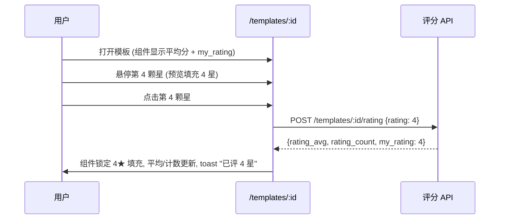
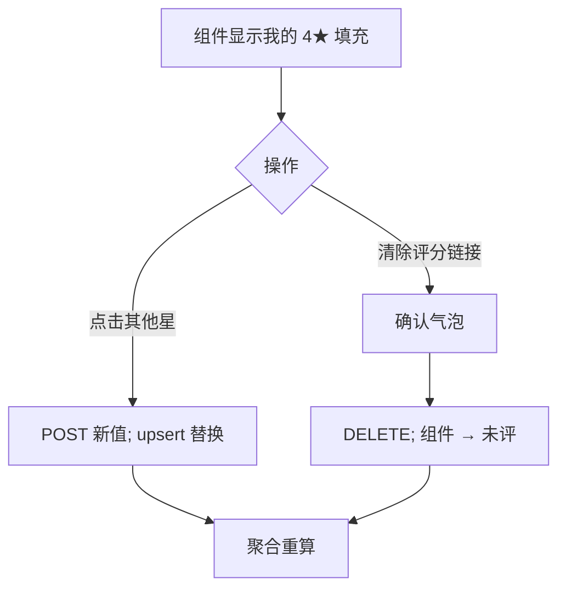

# 模板评分 — UI/UX 设计

- **功能标识:** template-ratings
- **版本:** 1.0
- **状态:** 已提案（待架构评审）
- **作者:** ui-ux-agent
- **日期:** 2026-10-12
- **配套文档:** `template-ratings-requirements-zh-CN.md`

## 1. 设计原则

1. **评分是质量，不是欣赏。** 星级组件在视觉与语义上与点赞/收藏分离：星回答"好用吗？"，心回答"我喜欢吗？"。绝不合并两行。
2. **一眼扫读，一层深入。** 卡片获得紧凑的 "★ 4.6 (128)"；详情页获得可交互组件 + 直方图。浅扫深判。
3. **一次点击完成评分。** 悬停预览星级，点击提交。无弹窗、无表单、不强制评论 —— 摩擦尽可能低。
4. **Aurora 原生。** 复用 token、图标风格、按钮、toast、Spinner、空状态与明暗主题。星星使用既有强调/警示 token 家族。
5. **诚实的状态。** 零评分显示"还没有评分"，绝不显示 "0.0"；组件始终反映 `my_rating`；失败回退并说明。

## 2. 信息架构

```mermaid
flowchart LR
    A[PromptCard: '★ 4.6 (128)'] -->|点击卡片| B[/templates/:id]
    B --> C[评分组件: 5 星 + 平均 + 计数]
    C -->|悬停| D[预览填充]
    C -->|点击星| E[POST/PUT 评分]
    C -->|已评分| F[清除评分操作]
    B --> G[直方图: 5 行]
    H[排序下拉: 评分最高] --> I[列表按平均分排序, 计数 >= 5]
```

**界面清单:**

| 界面 | 访问 | 内容 |
|---|---|---|
| PromptCard 星级行 | 公开 | 平均分（1 位小数）+ 计数 |
| `/templates/:id` 评分组件 + 直方图 | 公开可看；登录可评 | 可交互星级、平均分、计数、分布 |
| `top_rated` 排序选项 | 公开 | 既有排序下拉的新值 |
| 管理员模板详情 | 仅管理员 | 只读平均分 + 计数 |

## 3. 用户流程

### 3.1 为模板评分



### 3.2 修改或清除评分



### 3.3 使用前判断（潜在用户）

```mermaid
flowchart TD
    A[扫读卡片: '★ 4.6 (128)'] --> B[打开详情]
    B --> C[读平均 4.62 · 128 条评分]
    B --> D[扫直方图: 5★ 70% / 4★ 22% / 1★ 3%]
    D --> E{信任它?}
    E -- 是 --> F[使用模板]
    E -- 否 --> G[返回列表, 按评分最高排序]
```

## 4. 页面布局

### 4.1 PromptCard — 星级行（标题/元信息之下、点赞/收藏行之上）

```text
┌────────────────────────┐
│ 模板标题               │
│ 分类 · 3 个标签        │
│ ★★★★☆ 4.6 (128)        │
│ ♥ 456  ★ 78  ⎇ 12      │
└────────────────────────┘
```

- 紧凑：5 颗小星（按四舍五入的平均分填充）+ "4.6" + "(128)"；计数用弱化文本。
- 零评分：整行省略（不显示 "0.0"、不显示空星）—— 比死行更干净。

### 4.2 模板详情 — 评分区块（与社交统计同区、评论区之上）

```text
┌──────────────────────────────────────────────────────────────┐
│ 为模板评分                                                    │
│                                                              │
│   ☆ ☆ ☆ ☆ ☆        4.62 · 128 条评分                        │
│   (可交互)                                                   │
│                                                              │
│   5 ★ ████████████████████ 70%                               │
│   4 ★ ████████ 22%                                           │
│   3 ★ █ 3%                                                   │
│   2 ★ █ 2%                                                   │
│   1 ★ █ 3%                                                   │
│                                                              │
│   你的评分：4★ · [清除评分]           (仅当 my_rating 存在)   │
└──────────────────────────────────────────────────────────────┘
```

- 组件：5 颗大星；悬停/聚焦填充至预览星；点击提交；键盘：方向键调整、Enter/Space 提交。
- `my_rating` 状态：已提交的星保持强调色填充，出现"你的评分：N★"行 + "清除评分"文字按钮。
- 所有者视图：组件替换为"不能给自己的模板评分"提示（不可交互的星仍显示聚合值）。
- 匿名：星可见（聚合值）但点击跳转 `/login`（既有回跳行为）。
- 直方图条使用强调色 token；百分比以文本呈现（绝非仅颜色）。

### 4.3 排序下拉 — 新选项

```text
┌────────────────┐
│ 排序: 评分最高 ▾ │
└────────────────┘
```

- 加入既有排序下拉（搜索筛选功能）：`最新 · 最多点赞 · 最多收藏 · 趋势 · 评分最高`。
- "评分最高"显示提示："平均评分，至少 5 条评分"。

### 4.4 管理员模板详情 — 只读行

在 `/admin/templates/:id` 既有统计行加入"评分：4.62 (128)"的只读纯文本。无组件、无操作。

## 5. 组件规格

| 组件 | 说明 |
|---|---|
| `StarRating`（展示） | 只读星 + 值 + 计数；用于卡片与管理台；`size` 属性（sm/lg） |
| `RatingWidget`（交互） | 悬停预览、点击提交、键盘支持、我的评分状态、清除操作；乐观填充带回退 |
| `RatingHistogram` | 5 行：星级标签、条（宽 = %）、百分比文本；语义列表 |
| 排序选项 | 既有排序下拉（搜索筛选功能组件）的新 `top_rated` 值 |

所有新 i18n 键位于 `ratings.*` 命名空间，新排序选项复用既有 `sort.*` 命名空间，同时进入 `en` 与 `zh` 翻译文件。

## 6. 交互细节

- **悬停预览:** 星填充至悬停星，用更浅的填充；标签显示"4 — 好"式提示（本地化：1 很差 … 5 很好）。
- **提交:** 点击立即提交（无确认）；响应后组件锁定该值；toast 确认。
- **乐观填充:** 点击的星即时填充；失败回退 + 错误 toast。聚合值仅以响应更新（服务端为权威）。
- **清除评分:** 组件下方的小文字按钮（仅当 `my_rating` 存在时可见）；轻量确认气泡（非完整弹窗 —— 重新评分即可恢复）。
- **舍入:** 卡片显示 1 位小数（4.6）；详情显示 2 位（4.62）；星按四舍五入填充。
- **零评分:** 卡片省略该行；详情显示组件并在星下显示"还没有评分 —— 来抢第一个"。
- **键盘:** 组件是单一 Tab 停靠点；←/→ 调整预览、Enter/Space 提交、Esc 取消预览；`aria-valuetext` = "5 星中的 4 星，好"。

## 7. 状态汇总

| 场景 | 加载 | 空 | 错误 |
|---|---|---|---|
| 卡片星级行 | 随卡片渲染（无额外请求） | 行省略 | 行省略（空值安全） |
| 评分组件 | 星随详情数据渲染 | "还没有评分" | 组件禁用 + 重试 |
| 评分操作 | 星内转圈 | 无 | 回退 + 错误 toast |
| 直方图 | 骨架条 | 隐藏（0 评分） | 隐藏，组件仍可用 |
| 排序（top_rated） | 列表骨架 | 正常空列表 | 既有列表错误态 |

## 8. 国际化考量（中/英）

- 所有界面文案本地化："Rate this template" / "为模板评分"、"ratings" / "条评分"、"No ratings yet" / "还没有评分"、"Clear rating" / "清除评分"、"You rated {n}★" / "你的评分：{n} 星"、"Top rated" / "评分最高"、星级提示（"Poor/Good/…" / "很差/一般/好/很好"）。
- 数字：本地化格式（128 / 128；百分比 70% / 70%）；平均分在两种语言下均用西文数字（数学值）。
- 复数：英文 "1 rating" / "128 ratings"；中文不变式 "128 条评分"。
- 排序标签加入既有本地化排序选项；阈值提示本地化（"Average rating, minimum 5 ratings" / "平均评分，至少 5 条评分"）。

## 9. 无障碍

- `RatingWidget` 实现 slider/radiogroup 混合模式：`role="slider"`（或 radiogroup），带 `aria-valuemin=1`、`aria-valuemax=5`、`aria-valuenow`、含本地化提示的 `aria-valuetext`。
- 键盘：单一 Tab 停靠点、方向键、Enter/Space 提交、Esc 取消预览 —— 见 §6。
- `StarRating`（展示）有可访问名称（"128 条评分，平均 4.6 星"）。
- 直方图是带文本百分比的语义列表；条为装饰（`aria-hidden`）—— 文本承载信息。
- 颜色对比：填充与未填充的星以填充 + 形状区分，而非仅颜色；两套主题下满足 WCAG 2.1 AA。

## 10. 数据分析（可选，若分析功能上线）

- `rating_submitted`（值）、`rating_changed`、`rating_cleared`、`top_rated_sort_used` 事件。v1 不新增埋点基础设施 —— 仅当 prompt-analytics 功能的管道存在时。

## 11. 不做范围（与需求 §8 一致）

文字评价、按版本评分、声誉加权、验证使用门槛、评分通知、匿名评分、管理员评分审核、评分导出/导入，以及任何与变现相关的界面。
