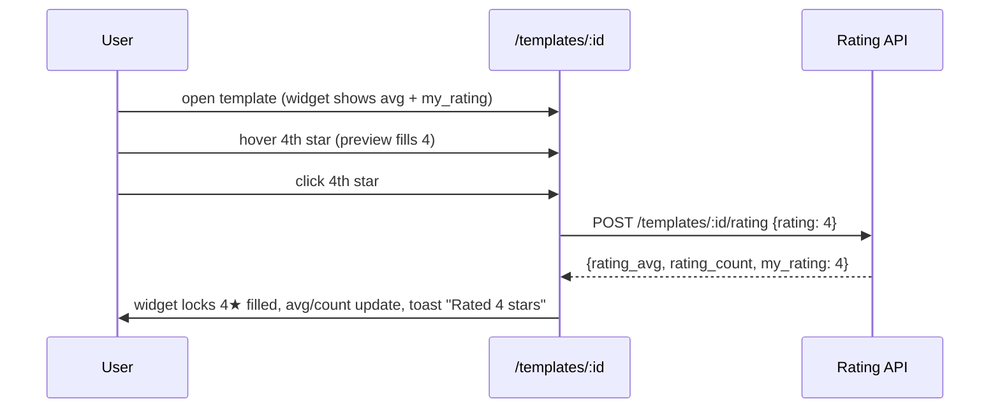
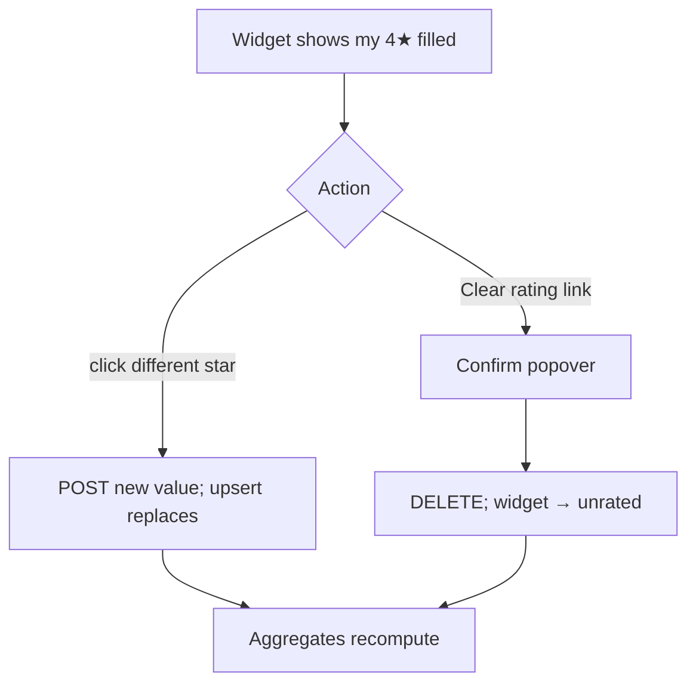

# Template Ratings — UI/UX Design

- **Feature ID:** template-ratings
- **Version:** 1.0
- **Status:** Proposed (for architecture review)
- **Author:** ui-ux-agent
- **Date:** 2026-10-12
- **Companion doc:** `template-ratings-requirements.md`

## 1. Design Principles

1. **Ratings are quality, not appreciation.** The star widget is visually and semantically separate from like/favorite: stars answer "did it work?", hearts answer "do I like it?". Never merge the two rows.
2. **One glance, one depth.** Cards get the compact "★ 4.6 (128)"; the detail page gets the interactive widget + histogram. Scan shallow, judge deep.
3. **Rate in one click.** Hover previews the stars, click commits. No modal, no form, no comment required — the lowest possible friction.
4. **Aurora-native.** Reuse tokens, iconography style, buttons, toasts, Spinner, empty states, and light/dark themes. Stars use the existing accent/warning token family.
5. **Honest states.** Zero ratings shows "No ratings yet", never "0.0"; the widget always reflects `my_rating`; failures revert and say so.

## 2. Information Architecture

```mermaid
flowchart LR
    A[PromptCard: '★ 4.6 (128)'] -->|card click| B[/templates/:id]
    B --> C[Rating widget: 5 stars + avg + count]
    C -->|hover| D[Preview fill]
    C -->|click star| E[POST/PUT rating]
    C -->|my rating set| F[Clear rating action]
    B --> G[Histogram: 5 rows]
    H[Sort dropdown: Top rated] --> I[List ordered by avg, count >= 5]
```

**Surfaces:**

| Surface | Access | Content |
|---|---|---|
| Star row on PromptCard | public | Average (1 decimal) + count |
| Rating widget + histogram on `/templates/:id` | public view; auth to rate | Interactive stars, average, count, distribution |
| `top_rated` sort option | public | New value in the existing sort dropdown |
| Admin template detail | admin only | Read-only average + count |

## 3. User Flows

### 3.1 Rate a template



### 3.2 Change or clear a rating



### 3.3 Judge before using (prospective user)

```mermaid
flowchart TD
    A[Scan cards: '★ 4.6 (128)'] --> B[Open detail]
    B --> C[Read avg 4.62 · 128 ratings]
    B --> D[Scan histogram: 5★ 70% / 4★ 22% / 1★ 3%]
    D --> E{Trust it?}
    E -- yes --> F[Use template]
    E -- no --> G[Back to list, sort Top rated]
```

## 4. Page Layouts

### 4.1 PromptCard — star row (below title/meta, above like/favorite row)

```text
┌────────────────────────┐
│ Template title         │
│ category · 3 tags      │
│ ★★★★☆ 4.6 (128)        │
│ ♥ 456  ★ 78  ⎇ 12      │
└────────────────────────┘
```

- Compact: 5 small stars (filled per rounded average) + "4.6" + "(128)"; count in muted text.
- Zero ratings: the row is omitted entirely (no "0.0", no empty stars) — cleaner than a dead row.

### 4.2 Template detail — rating block (with social stats, above comments)

```text
┌──────────────────────────────────────────────────────────────┐
│ Rate this template                                           │
│                                                              │
│   ☆ ☆ ☆ ☆ ☆        4.62 · 128 ratings                       │
│   (interactive)                                              │
│                                                              │
│   5 ★ ████████████████████ 70%                               │
│   4 ★ ████████ 22%                                           │
│   3 ★ █ 3%                                                   │
│   2 ★ █ 2%                                                   │
│   1 ★ █ 3%                                                   │
│                                                              │
│   You rated 4★ · [Clear rating]      (only when my_rating)   │
└──────────────────────────────────────────────────────────────┘
```

- Widget: 5 large stars; hover/focus fills up to the previewed star; click commits; keyboard: arrows adjust, Enter/Space commits.
- `my_rating` state: the committed stars stay filled with the accent color and a "You rated N★" line + "Clear rating" text button appears.
- Owner view: widget replaced by "You can't rate your own template" hint (non-interactive stars still show the aggregate).
- Anonymous: stars visible (aggregate) but clicking routes to `/login` (existing redirect-back behavior).
- Histogram bars use the accent token; percentages in text (never color-only).

### 4.3 Sort dropdown — new option

```text
┌────────────────┐
│ Sort: Top rated ▾│
└────────────────┘
```

- Added to the existing sort dropdown (search-filtering feature): `Newest · Most liked · Most favorited · Trending · Top rated`.
- "Top rated" shows a tooltip/hint: "Average rating, minimum 5 ratings".

### 4.4 Admin template detail — read-only row

On `/admin/templates/:id`, the stats row gains "Rating: 4.62 (128)" as plain read-only text. No widget, no actions.

## 5. Component Specs

| Component | Notes |
|---|---|
| `StarRating` (display) | Read-only stars + value + count; used on cards and admin; `size` prop (sm/lg) |
| `RatingWidget` (interactive) | Hover preview, click commit, keyboard support, my-rating state, clear action; optimistic fill with revert |
| `RatingHistogram` | 5 rows: star label, bar (width = %), percentage text; semantic list |
| Sort option | New `top_rated` value in the existing sort dropdown (search-filtering feature's component) |

All new i18n keys live under `ratings.*` and reuse the existing `sort.*` namespace for the new option, in both `en` and `zh` translation files.

## 6. Interaction Details

- **Hover preview:** stars fill up to the hovered star with a lighter fill; the label shows "4 — Good" style hints (localized: 1 Poor … 5 Excellent).
- **Commit:** click posts immediately (no confirm); the widget locks to the value on response; toast confirms.
- **Optimistic fill:** the clicked star fills instantly; on failure it reverts + error toast. Aggregates update only from the response (server is the source of truth).
- **Clear rating:** small text button under the widget (visible only with `my_rating`); a lightweight confirm popover (not a full modal — the action is reversible by re-rating).
- **Rounding:** card shows 1 decimal (4.6); detail shows 2 (4.62); stars fill by rounding to nearest integer.
- **Zero ratings:** cards omit the row; detail shows the widget with "No ratings yet — be the first" under the stars.
- **Keyboard:** widget is a single tab stop; ←/→ adjust the preview, Enter/Space commits, Esc cancels the preview; `aria-valuetext` = "4 of 5, Good".

## 7. States Summary

| Context | Loading | Empty | Error |
|---|---|---|---|
| Card star row | Renders with card (no extra fetch) | Row omitted | Row omitted (null-safe) |
| Rating widget | Stars render from detail data | "No ratings yet" | Widget disabled + Retry |
| Rate action | Star spinner | n/a | Revert + error toast |
| Histogram | Skeleton bars | Hidden (0 ratings) | Hidden, widget still works |
| Sort (top_rated) | List skeleton | Normal empty list | Existing list error state |

## 8. i18n Considerations (EN/ZH)

- All chrome strings localized: "Rate this template" / "为模板评分", "ratings" / "条评分", "No ratings yet" / "还没有评分", "Clear rating" / "清除评分", "You rated {n}★" / "你的评分：{n} 星", "Top rated" / "评分最高", star hints ("Poor/一般/Good/…", "很差/较差/一般/好/很好").
- Numbers: locale-aware formatting (128 / 128; percentages 70% / 70%); average always western digits in both locales (mathematical value).
- Pluralization: EN "1 rating" / "128 ratings"; ZH invariant "128 条评分".
- The sort label joins the existing localized sort options; the threshold hint is localized ("Average rating, minimum 5 ratings" / "平均评分，至少 5 条评分").

## 9. Accessibility

- `RatingWidget` implements the slider/checkbox hybrid pattern: `role="slider"` (or radiogroup) with `aria-valuemin=1`, `aria-valuemax=5`, `aria-valuenow`, `aria-valuetext` including the localized hint.
- Keyboard: single tab stop, arrow keys, Enter/Space to commit, Esc to cancel preview — documented in §6.
- `StarRating` (display) has an accessible name ("Rated 4.6 out of 5 with 128 ratings" / "128 条评分，平均 4.6 星").
- Histogram is a semantic list with text percentages; bars are decorative (`aria-hidden`) — the text carries the data.
- Color contrast: filled vs unfilled stars differ by fill + shape, not color alone; WCAG 2.1 AA in both themes.

## 10. Analytics (optional, if analytics feature ships)

- `rating_submitted` (value), `rating_changed`, `rating_cleared`, `top_rated_sort_used` events. No new instrumentation infrastructure in v1 — only if the prompt-analytics feature's pipeline exists.

## 11. Out of Scope (mirrors requirements §8)

Written reviews, per-version ratings, reputation weighting, verified-use gating, rating notifications, anonymous ratings, admin rating moderation, rating export/import, and any monetization-adjacent surface.
