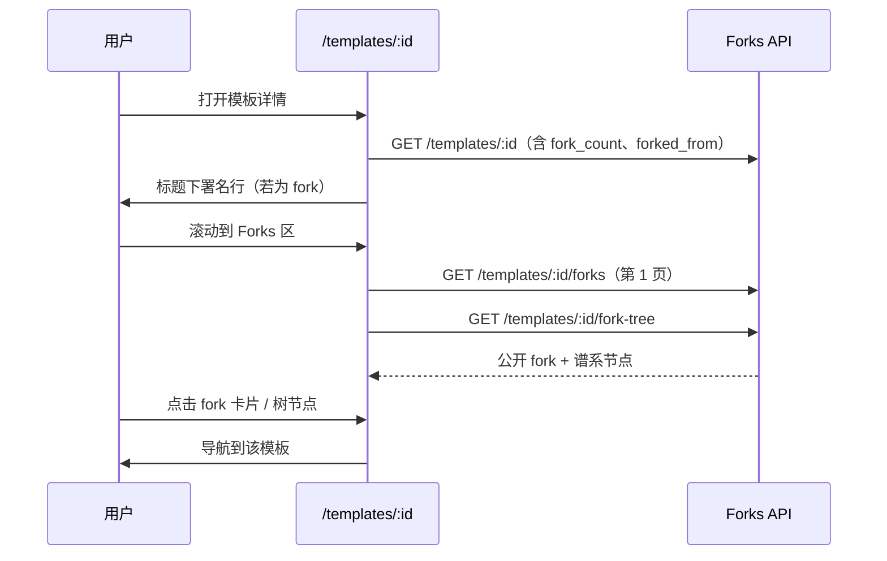
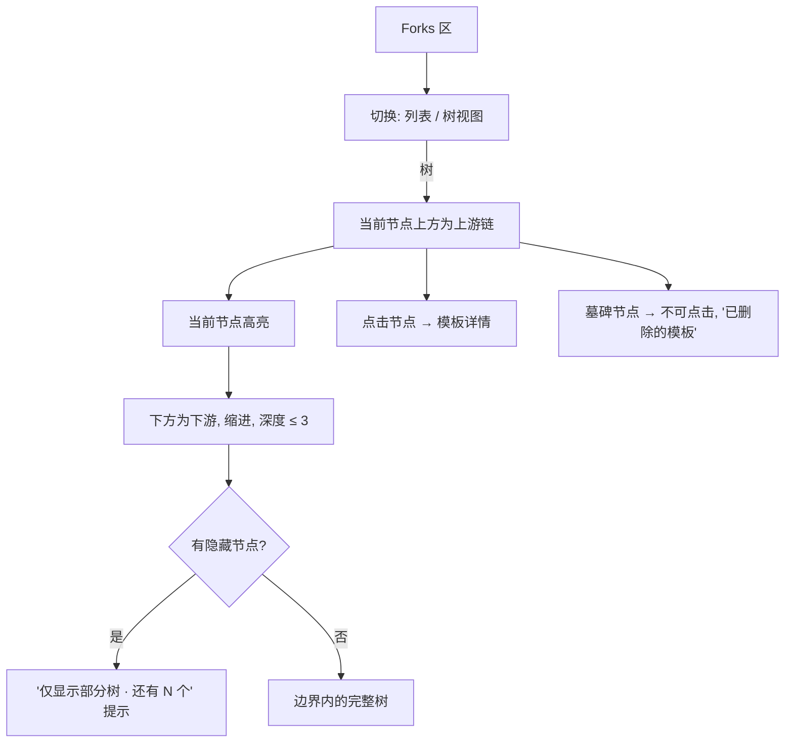
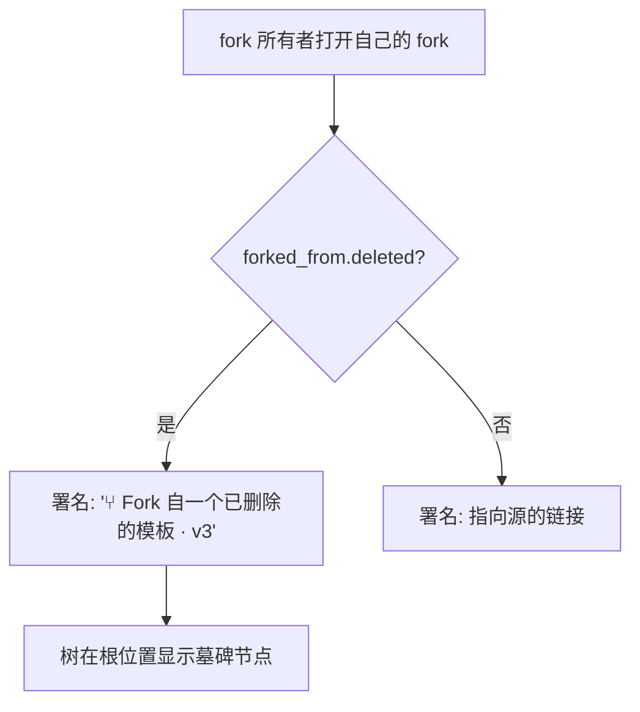

# 模板 Remix 与 Fork 树 — UI/UX 设计

- **功能标识:** template-remix-forks-tree
- **版本:** 1.0
- **状态:** 已提案（待架构评审）
- **作者:** ui-ux-agent
- **日期:** 2026-10-12
- **配套文档:** `template-remix-forks-tree-requirements-zh-CN.md`

## 1. 设计原则

1. **署名可见，不埋没。** "fork 自"行位于模板标题正下方 —— 读者视线第一落点 —— 而非元数据抽屉里。
2. **Fork 是发现，不是记账。** fork 区和谱系树是发现变体的界面，样式与模板页其余部分一致（卡片、区块），而非管理台表格。
3. **Aurora 原生。** 复用令牌、卡片表面、区块标题、Modal、Spinner、空状态、toast（`NotificationContext`）、明暗主题。树是 CSS 缩进结构加连接线 —— 不用图形库。
4. **隐私优先渲染。** 只渲染公开 fork 和查看者自己的 fork；墓碑只表明"曾存在过什么"，不泄露任何信息。
5. **优雅降级。** fork 列表/树的失败绝不影响模板详情页；谱系数据缺失时直接隐藏署名行。

## 2. 信息架构

```mermaid
flowchart LR
    A[/templates/:id] --> B[标题下署名行]
    A --> C[Forks 区: 卡片 + 树切换]
    B -->|链接| A2[/templates/:sourceId]
    C -->|卡片点击| A3[/templates/:forkId]
    C -->|树节点点击| A3
    D[Fork 模态框] -->|查看 Fork| A4[/templates/:newForkId]
    E[/admin/templates/:id] --> F[只读谱系面板]
    F -->|源链接| E2[/admin/templates/:sourceId]
```

**界面:**

| 界面 | 访问 | 内容 |
|---|---|---|
| `/templates/:id` 署名行 | 公开（随模板可见性） | "⑂ Fork 自 {所有者} 的 {标题} · v{N}" 或墓碑 |
| `/templates/:id` Forks 区 | 公开可读 | fork 数、fork 卡片（分页）、谱系树切换 |
| Fork 模态框（既有，增强文案） | 需登录 | 署名提示 + 确认 |
| fork 成功后 | fork 者 | "查看 Fork"入口 |
| `/admin/templates/:id` 谱系面板 | 管理员 | fork 自信息 + fork 数（只读） |

## 3. 用户流程

### 3.1 查看署名并探索 fork（浏览者）



### 3.2 fork 一个模板（fork 者）

```mermaid
flowchart TD
    A[在模板详情点击 Fork] --> B[模态框: 署名提示 + 确认]
    B -->|确认| C[POST /templates/:id/fork]
    C -->|成功| D[Toast: 已 fork + 查看按钮]
    D -->|查看 Fork| E[/templates/:newId — 署名行可见]
    C -->|失败| F[错误 toast; 模态框保留可重试]
```

### 3.3 谱系树交互



### 3.4 源被删除（墓碑）



## 4. 页面布局

### 4.1 模板详情 —— 署名行（标题下方）

```text
┌──────────────────────────────────────────────────────────────┐
│ [模板头部]                                                    │
│                                                              │
│ SQL 查询助手                            [⑂ 12] [♥ 89] [★ 34]  │
│ ⑂ Fork 自 Alice 的"SQL Helper" · v4                           │
│                                                              │
│ [描述、标签、内容 …… 不变 ……]                                  │
└──────────────────────────────────────────────────────────────┘
```

- 署名行：小号弱化文字，前缀 fork 符号（⑂）；标题是指向源的链接；follow-creators 功能上线后所有者名链接到其资料页（此前为纯文本）；"· v{N}"显示 fork 时的源版本号。
- 墓碑变体：`⑂ Fork 自一个已删除的模板 · v4` —— 无链接，同样弱化样式。
- fork 数角标 `[⑂ 12]` 加入头部统计行既有的点赞/收藏角标（为 0 时隐藏）。

### 4.2 模板详情 —— Forks 区（内容/评论下方）

```text
┌──────────────────────────────────────────────────────────────┐
│ Forks (12)                                    [列表] [树]      │
├──────────────────────────────────────────────────────────────┤
│ 列表视图（默认）:                                              │
│ ┌──────────────┐ ┌──────────────┐ ┌──────────────┐           │
│ │ PromptCard   │ │ PromptCard   │ │ PromptCard   │           │
│ │ (fork, ⑂ 3)  │ │ (fork, ⑂ 0)  │ │ (fork, ⑂ 1)  │           │
│ └──────────────┘ └──────────────┘ └──────────────┘           │
│                   [ 加载更多 Fork ]                           │
├──────────────────────────────────────────────────────────────┤
│ 树视图:                                                       │
│ ┌──────────────────────────────────────────────────────────┐ │
│ │ SQL Helper（根）                          by Alice  ⑂ 12 │ │
│ │ └─ SQL 查询助手  ◀ 当前                  by Bob     ⑂ 3  │ │
│ │    ├─ SQL 查询助手（中文版）             by Carol   ⑂ 1  │ │
│ │    └─ SQL 查询助手 精简版                by Dave    ⑂ 0  │ │
│ │ └─ SQL Helper Postgres 版               by Erin    ⑂ 0  │ │
│ │                                                          │ │
│ │ 仅显示部分树 —— 还有 7 个 Fork 未显示                     │ │
│ └──────────────────────────────────────────────────────────┘ │
└──────────────────────────────────────────────────────────────┘
```

- **列表视图（默认）:** 公开 fork 以标准 `PromptCard` 展示（每张卡片显示自己的 fork 数角标），最新在前，"加载更多"分页（按钮，与评论模式一致）。
- **树视图:** 切换后显示谱系树。上游渲染在当前节点上方（缩进链），当前节点高亮（强调色边框 + "◀ 当前"标记），下方为缩进的下游。每个节点：标题（链接）、所有者显示名、fork 数。墓碑：弱化斜体"已删除的模板"，不可点击。
- **截断提示:** 树被边界截断时显示弱化提示及隐藏数量；v1 无展开操作（fork 列表即完整的公开视图）。
- **自己的私有 fork:** 在两种视图中对其所有者可见，带小号"私有"角标；对其他人不可见。

### 4.3 Fork 模态框（既有模态框，增强文案）

```text
┌──────────────────────────────────────────────┐
│ Fork 模板                                     │
├──────────────────────────────────────────────┤
│ 确定要将此模板 fork 到你的私有库吗？           │
│ 最新版本内容将被复制。                         │
│                                              │
│ ⓘ 此 Fork 的页面将显示                        │
│    "Fork 自 Alice 的 'SQL Helper'"。          │
│                                              │
│                        [取消] [Fork]          │
└──────────────────────────────────────────────┘
```

### 4.4 fork 成功 toast

```text
┌──────────────────────────────────────────────┐
│ ✓  模板 fork 成功！                           │
│    [查看 Fork →]                              │
└──────────────────────────────────────────────┘
```

- 既有成功 toast 增加"查看 Fork"操作按钮，导航到新模板。若 toast 组件不支持操作，模态框转为成功态并放置相同按钮（备选，文案相同）。

### 4.5 管理控制台 —— `/admin/templates/:id` 谱系面板

```text
┌──────────────────────────────────────────────────────────────┐
│ 谱系                                                          │
├──────────────────────────────────────────────────────────────┤
│ Fork 自:     SQL Helper · v4 · by Alice     [在管理台打开 →]  │
│ Fork 数:     12 次 Fork（公开 + 私有）                        │
│              [查看公开 Fork →]（打开 /templates/:id）         │
└──────────────────────────────────────────────────────────────┘
```

- 既有模板信息下方的只读面板。源存在时"在管理台打开"链接到其管理详情；否则显示墓碑文案。"查看公开 Fork"深链到公开模板页的 fork 区。

## 5. 组件规格

| 组件 | 说明 |
|---|---|
| `ForkAttributionLine` | 标题下弱化行；链接/墓碑两种变体；谱系数据缺失时整体隐藏 |
| `ForksSection` | TemplateDetails 上的容器；持有列表/树状态、分页、计数；通过 api service 请求 |
| `ForksList` | 公开 fork + 自己私有 fork 的分页 `PromptCard` 网格 |
| `ForkLineageTree` | 缩进树：上游、当前（高亮）、深度 ≤ 3 的下游；墓碑；截断提示 |
| `ForkCountChip` | 头部统计与 PromptCard 复用的 `⑂ N` 角标；为 0 时隐藏 |
| `ForkModal`（增强） | 既有模态框 + 署名提示段落 |
| `AdminLineagePanel` | 管理台模板详情上的只读 fork 自 + fork 数 |

所有新 i18n 键位于 `forks.*` 和 `admin.forks.*` 命名空间，同时存在于 `en` 和 `zh` 翻译文件。

## 6. 交互细节

- **列表/树切换:** 区块头部的分段控件；选择在会话内保持（组件状态，不持久化存储）；默认为列表。
- **树渲染:** 纯 CSS 缩进（按深度 padding-left）加竖向连接线（`::before` 边框）—— 无图形库、无绝对定位；节点是可聚焦的链接。
- **计数同步:** 模板响应中的 `fork_count` 是事实来源；查看者 fork 成功后立即本地递增计数（不重新请求）。
- **卡片点击:** fork 卡片导航到该 fork 的详情页（标准 PromptCard 行为）；树节点导航到该节点的模板。
- **加载更多:** 追加下一页 fork（按钮，非无限滚动 —— 与评论/管理台模式一致）。
- **键盘:** 树节点是 tab 顺序中的真实链接；列表/树切换为 radiogroup（方向键）；署名链接是标准链接；所有操作无需鼠标可达。
- **深层链:** 超过 10 跳的上游以相同截断提示模式截断（罕见；文案与下游提示共用）。

## 7. 状态汇总

| 场景 | 加载 | 空 | 错误 |
|---|---|---|---|
| 署名行 | 随模板请求；加载期间不显示 | 隐藏（原创模板） | 隐藏（数据缺失） |
| Fork 列表 | 卡片网格骨架（3 张） | "还没有 Fork —— 成为第一个基于此模板创作的人" | 内联错误 + 重试；页面不受影响 |
| 谱系树 | 树骨架（3 行微光） | 不适用（树至少有当前节点 1 个） | 内联错误 + 重试（仅树区域） |
| Fork 操作 | 模态框按钮 spinner | 不适用 | 错误 toast；模态框保留可重试 |
| 管理台谱系面板 | 内联骨架行 | "原创模板 —— 非 Fork 而来" | 弱化"谱系信息不可用"文字 |

## 8. i18n 字符串表（EN/ZH）

| 键（EN） | ZH |
|---|---|
| forks.sectionTitle / Forks | Fork |
| forks.forkCount / {{count}} forks | {{count}} 次 Fork |
| forks.attribution / Forked from "{{title}}" by {{owner}} · v{{version}} | Fork 自 {{owner}} 的"{{title}}" · v{{version}} |
| forks.attributionDeleted / Forked from a deleted template · v{{version}} | Fork 自一个已删除的模板 · v{{version}} |
| forks.listTab / List | 列表 |
| forks.treeTab / Tree | 树 |
| forks.currentNode / Current | 当前 |
| forks.privateChip / Private | 私有 |
| forks.tombstone / Deleted template | 已删除的模板 |
| forks.truncated / Showing partial tree — {{count}} more forks hidden | 仅显示部分树 —— 还有 {{count}} 个 Fork 未显示 |
| forks.truncatedAncestors / Showing partial lineage — older ancestors hidden | 仅显示部分谱系 —— 更早的上游已省略 |
| forks.loadMore / Load more forks | 加载更多 Fork |
| forks.empty / No forks yet — be the first to build on this template | 还没有 Fork —— 成为第一个基于此模板创作的人 |
| forks.error / Couldn't load forks. | 无法加载 Fork。 |
| forks.retry / Retry | 重试 |
| forks.modalNotice / This fork will show "Forked from "{{title}}" by {{owner}}" on its page. | 此 Fork 的页面将显示"Fork 自 {{owner}} 的"{{title}}""。 |
| forks.viewFork / View fork | 查看 Fork |
| forks.forkedBadge / Forked | 已 Fork |
| admin.forks.lineageTitle / Lineage | 谱系 |
| admin.forks.forkedFrom / Forked from | Fork 自 |
| admin.forks.forkCount / Fork count | Fork 数 |
| admin.forks.forkCountValue / {{count}} forks (public + private) | {{count}} 次 Fork（公开 + 私有） |
| admin.forks.openInAdmin / Open in admin | 在管理台打开 |
| admin.forks.viewPublicForks / View public forks | 查看公开 Fork |
| admin.forks.original / Original template — not forked from any source | 原创模板 —— 非 Fork 而来 |
| admin.forks.unavailable / Lineage unavailable | 谱系信息不可用 |

## 9. 无障碍

- 树是嵌套 `<ul>`/`<li>` 结构；每个节点是可聚焦链接；深度由列表嵌套语义传达（非仅颜色）。
- 当前节点同时用强调色边框和可见的"当前"文字标记。
- 墓碑是纯文本（`<span>`，非链接），"已删除的模板"清晰播报。
- 列表/树切换使用 radiogroup 模式，方向键导航 + `aria-checked`。
- fork 数角标将 ⑂ 符号与数字及 `aria-label`（"12 次 Fork"）配对；绝非仅颜色。
- 署名行是真实链接，带描述性无障碍名称（"Fork 自 Alice 的 SQL Helper，版本 4"）。
- 所有状态（加载骨架、错误 + 重试、空）键盘可达且屏幕阅读器可播报；toast 使用既有 live-region 模式。
- 颜色在两种主题下均满足 WCAG AA（基于令牌）。

## 10. 响应式行为

- **署名行:** 窄屏换行到第二行；标题链接可单行截断加省略号（`title` 提示携带全文）。
- **Fork 列表:** 卡片网格随既有 PromptCard 断点重排（3 → 2 → 1 列）。
- **谱系树:** 缩进步距在 480px 以下由 24px 缩至 16px；长标题截断加省略号 + 提示；360px 以下隐藏所有者名（标题 + 计数保留）。
- **Fork 模态框与 toast:** 小屏使用全宽底部弹层模式（既有模态框响应式行为）。
- **管理台谱系面板:** 管理台平板断点以下行换行（标签在值上方）。

## 11. 分析（可选，若分析功能上线）

- `fork_section_opened`、`fork_tree_toggled`（视图）、`fork_card_clicked`、`fork_tree_node_clicked`、`fork_view_fork_clicked` —— 仅产品用途；v1 不新增埋点基础设施。

## 12. 范围之外（与需求 §8 一致）

交互式网络图、上游同步、源更新通知、根所有者通知、fork 备注、谱系编辑、公开树中对管理员的私有 fork 可见性、fork 搜索/过滤、JSON 导出中的 fork 数据、API key 访问 fork 端点，以及任何货币化相关界面。
