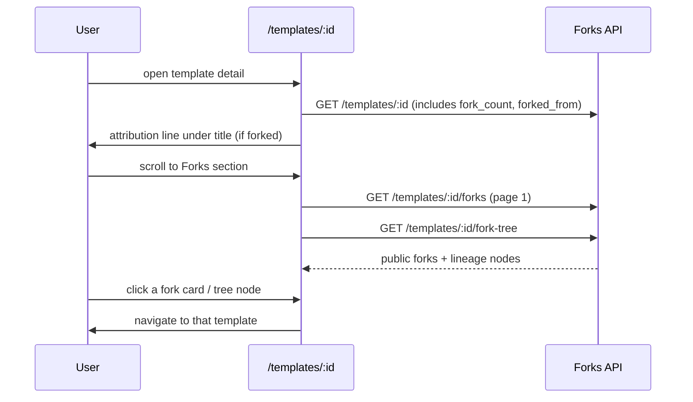
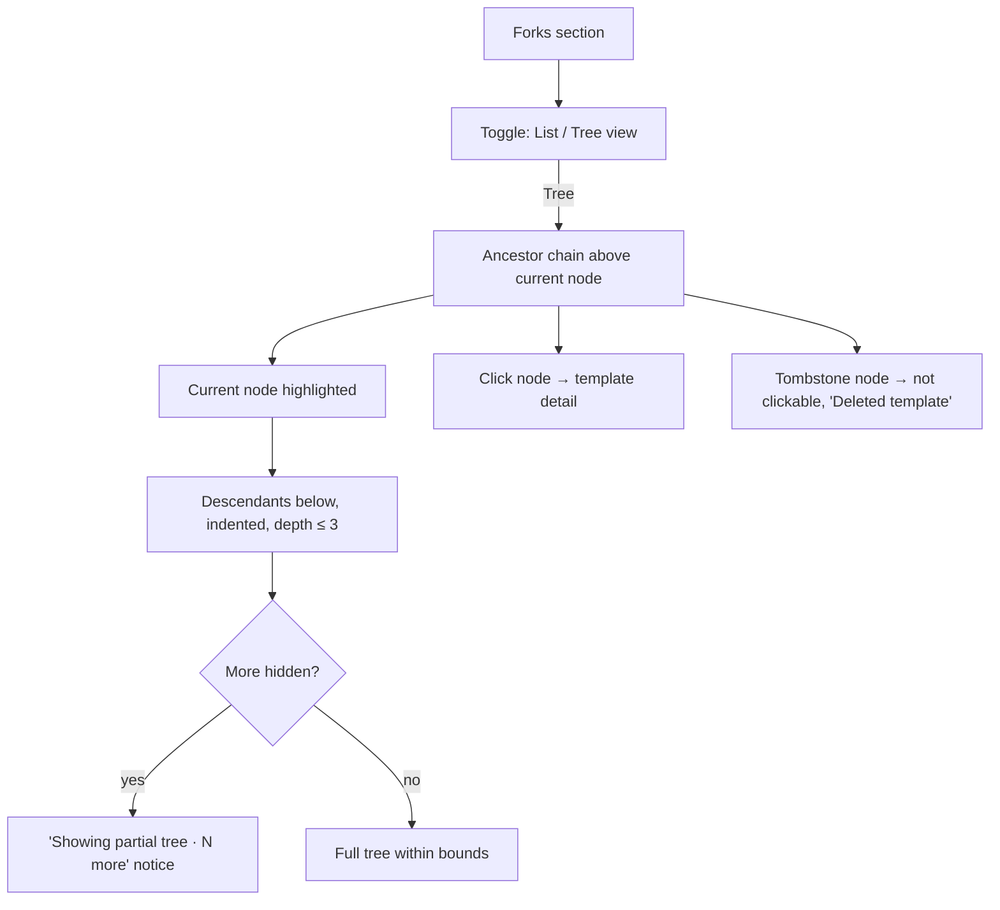
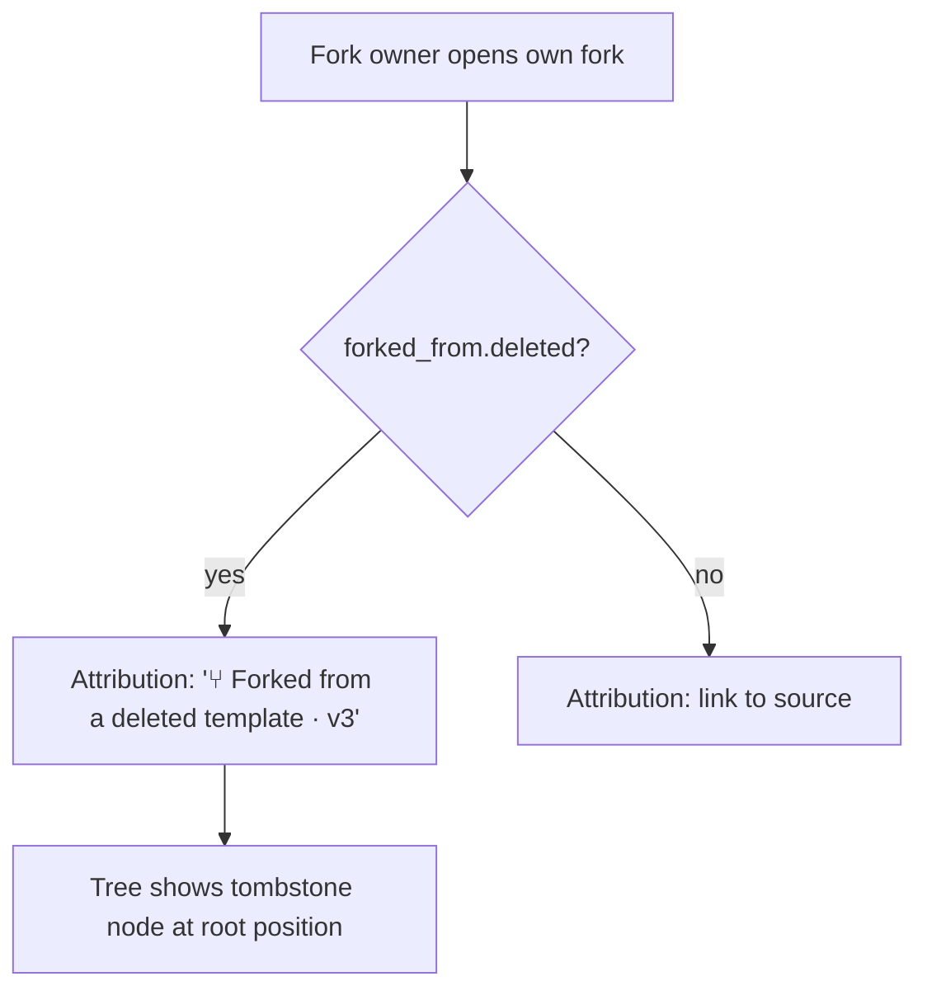

# Template Remix & Forks Tree — UI/UX Design

- **Feature ID:** template-remix-forks-tree
- **Version:** 1.0
- **Status:** Proposed (for architecture review)
- **Author:** ui-ux-agent
- **Date:** 2026-10-12
- **Companion doc:** `template-remix-forks-tree-requirements.md`

## 1. Design Principles

1. **Credit is visible, not buried.** The "forked from" line sits directly under the template title — the first place a reader's eye lands — not in a metadata drawer.
2. **Forks are discovery, not bookkeeping.** The forks section and lineage tree are surfaces for finding variants, styled like the rest of the template page (cards, sections), not like an admin table.
3. **Aurora-native.** Reuse tokens, card surfaces, section headers, Modal, Spinner, empty states, toasts (`NotificationContext`), light/dark themes. The tree is CSS-indented structure with connecting rules — no graph library.
4. **Privacy-first rendering.** Only public forks and the viewer's own forks are ever rendered; tombstones show that something existed without leaking anything about it.
5. **Graceful degradation.** Forks list/tree failures never affect the template detail page; missing lineage data simply hides the attribution line.

## 2. Information Architecture

```mermaid
flowchart LR
    A[/templates/:id] --> B[Attribution line under title]
    A --> C[Forks section: cards + tree toggle]
    B -->|link| A2[/templates/:sourceId]
    C -->|card click| A3[/templates/:forkId]
    C -->|tree node click| A3
    D[Fork modal] -->|View fork| A4[/templates/:newForkId]
    E[/admin/templates/:id] --> F[Read-only lineage panel]
    F -->|source link| E2[/admin/templates/:sourceId]
```

**Surfaces:**

| Surface | Access | Content |
|---|---|---|
| Attribution line on `/templates/:id` | public (per template visibility) | "⑂ Forked from {title} by {owner} · v{N}" or tombstone |
| Forks section on `/templates/:id` | public read | Fork count, fork cards (paginated), lineage tree toggle |
| Fork modal (existing, enhanced) | auth | Attribution notice + confirm |
| Post-fork success | forker | "View fork" action |
| `/admin/templates/:id` lineage panel | admin | Forked-from info + fork count (read-only) |

## 3. User Flows

### 3.1 View attribution & explore forks (viewer)



### 3.2 Fork a template (forker)

```mermaid
flowchart TD
    A[Click Fork on template detail] --> B[Modal: attribution notice + confirm]
    B -->|Confirm| C[POST /templates/:id/fork]
    C -->|success| D[Toast: forked + View fork button]
    D -->|View fork| E[/templates/:newId — attribution line visible]
    C -->|error| F[Error toast; modal stays for retry]
```

### 3.3 Lineage tree interaction



### 3.4 Source deleted (tombstone)



## 4. Page Layouts

### 4.1 Template detail — attribution line (under title)

```text
┌──────────────────────────────────────────────────────────────┐
│ [template header]                                            │
│                                                              │
│ SQL Query Assistant                    [⑂ 12] [♥ 89] [★ 34]  │
│ ⑂ Forked from "SQL Helper" by Alice · v4                     │
│                                                              │
│ [description, tags, content, … unchanged …]                  │
└──────────────────────────────────────────────────────────────┘
```

- Attribution line: small muted text with the fork glyph (⑂) prefix; title is a link to the source; owner name links to the source owner's profile when the follow-creators feature ships (plain text until then); "· v{N}" shows the source version at fork time.
- Tombstone variant: `⑂ Forked from a deleted template · v4` — no link, same muted style.
- The fork count chip `[⑂ 12]` joins the existing like/favorite chips in the header stats row (hidden when 0).

### 4.2 Template detail — Forks section (below content/comments)

```text
┌──────────────────────────────────────────────────────────────┐
│ Forks (12)                                    [List] [Tree]   │
├──────────────────────────────────────────────────────────────┤
│ List view (default):                                         │
│ ┌──────────────┐ ┌──────────────┐ ┌──────────────┐           │
│ │ PromptCard   │ │ PromptCard   │ │ PromptCard   │           │
│ │ (fork, ⑂ 3)  │ │ (fork, ⑂ 0)  │ │ (fork, ⑂ 1)  │           │
│ └──────────────┘ └──────────────┘ └──────────────┘           │
│                   [ Load more forks ]                        │
├──────────────────────────────────────────────────────────────┤
│ Tree view:                                                   │
│ ┌──────────────────────────────────────────────────────────┐ │
│ │ SQL Helper (root)                          by Alice  ⑂ 12 │ │
│ │ └─ SQL Query Assistant  ◀ current        by Bob     ⑂ 3  │ │
│ │    ├─ SQL Query Assistant (CN)           by Carol   ⑂ 1  │ │
│ │    └─ SQL Query Assistant Lite           by Dave    ⑂ 0  │ │
│ │ └─ SQL Helper for Postgres               by Erin    ⑂ 0  │ │
│ │                                                          │ │
│ │ Showing partial tree — 7 more forks hidden               │ │
│ └──────────────────────────────────────────────────────────┘ │
└──────────────────────────────────────────────────────────────┘
```

- **List view (default):** public forks as standard `PromptCard`s (each card shows its own fork count chip), newest first, "Load more" pagination (button, matching comments pattern).
- **Tree view:** toggle reveals the lineage tree. Ancestors render above the current node (indented chain), the current node is highlighted (accent border + "◀ current" marker), descendants below with indentation. Each node: title (link), owner display name, fork count. Tombstones: "Deleted template" in muted italic, not clickable.
- **Truncation notice:** when the tree is cut by bounds, a muted notice shows the hidden count; no expand action in v1 (the forks list is the complete public view).
- **Own private forks:** appear in both views for their owner, marked with a small "Private" chip; invisible to everyone else.

### 4.3 Fork modal (existing modal, enhanced copy)

```text
┌──────────────────────────────────────────────┐
│ Fork Template                                │
├──────────────────────────────────────────────┤
│ Are you sure you want to fork this template  │
│ to your private library? The latest version  │
│ content will be copied.                      │
│                                              │
│ ⓘ This fork will show "Forked from           │
│    'SQL Helper' by Alice" on its page.       │
│                                              │
│                        [Cancel] [Fork]       │
└──────────────────────────────────────────────┘
```

### 4.4 Post-fork success toast

```text
┌──────────────────────────────────────────────┐
│ ✓  Template forked successfully!             │
│    [View fork →]                             │
└──────────────────────────────────────────────┘
```

- The existing success toast gains a "View fork" action button navigating to the new template. If the toast component cannot host actions, the modal transforms into a success state with the same button (fallback, same copy).

### 4.5 Admin console — lineage panel on `/admin/templates/:id`

```text
┌──────────────────────────────────────────────────────────────┐
│ Lineage                                                      │
├──────────────────────────────────────────────────────────────┤
│ Forked from:  SQL Helper · v4 · by Alice   [Open in admin →] │
│ Fork count:   12 forks (public + private)                    │
│               [View public forks →] (opens /templates/:id)   │
└──────────────────────────────────────────────────────────────┘
```

- Read-only panel below existing template info. "Open in admin" links to the source's admin detail when it exists; tombstone text otherwise. "View public forks" deep-links to the public template page's forks section.

## 5. Component Specs

| Component | Notes |
|---|---|
| `ForkAttributionLine` | Muted line under title; link/tombstone variants; hides entirely when lineage data missing |
| `ForksSection` | Container on TemplateDetails; owns list/tree state, pagination, count; fetches via api service |
| `ForksList` | Paginated `PromptCard` grid of public forks + own private forks |
| `ForkLineageTree` | Indented tree: ancestors, current (highlighted), descendants ≤ depth 3; tombstones; truncation notice |
| `ForkCountChip` | `⑂ N` chip reused on header stats and PromptCard; hidden at 0 |
| `ForkModal` (enhanced) | Existing modal + attribution notice paragraph |
| `AdminLineagePanel` | Read-only forked-from + fork count on admin template detail |

All new i18n keys live under `forks.*` and `admin.forks.*` namespaces in both `en` and `zh` translation files.

## 6. Interaction Details

- **List/Tree toggle:** segmented control in the section header; selection persists per session (component state, not persisted storage); default is List.
- **Tree rendering:** pure CSS indentation (padding-left per depth) with vertical connector rules (`::before` borders) — no graph library, no absolute positioning; nodes are focusable links.
- **Counter sync:** `fork_count` from the template response is the source of truth; a successful fork by the viewer increments the local count immediately (no refetch).
- **Card click:** fork cards navigate to the fork's detail page (standard PromptCard behavior); tree nodes navigate to the node's template.
- **Load more:** appends next page of forks (button, not infinite scroll — matches comments/admin patterns).
- **Keyboard:** tree nodes are real links in tab order; the List/Tree toggle is a radiogroup (arrow keys); attribution link is a standard link; all actions reachable without a mouse.
- **Deep chains:** ancestors beyond 10 hops are cut with the same truncation notice pattern (rare; copy shared with descendants notice).

## 7. States Summary

| Context | Loading | Empty | Error |
|---|---|---|---|
| Attribution line | Part of template fetch; absent while loading | Hidden (original template) | Hidden (data missing) |
| Forks list | Card grid skeleton (3 cards) | "No forks yet — be the first to build on this template" | Inline error + Retry; page unaffected |
| Lineage tree | Tree skeleton (3 shimmer rows) | n/a (tree always has ≥ 1 node: current) | Inline error + Retry (tree area only) |
| Fork action | Button spinner in modal | n/a | Error toast; modal stays open for retry |
| Admin lineage panel | Inline skeleton row | "Original template — not forked from any source" | Muted "Lineage unavailable" text |

## 8. i18n String Table (EN/ZH)

| Key (EN) | ZH |
|---|---|
| forks.sectionTitle / Forks | Fork |
| forks.forkCount / {{count}} forks | {{count}} 次 Fork |
| forks.attribution / Forked from "{{title}}" by {{owner}} · v{{version}} | Fork 自 {{owner}} 的"{{title}}" · v{{version}} |
| forks.attributionDeleted / Forked from a deleted template · v{{version}} | Fork 自一个已删除的模板 · v{{version}} |
| forks.listTab / List | 列表 |
| forks.treeTab / Tree | 树 |
| forks.currentNode / Current | 当前 |
| forks.privateChip / Private | 私有 |
| forks.tombstone / Deleted template | 已删除的模板 |
| forks.truncated / Showing partial tree — {{count}} more forks hidden | 仅显示部分树 —— 还有 {{count}} 个 Fork 未显示 |
| forks.truncatedAncestors / Showing partial lineage — older ancestors hidden | 仅显示部分谱系 —— 更早的上游已省略 |
| forks.loadMore / Load more forks | 加载更多 Fork |
| forks.empty / No forks yet — be the first to build on this template | 还没有 Fork —— 成为第一个基于此模板创作的人 |
| forks.error / Couldn't load forks. | 无法加载 Fork。 |
| forks.retry / Retry | 重试 |
| forks.modalNotice / This fork will show "Forked from "{{title}}" by {{owner}}" on its page. | 此 Fork 的页面将显示"Fork 自 {{owner}} 的"{{title}}""。 |
| forks.viewFork / View fork | 查看 Fork |
| forks.forkedBadge / Forked | 已 Fork |
| admin.forks.lineageTitle / Lineage | 谱系 |
| admin.forks.forkedFrom / Forked from | Fork 自 |
| admin.forks.forkCount / Fork count | Fork 数 |
| admin.forks.forkCountValue / {{count}} forks (public + private) | {{count}} 次 Fork（公开 + 私有） |
| admin.forks.openInAdmin / Open in admin | 在管理台打开 |
| admin.forks.viewPublicForks / View public forks | 查看公开 Fork |
| admin.forks.original / Original template — not forked from any source | 原创模板 —— 非 Fork 而来 |
| admin.forks.unavailable / Lineage unavailable | 谱系信息不可用 |

## 9. Accessibility

- Tree is a nested `<ul>`/`<li>` structure; each node is a focusable link; depth conveyed by list nesting semantics (not color alone).
- Current node marked with both the accent border and the visible "Current" text label.
- Tombstones are plain text (`<span>`, not links) with "Deleted template" — announced clearly.
- List/Tree toggle uses the radiogroup pattern with arrow-key navigation and `aria-checked`.
- Fork count chips pair the ⑂ glyph with a number and an `aria-label` ("12 forks"); never color-only.
- Attribution line is a real link with descriptive accessible name ("Forked from SQL Helper by Alice, version 4").
- All states (loading skeletons, error + Retry, empty) are keyboard-reachable and screen-reader announced; toasts use the existing live-region pattern.
- Colors meet WCAG AA in both themes (token-based).

## 10. Responsive Behavior

- **Attribution line:** wraps to a second line on narrow screens; title link may truncate with ellipsis (single line, `title` tooltip carries full text).
- **Forks list:** card grid reflows with the existing PromptCard breakpoints (3 → 2 → 1 columns).
- **Lineage tree:** indentation step shrinks from 24px to 16px below 480px; long titles truncate with ellipsis + tooltip; owner names hide below 360px (title + count remain).
- **Fork modal & toast:** full-width bottom sheet pattern on small screens (existing modal responsive behavior).
- **Admin lineage panel:** rows wrap (label above value) below the admin console's tablet breakpoint.

## 11. Analytics (optional, if analytics feature ships)

- `fork_section_opened`, `fork_tree_toggled` (view), `fork_card_clicked`, `fork_tree_node_clicked`, `fork_view_fork_clicked` — product usage only; no new instrumentation infrastructure in v1.

## 12. Out of Scope (mirrors requirements §8)

Interactive network graph, upstream sync, source-update notifications, root-owner notifications, fork notes, lineage editing, private-fork visibility for admins in the public tree, fork search/filtering, fork data in JSON export, API-key access to fork endpoints, and any monetization-adjacent surface.
