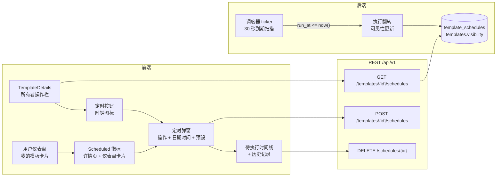
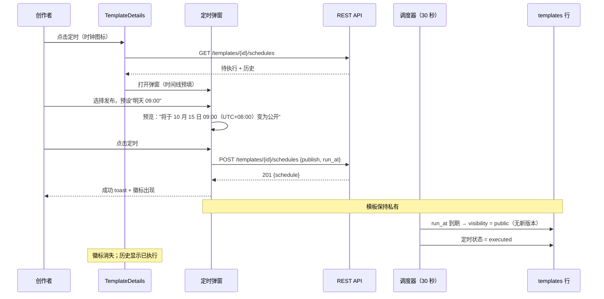
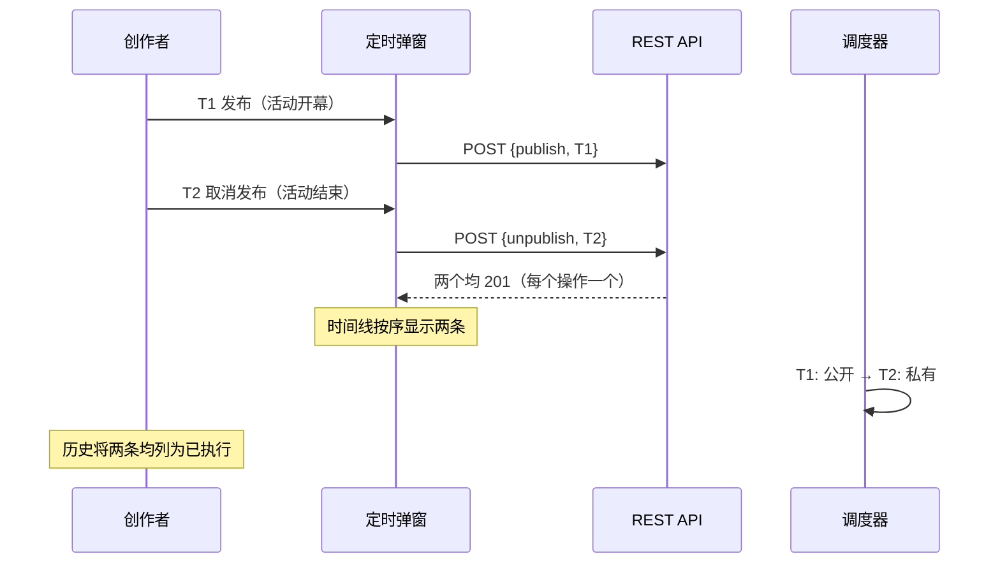
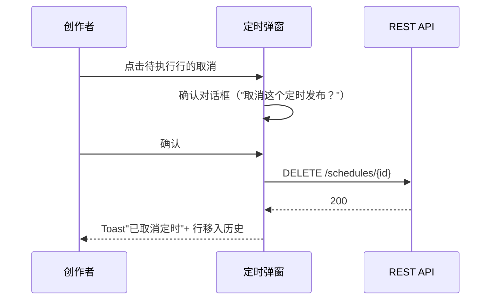
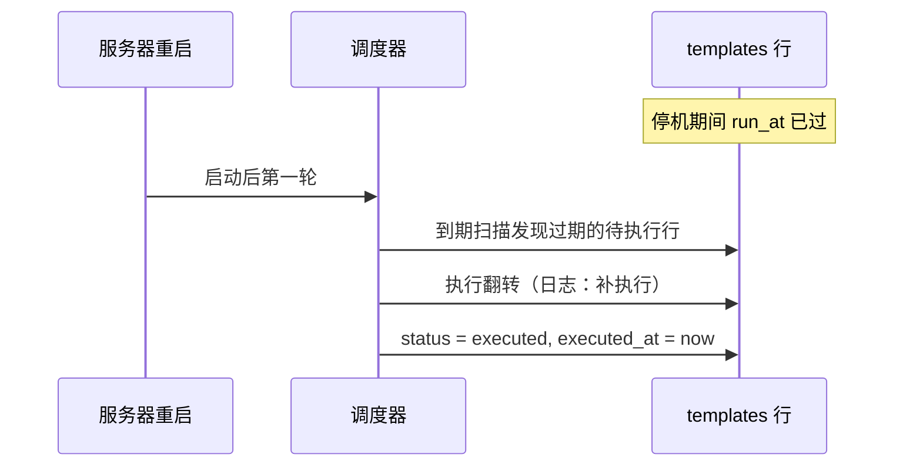

# 模板定时分享 — UI/UX 设计

- **Feature ID:** template-scheduler-sharing
- **Version:** 1.0
- **Status:** Proposed（待架构评审）
- **Author:** ui-ux-agent
- **Date:** 2026-10-12
- **Related docs:** [需求文档](./template-scheduler-sharing-requirements-zh-CN.md) · [English UI/UX design](./template-scheduler-sharing-ui-ux-design.md)

## 1. 设计原则

1. **定时是一个弹窗，不是一个新页面。** 创作者已经在自己的模板上；定时按钮紧邻分享按钮并打开一个聚焦的弹窗 —— 无导航、无新心智模型。
2. **预设优先，日期时间其次。** "明天 09:00"和"+7 天"覆盖常见场景；原生日期时间选择器服务其余情况。没人愿意手打时间戳。
3. **待执行状态始终可见。** 模板页和仪表盘卡片上的时钟徽标加上弹窗内的时间线意味着自动化从不隐形 —— 信任来自看到它已就绪。
4. **本地时间，明确标注。** 每个时间都显示带 `(UTC±HH:MM)` 标签的绝对本地时间和相对提示；UTC 歧义是定时功能的第一大 bug 来源，从设计上消除。
5. **手动与自动无意外共存。** 手动分享/取消分享照常工作；分享区域的待执行提示说明接下来会发生什么，因此任何翻转都有解释。

## 2. 信息架构



## 3. 用户流程

### 3.1 定时未来发布（主流程）



### 3.2 打开限时分享窗口



### 3.3 取消待执行定时



### 3.4 停机后补执行



## 4. 页面布局（线框图）

### 4.1 TemplateDetails 所有者操作栏（插入位置）

```
┌──────────────────────────────────────────────────────────────────┐
│  [模板标题]                              [私有 ●] 徽标            │
│  ────────────────────────────────────────────────────────────────│
│  ⏰ 已定时：公开 10 月 15 日 09:00（UTC+08:00）          ← 徽标   │
│  ────────────────────────────────────────────────────────────────│
│  [分享] [⏰ 定时] [Fork] [编辑] [删除]                          │
└──────────────────────────────────────────────────────────────────┘
```

### 4.2 定时弹窗 — 创建

```
┌──────────────────────────────────────────────────────────────┐
│  定时分享                                               [×]   │
│  ────────────────────────────────────────────────────────────│
│  操作                                                          │
│  ┌─────────────────┬─────────────────┐                       │
│  │  ◉ 发布         │  ○ 取消发布      │   （分段控件）         │
│  └─────────────────┴─────────────────┘                       │
│                                                               │
│  时间                                                          │
│  ┌───────────────────────────────┬──────────┐               │
│  │ 2026-10-15  09:00              │  📅      │               │
│  └───────────────────────────────┴──────────┘               │
│  预设：  [明天 09:00]  [+1 天]  [+7 天]                       │
│  时区：你的本地时间（UTC+08:00）                                │
│                                                               │
│  ▸ 该模板将于 2026 年 10 月 15 日 09:00（UTC+08:00）          │
│    变为公开 —— 2 天后。                                        │
│                                                               │
│  待执行（2）                                                   │
│  ▲ ⏰ 公开   10 月 15 日 09:00（UTC+08:00）· 2 天后   [取消]  │
│  ▼ ⏱ 私有   10 月 22 日 09:00（UTC+08:00）· 9 天后   [取消]  │
│                                                               │
│  ▸ 历史记录（折叠）                                             │
│                                                               │
│                        [取消]  [ 定时 ]                       │
└──────────────────────────────────────────────────────────────┘
```

### 4.3 历史记录区块（展开）

```
┌──────────────────────────────────────────────────────────────┐
│  历史记录                                                      │
│  ⏰ 公开   已执行   10 月 8 日 09:00  （按时执行）              │
│  ⏱ 私有   已取消   10 月 5 日 14:20  （由你取消）              │
│  ⏰ 公开   已执行   10 月 1 日 09:00  （补执行，延迟 3 分钟）   │
│  ────────────────────────────────────────────────────────────│
│  显示最近 10 条                                                 │
└──────────────────────────────────────────────────────────────┘
```

### 4.4 仪表盘卡片徽标

```
┌────────────────────────────┐
│  [卡片标题]                 │
│  分类 · 3 个标签            │
│  ⏰ 2 天后公开  ← 徽标（悬停：10 月 15 日 09:00 UTC+08:00）
│  ♥ 12   ★ 4   ⑂ 2         │
└────────────────────────────┘
```

### 4.5 取消确认对话框

```
┌──────────────────────────────────────────────────────────────┐
│  取消这个定时发布？                                             │
│  模板将保持私有，10 月 15 日 09:00 不会再自动变更。             │
│                        [保留定时]  [ 取消定时 ]               │
└──────────────────────────────────────────────────────────────┘
```

## 5. 组件规格

| 组件 | 基于 | Props / 行为 |
|---|---|---|
| `ScheduleButton` | 现有所有者操作按钮模式 | 时钟图标 + 文案；仅所有者；打开 `ScheduleModal`；定时列表首次加载期间禁用（仅首次）。 |
| `ScheduleModal` | `CreateTemplateModal` 弹窗模式 | 两个区块：创建表单（操作分段控件、`datetime-local` 输入、预设 chips、时区标签、预览语句）和待执行时间线 + 折叠历史；打开时加载 `GET /schedules`；提交 → `POST`；徽标乐观更新。 |
| `ActionSegmentedControl` | 分段控件模式 | 发布/取消发布两个选项带图标（▲ 公开 / ▼ 私有）；键盘方向键导航；选择驱动预览语句。 |
| `PresetChips` | 标签 chip 模式 | 三个 chips（明天 09:00 / +1 天 / +7 天）；点击填充日期时间输入；输入匹配预设时显示激活态。 |
| `PreviewSentence` | 展示型组件 | 随操作 + 日期时间实时更新；显示绝对本地时间 + `(UTC±HH:MM)` + 相对提示；`role="status"` 温和播报。 |
| `PendingTimeline` | 列表模式 | 按 `run_at` 升序排列；行：操作图标、绝对时间 + 相对提示、取消按钮（仅待执行）；空状态"暂无待执行的定时"。 |
| `HistoryList` | 折叠区块模式 | 最近 10 条已执行/已取消；状态徽标（已执行绿色 / 已取消灰色）；"按时执行"与"补执行，延迟 N 分钟"细节。 |
| `ScheduledBadge` | 徽标模式 | 时钟图标 + 简短相对时间；悬停显示确切时间；位于 TemplateDetails 所有者栏和仪表盘卡片；点击 → 打开 `ScheduleModal`。 |
| `CancelConfirmDialog` | 现有确认模式 | 点明操作和时间；说明后果；确认按钮使用破坏性样式。 |

## 6. 交互细节

1. **打开弹窗：** 定时按钮打开弹窗；打开即发起定时列表请求（时间线加载中显示骨架行）；焦点移到操作分段控件。
2. **预览实时更新：** 每次操作或日期时间变更立即重新渲染预览语句（无需提交）；无效状态显示行内错误而非预览。
3. **预设：** 点击预设填充日期时间输入并标记 chip 激活；手动编辑输入清除激活 chip；预设以浏览器本地时间的"现在"为基准计算。
4. **提交：** 操作 + 有效未来时间齐备前禁用；服务端错误映射到行内（重复待执行操作 → 操作控件下方；上限 → 头部下方；过去/90 天窗口 → 日期时间输入下方）。
5. **成功：** 弹窗保持打开，新行出现在时间线（乐观），toast 以绝对时间确认，弹窗背后的页面出现徽标。
6. **取消待执行：** 取消按钮 → 确认对话框 → `DELETE`；行移入历史显示为已取消（乐观、出错回滚）；若这是唯一的待执行定时，徽标消失。
7. **徽标点击：** 打开弹窗并滚动到时间线（移动端折叠创建表单），让创作者在修改前先看到已就绪的内容。
8. **时区标签：** 从 `Intl.DateTimeFormat().resolvedOptions().timeZone` 偏移一次性计算；显示在日期时间输入下方和每个时间线行中；绝不假设服务器时区。
9. **相对提示：** "2 天后"、"5 小时后"、"30 分钟后"使用现有相对时间辅助函数模式；渲染时重新计算，不轮询。
10. **键盘：** 弹窗焦点圈定、Escape 关闭、焦点返回定时按钮；分段控件使用方向键；时间线行可聚焦且取消按钮可通过 Tab 到达；所有操作可用键盘完成。

## 7. 状态汇总

| 状态 | 触发 | UI |
|---|---|---|
| 弹窗加载中 | 首次打开 | 时间线骨架行；表单可用 |
| 无待执行定时 | 时间线为空 | "暂无待执行的定时 —— 在下方新建一个" |
| 日期时间无效 | 过去时间 / 超过 90 天 | 输入下方行内错误；预览隐藏；提交禁用 |
| 重复待执行操作 | 相同操作已待执行 | 操作控件下方行内错误；提交禁用 |
| 达到上限 | 用户级 20 个待执行 | 头部下方行内错误；提交禁用 |
| 创建成功 | 201 | Toast + 时间线行 + 徽标 |
| 取消成功 | 200 | Toast + 行 → 历史；徽标可能消失 |
| 取消冲突 | 409（已执行） | 错误 toast；时间线重新拉取（行已移动） |
| 按时执行 | 调度器在 run_at 执行 | 历史行"按时执行"；徽标清除 |
| 延迟执行（补执行） | 停机延迟了执行 | 历史行"补执行，延迟 N 分钟" |
| API 错误 | 网络/5xx | 错误 toast；乐观变更回滚 |
| 非所有者 | 非本人模板 | 无定时按钮；API 返回 not_found |

## 8. i18n 字符串表

命名空间：`scheduling`（新增）+ `template_details`（扩展）+ `dashboard`（扩展）。

| 键 / 中文 | 英文 |
|---|---|
| `template_details.schedule` / 定时分享 | Schedule |
| `template_details.scheduled_badge` / 已定时：{{action}} {{time}} | Scheduled: {{action}} {{time}} |
| `scheduling.title` / 定时分享 | Schedule sharing |
| `scheduling.action_label` / 操作 | Action |
| `scheduling.action_publish` / 发布 | Publish |
| `scheduling.action_unpublish` / 取消发布 | Unpublish |
| `scheduling.when_label` / 时间 | When |
| `scheduling.presets_label` / 快捷选项 | Presets |
| `scheduling.preset_tomorrow` / 明天 09:00 | Tomorrow 09:00 |
| `scheduling.preset_plus1` / +1 天 | +1 day |
| `scheduling.preset_plus7` / +7 天 | +7 days |
| `scheduling.timezone_label` / 你的本地时间（{{offset}}） | Your local time ({{offset}}) |
| `scheduling.preview_publish` / 该模板将于 {{date}} {{time}}（{{offset}}）变为公开 —— {{relative}}。 | This template will become public on {{date}} at {{time}} ({{offset}}) — {{relative}}. |
| `scheduling.preview_unpublish` / 该模板将于 {{date}} {{time}}（{{offset}}）变为私有 —— {{relative}}。 | This template will become private on {{date}} at {{time}} ({{offset}}) — {{relative}}. |
| `scheduling.pending_title` / 待执行（{{count}}） | Pending ({{count}}) |
| `scheduling.pending_empty` / 暂无待执行的定时 —— 在下方新建一个。 | No pending schedules — schedule one below. |
| `scheduling.row_publish` / 公开 | public |
| `scheduling.row_unpublish` / 私有 | private |
| `scheduling.cancel` / 取消 | Cancel |
| `scheduling.history_title` / 历史记录 | History |
| `scheduling.history_footer` / 显示最近 10 条 | Showing latest 10 |
| `scheduling.status_executed` / 已执行 | executed |
| `scheduling.status_cancelled` / 已取消 | cancelled |
| `scheduling.ran_on_time` / 按时执行 | ran on time |
| `scheduling.ran_late` / 补执行，延迟 {{delay}} | catch-up, {{delay}} late |
| `scheduling.cancelled_by_you` / 由你取消 | by you |
| `scheduling.submit` / 定时 | Schedule |
| `scheduling.close` / 取消 | Cancel |
| `scheduling.error_past` / 请选择未来的时间（至少 1 分钟后） | Pick a time in the future (at least 1 minute from now) |
| `scheduling.error_window` / 请选择 90 天内的时间 | Pick a time within the next 90 days |
| `scheduling.error_duplicate` / 该模板已有一个待执行的{{action}}定时 | A {{action}} schedule is already pending for this template |
| `scheduling.error_cap` / 最多同时保留 20 个待执行定时，请先取消一个。 | You can have at most 20 pending schedules. Cancel one first. |
| `scheduling.error_generic` / 出错了，请重试 | Something went wrong — try again |
| `scheduling.success_created` / 已定时 —— 该模板将于 {{time}}变为{{action}} | Scheduled — this template will become {{action}} {{time}} |
| `scheduling.success_cancelled` / 已取消定时 | Schedule cancelled |
| `scheduling.cancel_dialog_title` / 取消这个定时{{action}}？ | Cancel this scheduled {{action}}? |
| `scheduling.cancel_dialog_body` / 模板将保持{{state}}，{{time}}不会再自动变更。 | The template will stay {{state}} and no automatic change will happen on {{time}}. |
| `scheduling.cancel_dialog_keep` / 保留定时 | Keep schedule |
| `scheduling.cancel_dialog_confirm` / 取消定时 | Cancel schedule |
| `scheduling.badge_tooltip` / {{action}}于 {{time}}（{{offset}}） | {{action}} at {{time}} ({{offset}}) |
| `scheduling.badge_relative` / {{action}}还有 {{relative}} | {{action}} in {{relative}} |
| `dashboard.scheduled_badge` / 已定时 | Scheduled |

## 9. 无障碍说明

- 操作分段控件是 radiogroup（`role="radiogroup"`、`role="radio"` 选项），支持方向键导航和可见焦点环；选中状态由 `aria-checked` 传达，而非仅靠颜色。
- 预览语句是 `role="status"`（温和 live region），日期时间变更会被播报且不抢占焦点。
- 日期时间输入使用原生 `datetime-local` 控件（免费获得平台无障碍支持）并带显式 `<label>`；时区标签通过 `aria-describedby` 关联到输入。
- 时间线行是列表项，带可聚焦的取消按钮；操作（公开/私有）由图标 + 文字传达，绝不只靠图标。
- 弹窗是 `role="dialog"` 且 `aria-modal`、焦点圈定、Escape 关闭、焦点返回定时按钮。
- 徽标以其悬停内容（确切时间）作为可访问名称；它是真实的按钮（打开弹窗），不是装饰性 span。
- 相对提示（"2 天后"）是补充 —— 绝对时间始终存在，因此屏幕阅读器用户获得完整事实而非仅相对信息。
- 取消确认对话框是 `role="alertdialog"`；破坏性确认按钮视觉为红色并以完整标签播报。

## 10. 响应式行为

- **桌面（≥1024px）：** 弹窗居中 520 px；拒绝时间线与表单并排 —— 区块堆叠保持单列；徽标内联在所有者栏。
- **平板（768–1023px）：** 弹窗全宽、24 px 边距；预设换行为两行；徽标截断为图标 + 相对时间。
- **移动端（<768px）：** 弹窗变为带拖拽手柄的底部弹层；从徽标打开时创建表单折叠在"新建定时"开关后（时间线优先）；日期时间输入使用原生选择器（系统面板）；预设 chips 横向滚动；徽标显示图标 + 简短相对（"2 天后"）。
- 所有者操作栏在窄宽度下换行为两行（定时紧邻分享）；所有触控目标保持 ≥ 44 px。

## 11. 分析事件（可选，若分析功能上线）

- `schedule_created` `{action, lead_time_bucket}`（分桶：<1h、<1d、<7d、≥7d）
- `schedule_preset_used` `{preset}`
- `schedule_cancelled` `{action, time_until_run_bucket}`
- `schedule_executed_viewed`（历史被打开）
- `scheduled_badge_clicked` `{surface: details | dashboard}`

## 12. 不在范围内（UI）

- 平台级定时的管理控制台视图。
- 循环定时编辑器（每周网格、cron 式输入）。
- 执行通知（用户离线时定时触发的 toast/邮件）。
- 仪表盘上的批量定时 UI（批量操作由 bulk-operations 负责）。
- 日历集成（ICS 导出、Google Calendar 链接）。
- 专门的"已定时"仪表盘标签页（卡片徽标已覆盖 v1）。
