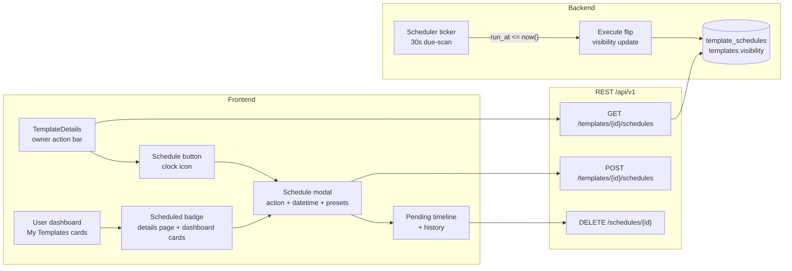
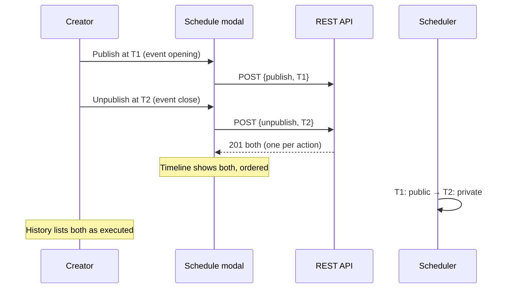
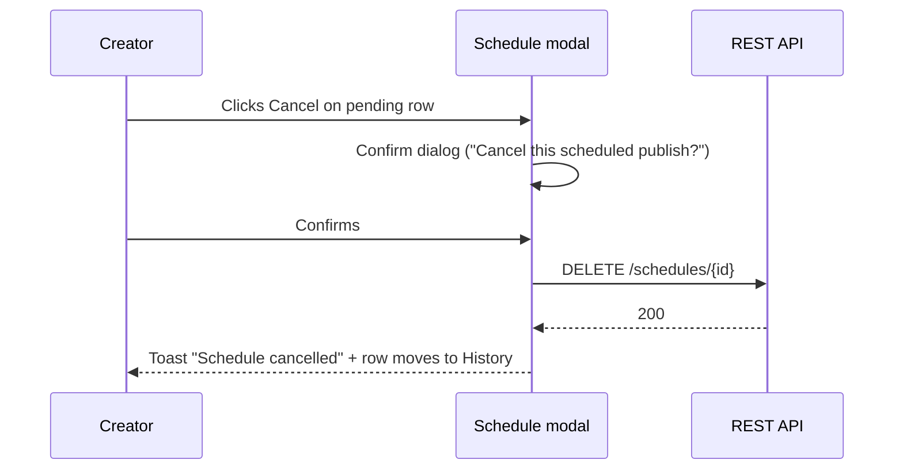
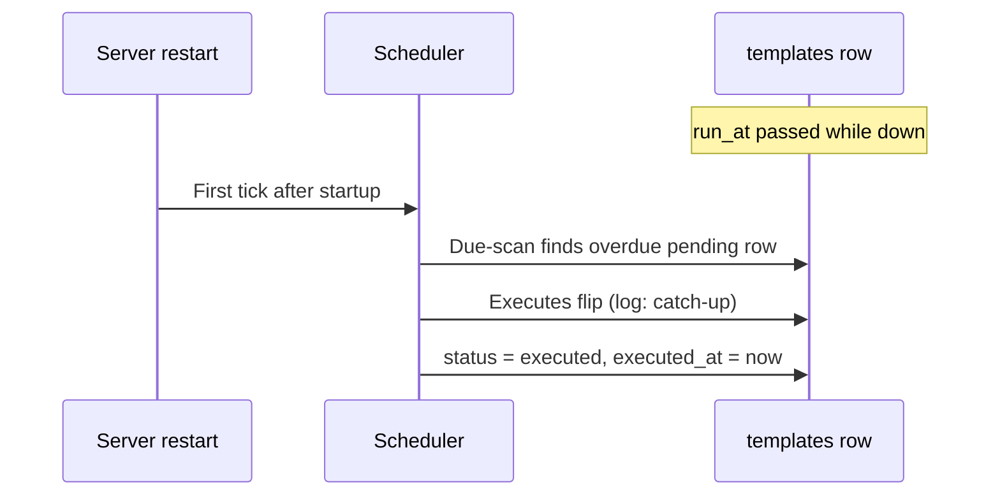

# Template Scheduler Sharing — UI/UX Design

- **Feature ID:** template-scheduler-sharing
- **Version:** 1.0
- **Status:** Proposed (for architecture review)
- **Author:** ui-ux-agent
- **Date:** 2026-10-12
- **Related docs:** [Requirements](./template-scheduler-sharing-requirements.md) · [中文 UI/UX 设计](./template-scheduler-sharing-ui-ux-design-zh-CN.md)

## 1. Design Principles

1. **Scheduling is one modal, not a new page.** The creator is already on their template; the Schedule button sits beside Share and opens a focused modal — no navigation, no new mental model.
2. **Presets first, datetime second.** "Tomorrow 09:00" and "+7 days" cover the common cases; the native datetime picker is there for the rest. Nobody types timestamps.
3. **The pending state is always visible.** A clock badge on the template page and dashboard cards plus a timeline in the modal mean automation is never invisible — trust comes from seeing it armed.
4. **Local time, explicitly labeled.** Every time shows absolute local time with a `(UTC±HH:MM)` label and a relative hint; UTC ambiguity is the #1 scheduling bug class and is designed out.
5. **Manual and automatic coexist without surprises.** Manual Share/Unshare keeps working; the pending hint in the share area explains what will happen next, so no flip is ever unexplained.

## 2. Information Architecture



## 3. User Flows

### 3.1 Schedule a future publish (primary flow)

```mermaid
sequenceDiagram
    participant U as Creator
    participant TD as TemplateDetails
    participant SM as Schedule modal
    participant API as REST API
    participant SC as Scheduler (30s)
    participant T as templates row

    U->>TD: Clicks Schedule (clock icon)
    TD->>API: GET /templates/{id}/schedules
    API-->>TD: pending + history
    TD->>SM: Opens modal (timeline prefilled)
    U->>SM: Picks Publish, preset "Tomorrow 09:00"
    SM->>SM: Preview: "will become public Oct 15, 09:00 (UTC+08:00)"
    U->>SM: Clicks Schedule
    SM->>API: POST /templates/{id}/schedules {publish, run_at}
    API-->>SM: 201 {schedule}
    SM-->>U: Success toast + badge appears
    Note over SM,T: Template stays private
    SC->>T: run_at due → visibility = public (no version)
    SC->>T: schedule status = executed
    Note over TD: Badge disappears; History shows executed
```

### 3.2 Open a time-boxed share window



### 3.3 Cancel a pending schedule



### 3.4 Catch-up after downtime



## 4. Page Layouts (Wireframes)

### 4.1 TemplateDetails owner action bar (insertion)

```
┌──────────────────────────────────────────────────────────────────┐
│  [Template title]                          [Private ●] badge     │
│  ────────────────────────────────────────────────────────────────│
│  ⏰ Scheduled: public Oct 15, 09:00 (UTC+08:00)        ← badge   │
│  ────────────────────────────────────────────────────────────────│
│  [Share] [⏰ Schedule] [Fork] [Edit] [Delete]                    │
└──────────────────────────────────────────────────────────────────┘
```

### 4.2 Schedule modal — create

```
┌──────────────────────────────────────────────────────────────┐
│  Schedule sharing                                     [×]   │
│  ────────────────────────────────────────────────────────────│
│  ACTION                                                       │
│  ┌─────────────────┬─────────────────┐                       │
│  │  ◉ Publish      │  ○ Unpublish    │   (segmented)         │
│  └─────────────────┴─────────────────┘                       │
│                                                               │
│  WHEN                                                         │
│  ┌───────────────────────────────┬──────────┐               │
│  │ 2026-10-15  09:00              │  📅      │               │
│  └───────────────────────────────┴──────────┘               │
│  Presets:  [Tomorrow 09:00]  [+1 day]  [+7 days]            │
│  Timezone: your local time (UTC+08:00)                       │
│                                                               │
│  ▸ This template will become public on Oct 15, 2026          │
│    at 09:00 (UTC+08:00) — in 2 days.                         │
│                                                               │
│  PENDING (2)                                                  │
│  ▲ ⏰ public  Oct 15, 09:00 (UTC+08:00) · in 2 days  [Cancel]│
│  ▼ ⏱ private  Oct 22, 09:00 (UTC+08:00) · in 9 days [Cancel]│
│                                                               │
│  ▸ History (collapsed)                                        │
│                                                               │
│                        [Cancel]  [ Schedule ]                │
└──────────────────────────────────────────────────────────────┘
```

### 4.3 History section (expanded)

```
┌──────────────────────────────────────────────────────────────┐
│  HISTORY                                                      │
│  ⏰ public   executed  Oct 8, 09:00  (ran on time)            │
│  ⏱ private  cancelled Oct 5, 14:20  (by you)                 │
│  ⏰ public   executed  Oct 1, 09:00  (catch-up, 3m late)      │
│  ────────────────────────────────────────────────────────────│
│  Showing latest 10                                            │
└──────────────────────────────────────────────────────────────┘
```

### 4.4 Dashboard card badge

```
┌────────────────────────────┐
│  [Card title]              │
│  Category · 3 tags         │
│  ⏰ public in 2 days  ← badge (tooltip: Oct 15, 09:00 UTC+08:00)
│  ♥ 12   ★ 4   ⑂ 2         │
└────────────────────────────┘
```

### 4.5 Cancel confirmation dialog

```
┌──────────────────────────────────────────────────────────────┐
│  Cancel this scheduled publish?                               │
│  The template will stay private and no automatic change      │
│  will happen on Oct 15, 09:00.                                │
│                        [Keep schedule]  [ Cancel schedule ]  │
└──────────────────────────────────────────────────────────────┘
```

## 5. Component Specifications

| Component | Based on | Props / Behavior |
|---|---|---|
| `ScheduleButton` | existing owner action button pattern | Clock icon + label; owner-only; opens `ScheduleModal`; disabled while schedules load (first open only). |
| `ScheduleModal` | `CreateTemplateModal` modal pattern | Two sections: create form (action segmented control, `datetime-local` input, preset chips, timezone label, preview sentence) and pending timeline + collapsible history; loads `GET /schedules` on open; submit → `POST`; optimistic badge update. |
| `ActionSegmentedControl` | segmented control pattern | Two options Publish/Unpublish with icons (▲ public / ▼ private); keyboard arrow navigation; selection drives preview sentence. |
| `PresetChips` | tag chip pattern | Three chips (Tomorrow 09:00 / +1 day / +7 days); click fills the datetime input; active state when input matches a preset. |
| `PreviewSentence` | presentational | Live-updates from action + datetime; shows absolute local time + `(UTC±HH:MM)` + relative hint; `role="status"` for polite announcement. |
| `PendingTimeline` | list pattern | Ordered by `run_at` ascending; row: action icon, absolute time + relative hint, Cancel button (pending only); empty state "No pending schedules". |
| `HistoryList` | collapsed section pattern | Latest 10 executed/cancelled; status chip (Executed green / Cancelled gray); "ran on time" vs "catch-up, Nm late" detail. |
| `ScheduledBadge` | badge pattern | Clock icon + short relative time; tooltip with exact time; on TemplateDetails owner bar and dashboard cards; click → opens `ScheduleModal`. |
| `CancelConfirmDialog` | existing confirm pattern | Names the action and time; states the consequence; destructive styling on confirm. |

## 6. Interaction Details

1. **Open modal:** Schedule button opens the modal; schedules fetch fires on open (skeleton rows in timeline while loading); focus moves to the action segmented control.
2. **Preview updates live:** every action or datetime change re-renders the preview sentence immediately (no submit needed); invalid states show inline errors instead of the preview.
3. **Presets:** clicking a preset fills the datetime input and marks the chip active; editing the input manually clears the active chip; presets compute from "now" in browser-local time.
4. **Submit:** disabled until action + valid future datetime; server errors map inline (duplicate pending action → under the action control; cap → under the header; past/90-day window → under the datetime input).
5. **Success:** modal stays open, new row appears in the timeline (optimistic), toast confirms with the absolute time, badge appears on the page behind the modal.
6. **Cancel pending:** Cancel button → confirm dialog → `DELETE`; row moves to History as cancelled (optimistic with rollback on error); if it was the only pending schedule, the badge disappears.
7. **Badge click:** opens the modal scrolled to the timeline (create form collapsed on mobile) so the creator sees what's armed before changing it.
8. **Timezone label:** computed once from `Intl.DateTimeFormat().resolvedOptions().timeZone` offset; shown under the datetime input and in every timeline row; never assumes server timezone.
9. **Relative hints:** "in 2 days", "in 5 hours", "in 30 minutes" via the existing relative-time helper pattern; re-computed on render, no polling.
10. **Keyboard:** modal is focus-trapped, Escape closes, focus returns to the Schedule button; segmented control uses arrow keys; timeline rows are focusable with Cancel reachable via Tab; all actions keyboard-operable.

## 7. States Summary

| State | Trigger | UI |
|---|---|---|
| Modal loading | first open | Skeleton timeline rows; form usable |
| No pending schedules | empty timeline | "No pending schedules — schedule one below" |
| Invalid datetime | past time / > 90 days | Inline error under input; preview hidden; submit disabled |
| Duplicate pending action | same action already pending | Inline error under action control; submit disabled |
| Cap reached | 20 pending user-wide | Inline error under header; submit disabled |
| Create success | 201 | Toast + timeline row + badge |
| Cancel success | 200 | Toast + row → History; badge may disappear |
| Cancel conflict | 409 (already executed) | Error toast; timeline refetches (row already moved) |
| Executed on time | scheduler ran at run_at | History row "ran on time"; badge clears |
| Executed late (catch-up) | downtime delayed execution | History row "catch-up, Nm late" |
| API error | network/5xx | Error toast; optimistic changes rolled back |
| Non-owner | not your template | No Schedule button; API returns not_found |

## 8. i18n String Table

Namespace: `scheduling` (new) + `template_details` (extended) + `dashboard` (extended).

| Key / EN | ZH |
|---|---|
| `template_details.schedule` / Schedule | 定时分享 |
| `template_details.scheduled_badge` / Scheduled: {{action}} {{time}} | 已定时：{{action}} {{time}} |
| `scheduling.title` / Schedule sharing | 定时分享 |
| `scheduling.action_label` / Action | 操作 |
| `scheduling.action_publish` / Publish | 发布 |
| `scheduling.action_unpublish` / Unpublish | 取消发布 |
| `scheduling.when_label` / When | 时间 |
| `scheduling.presets_label` / Presets | 快捷选项 |
| `scheduling.preset_tomorrow` / Tomorrow 09:00 | 明天 09:00 |
| `scheduling.preset_plus1` / +1 day | +1 天 |
| `scheduling.preset_plus7` / +7 days | +7 天 |
| `scheduling.timezone_label` / Your local time ({{offset}}) | 你的本地时间（{{offset}}） |
| `scheduling.preview_publish` / This template will become public on {{date}} at {{time}} ({{offset}}) — {{relative}}. | 该模板将于 {{date}} {{time}}（{{offset}}）变为公开 —— {{relative}}。 |
| `scheduling.preview_unpublish` / This template will become private on {{date}} at {{time}} ({{offset}}) — {{relative}}. | 该模板将于 {{date}} {{time}}（{{offset}}）变为私有 —— {{relative}}。 |
| `scheduling.pending_title` / Pending ({{count}}) | 待执行（{{count}}） |
| `scheduling.pending_empty` / No pending schedules — schedule one below. | 暂无待执行的定时 —— 在下方新建一个。 |
| `scheduling.row_publish` / public | 公开 |
| `scheduling.row_unpublish` / private | 私有 |
| `scheduling.cancel` / Cancel | 取消 |
| `scheduling.history_title` / History | 历史记录 |
| `scheduling.history_footer` / Showing latest 10 | 显示最近 10 条 |
| `scheduling.status_executed` / executed | 已执行 |
| `scheduling.status_cancelled` / cancelled | 已取消 |
| `scheduling.ran_on_time` / ran on time | 按时执行 |
| `scheduling.ran_late` / catch-up, {{delay}} late | 补执行，延迟 {{delay}} |
| `scheduling.cancelled_by_you` / by you | 由你取消 |
| `scheduling.submit` / Schedule | 定时 |
| `scheduling.close` / Cancel | 取消 |
| `scheduling.error_past` / Pick a time in the future (at least 1 minute from now) | 请选择未来的时间（至少 1 分钟后） |
| `scheduling.error_window` / Pick a time within the next 90 days | 请选择 90 天内的时间 |
| `scheduling.error_duplicate` / A {{action}} schedule is already pending for this template | 该模板已有一个待执行的{{action}}定时 |
| `scheduling.error_cap` / You can have at most 20 pending schedules. Cancel one first. | 最多同时保留 20 个待执行定时，请先取消一个。 |
| `scheduling.error_generic` / Something went wrong — try again | 出错了，请重试 |
| `scheduling.success_created` / Scheduled — this template will become {{action}} {{time}} | 已定时 —— 该模板将于 {{time}}变为{{action}} |
| `scheduling.success_cancelled` / Schedule cancelled | 已取消定时 |
| `scheduling.cancel_dialog_title` / Cancel this scheduled {{action}}? | 取消这个定时{{action}}？ |
| `scheduling.cancel_dialog_body` / The template will stay {{state}} and no automatic change will happen on {{time}}. | 模板将保持{{state}}，{{time}}不会再自动变更。 |
| `scheduling.cancel_dialog_keep` / Keep schedule | 保留定时 |
| `scheduling.cancel_dialog_confirm` / Cancel schedule | 取消定时 |
| `scheduling.badge_tooltip` / {{action}} at {{time}} ({{offset}}) | {{action}}于 {{time}}（{{offset}}） |
| `scheduling.badge_relative` / {{action}} in {{relative}} | {{action}}还有 {{relative}} |
| `dashboard.scheduled_badge` / Scheduled | 已定时 |

## 9. Accessibility Notes

- The action segmented control is a radiogroup (`role="radiogroup"`, `role="radio"` options) with arrow-key navigation and a visible focus ring; the selected state is conveyed by `aria-checked`, not color alone.
- The preview sentence is `role="status"` (polite live region) so datetime changes are announced without stealing focus.
- The datetime input uses the native `datetime-local` control (platform accessibility for free) with an explicit `<label>`; the timezone label is `aria-describedby` on the input.
- Timeline rows are list items with a focusable Cancel button; the action (public/private) is conveyed by icon + text, never icon alone.
- The modal is `role="dialog"` with `aria-modal`, focus-trapped, Escape to close, focus returned to the Schedule button.
- The badge has an accessible name from its tooltip content (exact time); it is a real button (opens the modal), not a decorative span.
- Relative hints ("in 2 days") are supplementary — the absolute time is always present so screen-reader users get the full fact, not just the relative one.
- The cancel confirm dialog is `role="alertdialog"`; destructive confirm button is visually red and announced with its full label.

## 10. Responsive Behavior

- **Desktop (≥1024px):** modal centered 520 px; timeline and form side by side is rejected — stacked sections keep one column; badge inline on the owner bar.
- **Tablet (768–1023px):** modal full-width with 24 px margins; presets wrap to two rows; badge truncates to icon + relative time.
- **Mobile (<768px):** modal becomes a bottom sheet with drag handle; the create form collapses behind a "New schedule" toggle when opened from the badge (timeline first); datetime input uses the native picker (OS sheet); preset chips scroll horizontally; badge shows icon + short relative ("in 2d").
- The owner action bar wraps to two rows on narrow widths (Schedule beside Share); all touch targets remain ≥ 44 px.

## 11. Analytics Events (optional, if analytics ships)

- `schedule_created` `{action, lead_time_bucket}` (bucketed: <1h, <1d, <7d, ≥7d)
- `schedule_preset_used` `{preset}`
- `schedule_cancelled` `{action, time_until_run_bucket}`
- `schedule_executed_viewed` (History opened)
- `scheduled_badge_clicked` `{surface: details | dashboard}`

## 12. Out of Scope (UI)

- Admin console view of platform-wide schedules.
- Recurring-schedule editor (weekly grid, cron-like input).
- Execution notifications (toast/email when a schedule fires while the user is offline).
- Bulk scheduling UI on the dashboard (bulk-operations owns batch surfaces).
- Calendar integration (ICS export, Google Calendar link).
- A dedicated "Scheduled" dashboard tab (badge on cards covers v1).
