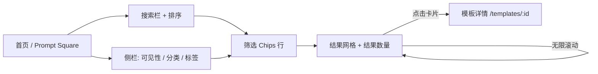
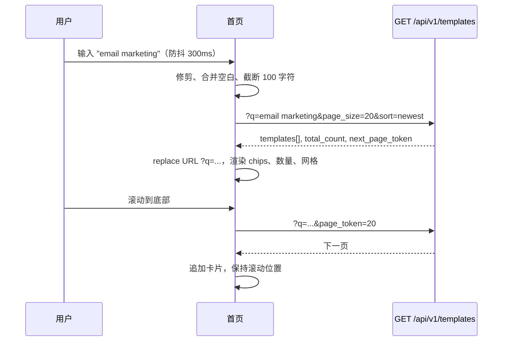
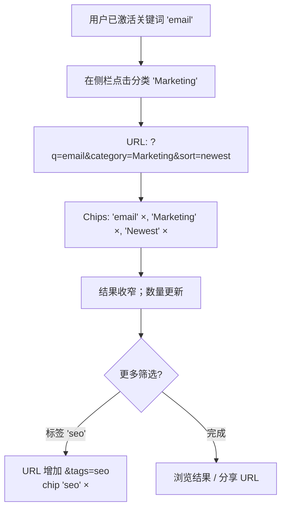
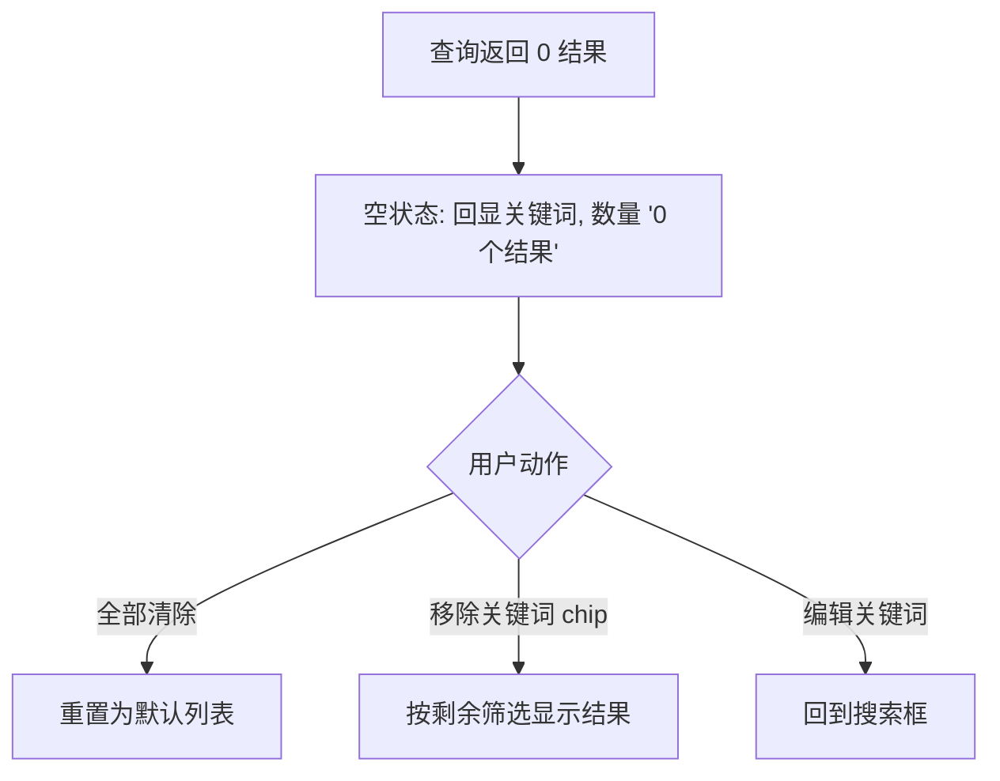

# 模板搜索与筛选 — UI/UX 设计

- **功能标识:** template-search-filtering
- **版本:** 1.0
- **状态:** 已提案（待架构评审）
- **作者:** ui-ux-agent
- **日期:** 2025-06-25
- **配套文档:** `template-search-filtering-requirements-zh-CN.md`

## 1. 设计原则

1. **搜索优先，浏览其次。** 搜索框是 Prompt Square 上最显著的交互元素，与所有竞品市场首页一致。分类/标签浏览仍保留在侧栏。
2. **零新增页面。** 搜索位于既有首页。无独立结果页、无弹窗 —— 结果原位替换网格，保留熟悉的无限滚动模式。
3. **状态可见且可逆。** 活动筛选渲染为可移除 chips；URL 始终镜像状态；前进/后退可用。
4. **Aurora 原生。** 复用既有 tokens、组件（Modal、Spinner、Icons）与亮/暗主题。不引入新设计语言。
5. **默认即快。** 输入防抖、客户端建议、加载期间无布局抖动（骨架屏）。

## 2. 信息架构

首页路由（`/`）增加查询参数。不新增路由。



**URL 参数契约:**

| 参数 | 取值 | 默认 | 说明 |
|---|---|---|---|
| `q` | 自由文本，≤100 字符 | 空 | 关键词；修剪空白；空 = 无筛选 |
| `category` | 分类 slug/名称 | 空 | 单值 |
| `tags` | 逗号分隔 | 空 | 多值，AND 语义 |
| `sort` | `newest` \| `most_liked` \| `most_favorited` \| `trending` | `newest` | 非法 → `newest` |
| `visibility` | `VISIBILITY_PUBLIC` \| `VISIBILITY_PRIVATE` \| 空 | 按 localStorage/认证 | 空 = 混合（登录）或公开（匿名） |

## 3. 用户流程

### 3.1 关键词搜索



### 3.2 组合筛选



### 3.3 空结果恢复



## 4. 页面布局

### 4.1 桌面端（≥1024px）

```text
┌──────────────────────────────────────────────────────────────────────┐
│ Header（既有）                                               [主题] [语言]│
├────────────┬─────────────────────────────────────────────────────────┤
│            │  ┌───────────────────────────────────────┐  ┌─────────┐ │
│  侧栏      │  │ 🔍  搜索提示词…                  [Enter ⏎]│  │ 最新 ▾ │ │
│  （既有）  │  └───────────────────────────────────────┘  └─────────┘ │
│            │  ┌─ 建议下拉（输入 ≥2 字符时） ────────────────────────┐ │
│  Prompt    │  │ 分类: Marketing                                 │ │
│  Square    │  │ 标签: email (12)                                │ │
│  我的提示词│  │ 标签: marketing (8)                             │ │
│  我的点赞  │  └────────────────────────────────────────────────────┘ │
│  我的收藏  │  ┌────────────────────────────────────────────────────┐ │
│            │  │ Chips: [email ×] [Marketing ×] [最新 ×]   全部清除 │ │
│  分类      │  └────────────────────────────────────────────────────┘ │
│  ▸ 写作    │  结果: 42 个模板                                          │
│  ▸ 营销    │  ┌─────┐ ┌─────┐ ┌─────┐ ┌─────┐                          │
│  ▸ 代码    │  │     │ │     │ │     │ │     │   （既有网格）          │
│            │  └─────┘ └─────┘ └─────┘ └─────┘                          │
│  标签      │  … 无限滚动 …                                            │
│  ☑ email   │                                                          │
│  ☐ seo     │                                                          │
└────────────┴─────────────────────────────────────────────────────────┘
```

### 4.2 移动端（<768px）

侧栏折叠到汉堡按钮后（既有）。搜索栏吸顶于 header 正下方；排序下拉位于搜索行右端。Chips 换行为多行。

```text
┌──────────────────────────────┐
│ ☰  Open Prompts      [语言] │
├──────────────────────────────┤
│ 🔍 搜索提示词…        [最新▾]│  ← 吸顶
├──────────────────────────────┤
│ [email ×] [Marketing ×]      │
│ [最新 ×]  全部清除           │
├──────────────────────────────┤
│ 结果: 42 个模板              │
│ ┌─────┐ ┌─────┐              │
│ │     │ │     │  （网格）    │
│ └─────┘ └─────┘              │
└──────────────────────────────┘
```

## 5. 组件规格

### 5.1 SearchBar

| 方面 | 规格 |
|---|---|
| 位置 | 网格上方，左对齐；排序下拉在其右侧 |
| 输入 | `type="search"`，占位符 `t('search.placeholder')` = "Search prompts…" / "搜索提示词…"；前置搜索图标；非空时显示清除（×）按钮 |
| 防抖 | 最后一次击键后 300ms → 触发查询；Enter 立即提交 |
| 最大长度 | `maxLength=100`（FR-8） |
| 无障碍 | `role="search"` 包裹，输入框 `aria-label`；建议列表 `role="listbox"` 配 `aria-activedescendant` |
| 状态 | 默认 / 聚焦（accent 描边）/ 输入中（右缘内嵌 spinner）/ 错误（danger 边框 + 下方消息） |

### 5.2 SortDropdown

| 方面 | 规格 |
|---|---|
| 触发器 | 样式类似既有 `.btn-ghost` 的按钮带箭头；显示当前排序标签 |
| 选项 | 最新 / 最多点赞 / 最多收藏 / 趋势（i18n 键 `search.sort.newest` 等） |
| 行为 | 点击选项 → 应用排序、关闭、push URL 状态；Escape/外点关闭；键盘可导航（↑↓ Enter Esc） |
| 无障碍 | `role="listbox"` / `role="option"` 配 `aria-selected` |

### 5.3 FilterChip / ChipRow

| 方面 | 规格 |
|---|---|
| 结构 | 标签 + × 移除按钮；排序 chip 显示当前排序图标 |
| 行为 | 点击 × → 移除该筛选并重新查询；≥1 个 chip 激活时行尾显示"全部清除"链接式按钮 |
| 样式 | `--surface-2` 背景、`--border` 描边、`--radius-pill`、`--text-1` 标签；hover: `--surface-3`；移除 × 用 `--text-2` → hover 变 `--danger` |
| 无障碍 | 每个 chip 是一个组，× 按钮带 `aria-label="Remove filter: {label}"` |

### 5.4 SuggestionsDropdown

| 方面 | 规格 |
|---|---|
| 触发 | 输入 ≥2 字符且聚焦；失焦（延迟 150ms 以便点击）、Escape 或选择后关闭 |
| 内容 | 最多 5 行：先匹配分类（图标: 文件夹），后匹配标签（图标: 标签）带计数 |
| 行为 | 选择分类 → 设置 `category` 筛选；标签 → 将标签加入 `tags`；两者都保留当前关键词 |
| 数据源 | 侧栏已获取的分类/标签（通过 props/context 共享，不重新请求） |
| 无障碍 | `role="listbox"`；方向键移动 `aria-activedescendant`；Enter 选择 |

### 5.5 ResultCount

| 方面 | 规格 |
|---|---|
| 内容 | "42 templates" / "42 个模板"（i18next 复数化） |
| 行为 | 每次查询更新；首页加载中隐藏；`total_count` 不可用时显示 "—" |
| 样式 | `--text-2`，13px，chips 行下方、网格上方 |

### 5.6 EmptyState（搜索变体）

| 方面 | 规格 |
|---|---|
| 内容 | 搜索图标（大号，`--text-3`）、标题 "No results for 'email'" / "没有找到 'email' 的结果"、正文 "Try different keywords or clear filters" / "试试其他关键词或清除筛选"、主按钮 "Clear all filters" / "清除全部筛选" |
| 行为 | 全部清除 → 重置一切（FR-16） |

### 5.7 骨架屏加载

| 方面 | 规格 |
|---|---|
| 时机 | 新查询（筛选变化）的首页，而非无限滚动加载 |
| 内容 | 8 个与 PromptCard 尺寸一致的骨架卡片，`--surface-2` 块带微光动画 |
| 原因 | 相比纯 spinner 避免布局抖动与感知卡顿 |

### 5.8 侧栏标签多选

| 方面 | 规格 |
|---|---|
| 变更 | 标签行增加复选框样式（左侧复选框，右侧计数）；点击行切换是否加入 `tags` 数组 |
| 持久化 | 所选标签反映到 URL `?tags=` 与 chips |
| 保留既有行为 | 标签计数、前 10 + "更多"切换、可见性导航、分类点击（分类点击仍重置标签） |

## 6. 交互细节

1. **防抖:** 300ms 尾随。Enter 绕过防抖。粘贴文本正常触发防抖。
2. **URL 更新:** 关键词变化用 `setSearchParams(..., { replace: true })`；离散筛选变化（分类/标签/排序/可见性）push 新条目。前进/后退恢复状态并重新查询。
3. **查询协调:** 所有筛选来源（搜索栏、侧栏、chips、建议、URL）汇入单一 `useTemplateFilters` hook（新增），由它持有状态、URL 同步与取数触发。首页委托给它。
4. **无限滚动:** 不变 —— 滚动处理器检查 `hasMore && !loading`；新页追加。任何筛选变化重置分页。
5. **混合视图:** 登录混合视图保留既有双流响应处理（`templates` + `private_templates`，组合 `public:private` token）。关键词/排序同时作用于两个流；结果数量 = 两个 `total_count` 字段之和（公开 + 私有）。
6. **语言切换:** UI 语言变化不重新触发查询（仅标签），与当前行为一致。
7. **错误处理:** 查询失败 → 错误状态带重试按钮；保留最后成功的结果渲染（不清空网格）。
8. **竞态条件:** 每个查询携带单调递增的 `requestId`；过期 ID 的响应被丢弃。
9. **焦点管理:** 选择建议后焦点保持在输入框；"全部清除"后焦点移到搜索输入框。

## 7. 状态汇总

| 状态 | 触发 | UI |
|---|---|---|
| 首次加载（无筛选） | 页面加载 | 默认列表，无 chips，显示数量 |
| 加载中（新查询） | 筛选/关键词变化 | 骨架卡片（8 个），数量隐藏 |
| 加载中（更多） | 无限滚动 | 网格底部既有 "Loading…" 文本 |
| 空结果 | 0 匹配 | EmptyState 回显关键词 + 全部清除 |
| 错误 | API 失败 | 错误横幅 + 重试；保留最后结果 |
| 建议展开 | ≥2 字符 + 聚焦 | 输入框下方下拉，最多 5 行 |
| 筛选激活 | 任一筛选设置 | Chips 行可见，显示数量 |

## 8. 视觉风格（Aurora 合规）

- **SearchBar:** `--surface-2` 背景、`--border` 描边、`--radius-12`、高 44px、`--text-1` 输入文本、`--text-3` 占位符；聚焦: 2px `--accent` 描边带 `--accent`-soft 光晕；前置图标 `--text-2`。
- **SortDropdown:** ghost 按钮、`--radius-12`、箭头 `--text-2`；展开面板 `--surface-2` + `--shadow-lg`，选中项 `--accent`-soft 背景 + `--accent` 文本。
- **Chips:** `--surface-2` 背景、`--border` 描边、`--radius-pill`、13px 标签、28px 高；移除 × `--text-2` → hover `--danger`；"全部清除"为 `--accent` 链接式文本按钮。
- **ResultCount:** `--text-2`，13px。
- **EmptyState:** 居中，图标 48px `--text-3`，标题 18px `--text-1`，正文 14px `--text-2`，主按钮 `.btn-primary`。
- **骨架屏:** `--surface-2` 块，微光用 `--gradient-brand` 8% 不透明度关键帧扫过，`--radius-12`。
- **暗/亮主题:** 所有组件仅用 tokens —— 两个主题零额外 CSS 即可工作。

## 9. 国际化考量（EN/ZH）

新增命名空间 `search.*`（同时加入 `en` 与 `zh` 翻译文件）：

```json
{
  "search": {
    "placeholder": "Search prompts…",
    "clear": "Clear",
    "sort": { "label": "Sort", "newest": "Newest", "most_liked": "Most Liked", "most_favorited": "Most Favorited", "trending": "Trending" },
    "chips": { "clear_all": "Clear all", "remove_filter": "Remove filter: {{label}}" },
    "results_count": "{{count}} template",
    "results_count_other": "{{count}} templates",
    "suggestions": { "category": "Category", "tag": "Tag", "none": "No suggestions" },
    "empty": { "title": "No results for \"{{keyword}}\"", "body": "Try different keywords or clear filters.", "clear_all": "Clear all filters" },
    "error": { "fetch": "Search failed. Please try again.", "retry": "Retry" }
  }
}
```

中文镜像：

```json
{
  "search": {
    "placeholder": "搜索提示词…",
    "clear": "清除",
    "sort": { "label": "排序", "newest": "最新", "most_liked": "最多点赞", "most_favorited": "最多收藏", "trending": "趋势" },
    "chips": { "clear_all": "全部清除", "remove_filter": "移除筛选：{{label}}" },
    "results_count": "{{count}} 个模板",
    "results_count_other": "{{count}} 个模板",
    "suggestions": { "category": "分类", "tag": "标签", "none": "暂无建议" },
    "empty": { "title": "没有找到 \"{{keyword}}\" 的结果", "body": "试试其他关键词或清除筛选。", "clear_all": "清除全部筛选" },
    "error": { "fetch": "搜索失败，请重试。", "retry": "重试" }
  }
}
```

说明: `results_count` 使用 i18next 复数化（`_other` 后缀）；ZH 两种形式使用同一键。关键词值是用户内容，绝不翻译。发送到 API 的排序值是 ASCII slug（`newest`、`most_liked` …），绝不是本地化标签。

## 10. 无障碍

- 搜索输入: `role="search"` 地标、程序化标签、`type="search"`（支持的浏览器原生清除）、出现错误时 `aria-describedby` 指向错误消息。
- 建议: combobox 模式 —— 输入框 `role="combobox"` 配 `aria-expanded`、`aria-controls`、`aria-activedescendant`；listbox 选项 `role="option"`；Escape 关闭且不改变值。
- 排序下拉: listbox 模式配 `aria-selected`，完整键盘支持（↑↓ Enter Esc），关闭时焦点回到触发器。
- Chips: 每个移除按钮带 `aria-label="Remove filter: {label}"`；chip 行带 `aria-label="Active filters"`。
- 结果数量: `aria-live="polite"` 让屏幕阅读器播报结果变化。
- 空/错误状态: 标题是真正的 `<h2>`；重试/清除按钮可键盘到达。
- 所有交互元素焦点可见（既有 Aurora 焦点环）。
- 颜色对比度: 所有基于 token 的颜色在两个主题中满足 WCAG AA（既有 tokens 已合规）。

## 11. 给开发者的实现说明

1. **新 hook `useTemplateFilters`:** 持有关键词/分类/标签/排序/可见性状态、URL 同步（`useSearchParams`）、防抖、requestId 竞态守卫与取数编排。首页消费它；侧栏照旧通过 props 接收当前筛选与变更回调（props 形状不变）。
2. **API 客户端:** 扩展 `getTemplates(params)` —— 它已透传任意参数；在参数对象中加入 `keyword` 与 `sort`。无新端点。
3. **后端:** proto `ListTemplatesRequest` 增加 `keyword`/`sort` 字段；网关映射查询参数；仓储 `List` 增加关键词 ILIKE 条件与白名单 ORDER BY；响应增加 `total_count`（混合视图另有 `private_total_count`）。见需求 FR-23–FR-28a。
4. **建议:** 从侧栏已有的分类/标签派生 —— 通过既有 props 或小型 context 提升该数据；不要重新请求。
5. **骨架屏:** 纯 CSS（SCSS 关键帧）覆盖 div 占位符；无新依赖。
6. **测试:** `useTemplateFilters` 单测（URL 同步、防抖、竞态守卫）；SearchBar（防抖、建议、无障碍属性）、SortDropdown（键盘导航）、ChipRow（移除/清除）组件测试；空状态与数量的集成测试。既有 Home 测试必须继续通过。
7. **迁移/兼容:** 无 schema 变更；无破坏性 API 变更；旧客户端不受影响（NFR-3）。
8. **范围外提醒:** 无高亮、无保存搜索、无 tsvector —— 见需求 §8。
