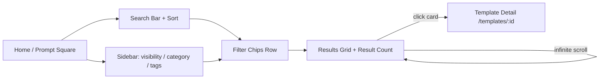
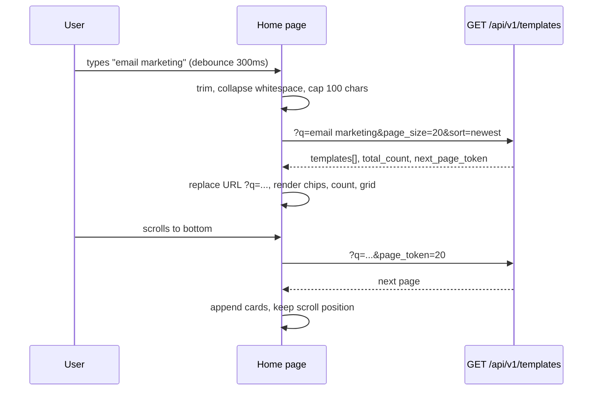
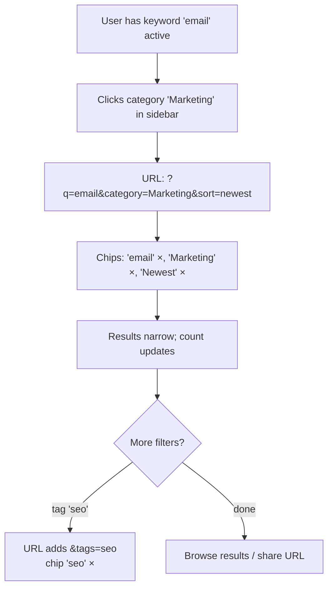
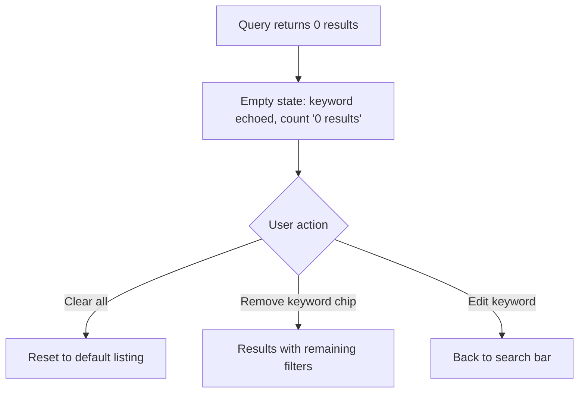

# Template Search & Filtering — UI/UX Design

- **Feature ID:** template-search-filtering
- **Version:** 1.0
- **Status:** Proposed (for architecture review)
- **Author:** ui-ux-agent
- **Date:** 2025-06-25
- **Companion doc:** `template-search-filtering-requirements.md`

## 1. Design Principles

1. **Search-first, browse-second.** The search bar is the most prominent interactive element on the Prompt Square, matching every competitor's marketplace home. Category/tag browsing remains available in the sidebar.
2. **Zero new surfaces.** Search lives on the existing home page. No separate results page, no modal — results replace the grid in place, preserving the familiar infinite-scroll pattern.
3. **State is visible and reversible.** Active filters render as removable chips; the URL always mirrors the state; back/forward works.
4. **Aurora-native.** Reuse existing tokens, components (Modal, Spinner, Icons), and light/dark themes. No new design language.
5. **Fast by default.** Debounced input, client-side suggestions, no layout shift while loading (skeletons).

## 2. Information Architecture

The home route (`/`) gains query parameters. No new routes.



**URL parameter contract:**

| Param | Values | Default | Notes |
|---|---|---|---|
| `q` | free text, ≤100 chars | empty | keyword; trimmed; empty = no filter |
| `category` | category slug/name | empty | single value |
| `tags` | comma-separated | empty | multi-value, AND semantics |
| `sort` | `newest` \| `most_liked` \| `most_favorited` \| `trending` | `newest` | invalid → `newest` |
| `visibility` | `VISIBILITY_PUBLIC` \| `VISIBILITY_PRIVATE` \| empty | per localStorage/auth | empty = mixed (logged-in) or public (anonymous) |

## 3. User Flows

### 3.1 Search with keyword



### 3.2 Combine filters



### 3.3 Empty results recovery



## 4. Page Layout

### 4.1 Desktop (≥1024px)

```text
┌──────────────────────────────────────────────────────────────────────┐
│ Header (existing)                                          [theme] [lang]│
├────────────┬─────────────────────────────────────────────────────────┤
│            │  ┌───────────────────────────────────────┐  ┌─────────┐ │
│  Sidebar   │  │ 🔍  Search prompts…            [Enter ⏎]│  │ Newest ▾│ │
│  (existing)│  └───────────────────────────────────────┘  └─────────┘ │
│            │  ┌─ Suggestions dropdown (while typing ≥2 chars) ─────┐ │
│  Prompt    │  │ Category: Marketing                        │ │
│  Square    │  │ Tag: email (12)                            │ │
│  My Prompts│  │ Tag: marketing (8)                         │ │
│  My Likes  │  └────────────────────────────────────────────────────┘ │
│  My Fav…   │  ┌────────────────────────────────────────────────────┐ │
│            │  │ Chips: [email ×] [Marketing ×] [Newest ×]  Clear all│ │
│  CATEGORIES│  └────────────────────────────────────────────────────┘ │
│  ▸ Writing │  Results: 42 templates                                     │
│  ▸ Marketing│ ┌─────┐ ┌─────┐ ┌─────┐ ┌─────┐                          │
│  ▸ Code    │  │     │ │     │ │     │ │     │   (existing grid)       │
│            │  └─────┘ └─────┘ └─────┘ └─────┘                          │
│  TAGS      │  … infinite scroll …                                     │
│  ☑ email   │                                                          │
│  ☐ seo     │                                                          │
└────────────┴─────────────────────────────────────────────────────────┘
```

### 4.2 Mobile (<768px)

Sidebar collapses behind a hamburger (existing). Search bar becomes sticky directly below the header; sort dropdown sits at the right end of the search row. Chips wrap to multiple lines.

```text
┌──────────────────────────────┐
│ ☰  Open Prompts      [lang] │
├──────────────────────────────┤
│ 🔍 Search prompts…   [Newest▾]│  ← sticky
├──────────────────────────────┤
│ [email ×] [Marketing ×]      │
│ [Newest ×]  Clear all        │
├──────────────────────────────┤
│ Results: 42 templates        │
│ ┌─────┐ ┌─────┐              │
│ │     │ │     │  (grid)      │
│ └─────┘ └─────┘              │
└──────────────────────────────┘
```

## 5. Component Specifications

### 5.1 SearchBar

| Aspect | Spec |
|---|---|
| Placement | Above grid, left-aligned; sort dropdown to its right |
| Input | `type="search"`, placeholder `t('search.placeholder')` = "Search prompts…" / "搜索提示词…"; leading search icon; clear (×) button when non-empty |
| Debounce | 300ms after last keystroke → triggers query; Enter submits immediately |
| Max length | `maxLength=100` (FR-8) |
| A11y | `role="search"` wrapper, `aria-label` on input; suggestions list `role="listbox"` with `aria-activedescendant` |
| States | Default / focus (accent ring) / typing (spinner inside right edge) / error (danger border + message below) |

### 5.2 SortDropdown

| Aspect | Spec |
|---|---|
| Trigger | Button styled like existing `.btn-ghost` with chevron; shows current sort label |
| Options | Newest / Most Liked / Most Favorited / Trending (i18n keys `search.sort.newest` etc.) |
| Behavior | Click option → apply sort, close, push URL state; Escape/outside-click closes; keyboard navigable (↑↓ Enter Esc) |
| A11y | `role="listbox"` / `role="option"` with `aria-selected` |

### 5.3 FilterChip / ChipRow

| Aspect | Spec |
|---|---|
| Anatomy | Label + × remove button; sort chip shows icon of current sort |
| Behavior | Click × → remove that filter, re-query; "Clear all" link-style button at row end when ≥1 chip active |
| Styling | `--surface-2` background, `--border` stroke, `--radius-pill`, `--text-1` label; hover: `--surface-3`; remove × uses `--text-2` → `--danger` on hover |
| A11y | Each chip is a group with `aria-label="Remove filter: {label}"` on the × button |

### 5.4 SuggestionsDropdown

| Aspect | Spec |
|---|---|
| Trigger | Input has ≥2 chars and focus; closes on blur (with 150ms delay for click), Escape, or selection |
| Content | Up to 5 rows: matching categories first (icon: folder), then tags (icon: tag) with counts |
| Behavior | Selecting category → set `category` filter; tag → add tag to `tags`; both keep current keyword |
| Data source | Categories/tags already fetched by Sidebar (shared via props/context, no refetch) |
| A11y | `role="listbox"`; arrow keys move `aria-activedescendant`; Enter selects |

### 5.5 ResultCount

| Aspect | Spec |
|---|---|
| Content | "42 templates" / "42 个模板" (i18n pluralization via i18next) |
| Behavior | Updates on every query; hidden while loading first page; shows "—" if total_count unavailable |
| Styling | `--text-2`, 13px, below chips row, above grid |

### 5.6 EmptyState (search variant)

| Aspect | Spec |
|---|---|
| Content | Search icon (large, `--text-3`), heading "No results for 'email'" / "没有找到 'email' 的结果", body "Try different keywords or clear filters" / "试试其他关键词或清除筛选", primary button "Clear all filters" / "清除全部筛选" |
| Behavior | Clear all → resets everything (FR-16) |

### 5.7 Skeleton loading

| Aspect | Spec |
|---|---|
| When | First page of a new query (filter change), not infinite-scroll loads |
| What | 8 skeleton cards matching PromptCard dimensions, `--surface-2` blocks with shimmer animation |
| Why | Avoids layout shift and perceived jank vs spinner-only |

### 5.8 Sidebar tag multi-select

| Aspect | Spec |
|---|---|
| Change | Tag rows gain a checkbox affordance (checkbox on left, count on right); clicking row toggles inclusion in `tags` array |
| Persistence | Selected tags reflected in URL `?tags=` and chips |
| Existing behavior kept | Tag counts, top-10 + "More" toggle, visibility nav, category clicks (category click resets tags as today) |

## 6. Interaction Details

1. **Debounce:** 300ms trailing. Enter bypasses debounce. Pasting text triggers debounce normally.
2. **URL updates:** keyword changes use `setSearchParams(..., { replace: true })`; discrete filter changes (category/tag/sort/visibility) push a new entry. Back/forward restores state and re-queries.
3. **Query coordination:** All filter sources (search bar, sidebar, chips, suggestions, URL) funnel through a single `useTemplateFilters` hook (new) that owns state, URL sync, and fetch triggering. Home page delegates to it.
4. **Infinite scroll:** unchanged — scroll handler checks `hasMore && !loading`; new pages append. Changing any filter resets pagination.
5. **Mixed view:** logged-in mixed view keeps the existing two-stream response handling (`templates` + `private_templates`, combined `public:private` token). Keyword/sort apply to both streams; result count = sum of both `total_count` fields (public + private).
6. **Language switch:** UI language change does not re-trigger queries (labels only), consistent with current behavior.
7. **Error handling:** failed query → error state with retry button; keeps last successful results rendered (does not blank the grid).
8. **Race conditions:** each query carries a monotonically increasing `requestId`; responses with stale IDs are discarded.
9. **Focus management:** after selecting a suggestion, focus stays in the input; after "Clear all", focus moves to the search input.

## 7. States Summary

| State | Trigger | UI |
|---|---|---|
| First load (no filters) | Page load | Default listing, no chips, count shown |
| Loading (new query) | Filter/keyword change | Skeleton cards (8), count hidden |
| Loading (more) | Infinite scroll | Existing "Loading…" text at grid bottom |
| Empty results | 0 matches | EmptyState with echoed keyword + Clear all |
| Error | API failure | Error banner + Retry; last results kept |
| Suggestions open | ≥2 chars + focus | Dropdown below input, max 5 rows |
| Filter active | Any filter set | Chips row visible, count shown |

## 8. Visual Style (Aurora compliance)

- **SearchBar:** `--surface-2` background, `--border` stroke, `--radius-12`, height 44px, `--text-1` input text, `--text-3` placeholder; focus: 2px `--accent` ring with `--accent`-soft glow; leading icon `--text-2`.
- **SortDropdown:** ghost button, `--radius-12`, chevron `--text-2`; open panel `--surface-2` + `--shadow-lg`, selected option `--accent`-soft background + `--accent` text.
- **Chips:** `--surface-2` bg, `--border` stroke, `--radius-pill`, 13px label, 28px height; remove × `--text-2` → `--danger` hover; "Clear all" as `--accent` link-style text button.
- **ResultCount:** `--text-2`, 13px.
- **EmptyState:** centered, icon 48px `--text-3`, heading 18px `--text-1`, body 14px `--text-2`, primary `.btn-primary`.
- **Skeletons:** `--surface-2` blocks, shimmer via `--gradient-brand` at 8% opacity keyframe sweep, `--radius-12`.
- **Dark/light:** all components use tokens only — both themes work with zero extra CSS.

## 9. i18n Considerations (EN/ZH)

New namespace `search.*` (added to both `en` and `zh` translation files):

```json
{
  "search": {
    "placeholder": "Search prompts…",
    "clear": "Clear",
    "sort": { "label": "Sort", "newest": "Newest", "most_liked": "Most Liked", "most_favorited": "Most Favorited", "trending": "Trending" },
    "chips": { "clear_all": "Clear all", "remove_filter": "Remove filter: {{label}}" },
    "results_count": "{{count}} template",
    "results_count_other": "{{count}} templates",
    "suggestions": { "category": "Category", "tag": "Tag", "none": "No suggestions" },
    "empty": { "title": "No results for \"{{keyword}}\"", "body": "Try different keywords or clear filters.", "clear_all": "Clear all filters" },
    "error": { "fetch": "Search failed. Please try again.", "retry": "Retry" }
  }
}
```

ZH mirror:

```json
{
  "search": {
    "placeholder": "搜索提示词…",
    "clear": "清除",
    "sort": { "label": "排序", "newest": "最新", "most_liked": "最多点赞", "most_favorited": "最多收藏", "trending": "趋势" },
    "chips": { "clear_all": "全部清除", "remove_filter": "移除筛选：{{label}}" },
    "results_count": "{{count}} 个模板",
    "results_count_other": "{{count}} 个模板",
    "suggestions": { "category": "分类", "tag": "标签", "none": "暂无建议" },
    "empty": { "title": "没有找到 \"{{keyword}}\" 的结果", "body": "试试其他关键词或清除筛选。", "clear_all": "清除全部筛选" },
    "error": { "fetch": "搜索失败，请重试。", "retry": "重试" }
  }
}
```

Notes: `results_count` uses i18next pluralization (`_other` suffix); ZH uses the same key for both forms. Keyword values are user content and are never translated. Sort values sent to the API are the ASCII slugs (`newest`, `most_liked`, …), never localized labels.

## 10. Accessibility

- Search input: `role="search"` landmark, programmatic label, `type="search"` (native clear in supporting browsers), `aria-describedby` pointing to error message when present.
- Suggestions: combobox pattern — input `role="combobox"` with `aria-expanded`, `aria-controls`, `aria-activedescendant`; listbox options `role="option"`; Escape closes without changing value.
- Sort dropdown: listbox pattern with `aria-selected`, full keyboard support (↑↓ Enter Esc), focus returns to trigger on close.
- Chips: each remove button has `aria-label="Remove filter: {label}"`; chip row has `aria-label="Active filters"`.
- Result count: `aria-live="polite"` so screen readers announce result changes.
- Empty/error states: headings are real `<h2>`; retry/clear buttons reachable by keyboard.
- Focus visible on all interactive elements (existing Aurora focus ring).
- Color contrast: all token-based colors meet WCAG AA in both themes (existing tokens already comply).

## 11. Implementation Notes for Developer

1. **New hook `useTemplateFilters`:** owns keyword/category/tags/sort/visibility state, URL sync (`useSearchParams`), debounce, requestId race-condition guard, and fetch orchestration. Home page consumes it; Sidebar receives current filters + change callbacks as today (props unchanged in shape).
2. **API client:** extend `getTemplates(params)` — it already passes through arbitrary params; add `keyword` and `sort` to the params object. No new endpoint.
3. **Backend:** proto `ListTemplatesRequest` + `keyword`/`sort` fields; gateway maps query params; repository `List` gains keyword ILIKE conditions and whitelisted ORDER BY; response gains `total_count` (and `private_total_count` for mixed view). See requirements FR-23–FR-28a.
4. **Suggestions:** derive from categories/tags already in Sidebar state — lift that data via existing props or a small context; do not refetch.
5. **Skeletons:** pure CSS (SCSS keyframes) over div placeholders; no new dependency.
6. **Testing:** unit tests for `useTemplateFilters` (URL sync, debounce, race guard); component tests for SearchBar (debounce, suggestions, a11y attributes), SortDropdown (keyboard nav), ChipRow (remove/clear); integration test for empty state and count. Existing Home tests must keep passing.
7. **Migration/compat:** no schema change; no breaking API change; old clients unaffected (NFR-3).
8. **Out of scope reminders:** no highlighting, no saved searches, no tsvector — see requirements §8.
