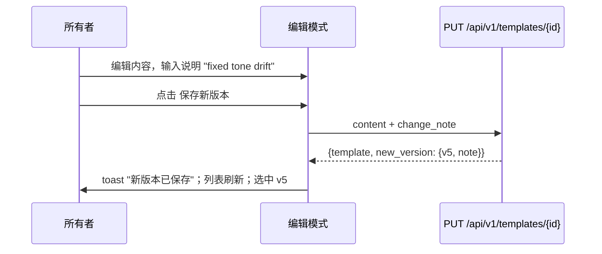
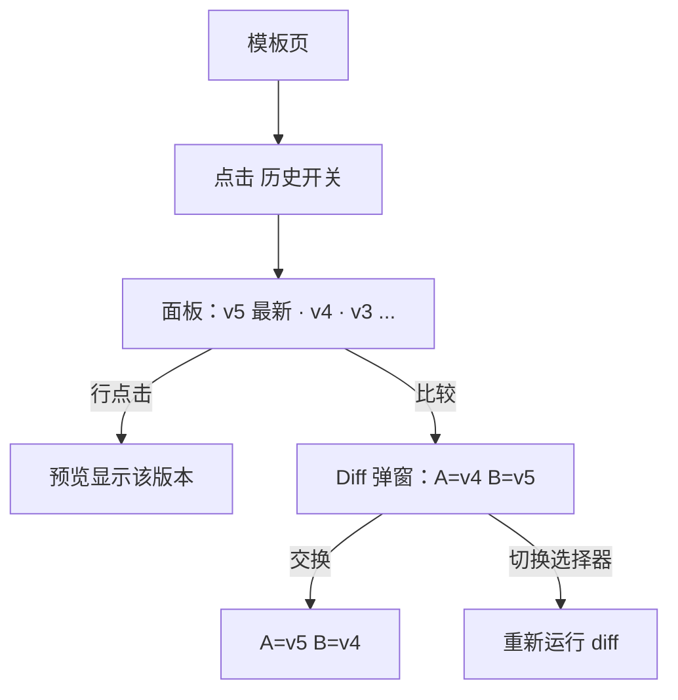
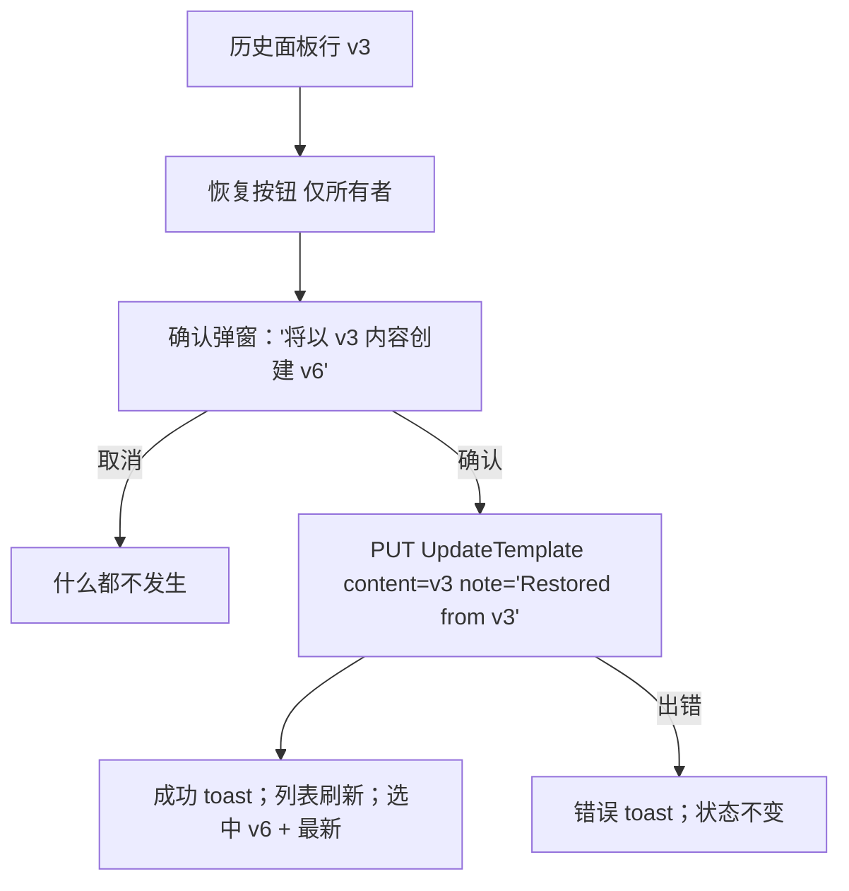

# 模板版本管理 UX — UI/UX 设计

- **功能标识:** template-versioning
- **版本:** 1.0
- **状态:** 已提案（待架构评审）
- **作者:** ui-ux-agent
- **日期:** 2026-10-10
- **配套文档:** `template-versioning-requirements-zh-CN.md`

## 1. 设计原则

1. **历史是一等界面。** 版本承载意图（说明）、使用量（提示词计数）与操作（diff、恢复）—— 下拉框装不下这些；面板可以。
2. **绝不破坏。** 恢复是追加；不删除、不重编号。UI 强化这一点：恢复总是说明"将创建新版本"。
3. **Aurora 原生。** 面板位于既有模板内容区块内；diff 与确认复用既有 Modal；toast 复用 NotificationContext；全程使用设计令牌与明暗主题。
4. **不需要新界面的地方绝不新增。** 无新路由 —— 一切都在模板详情页。无新后端端点 —— 恢复走 UpdateTemplate。
5. **说明是数据，界面文案才翻译。** 存储的说明（用户写的或自动生成的 "Restored from v{n}"）原样渲染；所有周边 UI 完全中英双语。

## 2. 信息架构

```mermaid
flowchart LR
    A[/templates/:id 模板详情] --> B[版本选择器 + 历史开关]
    B -->|切换| C[版本历史面板]
    C -->|行点击| D[预览切换到该版本]
    C -->|比较| E[Diff 弹窗 A vs B]
    C -->|恢复 仅所有者| F[确认弹窗] --> G[UpdateTemplate + 说明] --> H[新版本追加]
    A --> I[编辑模式] -->|可选说明| J[保存新版本]
    B -->|快速切换| D
```

**界面（全部在既有模板详情页上 —— 无新路由）：**

| 界面 | 访问 | 内容 |
|---|---|---|
| 版本选择器（既有，增强） | 任何可查看者 | v{n} + 日期 + 说明摘要 |
| 历史开关 + 面板 | 任何可查看者 | 版本列表：说明、使用量、操作 |
| Diff 弹窗 | 任何可查看者 | 统一 diff A vs B、统计、交换 |
| 恢复确认弹窗 | 仅所有者 | 警告 + 确认 |
| 变更说明输入（编辑模式） | 仅所有者 | 可选，200 字符 |

## 3. 用户流程

### 3.1 带说明保存



### 3.2 查看历史与 diff



### 3.3 恢复旧版本



## 4. 页面布局

### 4.1 带历史开关的模板内容区块

```text
┌──────────────────────────────────────────────────────────────────────┐
│ 内容                                                                  │
│ 版本: [v5 (6月20日) ▾]                                       [🕘 历史] │
├──────────────────────────────────────────────────────────────────────┤
│ （预览区 —— 不变；显示选中版本的内容）                                │
│                                          [编辑]（所有者，查看模式）    │
└──────────────────────────────────────────────────────────────────────┘
```

### 4.2 版本历史面板（展开时替换预览区）

```text
┌──────────────────────────────────────────────────────────────────────┐
│ 版本历史                                                   [关闭 ✕]   │
├──────────────────────────────────────────────────────────────────────┤
│ v5  [最新]  "Fixed tone drift"                          2小时前       │
│     1,204 字符 · 12 行 · 3 条提示词          [比较] [恢复]            │
├──────────────────────────────────────────────────────────────────────┤
│ v4             "Added output format section"           3天前          │
│     1,180 字符 · 11 行 · 7 条提示词           [比较] [恢复]           │
├──────────────────────────────────────────────────────────────────────┤
│ v3             无说明                                   1周前          │
│     980 字符 · 9 行 · 14 条提示词              [比较] [恢复]          │
├──────────────────────────────────────────────────────────────────────┤
│ v2             "Initial import cleanup"                2周前          │
│     950 字符 · 9 行 · 2 条提示词               [比较] [恢复]          │
├──────────────────────────────────────────────────────────────────────┤
│ v1             无说明                                   1周前          │
│     900 字符 · 9 行 · 0 条提示词                [比较]                 │
│                                                        [加载更多]     │
└──────────────────────────────────────────────────────────────────────┘
```

- 选中行高亮（`--surface-3` + `--accent` 左边框）；点击即选中。
- 最新行与非所有者不显示"恢复"；"比较"始终可见。
- API 响应缺失 `prompt_count` 时整个使用量列隐藏（NFR-6）。

### 4.3 Diff 弹窗

```text
┌──────────────────────────────────────────────────────────────────────┐
│ 比较版本                                                        ✕    │
│ A: [v4 ▾]        ⇄ 交换        B: [v5 ▾]        +12 −3 行           │
├──────────────────────────────────────────────────────────────────────┤
│  1  You are an expert email writer.                    （上下文）     │
│ - 2  Keep the tone formal.                                           │
│ + 2  Keep the tone friendly and warm.                                │
│ + 3  Always end with a clear call to action.                         │
│  4  Output: plain text only.                                         │
├──────────────────────────────────────────────────────────────────────┤
│                                            [复制 diff] [关闭]         │
└──────────────────────────────────────────────────────────────────────┘
```

- 统一 diff：行号、删除行红色底 + `−`、新增行绿色底 + `+`、上下文行普通。
- 等宽 13px、`pre-wrap`、最大高 60vh 滚动 —— 与仪表盘提示词查看弹窗相同的内容块样式。

### 4.4 恢复确认弹窗

```text
┌──────────────────────────────────────────────┐
│ 恢复版本                                 ✕  │
│ 将 v3 恢复为新版本（v6）？                    │
│ 当前内容会保留在历史中 ——                    │
│ 不会删除任何内容。                            │
│ 新版本将带有说明                              │
│ "Restored from v3"。                          │
│               [取消] [恢复 v3]                │
└──────────────────────────────────────────────┘
```

### 4.5 带变更说明输入的编辑模式

```text
┌──────────────────────────────────────────────────────────────────────┐
│ 版本: [v5 (6月20日) ▾]（编辑时禁用）                                   │
│ ┌──────────────────────────────────────────────────────────────────┐ │
│ │ （内容 textarea —— 不变）                                         │ │
│ └──────────────────────────────────────────────────────────────────┘ │
│ 变更说明（可选）                                            0/200     │
│ ┌──────────────────────────────────────────────────────────────────┐ │
│ │ 例如：修复语气漂移                                                │ │
│ └──────────────────────────────────────────────────────────────────┘ │
│                              [取消] [保存新版本]                      │
└──────────────────────────────────────────────────────────────────────┘
```

## 5. 组件规格

### 5.1 HistoryToggle

| 方面 | 规格 |
|---|---|
| 位置 | 版本选择器行的右端，与下拉同高 |
| 内容 | `ClockIcon` + "历史"文字（`.btn-ghost btn-sm`） |
| 行为 | 切换面板；打开时标签为"收起历史"；面板就地替换预览区（无布局跳动 —— 相同最小高度） |
| 无障碍 | 开关带 `aria-expanded`；面板是有标签的区域 |

### 5.2 VersionHistoryPanel

| 方面 | 规格 |
|---|---|
| 头部 | "版本历史"（`--text-1` 15px/600）+ 关闭（✕ 图标按钮） |
| 行 | 最新在前：`v{n}`（等宽 13px `--text-1`）、"最新"徽标（仅最新版）、说明（或"无说明" `--text-3` 斜体）、相对时间（`--text-3` 12px，`title` 中有绝对时间）、元信息行"X 字符 · Y 行 · Z 条提示词"（`--text-3` 12px）、操作 比较 / 恢复 |
| 行点击 | 选中版本（与下拉 onChange 相同的处理函数）；选中行 `--surface-3` + 2px `--accent` 左边框 |
| 分页 | 每页 20 条走 `page_token`；列表末尾"加载更多" `.btn-ghost btn-sm`；无 token 时隐藏 |
| 样式 | `--surface-2` 卡片，行间 `--border` 分隔，hover `--surface-3`；面板本身在既有 `.section` 内 |
| 状态 | 加载中：4 行骨架屏；空（单版本）："v1 是唯一的版本 —— 编辑模板即可创建更多。"；错误：消息 + 重试 |
| 无障碍 | 行组成的 `<ul>`；每行是按钮（选中），说明/时间包含在可访问名称中；操作是独立的带 `aria-label` 按钮 |

### 5.3 VersionRow 操作

| 操作 | 规格 |
|---|---|
| 比较 | 打开 DiffModal，A = 该版本，B = 最新版（若不同则选中版）；`.btn-ghost btn-sm` |
| 恢复 | 仅所有者，最新行隐藏；打开 RestoreConfirmModal；`.btn-ghost btn-sm` 文字 `--accent`；非所有者隐藏（不是禁用 —— 非所有者根本没有恢复能力） |

### 5.4 DiffModal

| 方面 | 规格 |
|---|---|
| 头部 | "比较版本" + 关闭；两个 VersionSelect 风格的选择器，标签 A（较旧）/ B（较新），中间"交换"按钮（⇄）；右对齐统计 chip "+N −M 行" |
| 主体 | 统一 diff 行：行号（`--text-3`，3 字符右对齐）、符号标记、内容；删除 = `--danger`-soft 底 + `−` 前缀；新增 = `--success`-soft 底 + `+` 前缀；上下文普通；等宽 13px `pre-wrap`；最大高 60vh 滚动 |
| 行为 | 选择器变更或交换时重算 diff；A/B 规范化为 A 总是较旧（交换翻转并重新规范化）；"复制 diff"复制原始统一文本 |
| 回退 | diff 工具不可用时（NFR-6）：并排原始内容窗格 + 提示 |
| 尺寸 | 既有 Modal `size="lg"` |
| 无障碍 | diff 行通过 `aria-label` 前缀（"删除行"、"新增行"）承载增删语义；选择器有标签"版本 A"/"版本 B"；焦点陷阱按既有 Modal |

### 5.5 RestoreConfirmModal

| 方面 | 规格 |
|---|---|
| 内容 | 标题"恢复版本"；正文："将 v{{version}} 恢复为新版本（v{{next}}）？当前内容会保留在历史中 —— 不会删除任何内容。新版本将带有说明 \"Restored from v{{version}}\"。" |
| 操作 | 取消（`.btn-ghost`）/ "恢复 v{{version}}"（`.btn-primary`） |
| 行为 | 确认 → `updateTemplate(id, {content: v{n}.content, change_note: "Restored from v{n}", ...元数据透传})` → 成功 toast → 刷新列表 → 选中新版本；进行中禁用按钮 |
| 无障碍 | 既有 Modal 焦点陷阱；措辞无破坏性（恢复是安全的）但明确说明新版本效果 |

### 5.6 ChangeNoteInput（编辑模式）

| 方面 | 规格 |
|---|---|
| 位置 | 内容 textarea 与操作按钮之间 |
| 内容 | 标签"变更说明（可选）"+ 输入框（maxlength 200）+ 实时计数"n/200"（`--text-3` 12px；180+ 时变 `--warning`） |
| 行为 | 保存时作为 `change_note` 发送；保存成功后清空；内容未变时忽略（FR-18） |
| 样式 | 既有 `.meta-input` / Field 模式；占位符"例如：修复语气漂移" |
| 无障碍 | 标签关联输入框；计数器 `aria-live="polite"` |

### 5.7 VersionSelect（增强）

| 方面 | 规格 |
|---|---|
| 变更 | 选项副行在既有日期下方增加说明摘要（前约 40 字符，省略号），`change_note` 存在时显示；其他行为不变 |
| 无障碍 | 不变（既有 listbox 语义）；说明包含在选项文本中 |

## 6. 交互细节

1. **面板切换:** 打开面板时版本选择器行保持可见（上下文），预览区换成列表；关闭恢复预览。选中版本在切换间保持。
2. **选中同步:** 面板行点击、下拉变更与恢复完成都走同一个 `setSelectedVersionId` 处理函数 —— 单一事实来源。
3. **Diff 默认值:** 行 v{n} 上的比较 → A = v{n}，B = 最新版。若该行就是最新版，B = 其前一版。选择器允许任意组合；A/B 自动规范化为旧→新。
4. **恢复元数据透传:** 恢复发送当前标题/描述/分类/标签/可见性（元数据不变）+ 旧内容 + 自动说明 —— 后端的内容差异检查保证创建新版本。
5. **乐观 vs 安全:** 选中与面板切换即时（本地状态）；恢复与保存是悲观（按钮 spinner，不乐观插入版本），避免幻影版本号。
6. **写入后刷新:** 保存与恢复都重新获取版本第一页（并更新 `latest_version` 状态），保证编号与最新徽标始终以服务端为准。
7. **相对时间:** 共享工具（D-6）："刚刚"/"X 分钟前"/"X 小时前"/"X 天前"/本地化日期；`title` 中有绝对时间戳。
8. **说明渲染:** 说明是通过 React 插值的纯文本 —— 绝不 `dangerouslySetInnerHTML`；200 字符上限由 maxlength + 服务端强制。
9. **使用量列:** 仅当 API 返回 `prompt_count` 时渲染；检测按响应进行（旧后端只是省略它）。
10. **键盘:** 面板行与操作是按钮（Tab/Enter/Space）；弹窗 Escape 关闭；下拉保持既有键盘支持。

## 7. 状态汇总

| 状态 | 触发 | UI |
|---|---|---|
| 面板加载中 | 打开 / 刷新 | 4 行骨架屏 |
| 面板已加载 | 获取成功 | 版本行 |
| 面板单版本 | 仅 1 个版本 | "v1 是唯一的版本…"提示 |
| 面板错误 | 获取失败 | 消息 + 重试（关闭面板仍可回到预览区） |
| Diff 计算中 | 选择器变更 | 弹窗主体短暂 spinner（通常 <100ms） |
| Diff 回退 | diff 工具不可用 | 并排原始窗格 + 提示 |
| 恢复进行中 | 点击确认 | 按钮禁用 + 恢复按钮 spinner |
| 恢复出错 | API 失败 | 错误 toast；列表不变 |
| 保存进行中 | 点击保存 | 既有保存状态 + 说明输入禁用 |
| 说明超限 | 输入 180+ 字符 | 计数器 `--warning`；200 处硬停（maxlength） |
| 非所有者 | 不是所有者 | 面板 + 比较可见；恢复隐藏 |
| 匿名（公开模板） | 无 token | 只读面板 + 比较；恢复隐藏 |

## 8. 视觉风格（Aurora 合规）

- **面板:** 在既有 `.section` 内（`--surface-2`、`--border`、`--radius-12`）；行间 `--border` 分隔；hover `--surface-3`；选中行 2px `--accent` 左边框。
- **最新徽标:** `--accent`-soft 底 + `--accent` 文字、`--radius-pill`、11px/600 —— 与仪表盘"公开"徽标相同配方。
- **版本号:** 等宽 13px `--text-1`（匹配偏代码的内容语境）。
- **元信息行:** `--text-3` 12px；"无说明"斜体 `--text-3`。
- **Diff:** 删除 `--danger`-soft 底、新增 `--success`-soft 底、行号 `--text-3`；等宽 13px；统计 chip `--surface-3` + `--radius-pill`。
- **按钮:** 比较/恢复 `.btn-ghost btn-sm`；恢复文字 `--accent`；弹窗操作按既有 Modal 模式。
- **说明输入:** 既有输入样式；计数器 `--text-3` → 接近上限时 `--warning`。
- **明暗主题:** 仅用设计令牌；diff 底色使用两个主题中都存在的 soft 变体。

## 9. 国际化考量（中/英）

新命名空间 `versioning.*`（避免触碰既有 `template_details.*` 键）：

```json
{
  "versioning": {
    "history": "历史",
    "hide_history": "收起历史",
    "panel_title": "版本历史",
    "latest": "最新",
    "no_note": "无说明",
    "meta": "{{chars}} 字符 · {{lines}} 行 · {{prompts}} 条提示词",
    "meta_no_usage": "{{chars}} 字符 · {{lines}} 行",
    "single_version": "v1 是唯一的版本 —— 编辑模板即可创建更多。",
    "load_more": "加载更多",
    "compare": "比较",
    "restore": "恢复",
    "compare_title": "比较版本",
    "version_a": "版本 A",
    "version_b": "版本 B",
    "swap": "交换",
    "stats": "+{{added}} −{{removed}} 行",
    "removed_line": "删除行",
    "added_line": "新增行",
    "copy_diff": "复制 diff",
    "diff_fallback_notice": "Diff 视图不可用 —— 并排显示两个版本。",
    "restore_title": "恢复版本",
    "restore_body": "将 v{{version}} 恢复为新版本（v{{next}}）？当前内容会保留在历史中 —— 不会删除任何内容。新版本将带有说明 \"Restored from v{{version}}\"。",
    "restore_confirm": "恢复 v{{version}}",
    "note_label": "变更说明（可选）",
    "note_placeholder": "例如：修复语气漂移",
    "note_counter": "{{count}}/200",
    "toast": { "restored": "已恢复为 v{{version}}", "diff_copied": "Diff 已复制到剪贴板" },
    "error": { "fetch": "加载版本历史失败。", "restore": "恢复版本失败。", "retry": "重试" }
  }
}
```

英文镜像：

```json
{
  "versioning": {
    "history": "History",
    "hide_history": "Hide history",
    "panel_title": "Version history",
    "latest": "Latest",
    "no_note": "No note",
    "meta": "{{chars}} chars · {{lines}} lines · {{prompts}} prompts",
    "meta_no_usage": "{{chars}} chars · {{lines}} lines",
    "single_version": "v1 is the only version — edit the template to create more.",
    "load_more": "Load more",
    "compare": "Compare",
    "restore": "Restore",
    "compare_title": "Compare versions",
    "version_a": "Version A",
    "version_b": "Version B",
    "swap": "Swap",
    "stats": "+{{added}} −{{removed}} lines",
    "removed_line": "removed line",
    "added_line": "added line",
    "copy_diff": "Copy diff",
    "diff_fallback_notice": "Diff view is unavailable — showing both versions side by side.",
    "restore_title": "Restore version",
    "restore_body": "Restore v{{version}} as a new version (v{{next}})? Your current content stays in the history — nothing is deleted. The new version gets the note \"Restored from v{{version}}\".",
    "restore_confirm": "Restore v{{version}}",
    "note_label": "Change note (optional)",
    "note_placeholder": "e.g., Fixed tone drift",
    "note_counter": "{{count}}/200",
    "toast": { "restored": "Version restored as v{{version}}", "diff_copied": "Diff copied to clipboard" },
    "error": { "fetch": "Failed to load version history.", "restore": "Failed to restore version.", "retry": "Retry" }
  }
}
```

说明: 存储的变更说明与自动生成的 "Restored from v{n}" 字符串是数据，在两种语言下均原样渲染（D-7）。`v{n}` 记法与语言无关。相对时间来自共享的 `time.*` 工具键。

## 10. 无障碍

- **HistoryToggle:** 真实按钮、`aria-expanded`、可见焦点环。
- **面板:** 有标签的区域（`aria-labelledby` 指向面板标题）；行是 `<ul>` 中的按钮；说明 + 时间包含在可访问名称中；操作是独立的可聚焦按钮，带 `aria-label`（"比较 v4"、"恢复 v3"）。
- **DiffModal:** 既有 Modal 焦点陷阱 + Escape；选择器有标签；每行 diff 的增删状态通过 `aria-label` 前缀传达（屏幕阅读器听到"删除行: …"）；统计 chip 是真实文本；颜色绝不是唯一信号（−/+ 标记伴随底色）。
- **RestoreConfirmModal:** 平实语言的正文；效果（新版本、不删除任何内容）以文字说明；按钮标签清晰。
- **ChangeNoteInput:** 标签关联；计数器 polite live region；强制 maxlength。
- **VersionSelect:** 既有 listbox 键盘支持不变；说明文本包含在选项标签中。
- **对比度:** diff 底色在两个主题中保持文字对比度 ≥ 4.5:1；所有文字满足 AA。

## 11. 给开发者的实现说明

1. **后端:** `ALTER TABLE template_versions ADD COLUMN IF NOT EXISTS change_note TEXT`（可空，不回填）；proto：`TemplateVersion` 与 `UpdateTemplateRequest` 上的 `change_note`；列表响应上的 `prompt_count`（LEFT JOIN COUNT，开放问题 #1）；服务层长度校验（≤ 200）返回 `InvalidArgument`。
2. **网关:** 在 `PUT /api/v1/templates/{id}` 透传 `change_note`；在版本 JSON 响应中包含它（与 `prompt_count`）—— 仅增量字段。
3. **前端状态:** 扩展 TemplateDetails 既有 `versions` 状态；新增 `isHistoryOpen`、`historyPageToken`、`diffState {aId, bId}`；保持单一 `setSelectedVersionId` 处理函数作为选中事实来源。
4. **分页:** 用 `page_size: 20` + token 累积（"加载更多"追加）替换一次性 `page_size: 100` 获取；下拉消费累积列表（UX 不变）。
5. **Diff 工具:** `diff` 包的 `diffLines`（或手写 LCS 回退 —— 开放问题 #2）；封装为 `utils/diff.js`，输出规范化的 `{type: 'add'|'remove'|'context', text, aLine, bLine}`，弹窗只渲染一种行类型。
6. **恢复:** `updateTemplate(id, { ...当前元数据, content: version.content, change_note: `Restored from v${version.version}` })`；成功后重新获取版本第 1 页、选中 `new_version.id`、toast。
7. **组件:** `VersionHistoryPanel`、`VersionRow`（面板内联）、`DiffModal`、`RestoreConfirmModal`、`ChangeNoteInput`；增强 `VersionSelect` 选项副行显示说明摘要。
8. **共享工具:** 相对时间（与仪表盘/通知功能共享）；复制到剪贴板（已共享）。
9. **测试:** diff 封装（增/删/上下文/空/相同）、说明长度校验、恢复 payload 构造器的单元测试；面板（渲染、选中、分页、所有者门控）、DiffModal（默认值、交换、统计）、ChangeNoteInput（计数器、maxlength）的组件测试；带说明保存与恢复流程更新列表的页面级测试；i18n 键一致性测试。
