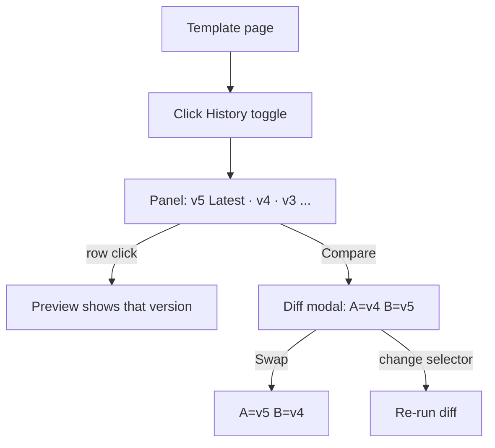
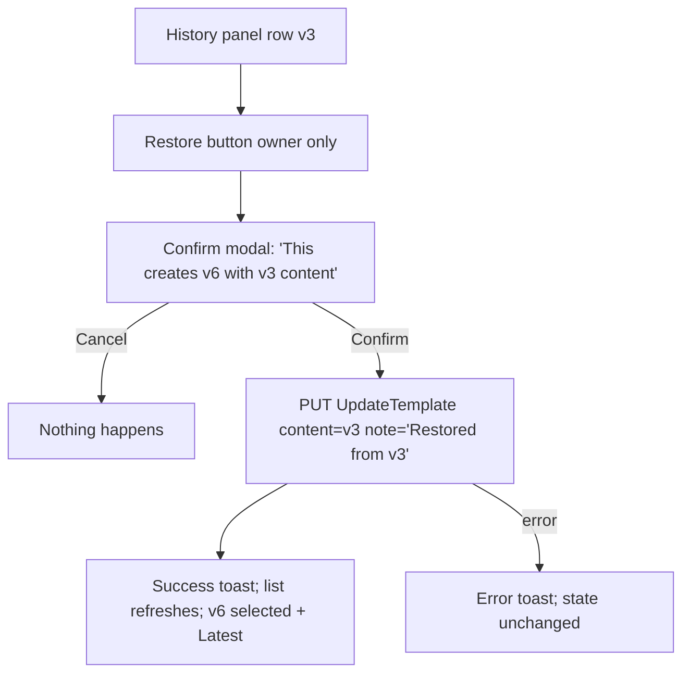

# Template Versioning UX — UI/UX Design

- **Feature ID:** template-versioning
- **Version:** 1.0
- **Status:** Proposed (for architecture review)
- **Author:** ui-ux-agent
- **Date:** 2026-10-10
- **Companion doc:** `template-versioning-requirements.md`

## 1. Design Principles

1. **History is a first-class surface.** Versions carry intent (notes), usage (prompt counts), and actions (diff, restore) — a dropdown cannot hold all that; a panel can.
2. **Never destroy.** Restore appends; nothing is deleted or renumbered. The UI reinforces this: restore always says "creates a new version".
3. **Aurora-native.** The panel lives inside the existing template-content section; diff and confirm reuse the existing Modal; toasts reuse NotificationContext; tokens and light/dark themes throughout.
4. **Zero new surfaces where none are needed.** No new routes — everything is on the template details page. No new backend endpoints — restore rides UpdateTemplate.
5. **Notes are data, chrome is translated.** Stored notes (user-written or auto-generated "Restored from v{n}") render verbatim; all surrounding UI is fully EN/ZH.

## 2. Information Architecture

```mermaid
flowchart LR
    A[/templates/:id Template details] --> B[Version selector + History toggle]
    B -->|toggle| C[Version history panel]
    C -->|row click| D[Preview switches to version]
    C -->|Compare| E[Diff modal A vs B]
    C -->|Restore owner| F[Confirm modal] --> G[UpdateTemplate + note] --> H[New version appended]
    A --> I[Edit mode] -->|optional note| J[Save new version]
    B -->|quick switch| D
```

**Surfaces (all on the existing template details page — no new routes):**

| Surface | Access | Content |
|---|---|---|
| Version selector (existing, enhanced) | anyone who can view | v{n} + date + note snippet |
| History toggle + panel | anyone who can view | Version list: notes, usage, actions |
| Diff modal | anyone who can view | Unified diff A vs B, stats, swap |
| Restore confirm modal | owner only | Warning + confirm |
| Change note input (edit mode) | owner only | Optional, 200 chars |

## 3. User Flows

### 3.1 Save with a note

```mermaid
sequenceDiagram
    participant U as Owner
    participant E as Edit mode
    participant API as PUT /api/v1/templates/{id}
    U->>E: edits content, types note "fixed tone drift"
    U->>E: clicks Save New Version
    E->>API: content + change_note
    API-->>E: {template, new_version: {v5, note}}
    E->>U: toast "New version saved"; list refreshes; v5 selected
```

### 3.2 Inspect history & diff



### 3.3 Restore an old version



## 4. Page Layouts

### 4.1 Template content section with History toggle

```text
┌──────────────────────────────────────────────────────────────────────┐
│ Content                                                               │
│ Version: [v5 (Jun 20) ▾]                              [🕘 History]   │
├──────────────────────────────────────────────────────────────────────┤
│ (preview area — unchanged; shows selected version's content)         │
│                                          [Edit] (owner, view mode)   │
└──────────────────────────────────────────────────────────────────────┘
```

### 4.2 Version history panel (expanded, replaces preview area while open)

```text
┌──────────────────────────────────────────────────────────────────────┐
│ Version history                                          [Close ✕]   │
├──────────────────────────────────────────────────────────────────────┤
│ v5  [Latest]  "Fixed tone drift"                       2h ago        │
│     1,204 chars · 12 lines · 3 prompts      [Compare] [Restore]     │
├──────────────────────────────────────────────────────────────────────┤
│ v4             "Added output format section"           3d ago        │
│     1,180 chars · 11 lines · 7 prompts      [Compare] [Restore]     │
├──────────────────────────────────────────────────────────────────────┤
│ v3             No note                                 1w ago        │
│     980 chars · 9 lines · 14 prompts        [Compare] [Restore]     │
├──────────────────────────────────────────────────────────────────────┤
│ v2             "Initial import cleanup"                2w ago        │
│     950 chars · 9 lines · 2 prompts         [Compare] [Restore]     │
├──────────────────────────────────────────────────────────────────────┤
│ v1             No note                                 1w ago        │
│     900 chars · 9 lines · 0 prompts         [Compare]                │
│                                                        [Load more]   │
└──────────────────────────────────────────────────────────────────────┘
```

- Selected row highlighted (`--surface-3` + `--accent` left border); clicking selects.
- "Restore" hidden on the latest row and for non-owners; "Compare" always visible.
- Usage column hidden entirely when `prompt_count` is absent from the API (NFR-6).

### 4.3 Diff modal

```text
┌──────────────────────────────────────────────────────────────────────┐
│ Compare versions                                                  ✕  │
│ A: [v4 ▾]        ⇄ Swap        B: [v5 ▾]      +12 −3 lines          │
├──────────────────────────────────────────────────────────────────────┤
│  1  You are an expert email writer.                    (context)     │
│ - 2  Keep the tone formal.                                           │
│ + 2  Keep the tone friendly and warm.                                │
│ + 3  Always end with a clear call to action.                         │
│  4  Output: plain text only.                                         │
├──────────────────────────────────────────────────────────────────────┤
│                                              [Copy diff] [Close]     │
└──────────────────────────────────────────────────────────────────────┘
```

- Unified diff: line numbers, removed lines red-tinted with `−`, added green-tinted with `+`, context plain.
- Monospace 13px, `pre-wrap`, max-height 60vh scroll — same content-block styling as the dashboard's prompt view modal.

### 4.4 Restore confirm modal

```text
┌──────────────────────────────────────────────┐
│ Restore version                          ✕  │
│ Restore v3 as a new version (v6)?            │
│ Your current content stays in the history —  │
│ nothing is deleted.                          │
│ The new version gets the note                │
│ "Restored from v3".                          │
│               [Cancel] [Restore v3]          │
└──────────────────────────────────────────────┘
```

### 4.5 Edit mode with change note input

```text
┌──────────────────────────────────────────────────────────────────────┐
│ Version: [v5 (Jun 20) ▾]  (disabled while editing)                   │
│ ┌──────────────────────────────────────────────────────────────────┐ │
│ │ (content textarea — unchanged)                                   │ │
│ └──────────────────────────────────────────────────────────────────┘ │
│ Change note (optional)                              0/200           │
│ ┌──────────────────────────────────────────────────────────────────┐ │
│ │ e.g., Fixed tone drift                                           │ │
│ └──────────────────────────────────────────────────────────────────┘ │
│                              [Cancel] [Save New Version]             │
└──────────────────────────────────────────────────────────────────────┘
```

## 5. Component Specifications

### 5.1 HistoryToggle

| Aspect | Spec |
|---|---|
| Placement | Right end of the version-selector row, same height as the select |
| Content | `ClockIcon` + "History" text (`.btn-ghost btn-sm`) |
| Behavior | Toggles panel; while open the label reads "Hide history"; panel replaces the preview area in-place (no layout jump — same min-height) |
| A11y | `aria-expanded` on the toggle; panel is a labelled region |

### 5.2 VersionHistoryPanel

| Aspect | Spec |
|---|---|
| Header | "Version history" (`--text-1` 15px/600) + Close (✕ icon button) |
| Rows | Newest first: `v{n}` (mono 13px `--text-1`), "Latest" badge (newest only), note (or "No note" `--text-3` italic), relative time (`--text-3` 12px, absolute in `title`), meta line "X chars · Y lines · Z prompts" (`--text-3` 12px), actions Compare / Restore |
| Row click | Selects version (same handler as the dropdown's onChange); selected row `--surface-3` + 2px `--accent` left border |
| Pagination | 20/page via `page_token`; "Load more" `.btn-ghost btn-sm` at list end; hidden when no token |
| Styling | `--surface-2` card, rows separated by `--border`, hover `--surface-3`; panel itself inside the existing `.section` |
| States | Loading: 4 skeleton rows; Empty (single version): "v1 is the only version — edit the template to create more."; Error: message + Retry |
| A11y | `<ul>` of rows; each row is a button (select) with note/time in the accessible name; actions are separate buttons with `aria-label`s |

### 5.3 VersionRow actions

| Action | Spec |
|---|---|
| Compare | Opens DiffModal with A = this version, B = latest (or selected if different); `.btn-ghost btn-sm` |
| Restore | Owner-only, hidden on latest row; opens RestoreConfirmModal; `.btn-ghost btn-sm` with `--accent` text; hidden for non-owners (not disabled — non-owners have no restore capability at all) |

### 5.4 DiffModal

| Aspect | Spec |
|---|---|
| Header | "Compare versions" + Close; two `VersionSelect`-style selectors labeled A (older) / B (newer), Swap button (⇄) between them; stats chip "+N −M lines" right-aligned |
| Body | Unified diff rows: line number (`--text-3`, 3ch right-aligned), sign marker, content; removed = `--danger`-soft bg + `−` prefix; added = `--success`-soft bg + `+` prefix; context plain; monospace 13px `pre-wrap`; max-height 60vh scroll |
| Behavior | Diff recomputed on selector change or Swap; A/B normalized so A is always the older (Swap flips and re-normalizes); "Copy diff" copies the raw unified text |
| Fallback | If the diff util is unavailable (NFR-6): side-by-side raw content panes with a notice |
| Size | Existing Modal `size="lg"` |
| A11y | Diff rows carry `role="del"`/`role="ins"`-equivalent semantics via `aria-label` prefixes ("removed line", "added line"); selectors labelled "Version A"/"Version B"; focus trap per existing Modal |

### 5.5 RestoreConfirmModal

| Aspect | Spec |
|---|---|
| Content | Title "Restore version"; body: "Restore v{n} as a new version (v{next})? Your current content stays in the history — nothing is deleted. The new version gets the note \"Restored from v{n}\"." |
| Actions | Cancel (`.btn-ghost`) / "Restore v{n}" (`.btn-primary`) |
| Behavior | Confirm → `updateTemplate(id, {content: v{n}.content, change_note: "Restored from v{n}", ...metadata passthrough})` → success toast → refresh list → select new version; in-flight disables buttons |
| A11y | Existing Modal focus trap; destructive-free wording (restore is safe) but explicit about the new-version effect |

### 5.6 ChangeNoteInput (edit mode)

| Aspect | Spec |
|---|---|
| Placement | Between content textarea and action buttons |
| Content | Label "Change note (optional)" + input (maxlength 200) + live counter "n/200" (`--text-3` 12px; counter turns `--warning` at 180+) |
| Behavior | Sent as `change_note` on save; cleared after successful save; ignored when content unchanged (FR-18) |
| Styling | Existing `.meta-input` / Field pattern; placeholder "e.g., Fixed tone drift" |
| A11y | Label tied to input; counter `aria-live="polite"` |

### 5.7 VersionSelect (enhancement)

| Aspect | Spec |
|---|---|
| Change | Option sub-line gains the note snippet (first ~40 chars, ellipsis) under the existing date when `change_note` is present; no other behavior change |
| A11y | Unchanged (existing listbox semantics); note included in option text |

## 6. Interaction Details

1. **Panel toggle:** opening the panel keeps the version selector row visible (context) and swaps the preview area for the list; closing restores the preview. The selected version persists across toggles.
2. **Selection sync:** panel row click, dropdown change, and restore-completion all route through the same `setSelectedVersionId` handler — one source of truth.
3. **Diff defaults:** Compare on row v{n} → A = v{n}, B = latest. If the row IS the latest, B = the version before it. Selectors allow any pair; A/B auto-normalize older→newer.
4. **Restore metadata passthrough:** restore sends the current title/description/category/tags/visibility (metadata unchanged) plus the old content and the auto note — the backend's content-diff check guarantees a new version is created.
5. **Optimistic vs safe:** selection and panel toggling are instant (local state); restore and save are pessimistic (button spinner, no optimistic version insertion) to avoid phantom version numbers.
6. **Refresh after write:** save and restore both re-fetch the first page of versions (and update `latest_version` state) so numbering and the Latest badge are always server-truthful.
7. **Relative time:** shared util (D-6): "just now"/"Xm ago"/"Xh ago"/"Xd ago"/locale date; absolute timestamp in `title`.
8. **Note rendering:** notes are plain text through React interpolation — never `dangerouslySetInnerHTML`; 200-char cap enforced by maxlength + server.
9. **Usage column:** rendered only when the API returns `prompt_count`; detection is per-response (older backends simply omit it).
10. **Keyboard:** panel rows and actions are buttons (Tab/Enter/Space); modal Escape closes; dropdown keeps its existing keyboard support.

## 7. States Summary

| State | Trigger | UI |
|---|---|---|
| Panel loading | Open / refresh | 4 skeleton rows |
| Panel loaded | Fetch success | Version rows |
| Panel single version | 1 version only | "v1 is the only version…" hint |
| Panel error | Fetch fails | Message + Retry (preview area still reachable by closing panel) |
| Diff computing | Selector change | Brief spinner in modal body (typically <100ms) |
| Diff fallback | Diff util unavailable | Side-by-side raw panes + notice |
| Restore in flight | Confirm clicked | Buttons disabled + spinner on Restore |
| Restore error | API fails | Error toast; list unchanged |
| Save in flight | Save clicked | Existing saving state + disabled note input |
| Note over limit | 180+ chars typed | Counter `--warning`; hard stop at 200 (maxlength) |
| Non-owner | Not owner | Panel + Compare visible; Restore hidden |
| Anonymous (public template) | No token | Read-only panel + Compare; Restore hidden |

## 8. Visual Style (Aurora compliance)

- **Panel:** inside existing `.section` (`--surface-2`, `--border`, `--radius-12`); rows separated by `--border`; hover `--surface-3`; selected row 2px `--accent` left border.
- **Latest badge:** `--accent`-soft bg + `--accent` text, `--radius-pill`, 11px/600 — same recipe as the dashboard's Public badge.
- **Version number:** monospace 13px `--text-1` (matches code-ish content context).
- **Meta line:** `--text-3` 12px; "No note" italic `--text-3`.
- **Diff:** removed `--danger`-soft bg, added `--success`-soft bg, line numbers `--text-3`; monospace 13px; stats chip `--surface-3` + `--radius-pill`.
- **Buttons:** Compare/Restore `.btn-ghost btn-sm`; Restore text `--accent`; modal actions per existing Modal patterns.
- **Note input:** existing input styling; counter `--text-3` → `--warning` near limit.
- **Dark/light:** token-only; diff tints use the soft variants that exist in both themes.

## 9. i18n Considerations (EN/ZH)

New namespace `versioning.*` (avoids touching existing `template_details.*` keys):

```json
{
  "versioning": {
    "history": "History",
    "hide_history": "Hide history",
    "panel_title": "Version history",
    "latest": "Latest",
    "no_note": "No note",
    "meta": "{{chars}} chars · {{lines}} lines · {{prompts}} prompts",
    "meta_no_usage": "{{chars}} chars · {{lines}} lines",
    "single_version": "v1 is the only version — edit the template to create more.",
    "load_more": "Load more",
    "compare": "Compare",
    "restore": "Restore",
    "compare_title": "Compare versions",
    "version_a": "Version A",
    "version_b": "Version B",
    "swap": "Swap",
    "stats": "+{{added}} −{{removed}} lines",
    "removed_line": "removed line",
    "added_line": "added line",
    "copy_diff": "Copy diff",
    "diff_fallback_notice": "Diff view is unavailable — showing both versions side by side.",
    "restore_title": "Restore version",
    "restore_body": "Restore v{{version}} as a new version (v{{next}})? Your current content stays in the history — nothing is deleted. The new version gets the note \"Restored from v{{version}}\".",
    "restore_confirm": "Restore v{{version}}",
    "note_label": "Change note (optional)",
    "note_placeholder": "e.g., Fixed tone drift",
    "note_counter": "{{count}}/200",
    "toast": { "restored": "Version restored as v{{version}}", "diff_copied": "Diff copied to clipboard" },
    "error": { "fetch": "Failed to load version history.", "restore": "Failed to restore version.", "retry": "Retry" }
  }
}
```

ZH mirror:

```json
{
  "versioning": {
    "history": "历史",
    "hide_history": "收起历史",
    "panel_title": "版本历史",
    "latest": "最新",
    "no_note": "无说明",
    "meta": "{{chars}} 字符 · {{lines}} 行 · {{prompts}} 条提示词",
    "meta_no_usage": "{{chars}} 字符 · {{lines}} 行",
    "single_version": "v1 是唯一的版本 —— 编辑模板即可创建更多。",
    "load_more": "加载更多",
    "compare": "比较",
    "restore": "恢复",
    "compare_title": "比较版本",
    "version_a": "版本 A",
    "version_b": "版本 B",
    "swap": "交换",
    "stats": "+{{added}} −{{removed}} 行",
    "removed_line": "删除行",
    "added_line": "新增行",
    "copy_diff": "复制 diff",
    "diff_fallback_notice": "Diff 视图不可用 —— 并排显示两个版本。",
    "restore_title": "恢复版本",
    "restore_body": "将 v{{version}} 恢复为新版本（v{{next}}）？当前内容会保留在历史中 —— 不会删除任何内容。新版本将带有说明 \"Restored from v{{version}}\"。",
    "restore_confirm": "恢复 v{{version}}",
    "note_label": "变更说明（可选）",
    "note_placeholder": "例如：修复语气漂移",
    "note_counter": "{{count}}/200",
    "toast": { "restored": "已恢复为 v{{version}}", "diff_copied": "Diff 已复制到剪贴板" },
    "error": { "fetch": "加载版本历史失败。", "restore": "恢复版本失败。", "retry": "重试" }
  }
}
```

Notes: stored change notes and the auto-generated "Restored from v{n}" string are data and render verbatim in both locales (D-7). The `v{n}` notation is locale-neutral. Relative times come from the shared `time.*` util keys.

## 10. Accessibility

- **HistoryToggle:** real button, `aria-expanded`, visible focus ring.
- **Panel:** labelled region (`aria-labelledby` to the panel title); rows are buttons in a `<ul>`; note + time included in the accessible name; actions are separate focusable buttons with `aria-label`s ("Compare v4", "Restore v3").
- **DiffModal:** existing Modal focus trap + Escape; selectors labelled; each diff line's add/remove status conveyed via `aria-label` prefixes (screen readers hear "removed line: …"); stats chip is real text; color never the only signal (−/+ markers accompany tints).
- **RestoreConfirmModal:** plain-language body; the effect (new version, nothing deleted) stated in text; buttons clearly labeled.
- **ChangeNoteInput:** label association; counter polite live region; maxlength enforced.
- **VersionSelect:** existing listbox keyboard support unchanged; note text included in option labels.
- **Contrast:** diff tints keep ≥ 4.5:1 text contrast in both themes; all text AA.

## 11. Implementation Notes for Developer

1. **Backend:** `ALTER TABLE template_versions ADD COLUMN IF NOT EXISTS change_note TEXT` (nullable, no backfill); proto: `change_note` on `TemplateVersion`, `UpdateTemplateRequest`; `prompt_count` on the list response (LEFT JOIN COUNT, open question #1); length validation (≤ 200) in the service layer returning `InvalidArgument`.
2. **Gateway:** pass `change_note` through `PUT /api/v1/templates/{id}`; include it (and `prompt_count`) in version JSON responses — additive fields only.
3. **Frontend state:** extend TemplateDetails' existing `versions` state; add `isHistoryOpen`, `historyPageToken`, `diffState {aId, bId}`; keep the single `setSelectedVersionId` handler as the selection source of truth.
4. **Pagination:** replace the one-shot `page_size: 100` fetch with `page_size: 20` + token accumulation ("Load more" appends); the dropdown consumes the accumulated list (unchanged UX).
5. **Diff util:** `diffLines` from the `diff` package (or the hand-rolled LCS fallback — open question #2); wrap in `utils/diff.js` with a normalized `{type: 'add'|'remove'|'context', text, aLine, bLine}` output so the modal renders one row type.
6. **Restore:** `updateTemplate(id, { ...currentMetadata, content: version.content, change_note: `Restored from v${version.version}` })`; on success re-fetch page 1 of versions, select `new_version.id`, toast.
7. **Components:** `VersionHistoryPanel`, `VersionRow` (inline in panel), `DiffModal`, `RestoreConfirmModal`, `ChangeNoteInput`; enhance `VersionSelect` option sub-line with the note snippet.
8. **Shared utils:** relative time (with dashboard/notifications features); copy-to-clipboard (already shared).
9. **Testing:** unit tests for the diff wrapper (add/remove/context/empty/identical), note-length validation, restore payload builder; component tests for the panel (render, select, pagination, owner gating), DiffModal (defaults, swap, stats), ChangeNoteInput (counter, maxlength); page-level test that save-with-note and restore flow update the list; i18n key parity test.
