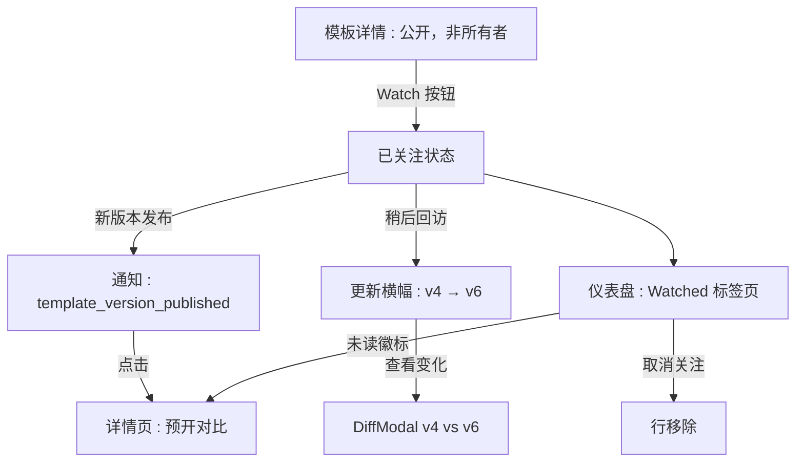
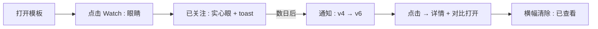
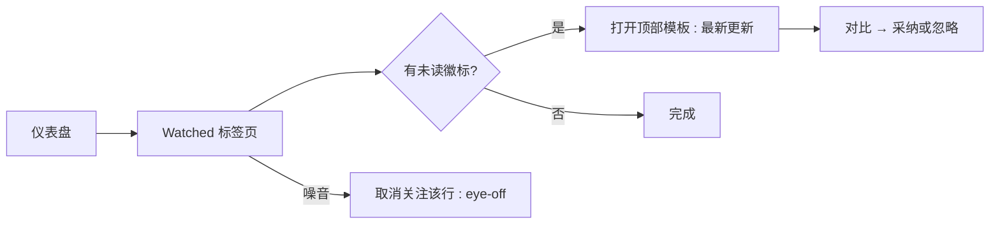

# 模板关注（Watch）— UI/UX 设计

- **功能 ID：** template-watch
- **版本：** 1.0
- **状态：** Proposed（待架构评审）
- **作者：** ui-ux-agent
- **日期：** 2026-10-13
- **配套文档：** `template-watch-requirements-zh-CN.md`

## 1. 设计原则

1. **一个动词，一个图标。** Watch 用眼睛（不是星星、不是铃铛）—— 与收藏和 follow 视觉区分，用户绝不会混淆三者。
2. **更新出现在注意力已存在的地方。** 不新建收件箱：现有通知中心、现有仪表盘、正在阅读的页面上一条横幅。
3. **变化一键可对比。** 每个更新界面都直链版本对比 —— 绝不让关注者通读全文来找变化。
4. **默认安静，重要时才响。** 每模板每小时最多一条通知；未读徽标是含蓄的圆点，不是警报。

## 2. 信息架构



| 界面 | 位置 | 受众 | 目的 |
|---|---|---|---|
| Watch 按钮 | 模板详情页头部操作区 | 已认证非所有者 | 订阅/退订 |
| 更新横幅 | 模板详情页，标题下方 | 回访关注者 | "我不在的时候发生了什么变化" |
| Watched 标签页 | `/dashboard/watched` | 关注者 | 集中分流所有订阅 |
| 通知条目 | 通知中心（现有） | 关注者 | 推送式更新提醒 |
| 关注数 | 模板详情页，仅所有者视图 | 所有者 | 兴趣指标 |

## 3. 用户流程

### 3.1 关注并获知更新



### 3.2 仪表盘分流



## 4. 页面布局

### 4.1 模板详情 — Watch 按钮（头部操作区）

```
+----------------------------------------------------------------------+
|  ← 返回                                                              |
|                                                                      |
|  Cold Email Template                              [👁 关注] [☆] [⋯]  |
|  by Alice · Marketing · v6 · ★128                                    |
+----------------------------------------------------------------------+
```

已关注状态：实心眼 + "已关注"文字；悬浮显示"取消关注"（eye-off 图标）。

### 4.2 更新横幅（回访关注者）

```
+----------------------------------------------------------------------+
|  ↻ 自你上次查看已更新 —— v4 → v6                  [查看变化] [×]      |
+----------------------------------------------------------------------+
```

信息色调横幅（左侧强调色边框）；关闭（×）后本版本内不再显示（会话级）。

### 4.3 仪表盘 — Watched 标签页

```
+----------------------------------------------------------------------+
|  概览 | 我的模板 | 我的提示词 | 我的合集 | 已关注 (3)                   |
+----------------------------------------------------------------------+
|  ●  Cold Email Template      Marketing   v6   [2 个新版本]      👁   |
|  ●  Code Review Checklist    Dev         v9   [1 个新版本]      👁   |
|     Logo Prompt Pack         Design      v2                    👁   |
+----------------------------------------------------------------------+
```

● = 未读圆点；行按最近更新优先排序；眼睛按钮 = 快速取消关注。

### 4.4 通知条目

```
+----------------------------------------------------------------------+
|  👁  Cold Email Template 已更新：v4 → v6                              |
|      "tightened opener, added follow-up P.S."            2 小时前     |
+----------------------------------------------------------------------+
```

点击 → 模板详情页并预开对比。

### 4.5 移动端

Watch 按钮加入详情页操作行（仅图标，44×44px，带 aria-label）。横幅在标题下方全宽展示。Watched 标签页复用仪表盘的移动端标签滚动条；行堆叠排列，未读徽标内联在版本号之后。

## 5. 组件规格

| 组件 | 行为 | 状态 |
|---|---|---|
| WatchButton | 眼睛图标开关；变化时 toast；所有者禁用（提示"这是你自己的模板"） | 未关注 / 已关注 / 加载中 / 禁用(所有者) |
| UpdatedBanner | 版本区间 + 查看变化 + 关闭；挂载时触发已查看信标 | 显示 / 已关闭 / 隐藏(无更新) |
| WatchedTab | 仪表盘标签页；PromptCard 列表 + 未读徽标 + 取消关注操作；按更新优先排序 | 已加载 / 加载中 / 空态 / 错误 |
| UnreadBadge | "N 个新版本"胶囊（移动端为圆点） | 0(隐藏) / 1 / N(2+) |
| WatchNotification | 图标 + 标题 + 版本区间 + 变更说明摘录 + 时间 | 未读 / 已读 |

## 6. 交互细节

1. **Watch 开关：** 点击 → 乐观状态变更 → POST/DELETE；失败回滚并弹错误 toast。关注成功显示确认 toast（"已关注 —— 有新版本时会通知你"）。
2. **所有者视图：** Watch 按钮替换为关注数 chip（"👁 12 人关注"）—— 所有者不能关注自己的模板（FR-1）。
3. **横幅 → 对比：** "查看变化"打开 template-versioning 的 DiffModal 并预选 prev→new；关闭弹窗保留横幅的已关闭状态。
4. **已查看信标：** 横幅挂载与详情页加载（对关注者）触发 fire-and-forget 的已查看更新；未读徽标在下一次仪表盘渲染时清除。
5. **Watched 标签页排序：** 未读行在前（最新更新优先），已读行按关注时间排后；存在任何未读时标签名显示计数徽标。
6. **快速取消关注：** 行上的 eye-off 按钮移除该行并弹可撤销 toast（5 秒）—— 误操作可恢复。
7. **通知点击：** 标记已读（现有行为）并携带 `?diff={prev}..{new}` 深链；DiffModal 从 URL 参数自动打开。
8. **折叠展示：** 多版本折叠时（FR-9），通知/横幅显示区间 "v3 → v8" —— 绝不罗列每个中间版本。

## 7. 状态汇总

| 界面 | 加载中 | 空态 | 错误 |
|---|---|---|---|
| WatchButton | 按钮内 spinner | — | 回滚 + 错误 toast |
| UpdatedBanner | — | 隐藏（无更新） | 隐藏（fail open） |
| WatchedTab | 骨架卡片 | "你还没有关注任何模板 —— 去找一个你常用的" + 去首页 CTA | 错误横幅 + 重试 |
| UnreadBadge | — | 隐藏（0） | — |
| 通知 | — | — | 现有通知渲染 |

## 8. 国际化（i18n）

| Key | 中文 | 英文 |
|---|---|---|
| `watch.button.watch` | 关注 | Watch |
| `watch.button.watching` | 已关注 | Watching |
| `watch.button.unwatch` | 取消关注 | Unwatch |
| `watch.button.ownerDisabled` | 这是你自己的模板 | You own this template |
| `watch.toast.watching` | 已关注 —— 有新版本时会通知你 | Watching — you'll be notified about new versions |
| `watch.toast.unwatched` | 已取消关注 | Unwatched |
| `watch.toast.undo` | 撤销 | Undo |
| `watch.banner.updated` | 自你上次查看已更新 —— v{{from}} → v{{to}} | Updated since you last viewed — v{{from}} → v{{to}} |
| `watch.banner.viewChanges` | 查看变化 | View changes |
| `watch.dashboard.tab` | 已关注 | Watched |
| `watch.dashboard.empty` | 你还没有关注任何模板 —— 去找一个你常用的 | You're not watching any templates yet — find one you rely on |
| `watch.dashboard.emptyCta` | 浏览模板 | Browse templates |
| `watch.badge.newVersions` | {{count}} 个新版本 | {{count}} new version |
| `watch.badge.newVersions_other` | {{count}} 个新版本 | {{count}} new versions |
| `watch.notification.title` | {{title}} 已更新：v{{from}} → v{{to}} | {{title}} updated: v{{from}} → v{{to}} |
| `watch.notification.noNote` | 新版本已发布 | New version published |
| `watch.owner.count` | {{count}} 人关注 | {{count}} watching |
| `watch.aria.watch` | 关注此模板以获取版本更新 | Watch this template for version updates |
| `watch.aria.watching` | 已关注。点击可取消关注 | Watching. Activate to stop watching |

## 9. 无障碍

- WatchButton 是标准切换按钮，带 `aria-pressed`（关注时为 true）与来自 `watch.aria.*` 的 `aria-label`；状态变化通过 toast（`role=status`）播报。
- 横幅是 `role=status` 区域；"查看变化"是真实按钮，具有描述性名称（"查看从版本 4 到 6 的变化"）。
- 未读徽标包含视觉隐藏文字（"2 个新版本"）—— 圆点绝不是唯一信号。
- Watched 标签页遵循仪表盘现有标签语义（`role=tab`、方向键导航）；行可聚焦，取消关注可通过键盘到达。
- DiffModal 深链保留 versioning 功能现有的焦点陷阱与 Esc 行为。

## 10. 数据埋点（可选）

- `watch_started`、`watch_stopped`（来源：详情页/仪表盘）、`watch_banner_shown`、`watch_diff_opened`、`watched_tab_opened` —— 仅产品使用事件。

## 11. 不在范围内

- 关注粒度分级；关注者列表（谁在关注）；邮件/推送渠道。
- 关注评论/fork/合集/链；一键关注创作者全部作品。
- 任何形式的变现 —— 本产品永久不做。
