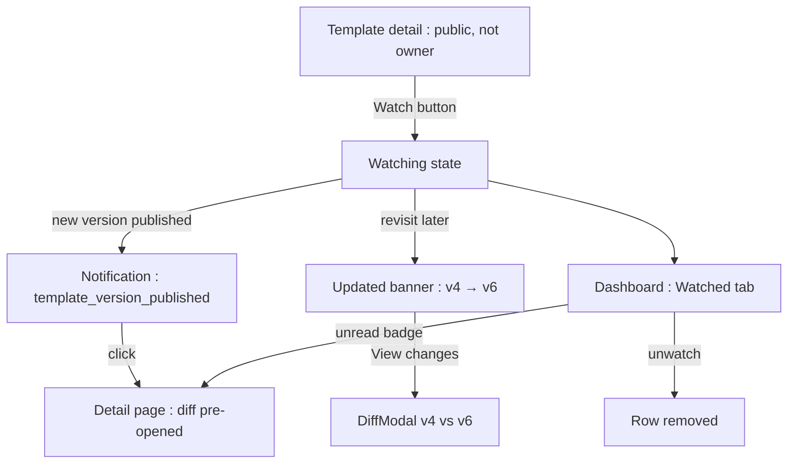
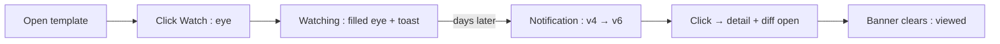
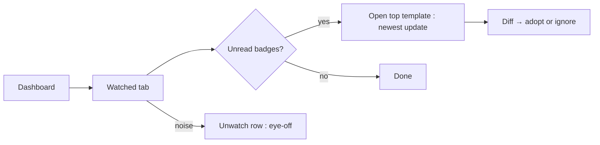

# Template Watch — UI/UX Design

- **Feature ID:** template-watch
- **Version:** 1.0
- **Status:** Proposed (for architecture review)
- **Author:** ui-ux-agent
- **Date:** 2026-10-13
- **Companion doc:** `template-watch-requirements.md`

## 1. Design Principles

1. **One verb, one icon.** Watch is an eye (not a star, not a bell) — visually distinct from favorite and follow so users never confuse the three.
2. **Updates arrive where attention already lives.** No new inbox: the existing notification center, the existing dashboard, a banner on the page they're reading.
3. **Changes are diffable in one click.** Every update surface links straight to the version diff — never make a watcher read the whole prompt to spot the change.
4. **Quiet by default, loud when it matters.** One notification per hour per template; unread badges are subtle dots, not alarms.

## 2. Information Architecture



| Surface | Location | Audience | Purpose |
|---|---|---|---|
| Watch button | Template detail header actions | Authenticated non-owners | Subscribe/unsubscribe |
| Updated banner | Template detail, below header | Returning watchers | "What changed since I was here" |
| Watched tab | `/dashboard/watched` | Watchers | Triage all subscriptions |
| Notification item | Notification center (existing) | Watchers | Push-style update alert |
| Watcher count | Template detail, owner view only | Owner | Interest metric |

## 3. User Flows

### 3.1 Watch and get updated



### 3.2 Triage in dashboard



## 4. Page Layouts

### 4.1 Template detail — watch button (header actions)

```
+----------------------------------------------------------------------+
|  ← Back                                                              |
|                                                                      |
|  Cold Email Template                              [👁 Watch] [☆] [⋯] |
|  by Alice · Marketing · v6 · ★128                                    |
+----------------------------------------------------------------------+
```

Watching state: filled eye + "Watching" label; hover shows "Unwatch" (eye-off icon).

### 4.2 Updated banner (returning watcher)

```
+----------------------------------------------------------------------+
|  ↻ Updated since you last viewed — v4 → v6        [View changes] [×] |
+----------------------------------------------------------------------+
```

Info-tone banner (accent left border); dismiss (×) hides for this version (session-level).

### 4.3 Dashboard — Watched tab

```
+----------------------------------------------------------------------+
|  Overview | My Templates | My Prompts | My Collections | Watched (3) |
+----------------------------------------------------------------------+
|  ●  Cold Email Template      Marketing   v6   [2 new versions]  👁   |
|  ●  Code Review Checklist    Dev         v9   [1 new version]   👁   |
|     Logo Prompt Pack         Design      v2                    👁   |
+----------------------------------------------------------------------+
```

● = unread dot; rows sorted newest-update-first; eye button = quick unwatch.

### 4.4 Notification item

```
+----------------------------------------------------------------------+
|  👁  Cold Email Template updated: v4 → v6                            |
|      "tightened opener, added follow-up P.S."            2 hours ago |
+----------------------------------------------------------------------+
```

Click → template detail with diff pre-opened.

### 4.5 Mobile

The watch button joins the detail-page action row (icon-only, 44×44px, aria-label). The banner spans full width below the title. The Watched tab reuses the dashboard's mobile tab scroller; rows stack with the unread badge inline after the version.

## 5. Component Specs

| Component | Behavior | States |
|---|---|---|
| WatchButton | Eye icon toggle; toast on change; disabled for owner (tooltip "You own this") | Unwatched / watching / loading / disabled(owner) |
| UpdatedBanner | Version range + View changes + dismiss; triggers viewed beacon on mount | Shown / dismissed / hidden(no updates) |
| WatchedTab | Dashboard tab; list of PromptCards + unread badge + unwatch action; sorted update-first | Loaded / loading / empty / error |
| UnreadBadge | "N new versions" pill (or dot on mobile) | 0(hidden) / 1 / N(2+) |
| WatchNotification | Icon + title + version range + change note excerpt + time | Unread / read |

## 6. Interaction Details

1. **Watch toggle:** click → optimistic state change → POST/DELETE; failure reverts with error toast. Watching shows a confirmation toast ("Watching — you'll be notified about new versions").
2. **Owner view:** the watch button is replaced by a watcher-count chip ("👁 12 watching") — owners cannot watch their own template (FR-1).
3. **Banner → diff:** View changes opens the template-versioning DiffModal with prev→new preselected; closing the modal keeps the banner dismissed state.
4. **Viewed beacon:** banner mount and detail-page load (for watchers) fire the fire-and-forget viewed update; the unread badge clears on next dashboard render.
5. **Watched tab sorting:** unread rows first (newest update first), then read rows by watch date; the tab label shows a count badge when any unread exists.
6. **Quick unwatch:** the eye-off button on a row removes it with an undo toast (5s) — accidental unwatch is recoverable.
7. **Notification click:** marks read (existing behavior) and deep-links with `?diff={prev}..{new}`; the DiffModal auto-opens from the URL param.
8. **Collapse display:** when multiple versions collapsed (FR-9), the notification/banner shows the range "v3 → v8" — never a list of every intermediate version.

## 7. States Summary

| Surface | Loading | Empty | Error |
|---|---|---|---|
| WatchButton | Spinner in button | — | Revert + error toast |
| UpdatedBanner | — | Hidden (no updates) | Hidden (fail open) |
| WatchedTab | Skeleton cards | "You're not watching any templates yet — find one you rely on" + CTA to home | Error banner + retry |
| UnreadBadge | — | Hidden (0) | — |
| Notification | — | — | Existing notification rendering |

## 8. i18n

| Key | EN | ZH |
|---|---|---|
| `watch.button.watch` | Watch | 关注 |
| `watch.button.watching` | Watching | 已关注 |
| `watch.button.unwatch` | Unwatch | 取消关注 |
| `watch.button.ownerDisabled` | You own this template | 这是你自己的模板 |
| `watch.toast.watching` | Watching — you'll be notified about new versions | 已关注 —— 有新版本时会通知你 |
| `watch.toast.unwatched` | Unwatched | 已取消关注 |
| `watch.toast.undo` | Undo | 撤销 |
| `watch.banner.updated` | Updated since you last viewed — v{{from}} → v{{to}} | 自你上次查看已更新 —— v{{from}} → v{{to}} |
| `watch.banner.viewChanges` | View changes | 查看变化 |
| `watch.dashboard.tab` | Watched | 已关注 |
| `watch.dashboard.empty` | You're not watching any templates yet — find one you rely on | 你还没有关注任何模板 —— 去找一个你常用的 |
| `watch.dashboard.emptyCta` | Browse templates | 浏览模板 |
| `watch.badge.newVersions` | {{count}} new version | {{count}} 个新版本 |
| `watch.badge.newVersions_other` | {{count}} new versions | {{count}} 个新版本 |
| `watch.notification.title` | {{title}} updated: v{{from}} → v{{to}} | {{title}} 已更新：v{{from}} → v{{to}} |
| `watch.notification.noNote` | New version published | 新版本已发布 |
| `watch.owner.count` | {{count}} watching | {{count}} 人关注 |
| `watch.aria.watch` | Watch this template for version updates | 关注此模板以获取版本更新 |
| `watch.aria.watching` | Watching. Activate to stop watching | 已关注。点击可取消关注 |

## 9. Accessibility

- WatchButton is a standard toggle button with `aria-pressed` (true when watching) and an `aria-label` from `watch.aria.*`; state change is announced via the toast (`role=status`).
- The banner is a `role=status` region; View changes is a real button with a descriptive name ("View changes from version 4 to 6").
- Unread badges include visually-hidden text ("2 new versions") — the dot is never the only signal.
- The Watched tab follows the dashboard's existing tab semantics (`role=tab`, arrow-key navigation); rows are focusable with unwatch reachable via keyboard.
- The DiffModal deep-link preserves the versioning feature's existing focus-trap and Esc behavior.

## 10. Analytics (optional)

- `watch_started`, `watch_stopped` (source: detail/dashboard), `watch_banner_shown`, `watch_diff_opened`, `watched_tab_opened` — product usage events only.

## 11. Out of Scope

- Watch granularity levels; watcher lists (who watches); email/push channels.
- Watching comments/forks/collections/chains; watch-all-from-creator.
- Monetization of any kind — permanently out of scope for this product.
