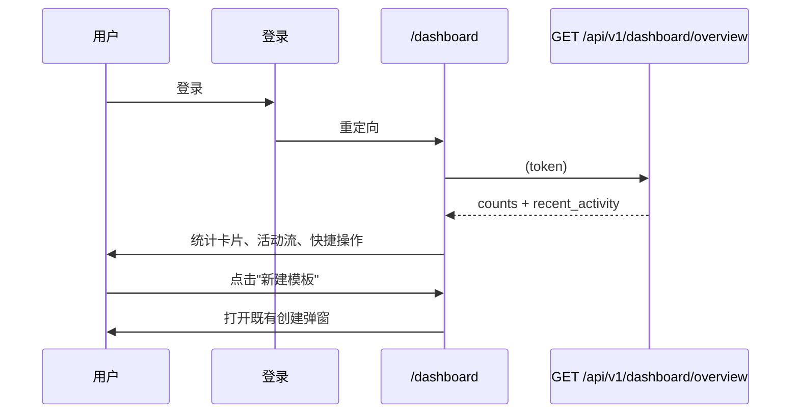
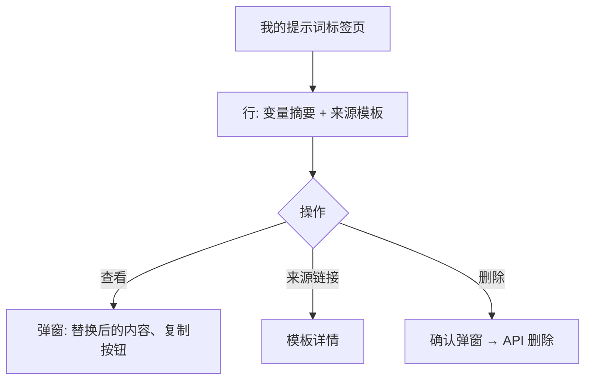

# 用户仪表盘 — UI/UX 设计

- **功能标识:** user-dashboard
- **版本:** 1.0
- **状态:** 已提案（待架构评审）
- **作者:** ui-ux-agent
- **日期:** 2025-06-25
- **配套文档:** `user-dashboard-requirements-zh-CN.md`

## 1. 设计原则

1. **工作区而非个人主页。** 仪表盘是生产力界面：计数、最近条目、快捷操作、管理列表。身份信息留在 /profile。
2. **一瞥即可行动。** 每个元素都回答一个问题或启动一个任务：统计卡片可导航、活动条目带链接、快捷操作可创建。
3. **Aurora 原生。** 复用 Layout/Sidebar 外壳、PromptCard、Modal、徽章、Spinner、NotificationContext、tokens、亮/暗主题。
4. **优雅降级。** 对合集做特性检测；功能缺失时隐藏 —— 绝不报错。
5. **熟悉的列表。** 我的模板/我的提示词复用既有网格/表格模式的视觉语言；不引入新列表范式。

## 2. 信息架构

```mermaid
flowchart LR
    A[登录成功] --> B[/dashboard 总览]
    B --> C[统计卡片 x4]
    B --> D[最近活动]
    B --> E[快捷操作]
    F[侧栏: 我的工作区] --> B
    B --> G[/dashboard/templates 我的模板]
    B --> H[/dashboard/prompts 我的提示词]
    B --> I[/collections/mine 我的合集]
    B --> J[/api-keys API Keys]
    G -->|编辑| K[/templates/:id]
    H -->|来源链接| K
    H -->|查看| L[提示词查看弹窗]
```

**路由:**

| 路由 | 访问 | 内容 |
|---|---|---|
| `/dashboard` | 认证 | 总览：统计卡片、活动、快捷操作 |
| `/dashboard/templates` | 认证 | 我的模板管理列表 |
| `/dashboard/prompts` | 认证 | 我的提示词（实例化）列表 |

仪表盘导航（页内，标题下方）：总览 · 我的模板 · 我的提示词 · 我的合集* · API Keys（*合集功能缺失时隐藏）。

## 3. 用户流程

### 3.1 登录 → 总览 → 行动



### 3.2 管理模板

```mermaid
flowchart TD
    A[总览 → 我的模板统计卡片] --> B[/dashboard/templates]
    B --> C{操作}
    C -- 编辑 --> D[/templates/:id 编辑模式]
    C -- 删除 --> E[确认弹窗] --> F[API 删除] --> G[列表刷新]
    C -- 切换可见性 --> H[API 更新] --> G
```

### 3.3 重访提示词



## 4. 页面布局

### 4.1 总览（`/dashboard`）

```text
┌──────────────────────────────────────────────────────────────────────┐
│ Header（既有）                                                        │
├────────────┬─────────────────────────────────────────────────────────┤
│ 侧栏       │  我的工作区                                              │
│ （+ 我的   │  总览 · 模板 · 提示词 · 合集 · API Keys                  │
│  工作区    │  ┌─────────┐ ┌─────────┐ ┌─────────┐ ┌─────────┐        │
│  导航项    │  │ 模板    │ │ 提示词  │ │ 合集    │ │API Keys │        │
│  置顶）    │  │   12    │ │   34    │ │    3    │ │    2    │        │
│            │  └─────────┘ └─────────┘ └─────────┘ └─────────┘        │
│            │  ┌───────────────────────────────┐ ┌──────────────────┐ │
│            │  │ 最近活动                       │ │ 快捷操作         │ │
│            │  │ 📄 创建了"邮件写手"  2小时前   │ │ [+ 新建模板]     │ │
│            │  │ ▶ 使用了"代码审查"  昨天       │ │ [+ 新建 API key] │ │
│            │  │ ❤ 点赞了"Logo 简报"  3天前     │ │                  │ │
│            │  │ ★ 收藏了"SQL 助手"  5天前      │ │                  │ │
│            │  │ …（最多 10 条）                │ │                  │ │
│            │  └───────────────────────────────┘ └──────────────────┘ │
└────────────┴─────────────────────────────────────────────────────────┘
```

### 4.2 我的模板（`/dashboard/templates`）

```text
│  我的模板                       [全部][公开][私有][系统][用户]        │
│  ┌────────────────────────────────────────────────────────────────┐  │
│  │ 邮件写手   [公开][用户]  营销 · email, outreach                 │  │
│  │ ❤ 42 ★ 17 · 更新于 6月20日          [编辑][可见性][删除]       │  │
│  ├────────────────────────────────────────────────────────────────┤  │
│  │ 代码审查   [私有][用户]  代码 · review, quality                │  │
│  │ ❤ 0 ★ 0 · 更新于 6月18日            [编辑][可见性][删除]       │  │
│  └────────────────────────────────────────────────────────────────┘  │
│  ‹ 1 2 3 ›                                                           │
```

### 4.3 我的提示词（`/dashboard/prompts`）

```text
│  我的提示词                                   [筛选: 所有模板 ▾]     │
│  ┌────────────────────────────────────────────────────────────────┐  │
│  │ tone=friendly, length=short · 来自"邮件写手" · 6月21日          │  │
│  │                                        [查看][删除]             │  │
│  ├────────────────────────────────────────────────────────────────┤  │
│  │ language=Go, focus=errors · 来自"代码审查" · 6月20日            │  │
│  │                                        [查看][删除]             │  │
│  └────────────────────────────────────────────────────────────────┘  │
│  ‹ 1 2 ›                                                             │
```

### 4.4 提示词查看弹窗

```text
┌──────────────────────────────────────────────┐
│ 来自"邮件写手"的提示词                     ✕  │
│ 创建于 2025年6月21日                         │
│ ┌──────────────────────────────────────────┐ │
│ │（替换后的提示词内容，等宽字体，           │ │
│ │  可滚动，pre-wrap）                       │ │
│ └──────────────────────────────────────────┘ │
│ 变量: tone=friendly · length=short           │
│                       [复制] [删除] [关闭]    │
└──────────────────────────────────────────────┘
```

## 5. 组件规格

### 5.1 StatCard

| 方面 | 规格 |
|---|---|
| 内容 | 标签（13px `--text-2`）、计数（28px `--text-1`）、右上角淡图标（`--text-3`） |
| 行为 | 整卡是链接，指向对应标签页/页面；hover: `--surface-3` + `--shadow-md` |
| 样式 | `--surface-2`、`--border`、`--radius-12`、内边距 20px；4 列网格（平板 2×2，手机单列） |
| 无障碍 | 真实链接带描述性 `aria-label`（"我的模板，12 项"） |

### 5.2 ActivityFeed

| 方面 | 规格 |
|---|---|
| 内容 | 最多 10 行：图标（📄 模板 / ▶ 提示词 / ❤ 点赞 / ★ 收藏）、文本（"创建了\"邮件写手\""）、相对时间、行链接到实体 |
| 数据 | 来自总览端点（FR-18）；无客户端合并 |
| 样式 | `--surface-2` 卡片，行间 `--border` 分隔；图标颜色：模板 `--accent`、提示词 `--secondary`、点赞 `--danger`（心）、收藏 `--warning`（星） |
| 空状态 | "还没有活动 —— 你的操作会显示在这里" |
| 无障碍 | 语义 `<ul>`；每行是链接；相对时间放 `title`（悬停显示绝对时间） |

### 5.3 QuickActions

| 方面 | 规格 |
|---|---|
| 内容 | 两个按钮："新建模板"（`.btn-primary`，打开既有创建弹窗）、"新建 API key"（`.btn-ghost`，导航） |
| 样式 | `--surface-2` 卡片内垂直堆叠，按钮全宽 |

### 5.4 DashboardNav（页内标签）

| 方面 | 规格 |
|---|---|
| 内容 | 总览 · 我的模板 · 我的提示词 · 我的合集* · API Keys |
| 行为 | React Router 链接；激活标签 `--accent` 下划线；合集功能缺失时隐藏该入口（D-3） |
| 无障碍 | `<nav aria-label="Dashboard">`，激活项 `aria-current="page"` |

### 5.5 TemplateManageRow

| 方面 | 规格 |
|---|---|
| 内容 | 标题（链接）、可见性徽章、类型徽章、分类、前 3 个标签、点赞/收藏计数、更新日期、操作：编辑 / 可见性切换 / 删除 |
| 操作 | 编辑 → 模板详情；可见性 → 徽章乐观翻转 + 更新 API（失败回滚 + toast）；删除 → 确认弹窗（回显名称）→ 删除 API → 行移除 |
| 样式 | `--surface-2` 行、`--border` 分隔、hover `--surface-3`；徽章遵循既有模式 |
| 无障碍 | 操作是图标+文本按钮带 `aria-label`；删除用 `--danger` |

### 5.6 PromptRow

| 方面 | 规格 |
|---|---|
| 内容 | 变量摘要（前 2 个 `key=value` 对，截断，等宽 12px）、来源模板标题（链接）、创建日期、操作：查看 / 删除 |
| 查看 | 打开 PromptViewModal（5.7） |
| 删除 | 确认弹窗 → 删除 API → 行移除 |
| 样式 | 与 5.5 相同的行模式；变量用 `--surface-3` 内联代码 chips |

### 5.7 PromptViewModal

| 方面 | 规格 |
|---|---|
| 内容 | 头部"来自\"{template}\"的提示词"、创建日期、替换后的内容（按 FR-20 客户端组装）在可滚动等宽块中、变量列表、操作：复制 / 删除 / 关闭 |
| 复制 | `navigator.clipboard` + 回退；成功 toast |
| 尺寸 | 既有 Modal `size="lg"`；内容最大高 60vh，`pre-wrap` |
| 无障碍 | 既有 Modal 焦点陷阱；内容区域有标签；复制通过 toast 播报 |

### 5.8 FilterChips（模板标签页）

| 方面 | 规格 |
|---|---|
| 选项 | 全部 / 公开 / 私有 / 系统 / 用户 |
| 行为 | 对当前页行的客户端筛选（v1）；激活 chip `--accent`-soft |
| 无障碍 | radiogroup 语义 |

## 6. 交互细节

1. **登录重定向:** 登录成功处理器导航到 `/dashboard`（D-4）；若存在"记住我"/深链目标（如 `?next=`）则优先。
2. **总览取数:** 挂载时单次调用；加载中显示骨架统计卡片 + 活动行；失败显示错误横幅 + 重试。
3. **标签页:** 每个标签页挂载时取自己的列表（ListTemplates owner_id=me / ListPrompts owner_id=me）；分页用既有 page_token 模式。
4. **可见性切换:** 乐观 UI；失败回滚并显示错误 toast（既有 NotificationContext）。
5. **删除流程:** 确认弹窗回显实体名称；成功 toast；行动画移除。
6. **提示词查看:** 首次点击查看时懒加载模板内容（会话内按模板 id 缓存）；替换复用共享工具（D-5）。
7. **相对时间:** 共享工具（D-6）—— <60s "刚刚"、<60m "X分钟前"、<24h "X小时前"、<7d "X天前"、否则 locale 日期；渲染后无需重渲染。
8. **特性检测（合集）:** 仪表盘挂载时探测 `/api/v1/collections`（HEAD/GET）；404 → 隐藏合集卡片/导航（D-3）；结果缓存在模块状态。
9. **空状态:** 按 §5 规格；每个都有 CTA（创建模板 / 浏览广场）。

## 7. 状态汇总

| 状态 | 触发 | UI |
|---|---|---|
| 加载中 | 标签页挂载 / 总览取数 | 骨架卡片/行 |
| 已加载 | 取数成功 | 完整内容 |
| 空（各标签页） | 无数据 | 空状态 + CTA |
| 错误 | API 失败 | 错误横幅 + 重试 |
| 功能缺失 | 合集 404 | 隐藏合集卡片/导航 |
| 匿名 | 无 token | 重定向到 /login |
| 确认弹窗 | 删除/可见性 | 弹窗（既有模式） |

## 8. 视觉风格（Aurora 合规）

- **StatCard:** `--surface-2` + `--border` + `--radius-12`；计数 `--text-1` 28px；标签 `--text-2` 13px；图标 `--text-3`。
- **ActivityFeed:** 图标 `--accent`/`--secondary`/`--danger`/`--warning`；文本 `--text-1`；时间 `--text-3` 12px。
- **DashboardNav:** 文本 `--text-2`，激活 `--text-1` + 2px `--accent` 下划线；hover `--text-1`。
- **行:** `--surface-2` 背景、`--border` 分隔、hover `--surface-3`；徽章：公开 `--accent`-soft、私有 `--surface-3`+`--text-2`、系统 `--secondary`-soft、用户 `--info`-soft。
- **QuickActions:** 主按钮 `.btn-primary` 带 + 图标；次按钮 `.btn-ghost`。
- **PromptViewModal:** 内容块 `--surface-3` 背景、`--radius-12`、等宽 13px；变量 chips `--surface-3` + `--radius-pill`。
- **暗/亮主题:** 仅 token；两个主题自动。

## 9. 国际化考量（EN/ZH）

新增命名空间 `dashboard_v2.*`（既有 `dashboard.*` 键被当前侧栏使用；新键避免冲突）：

```json
{
  "dashboard_v2": {
    "title": "My Workspace",
    "nav": { "overview": "Overview", "templates": "My Templates", "prompts": "My Prompts", "collections": "My Collections", "api_keys": "API Keys" },
    "stats": { "templates": "Templates", "prompts": "Prompts", "collections": "Collections", "api_keys": "API Keys" },
    "activity": {
      "title": "Recent activity",
      "empty": "No activity yet — your actions will appear here.",
      "template_created": "Created \"{{title}}\"",
      "template_updated": "Updated \"{{title}}\"",
      "prompt_used": "Used \"{{title}}\"",
      "liked": "Liked \"{{title}}\"",
      "favorited": "Favorited \"{{title}}\""
    },
    "quick": { "new_template": "New template", "new_api_key": "New API key" },
    "templates": {
      "filter": { "all": "All", "public": "Public", "private": "Private", "system": "System", "user": "User" },
      "updated": "Updated {{date}}",
      "empty": "You haven't created any templates yet.",
      "empty_cta": "Create a template",
      "delete_confirm": "Delete \"{{title}}\"? This cannot be undone."
    },
    "prompts": {
      "filter": "All templates",
      "from": "from \"{{title}}\"",
      "created": "Created {{date}}",
      "empty": "No prompts yet — use a template to create one.",
      "empty_cta": "Browse the Prompt Square",
      "view": "View",
      "delete_confirm": "Delete this prompt? This cannot be undone.",
      "modal_title": "Prompt from \"{{title}}\"",
      "variables": "Variables",
      "copy": "Copy"
    },
    "error": { "fetch": "Failed to load dashboard.", "retry": "Retry" }
  }
}
```

中文镜像：

```json
{
  "dashboard_v2": {
    "title": "我的工作区",
    "nav": { "overview": "总览", "templates": "我的模板", "prompts": "我的提示词", "collections": "我的合集", "api_keys": "API Keys" },
    "stats": { "templates": "模板", "prompts": "提示词", "collections": "合集", "api_keys": "API Keys" },
    "activity": {
      "title": "最近活动",
      "empty": "还没有活动 —— 你的操作会显示在这里。",
      "template_created": "创建了\"{{title}}\"",
      "template_updated": "更新了\"{{title}}\"",
      "prompt_used": "使用了\"{{title}}\"",
      "liked": "点赞了\"{{title}}\"",
      "favorited": "收藏了\"{{title}}\""
    },
    "quick": { "new_template": "新建模板", "new_api_key": "新建 API key" },
    "templates": {
      "filter": { "all": "全部", "public": "公开", "private": "私有", "system": "系统", "user": "用户" },
      "updated": "更新于 {{date}}",
      "empty": "你还没有创建任何模板。",
      "empty_cta": "创建模板",
      "delete_confirm": "删除\"{{title}}\"？此操作不可撤销。"
    },
    "prompts": {
      "filter": "所有模板",
      "from": "来自\"{{title}}\"",
      "created": "创建于 {{date}}",
      "empty": "还没有提示词 —— 使用模板创建一个。",
      "empty_cta": "去 Prompt Square 浏览",
      "view": "查看",
      "delete_confirm": "删除此提示词？此操作不可撤销。",
      "modal_title": "来自\"{{title}}\"的提示词",
      "variables": "变量",
      "copy": "复制"
    },
    "error": { "fetch": "加载仪表盘失败。", "retry": "重试" }
  }
}
```

说明: 相对时间（"2小时前"）来自带各 locale 字符串的共享工具（`time.just_now`、`time.m_ago` 等 —— 加入 `common.*`）。实体标题是用户内容，绝不翻译。既有 `dashboard.*` 命名空间为当前侧栏标签保留不动。

## 10. 无障碍

- StatCard: 描述性链接标签；计数是真实文本（非图片）。
- ActivityFeed: 链接组成的 `<ul>`；图标 `aria-hidden`，文本承载含义；`title` 中有绝对时间戳。
- DashboardNav: 地标 nav + `aria-current`。
- 行: 操作是带 `aria-label` 的按钮；删除明确标注为破坏性（文本 + 颜色）。
- 弹窗: 既有 Modal 焦点陷阱、Escape、遮罩点击；PromptViewModal 内容区域有 `role="region"` + 标签。
- 筛选 chips: radiogroup 语义；可键盘切换。
- 所有颜色在两个主题中 AA；焦点环可见。

## 11. 给开发者的实现说明

1. **路由:** `/dashboard`、`/dashboard/templates`、`/dashboard/prompts`（懒加载）+ 认证守卫；嵌套布局组件 `DashboardLayout` 渲染 DashboardNav + `<Outlet/>`。
2. **API 客户端:** 新增 `getDashboardOverview()`；复用 `getTemplates({owner_id, page_size, page_token})` 与 `listPrompts({owner_id, ...})`。
3. **需抽取的共享工具:** 占位符替换（来自 TemplateDetails.js）、相对时间（新增）、复制到剪贴板（新增；合集功能也用）。
4. **登录重定向:** 将成功处理器目标改为 `/dashboard`（若代码库支持 `?next=` 则尊重；若简单可加上）。
5. **侧栏:** 为登录用户在顶部添加"我的工作区"入口（图标：网格/主页变体）；保留既有入口（D-7）。
6. **特性检测:** 模块级缓存的 `/api/v1/collections` 探测（GET 带 404 处理）；暴露 `hasCollections()` 助手。
7. **测试:** 相对时间工具、替换工具、特性检测的单元测试；StatCard、ActivityFeed、TemplateManageRow（操作）、PromptRow + 弹窗的组件测试；三个路由的页面测试（加载/空/错误/认证重定向）；i18n 键一致性测试。
8. **后端:** 单个新的只读端点 `GET /api/v1/dashboard/overview`（FR-17/18）—— 四个 COUNT + UNION LIMIT 10，全部按 token 限定所有者；无其他后端变更。
