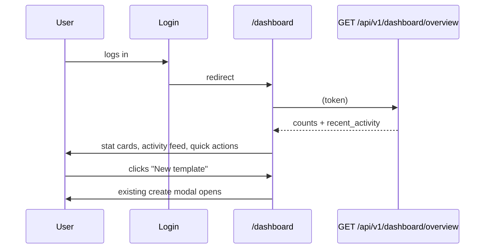
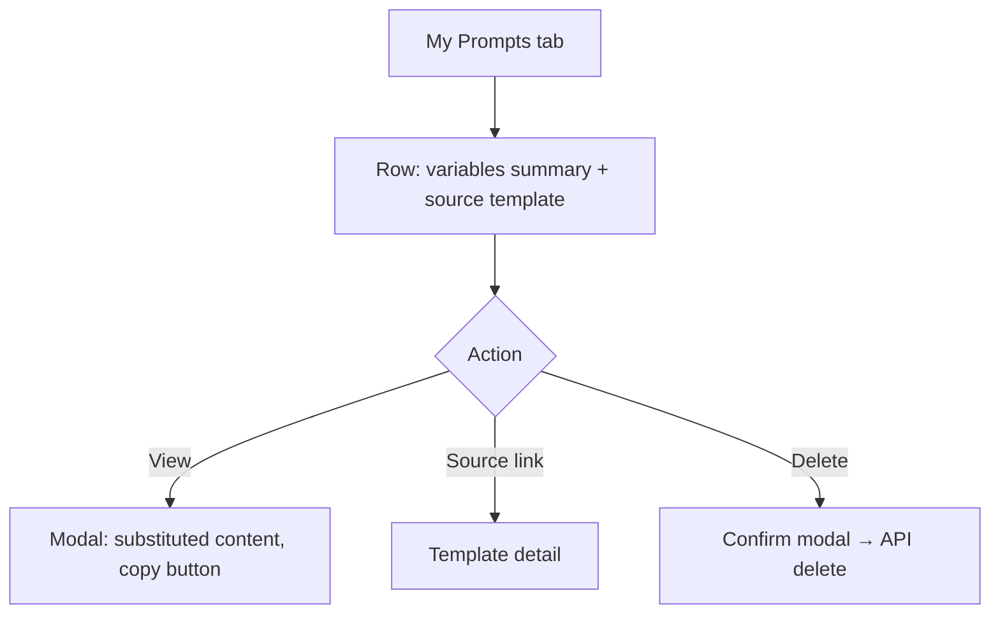

# User Dashboard — UI/UX Design

- **Feature ID:** user-dashboard
- **Version:** 1.0
- **Status:** Proposed (for architecture review)
- **Author:** ui-ux-agent
- **Date:** 2025-06-25
- **Companion doc:** `user-dashboard-requirements.md`

## 1. Design Principles

1. **Workspace, not profile.** The dashboard is a productivity surface: counts, recent items, quick actions, management lists. Identity stays on /profile.
2. **Glance → act.** Every element answers a question or starts a task: stat cards navigate, activity items link, quick actions create.
3. **Aurora-native.** Reuse Layout/Sidebar shell, PromptCard, Modal, badges, Spinner, NotificationContext, tokens, light/dark themes.
4. **Degrade gracefully.** Feature-detect collections; hide — never break — when a feature is absent.
5. **Familiar lists.** My Templates/My Prompts reuse the visual language of the existing grid/table patterns; no new list paradigm.

## 2. Information Architecture

```mermaid
flowchart LR
    A[Login success] --> B[/dashboard Overview]
    B --> C[Stat cards x4]
    B --> D[Recent activity]
    B --> E[Quick actions]
    F[Sidebar: My Workspace] --> B
    B --> G[/dashboard/templates My Templates]
    B --> H[/dashboard/prompts My Prompts]
    B --> I[/collections/mine My Collections]
    B --> J[/api-keys API Keys]
    G -->|Edit| K[/templates/:id]
    H -->|source link| K
    H -->|View| L[Prompt view modal]
```

**Routes:**

| Route | Access | Content |
|---|---|---|
| `/dashboard` | auth | Overview: stat cards, activity, quick actions |
| `/dashboard/templates` | auth | My Templates management list |
| `/dashboard/prompts` | auth | My Prompts (instantiated) list |

Dashboard nav (in-page, under the page title): Overview · My Templates · My Prompts · My Collections* · API Keys (*hidden if collections feature absent).

## 3. User Flows

### 3.1 Login → overview → act



### 3.2 Manage a template

```mermaid
flowchart TD
    A[Overview → My Templates stat card] --> B[/dashboard/templates]
    B --> C{Action}
    C -- Edit --> D[/templates/:id edit mode]
    C -- Delete --> E[Confirm modal] --> F[API delete] --> G[List refreshes]
    C -- Toggle visibility --> H[API update] --> G
```

### 3.3 Revisit a prompt



## 4. Page Layouts

### 4.1 Overview (`/dashboard`)

```text
┌──────────────────────────────────────────────────────────────────────┐
│ Header (existing)                                                    │
├────────────┬─────────────────────────────────────────────────────────┤
│ Sidebar    │  My Workspace                                            │
│ (+ My      │  Overview · Templates · Prompts · Collections · API Keys│
│  Workspace │  ┌─────────┐ ┌─────────┐ ┌─────────┐ ┌─────────┐        │
│  nav item  │  │Templates│ │ Prompts │ │Collectns│ │API Keys │        │
│  at top)   │  │   12    │ │   34    │ │    3    │ │    2    │        │
│            │  └─────────┘ └─────────┘ └─────────┘ └─────────┘        │
│            │  ┌───────────────────────────────┐ ┌──────────────────┐ │
│            │  │ Recent activity               │ │ Quick actions    │ │
│            │  │ 📄 Created "Email writer" 2h  │ │ [+ New template] │ │
│            │  │ ▶ Used "Code review" yesterday│ │ [+ New API key]  │ │
│            │  │ ❤ Liked "Logo brief" 3d ago   │ │                  │ │
│            │  │ ★ Favorited "SQL helper" 5d   │ │                  │ │
│            │  │ … (max 10)                    │ │                  │ │
│            │  └───────────────────────────────┘ └──────────────────┘ │
└────────────┴─────────────────────────────────────────────────────────┘
```

### 4.2 My Templates (`/dashboard/templates`)

```text
│  My Templates                    [All][Public][Private][System][User] │
│  ┌────────────────────────────────────────────────────────────────┐  │
│  │ Email writer   [Public][User]  Marketing · email, outreach     │  │
│  │ ❤ 42 ★ 17 · Updated Jun 20        [Edit][Visibility][Delete]   │  │
│  ├────────────────────────────────────────────────────────────────┤  │
│  │ Code review    [Private][User]  Code · review, quality         │  │
│  │ ❤ 0 ★ 0 · Updated Jun 18         [Edit][Visibility][Delete]   │  │
│  └────────────────────────────────────────────────────────────────┘  │
│  ‹ 1 2 3 ›                                                           │
```

### 4.3 My Prompts (`/dashboard/prompts`)

```text
│  My Prompts                                  [Filter: All templates ▾]│
│  ┌────────────────────────────────────────────────────────────────┐  │
│  │ tone=friendly, length=short · from "Email writer" · Jun 21     │  │
│  │                                        [View][Delete]           │  │
│  ├────────────────────────────────────────────────────────────────┤  │
│  │ language=Go, focus=errors · from "Code review" · Jun 20        │  │
│  │                                        [View][Delete]           │  │
│  └────────────────────────────────────────────────────────────────┘  │
│  ‹ 1 2 ›                                                             │
```

### 4.4 Prompt view modal

```text
┌──────────────────────────────────────────────┐
│ Prompt from "Email writer"                ✕  │
│ Created Jun 21, 2025                        │
│ ┌──────────────────────────────────────────┐ │
│ │ (substituted prompt content, monospace,  │ │
│ │  scrollable, pre-wrap)                   │ │
│ └──────────────────────────────────────────┘ │
│ Variables: tone=friendly · length=short      │
│                       [Copy] [Delete] [Close]│
└──────────────────────────────────────────────┘
```

## 5. Component Specifications

### 5.1 StatCard

| Aspect | Spec |
|---|---|
| Content | Label (13px `--text-2`), count (28px `--text-1`), subtle icon top-right (`--text-3`) |
| Behavior | Whole card is a link to its tab/page; hover: `--surface-3` + `--shadow-md` |
| Styling | `--surface-2`, `--border`, `--radius-12`, padding 20px; 4-across grid (2×2 on tablet, 1-col mobile) |
| A11y | Real link with descriptive `aria-label` ("My templates, 12 items") |

### 5.2 ActivityFeed

| Aspect | Spec |
|---|---|
| Content | Max 10 rows: icon (📄 template / ▶ prompt / ❤ like / ★ favorite), text ("Created \"Email writer\""), relative time, row links to entity |
| Data | From overview endpoint (FR-18); no client-side merging |
| Styling | `--surface-2` card, rows separated by `--border`; icons colored: template `--accent`, prompt `--secondary`, like `--danger` (heart), favorite `--warning` (star) |
| Empty | "No activity yet — your actions will appear here" |
| A11y | Semantic `<ul>`; each row a link; relative time in `title` (absolute on hover) |

### 5.3 QuickActions

| Aspect | Spec |
|---|---|
| Content | Two buttons: "New template" (`.btn-primary`, opens existing create modal), "New API key" (`.btn-ghost`, navigates) |
| Styling | Vertical stack in a `--surface-2` card, full-width buttons |

### 5.4 DashboardNav (in-page tabs)

| Aspect | Spec |
|---|---|
| Content | Overview · My Templates · My Prompts · My Collections* · API Keys |
| Behavior | React Router links; active tab underlined with `--accent`; Collections entry hidden when feature absent (D-3) |
| A11y | `<nav aria-label="Dashboard">` with `aria-current="page"` on active |

### 5.5 TemplateManageRow

| Aspect | Spec |
|---|---|
| Content | Title (link), visibility badge, type badge, category, first 3 tags, like/favorite counts, updated date, actions: Edit / Visibility toggle / Delete |
| Actions | Edit → template detail; Visibility → optimistic badge flip + update API (error reverts + toast); Delete → confirm modal (name echoed) → delete API → row removal |
| Styling | `--surface-2` rows, `--border` separators, hover `--surface-3`; badges per existing patterns |
| A11y | Actions are icon+text buttons with `aria-label`s; destructive Delete uses `--danger` |

### 5.6 PromptRow

| Aspect | Spec |
|---|---|
| Content | Variables summary (first 2 `key=value` pairs, truncated, monospace 12px), source template title (link), created date, actions: View / Delete |
| View | Opens PromptViewModal (5.7) |
| Delete | Confirm modal → delete API → row removal |
| Styling | Same row pattern as 5.5; variables in `--surface-3` inline code chips |

### 5.7 PromptViewModal

| Aspect | Spec |
|---|---|
| Content | Header "Prompt from \"{template}\"", created date, substituted content (client-side per FR-20) in a scrollable monospace block, variables list, actions: Copy / Delete / Close |
| Copy | `navigator.clipboard` + fallback; success toast |
| Size | Existing Modal `size="lg"`; content max-height 60vh, `pre-wrap` |
| A11y | Existing Modal focus trap; content region labelled; Copy announces via toast |

### 5.8 FilterChips (templates tab)

| Aspect | Spec |
|---|---|
| Options | All / Public / Private / System / User |
| Behavior | Client-side filter of the current page's rows (v1); active chip `--accent`-soft |
| A11y | radiogroup semantics |

## 6. Interaction Details

1. **Login redirect:** login success handler navigates to `/dashboard` (D-4); "remember me"/deep-link targets (e.g., `?next=`) take precedence if present.
2. **Overview fetch:** single call on mount; skeleton stat cards + activity rows while loading; error banner + Retry on failure.
3. **Tabs:** each tab fetches its own list on mount (ListTemplates owner_id=me / ListPrompts owner_id=me); pagination via existing page_token pattern.
4. **Visibility toggle:** optimistic UI; failure reverts and shows error toast (existing NotificationContext).
5. **Delete flows:** confirmation modals echo the entity name; success toast; row animates out.
6. **Prompt view:** fetches template content lazily on first View click (cached per template id in session); substitution reuses the shared util (D-5).
7. **Relative time:** shared util (D-6) — <60s "just now", <60m "Xm ago", <24h "Xh ago", <7d "Xd ago", else locale date; re-renders not required (static once rendered).
8. **Feature detection (collections):** probe `/api/v1/collections` with a HEAD/GET on dashboard mount; 404 → hide collections card/nav (D-3); result cached in module state.
9. **Empty states:** per §5 specs; each has a CTA (create template / browse square).

## 7. States Summary

| State | Trigger | UI |
|---|---|---|
| Loading | Tab mount / overview fetch | Skeleton cards/rows |
| Loaded | Fetch success | Full content |
| Empty (per tab) | No data | Empty state + CTA |
| Error | API failure | Error banner + Retry |
| Feature absent | Collections 404 | Collections card/nav hidden |
| Anonymous | No token | Redirect to /login |
| Confirm open | Delete/visibility | Modal (existing pattern) |

## 8. Visual Style (Aurora compliance)

- **StatCard:** `--surface-2` + `--border` + `--radius-12`; count `--text-1` 28px; label `--text-2` 13px; icon `--text-3`.
- **ActivityFeed:** icons `--accent`/`--secondary`/`--danger`/`--warning`; text `--text-1`; time `--text-3` 12px.
- **DashboardNav:** text `--text-2`, active `--text-1` + 2px `--accent` underline; hover `--text-1`.
- **Rows:** `--surface-2` bg, `--border` separators, hover `--surface-3`; badges: Public `--accent`-soft, Private `--surface-3`+`--text-2`, System `--secondary`-soft, User `--info`-soft.
- **QuickActions:** primary `.btn-primary` with + icon; secondary `.btn-ghost`.
- **PromptViewModal:** content block `--surface-3` bg, `--radius-12`, monospace 13px; variable chips `--surface-3` + `--radius-pill`.
- **Dark/light:** token-only; automatic in both themes.

## 9. i18n Considerations (EN/ZH)

New namespace `dashboard_v2.*` (existing `dashboard.*` keys are used by the current sidebar; new keys avoid collisions):

```json
{
  "dashboard_v2": {
    "title": "My Workspace",
    "nav": { "overview": "Overview", "templates": "My Templates", "prompts": "My Prompts", "collections": "My Collections", "api_keys": "API Keys" },
    "stats": { "templates": "Templates", "prompts": "Prompts", "collections": "Collections", "api_keys": "API Keys" },
    "activity": {
      "title": "Recent activity",
      "empty": "No activity yet — your actions will appear here.",
      "template_created": "Created \"{{title}}\"",
      "template_updated": "Updated \"{{title}}\"",
      "prompt_used": "Used \"{{title}}\"",
      "liked": "Liked \"{{title}}\"",
      "favorited": "Favorited \"{{title}}\""
    },
    "quick": { "new_template": "New template", "new_api_key": "New API key" },
    "templates": {
      "filter": { "all": "All", "public": "Public", "private": "Private", "system": "System", "user": "User" },
      "updated": "Updated {{date}}",
      "empty": "You haven't created any templates yet.",
      "empty_cta": "Create a template",
      "delete_confirm": "Delete \"{{title}}\"? This cannot be undone."
    },
    "prompts": {
      "filter": "All templates",
      "from": "from \"{{title}}\"",
      "created": "Created {{date}}",
      "empty": "No prompts yet — use a template to create one.",
      "empty_cta": "Browse the Prompt Square",
      "view": "View",
      "delete_confirm": "Delete this prompt? This cannot be undone.",
      "modal_title": "Prompt from \"{{title}}\"",
      "variables": "Variables",
      "copy": "Copy"
    },
    "error": { "fetch": "Failed to load dashboard.", "retry": "Retry" }
  }
}
```

ZH mirror:

```json
{
  "dashboard_v2": {
    "title": "我的工作区",
    "nav": { "overview": "总览", "templates": "我的模板", "prompts": "我的提示词", "collections": "我的合集", "api_keys": "API Keys" },
    "stats": { "templates": "模板", "prompts": "提示词", "collections": "合集", "api_keys": "API Keys" },
    "activity": {
      "title": "最近活动",
      "empty": "还没有活动 —— 你的操作会显示在这里。",
      "template_created": "创建了\"{{title}}\"",
      "template_updated": "更新了\"{{title}}\"",
      "prompt_used": "使用了\"{{title}}\"",
      "liked": "点赞了\"{{title}}\"",
      "favorited": "收藏了\"{{title}}\""
    },
    "quick": { "new_template": "新建模板", "new_api_key": "新建 API key" },
    "templates": {
      "filter": { "all": "全部", "public": "公开", "private": "私有", "system": "系统", "user": "用户" },
      "updated": "更新于 {{date}}",
      "empty": "你还没有创建任何模板。",
      "empty_cta": "创建模板",
      "delete_confirm": "删除\"{{title}}\"？此操作不可撤销。"
    },
    "prompts": {
      "filter": "所有模板",
      "from": "来自\"{{title}}\"",
      "created": "创建于 {{date}}",
      "empty": "还没有提示词 —— 使用模板创建一个。",
      "empty_cta": "去 Prompt Square 浏览",
      "view": "查看",
      "delete_confirm": "删除此提示词？此操作不可撤销。",
      "modal_title": "来自\"{{title}}\"的提示词",
      "variables": "变量",
      "copy": "复制"
    },
    "error": { "fetch": "加载仪表盘失败。", "retry": "重试" }
  }
}
```

Notes: relative times ("2h ago"/"2小时前") come from the shared util with per-locale strings (`time.just_now`, `time.m_ago`, etc. — added to `common.*`). Entity titles are user content, never translated. The existing `dashboard.*` namespace stays untouched for the current sidebar labels.

## 10. Accessibility

- StatCard: descriptive link labels; counts are real text (not images).
- ActivityFeed: `<ul>` of links; icons `aria-hidden` with text carrying meaning; absolute timestamp in `title`.
- DashboardNav: landmark nav + `aria-current`.
- Rows: actions are buttons with `aria-label`s; Delete is clearly destructive (text + color).
- Modals: existing Modal focus trap, Escape, overlay click; PromptViewModal content region has `role="region"` + label.
- Filter chips: radiogroup semantics; keyboard toggleable.
- All colors AA in both themes; focus rings visible.

## 11. Implementation Notes for Developer

1. **Routes:** `/dashboard`, `/dashboard/templates`, `/dashboard/prompts` (lazy) + auth guard; nested layout component `DashboardLayout` rendering DashboardNav + `<Outlet/>`.
2. **API client:** `getDashboardOverview()` new; reuse `getTemplates({owner_id, page_size, page_token})` and `listPrompts({owner_id, ...})`.
3. **Shared utils to extract:** placeholder substitution (from TemplateDetails.js), relative time (new), copy-to-clipboard (new; also used by collections feature).
4. **Login redirect:** change success handler target to `/dashboard` (respect `?next=` if the codebase supports it; add if trivial).
5. **Sidebar:** add "My Workspace" entry at top for logged-in users (icon: grid/home variant); keep existing entries (D-7).
6. **Feature detection:** module-level cached probe of `/api/v1/collections` (GET with 404 handling); expose `hasCollections()` helper.
7. **Testing:** unit tests for relative-time util, substitution util, feature detection; component tests for StatCard, ActivityFeed, TemplateManageRow (actions), PromptRow + modal; page tests for the three routes (loading/empty/error/auth-redirect); i18n key parity test.
8. **Backend:** single new read-only endpoint `GET /api/v1/dashboard/overview` (FR-17/18) — four COUNTs + UNION LIMIT 10, all owner-scoped by token; no other backend changes.
