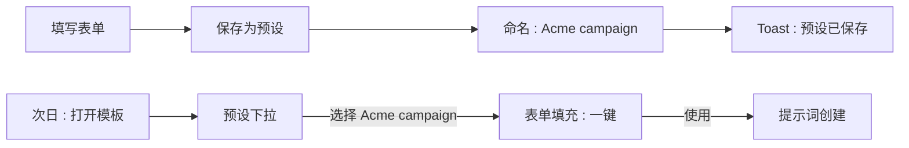
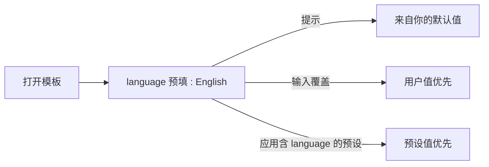
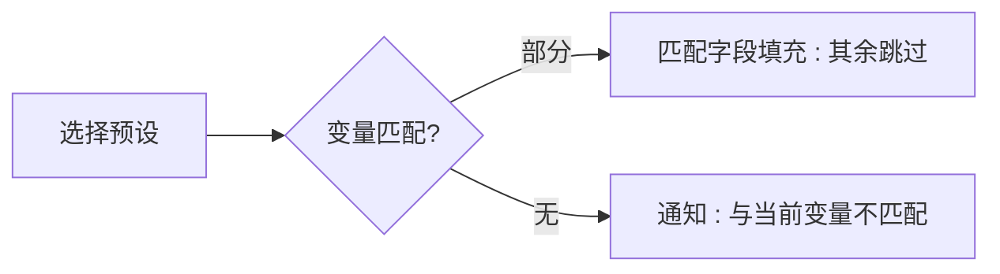

# 变量预设 — UI/UX 设计

- **功能 ID：** variable-presets
- **版本：** 1.0
- **状态：** 已提案（待架构评审）
- **作者：** ui-ux-agent
- **日期：** 2026-10-13
- **配套文档：** `variable-presets-requirements-zh-CN.md`

## 1. 设计原则

1. **一键复用。** 从"打开模板"到"表单填充"的距离是一次下拉选择 —— 绝不是重新输入。
2. **显式保存，无静默捕获。** 预设因用户命名而存在；没有显式操作就不记录任何内容（信任 + 可预测）。
3. **具体优于一般。** 预设值覆盖默认值；输入值覆盖预设。最近的显式意图总是获胜。
4. **默认安静。** 无预设的用户只看到一个安静的"保存为预设"入口；下拉仅在其中有内容时出现。

## 2. 信息架构

```mermaid
flowchart TD
    A[生成器表单 : 模板详情] -->|已登录| B{有预设?}
    B -->|是| C[预设下拉 : MRU 列表]
    B -->|否| D[仅保存为预设操作]
    C -->|选择| E[字段填充 : 合并]
    C -->|管理| F[管理预设弹窗]
    A -->|首次渲染| G{默认值匹配?}
    G -->|是| H[预填 + 提示]
    A -->|填充后| I[将当前保存为预设]
    I -->|命名对话框| J[预设已保存 : toast]
    F --> K[/settings/defaults : 我的默认值]
```

| 界面 | 位置 | 受众 | 目的 |
|---|---|---|---|
| 预设下拉 | 生成器表单头部 | 登录用户 | 应用/管理按模板预设 |
| 保存为预设操作 | 生成器表单底部 | 登录用户 | 捕获当前值 |
| 管理预设弹窗 | 从下拉进入 | 预设所有者 | 重命名/更新/删除 |
| 我的默认值页面 | `/settings/defaults` | 登录用户 | 管理全局默认值 |
| 预填提示 | 第一个预填字段 | 有默认值的用户 | 解释值的来源 |

## 3. 用户流程

### 3.1 保存与复用



### 3.2 默认值预填与覆盖



### 3.3 过期预设



## 4. 页面布局

### 4.1 带预设的生成器表单（桌面）

```
+-----------------------------------------------+
|  生成器                                         |
|  预设: [ Acme campaign ▾ ]  [管理]              |
|                                            |
|  tone        [ professional        ]  ← 已填充  |
|  language    [ English             ]  ← 提示:   |
|                 来自你的默认值 (关闭 ×)            |
|  company     [ Acme                ]            |
|  audience    [                     ]            |
|                                            |
|  [ 使用提示词 ]   [ 保存为预设 ]                   |
+-----------------------------------------------+
```

下拉打开状态：

```
|  预设                              |
|  ─────────────────────────────    |
|  ★ Acme campaign   2 小时前使用     |
|  ● Beta launch     3 天前使用       |
|  ─────────────────────────────    |
|  ＋ 将当前保存为预设…               |
|  ⚙ 管理预设                        |
```

### 4.2 管理预设弹窗

```
+-----------------------------------------------+
|  管理预设 — Cold Email v3              [×]     |
|  ─────────────────────────────────────────    |
|  名称            变量数         更新时间  操作   |
|  Acme campaign   3 个变量       10-12   ↻ ✕   |
|  Beta launch     3 个变量       10-09   ↻ ✕   |
|  ─────────────────────────────────────────    |
|  [ 将当前表单保存为新预设 ]                      |
+-----------------------------------------------+
```

`↻` = 用当前表单值更新（确认）；`✕` = 删除（确认）。

### 4.3 我的默认值页面（`/settings/defaults`）

```
+----------------------------------------------------------------------+
|  ← 设置    我的默认变量值                                               |
+----------------------------------------------------------------------+
|  这些值会预填每个模板中的匹配变量。                                       |
|  +---------------------------------------------------------------+   |
|  | tone        [ professional                    ]          [ ✕ ]  |   |
|  | language    [ English                         ]          [ ✕ ]  |   |
|  | name        [ Alex                            ]          [ ✕ ]  |   |
|  +---------------------------------------------------------------+   |
|  [ ＋ 添加变量 ]                          [ 全部清空 ]                |
+----------------------------------------------------------------------+
```

### 4.4 移动端

生成器垂直堆叠；预设下拉变为第一个字段上方的全宽选择控件；管理弹窗变为底部抽屉；我的默认值按 标签/输入/✕ 行全宽堆叠。

## 5. 组件规格

| 组件 | 行为 | 状态 |
|---|---|---|
| PresetDropdown | MRU 排序列表（名称 + 相对时间）；操作行；键盘 listbox 导航 | 关闭 / 打开 / 空（无预设 → 仅操作）/ 加载中 |
| SavePresetDialog | 名称输入（1–50 字符）+ 重名覆盖确认 | 打开 / 校验中 / 重名确认 / 保存中 / 已保存 |
| ApplyPreset | 客户端合并填充；触发 `use` 信标；0 匹配时过期通知 | 已应用 / 部分 / 过期 |
| DefaultsHint | 第一个预填字段上一次性可关闭提示 chip | 可见 / 已关闭（会话） |
| ManagePresetsModal | 带更新/删除操作的预设表；内联确认 | 加载中 / 已加载 / 空 / 变更中 |
| DefaultsPage | 键/值编辑行、添加行、全部清空（确认） | 加载中 / 已加载 / 空 / 保存中 / 错误 |

## 6. 交互细节

1. **合并填充：** 应用预设仅设置预设中存在变量名的字段；未触及的字段保留值（FR-2）。填充即时（< 50ms），变更字段有细微闪烁。
2. **MRU 排序：** 预设按 `last_used_at` 降序排序；信标在应用时触发，而非菜单打开时。
3. **覆盖确认：** 保存重名显示"名为 'X' 的预设已存在。覆盖吗？" —— 覆盖更新值和 `updated_at`，保留 id。
4. **更新（↻）：** 确认对话框"用当前值更新 'Acme campaign' 吗？" —— 一键，成功 toast。
5. **删除：** 带预设名称的确认对话框；删除立即生效；下拉关闭并无该项重新渲染。
6. **默认值提示：** 会话中默认值首次预填时，第一个预填字段旁出现可关闭 chip（"来自你的默认值"）；关闭后不再出现（会话存储）。
7. **保存到默认值：** 在生成器底部菜单（保存为预设旁的 ⋯）中，"全部保存到我的默认值"及通过字段上下文菜单的逐字段"保存此值"；已存在键提示覆盖。
8. **过期通知：** 下拉下方的内联通知，下次交互时自动消失；预设保持可选（版本变化后可能再次匹配）。
9. **上限处理：** 收到 400（达上限）时，对话框切换为"请先移除一个"状态，列出带删除按钮的现有预设。
10. **匿名：** 以上均不渲染；生成器与今天像素级一致。

## 7. 状态汇总

| 界面 | 加载中 | 空 | 错误 |
|---|---|---|---|
| PresetDropdown | 触发器内联转圈 | 仅操作（无列表） | 菜单内重试链接 |
| ApplyPreset | — | 过期 → 通知 | 信标失败忽略（静默） |
| SavePresetDialog | 保存中转圈 | — | 400 上限 → 移除状态；其他 → 错误文本 |
| ManagePresetsModal | 骨架行 | "还没有预设" + 保存 CTA | 错误横幅 + 重试 |
| DefaultsPage | 骨架行 | 空态文案 + 添加 CTA | 错误横幅 + 重试 |

## 8. 国际化

| 键 | EN | ZH |
|---|---|---|
| `presets.label` | Presets | 预设 |
| `presets.saveCurrent` | Save current as preset… | 将当前保存为预设… |
| `presets.manage` | Manage presets | 管理预设 |
| `presets.usedAgo` | used {{time}} | {{time}}使用过 |
| `presets.dialog.title` | Save preset | 保存预设 |
| `presets.dialog.nameLabel` | Preset name | 预设名称 |
| `presets.dialog.overwrite` | A preset named "{{name}}" exists. Overwrite? | 名为"{{name}}"的预设已存在。覆盖吗？ |
| `presets.dialog.capReached` | Preset limit reached ({{limit}}). Remove one first: | 已达预设上限（{{limit}}）。请先移除一个： |
| `presets.toast.saved` | Preset saved | 预设已保存 |
| `presets.toast.updated` | Preset updated | 预设已更新 |
| `presets.toast.deleted` | Preset deleted | 预设已删除 |
| `presets.confirm.update` | Update "{{name}}" with current values? | 用当前值更新"{{name}}"吗？ |
| `presets.confirm.delete` | Delete preset "{{name}}"? | 删除预设"{{name}}"吗？ |
| `presets.notice.stale` | This preset doesn't match the current variables | 此预设与当前变量不匹配 |
| `presets.hint.fromDefaults` | From your defaults | 来自你的默认值 |
| `presets.defaults.title` | My default variable values | 我的默认变量值 |
| `presets.defaults.subtitle` | These values pre-fill matching variables in every template. | 这些值会预填每个模板中的匹配变量。 |
| `presets.defaults.add` | Add variable | 添加变量 |
| `presets.defaults.clearAll` | Clear all | 全部清空 |
| `presets.defaults.confirm.clear` | Remove all default values? | 移除所有默认值吗？ |
| `presets.defaults.saveToDefaults` | Save all to my defaults | 全部保存到我的默认值 |
| `presets.aria.dropdown` | Template presets | 模板预设 |
| `presets.aria.applied` | Preset {{name}} applied | 已应用预设 {{name}} |

变量名是用户自定义标识符，不翻译。

## 9. 无障碍

- 下拉遵循 ARIA 1.2 combobox/listbox 模式（与 keyboard-shortcuts 面板惯例相同）：触发按钮 + `role=listbox` 弹出层、方向键导航、Enter 选择、Esc 关闭。
- 保存/更新/删除对话框是标准焦点陷阱模态；确认按钮清晰标注预设名称。
- 应用时的字段填充通过 polite live region 播报一次（`presets.aria.applied`），而非逐字段。
- 默认值提示 chip 是 `role=status`；关闭将焦点返回字段。
- 默认值页面行是 标签 + 输入 组（`<label for>`）；✕ 按钮有 `aria-label`（"移除 {{variable}}"）。
- 所有触控目标 ≥ 44×44px；下拉触发器在移动端全宽。

## 10. 分析（可选）

- `preset_saved`、`preset_applied`（vars_matched、vars_skipped）、`preset_updated`、`preset_deleted`、`defaults_prefill_shown`、`defaults_page_viewed` —— 仅计数，绝不记录值（隐私，NFR-2）。

## 11. 范围之外

- 团队共享预设；预设导出/导入；API key 消费中的预设。
- 自动捕获值历史；预设版本化/diff。
- 管理员查看用户预设。
- 任何形式的变现 —— 本产品永久超出范围。
