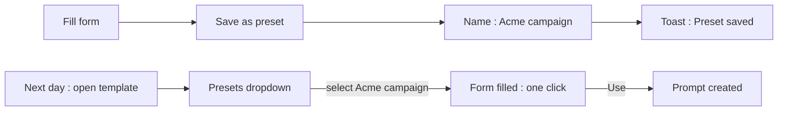
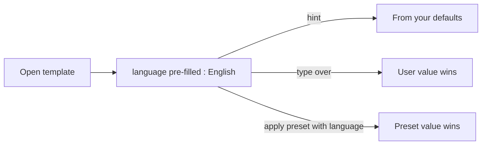
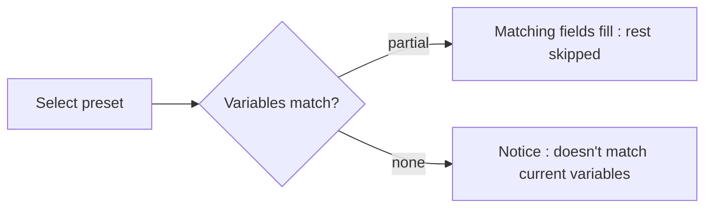

# Variable Presets — UI/UX Design

- **Feature ID:** variable-presets
- **Version:** 1.0
- **Status:** Proposed (for architecture review)
- **Author:** ui-ux-agent
- **Date:** 2026-10-13
- **Companion doc:** `variable-presets-requirements.md`

## 1. Design Principles

1. **One click to reuse.** The distance from "open template" to "form filled" is a single dropdown selection — never a re-typing session.
2. **Explicit save, no silent capture.** Presets exist because the user named them; nothing is recorded without an explicit action (trust + predictability).
3. **Specific beats general.** Preset values override defaults; typed values override presets. The most recent explicit intent always wins.
4. **Calm by default.** Users without presets see one quiet "Save as preset" affordance; the dropdown appears only when it has content.

## 2. Information Architecture

```mermaid
flowchart TD
    A[Generator form : template detail] -->|logged in| B{Presets exist?}
    B -->|yes| C[Presets dropdown : MRU list]
    B -->|no| D[Save as preset action only]
    C -->|select| E[Fields fill : merge]
    C -->|Manage| F[Manage presets modal]
    A -->|first render| G{Defaults match?}
    G -->|yes| H[Pre-fill + hint]
    A -->|after fill| I[Save current as preset]
    I -->|name dialog| J[Preset saved : toast]
    F --> K[/settings/defaults : My defaults]
```

| Surface | Location | Audience | Purpose |
|---|---|---|---|
| Presets dropdown | Generator form header | Logged-in users | Apply/manage per-template presets |
| Save-as-preset action | Generator form footer | Logged-in users | Capture current values |
| Manage presets modal | From dropdown | Preset owners | Rename/update/delete |
| My defaults page | `/settings/defaults` | Logged-in users | Manage global default values |
| Pre-fill hint | First pre-filled field | Users with defaults | Explain where values came from |

## 3. User Flows

### 3.1 Save and reuse



### 3.2 Defaults pre-fill with override



### 3.3 Stale preset



## 4. Page Layouts

### 4.1 Generator form with presets (desktop)

```
+-----------------------------------------------+
|  Generator                                     |
|  Presets: [ Acme campaign ▾ ]  [Manage]        |
|                                            |
|  tone        [ professional        ]  ← filled |
|  language    [ English             ]  ← hint:  |
|                 from your defaults (dismiss ×)  |
|  company     [ Acme                ]            |
|  audience    [                     ]            |
|                                            |
|  [ Use prompt ]   [ Save as preset ]            |
+-----------------------------------------------+
```

Dropdown open state:

```
|  Presets                          |
|  ─────────────────────────────    |
|  ★ Acme campaign   used 2h ago    |
|  ● Beta launch     used 3d ago    |
|  ─────────────────────────────    |
|  ＋ Save current as preset…       |
|  ⚙ Manage presets                 |
```

### 4.2 Manage presets modal

```
+-----------------------------------------------+
|  Manage presets — Cold Email v3          [×]  |
|  ─────────────────────────────────────────    |
|  Name            Variables      Updated  Ops  |
|  Acme campaign   3 vars         Oct 12  ↻ ✕   |
|  Beta launch     3 vars         Oct 09  ↻ ✕   |
|  ─────────────────────────────────────────    |
|  [ Save current form as new preset ]           |
+-----------------------------------------------+
```

`↻` = update with current form values (confirm); `✕` = delete (confirm).

### 4.3 My defaults page (`/settings/defaults`)

```
+----------------------------------------------------------------------+
|  ← Settings    My default variable values                             |
+----------------------------------------------------------------------+
|  These values pre-fill matching variables in every template.         |
|  +---------------------------------------------------------------+   |
|  | tone        [ professional                    ]          [ ✕ ]  |   |
|  | language    [ English                         ]          [ ✕ ]  |   |
|  | name        [ Alex                            ]          [ ✕ ]  |   |
|  +---------------------------------------------------------------+   |
|  [ ＋ Add variable ]                        [ Clear all ]            |
+----------------------------------------------------------------------+
```

### 4.4 Mobile

The generator stacks vertically; the Presets dropdown becomes a full-width select-style control above the first field; the manage modal becomes a bottom sheet; My defaults stacks label/input/✕ rows full-width.

## 5. Component Specs

| Component | Behavior | States |
|---|---|---|
| PresetDropdown | MRU-sorted list (name + relative time); actions row; keyboard listbox navigation | Closed / open / empty (no presets → only actions) / loading |
| SavePresetDialog | Name input (1–50 chars) + overwrite confirm on duplicate | Open / validating / duplicate-confirm / saving / saved |
| ApplyPreset | Client-side merge fill; fires `use` beacon; stale notice when 0 matches | Applied / partial / stale |
| DefaultsHint | One-time dismissible hint chip on first pre-filled field | Visible / dismissed (session) |
| ManagePresetsModal | Table of presets with update/delete ops; inline confirms | Loading / loaded / empty / mutating |
| DefaultsPage | Key/value editor rows, add row, clear all (confirm) | Loading / loaded / empty / saving / error |

## 6. Interaction Details

1. **Merge fill:** applying a preset sets only fields whose variable name exists in the preset; untouched fields keep values (FR-2). Fill is instant (< 50ms) with a subtle flash on changed fields.
2. **MRU sorting:** presets sort by `last_used_at` desc; the beacon fires on apply, not on menu open.
3. **Overwrite confirm:** saving a duplicate name shows "A preset named 'X' exists. Overwrite?" — overwrite updates values and `updated_at`, keeps id.
4. **Update (↻):** confirm dialog "Update 'Acme campaign' with current values?" — one click, toast on success.
5. **Delete:** confirm dialog with preset name; deletion is immediate; the dropdown closes and re-renders without the item.
6. **Defaults hint:** the first time defaults pre-fill in a session, a dismissible chip appears beside the first pre-filled field ("From your defaults"); it never re-appears after dismissal (session storage).
7. **Save to defaults:** in the generator footer menu (⋯ beside Save as preset), "Save all to my defaults" and per-field "save this value" via field context menu; existing keys prompt overwrite.
8. **Stale notice:** inline notice below the dropdown, auto-dismisses on next interaction; the preset stays selectable (it may match again after version changes).
9. **Cap handling:** on 400 (cap reached), the dialog switches to a "remove one first" state listing existing presets with delete buttons.
10. **Anonymous:** none of the above renders; the generator is pixel-identical to today.

## 7. States Summary

| Surface | Loading | Empty | Error |
|---|---|---|---|
| PresetDropdown | Inline spinner in trigger | Actions only (no list) | Retry link in menu |
| ApplyPreset | — | Stale → notice | Beacon failure ignored (silent) |
| SavePresetDialog | Saving spinner | — | 400 cap → remove-one state; other → error text |
| ManagePresetsModal | Skeleton rows | "No presets yet" + save CTA | Error banner + retry |
| DefaultsPage | Skeleton rows | Empty-state copy + add CTA | Error banner + retry |

## 8. i18n

| Key | EN | ZH |
|---|---|---|
| `presets.label` | Presets | 预设 |
| `presets.saveCurrent` | Save current as preset… | 将当前保存为预设… |
| `presets.manage` | Manage presets | 管理预设 |
| `presets.usedAgo` | used {{time}} | {{time}}使用过 |
| `presets.dialog.title` | Save preset | 保存预设 |
| `presets.dialog.nameLabel` | Preset name | 预设名称 |
| `presets.dialog.overwrite` | A preset named "{{name}}" exists. Overwrite? | 名为"{{name}}"的预设已存在。覆盖吗？ |
| `presets.dialog.capReached` | Preset limit reached ({{limit}}). Remove one first: | 已达预设上限（{{limit}}）。请先移除一个： |
| `presets.toast.saved` | Preset saved | 预设已保存 |
| `presets.toast.updated` | Preset updated | 预设已更新 |
| `presets.toast.deleted` | Preset deleted | 预设已删除 |
| `presets.confirm.update` | Update "{{name}}" with current values? | 用当前值更新"{{name}}"吗？ |
| `presets.confirm.delete` | Delete preset "{{name}}"? | 删除预设"{{name}}"吗？ |
| `presets.notice.stale` | This preset doesn't match the current variables | 此预设与当前变量不匹配 |
| `presets.hint.fromDefaults` | From your defaults | 来自你的默认值 |
| `presets.defaults.title` | My default variable values | 我的默认变量值 |
| `presets.defaults.subtitle` | These values pre-fill matching variables in every template. | 这些值会预填每个模板中的匹配变量。 |
| `presets.defaults.add` | Add variable | 添加变量 |
| `presets.defaults.clearAll` | Clear all | 全部清空 |
| `presets.defaults.confirm.clear` | Remove all default values? | 移除所有默认值吗？ |
| `presets.defaults.saveToDefaults` | Save all to my defaults | 全部保存到我的默认值 |
| `presets.aria.dropdown` | Template presets | 模板预设 |
| `presets.aria.applied` | Preset {{name}} applied | 已应用预设 {{name}} |

Variable names are user-defined identifiers and are not translated.

## 9. Accessibility

- The dropdown follows the ARIA 1.2 combobox/listbox pattern (same as keyboard-shortcuts palette conventions): trigger button + `role=listbox` popup, arrow-key navigation, Enter selects, Esc closes.
- Save/update/delete dialogs are standard focus-trapped modals; confirm buttons are clearly labeled with the preset name.
- Field fill on apply is announced once via a polite live region (`presets.aria.applied`), not per field.
- The defaults hint chip is `role=status`; dismissal moves focus back to the field.
- Defaults page rows are label + input groups (`<label for>`); ✕ buttons have `aria-label` ("Remove {{variable}}").
- All touch targets ≥ 44×44px; the dropdown trigger is full-width on mobile.

## 10. Analytics (optional)

- `preset_saved`, `preset_applied` (vars_matched, vars_skipped), `preset_updated`, `preset_deleted`, `defaults_prefill_shown`, `defaults_page_viewed` — counts only, never values (privacy, NFR-2).

## 11. Out of Scope

- Team-shared presets; preset export/import; presets in API-key consumption.
- Auto-captured value history; preset versioning/diffing.
- Admin visibility into user presets.
- Monetization of any kind — permanently out of scope for this product.
