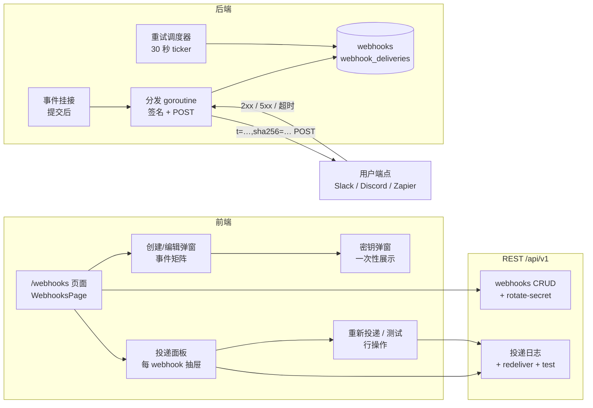
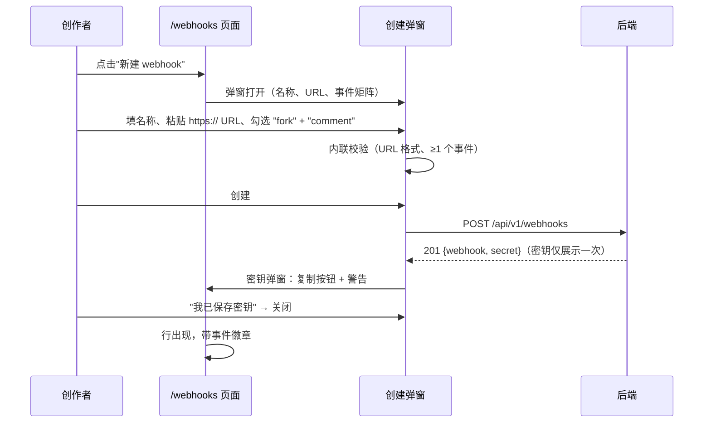
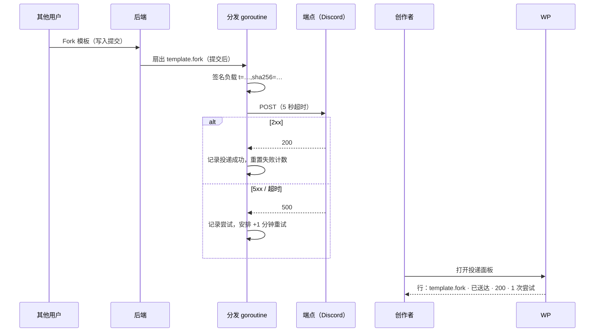
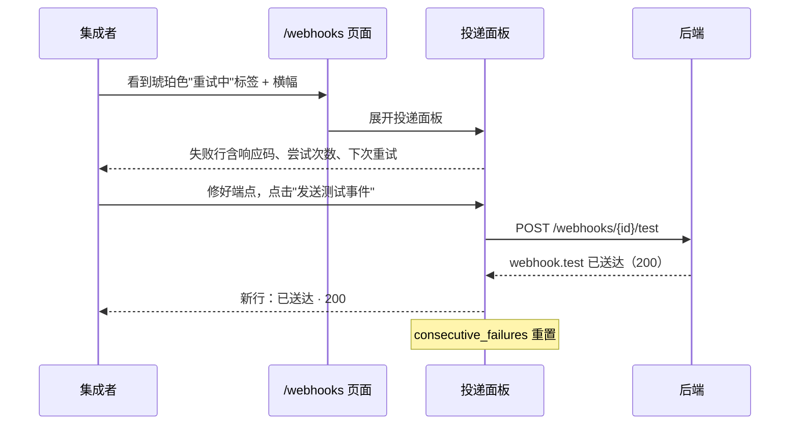
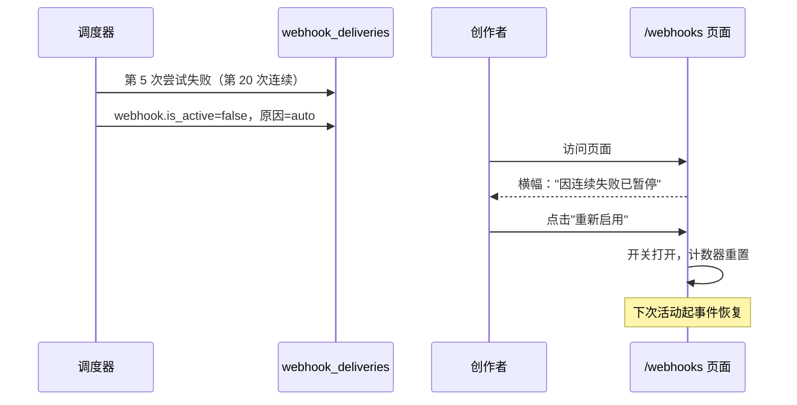
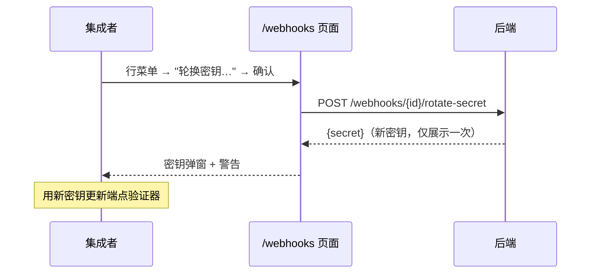

# Webhooks API 集成（Webhooks API Integration）— UI/UX 设计

- **Feature ID:** webhooks-api-integration
- **Version:** 1.0
- **Status:** Proposed（待架构评审）
- **Author:** ui-ux-agent
- **Date:** 2026-10-12
- **相关文档：** [需求](./webhooks-api-integration-requirements-zh-CN.md) · [UI/UX Design (EN)](./webhooks-api-integration-ui-ux-design.md)

## 1. 设计原则

1. **粘贴 URL、勾选框、完成。** 主要用户是把通知接进 Slack/Discord/Zapier 的创作者 —— 不是基础设施工程师。创建就是一个弹窗，没有不带工具提示的行话。
2. **密钥是神圣的。** 一次性展示、复制按钮、明确的"不再显示"警告 —— 与用户在 API key 生成时学到的契约相同。
3. **投递日志即产品。** "我的端点收到了吗？它返回了什么？" —— 带状态标签、响应码和重新投递的日志无需工单即可回答调试问题。
4. **失败是平静且可恢复的。** 重试中是正常状态（琥珀色标签、下次尝试时间）；自动暂停是带一键重新启用的横幅，绝不是无声黑洞。
5. **通过透明建立信任。** 签名方案、负载示例和事件目录在 UI（文档抽屉）中可见，编写验证代码无需离开页面。

## 2. 信息架构



## 3. 用户流程

### 3.1 创建 webhook（主流程）



### 3.2 真实事件 → 投递 → 日志



### 3.3 调试失败端点



### 3.4 自动暂停与恢复



### 3.5 轮换密钥



## 4. 页面布局（线框图）

### 4.1 /webhooks — 列表

```
┌──────────────────────────────────────────────────────────────────────┐
│  ← Header        Webhooks                              [+ 新建 webhook]│
│  ────────────────────────────────────────────────────────────────────│
│  将平台事件推送到你的 HTTPS 端点。带签名、自动重试并记录日志。          │
│  查看文档 →                                                            │
│  ────────────────────────────────────────────────────────────────────│
│  ⚠ 因连续投递失败已暂停 —— 请检查你的端点后重新启用。                  │
│                                                [重新启用]              │
│  ────────────────────────────────────────────────────────────────────│
│  名称            事件                 最近投递      状态      操作      │
│  Discord hook    fork comment         2 分钟前      ● 启用    ⋮        │
│  Zapier mirror   created updated      1 小时前      ● 启用    ⋮        │
│                  deleted fork                                             │
│  ────────────────────────────────────────────────────────────────────│
│  （空状态："还没有 webhook —— 创建一个即可接收推送事件"）               │
└──────────────────────────────────────────────────────────────────────┘
```

### 4.2 创建/编辑弹窗

```
┌──────────────────────────────────────────────────────────────┐
│  新建 webhook                                          [×]  │
│  ────────────────────────────────────────────────────────────│
│  名称                                                        │
│  ┌────────────────────────────────────────────────────────┐ │
│  │ Discord hook                                           │ │
│  └────────────────────────────────────────────────────────┘ │
│                                                              │
│  负载 URL（仅 HTTPS）                                       │
│  ┌────────────────────────────────────────────────────────┐ │
│  │ https://discord.com/api/webhooks/…/…                   │ │
│  └────────────────────────────────────────────────────────┘ │
│  ⓘ 你的端点必须可通过公网 HTTPS 访问。                       │
│                                                              │
│  事件                                                        │
│  模板生命周期              互动                              │
│  ☑ created                 ☐ like                           │
│  ☑ updated                 ☑ fork                            │
│  ☐ deleted                 ☑ comment                         │
│  （新版本）                 ☐ favorite                        │
│                                                              │
│                    [取消]   [ 创建 webhook ]                 │
└──────────────────────────────────────────────────────────────┘
```

### 4.3 一次性密钥弹窗

```
┌──────────────────────────────────────────────────────────────┐
│  保存你的签名密钥                                      [×]  │
│  ────────────────────────────────────────────────────────────│
│  使用此密钥验证 X-OpenPrompts-Signature。                    │
│  它将不会再次显示。                                          │
│                                                              │
│  ┌────────────────────────────────────────────────┐ [复制]  │
│  │ whsec_3f9a…c21b                                 │        │
│  └────────────────────────────────────────────────┘         │
│                                                              │
│  验证方式（Stripe 风格）：                                    │
│  HMAC-SHA256(密钥, "<t>." + 原始请求体) == sha256 值        │
│                                                              │
│                      [ 我已保存密钥 ]                        │
└──────────────────────────────────────────────────────────────┘
```

### 4.4 投递面板（抽屉）

```
┌──────────────────────────────────────────────────────────────┐
│  投递记录 — Discord hook                          [×]       │
│  [发送测试事件]                                               │
│  ────────────────────────────────────────────────────────────│
│  事件             状态        响应  尝试    时间               │
│  template.fork    ● 已送达    200   1       2 分钟前          │
│  template.comment ● 已送达    200   1       18 分钟前         │
│  template.fork    ◐ 重试中    500   3       1 小时前          │
│                  4 分钟后下次尝试                [重新投递]   │
│  template.like    ● 已送达    204   1       3 小时前          │
│  webhook.test     ● 已送达    200   1       昨天              │
│  template.fork    ✕ 失败      500   5       昨天              │
│                  永久失败                        [重新投递]   │
│  ────────────────────────────────────────────────────────────│
│  显示最近 50 条 · 保留 30 天                                  │
└──────────────────────────────────────────────────────────────┘
```

### 4.5 行操作菜单（⋮）

```
  查看投递记录
  发送测试事件
  编辑
  轮换密钥…
  ──────────────────
  删除（红色，确认弹窗）
```

## 5. 组件规格

| 组件 | 基于 | Props / 行为 |
|---|---|---|
| `WebhooksPage` | `APIKeys.js` 页面模式 | 会话认证重定向；页头 + 描述 + 文档链接；表格上方的自动暂停横幅；带 CTA 的空状态；挂载时加载 `GET /webhooks`。 |
| `WebhookTable` | `APIKeyManager` 表格模式 | 列：名称、事件徽章（chips，+N 溢出）、最近投递结果 + 相对时间、状态（启用/暂停开关）、操作菜单。按 created_at 倒序。 |
| `WebhookFormModal` | `CreateTemplateModal` 弹窗模式 | 创建 + 编辑双模式；字段：名称（1–100）、URL（强制 https，内联格式错误）、事件复选框矩阵（两组）；校验通过前提交禁用；服务端错误内联映射（达上限、URL 无效）。 |
| `SecretRevealModal` | APIKeys 生成密钥弹窗模式 | `{secret}`；等宽字体值 + 复制按钮（复制后显示对勾）；验证代码片段；单一关闭按钮；关闭后无法重开。 |
| `DeliveryPanel` | 右侧抽屉（新，遵循弹窗 SCSS 模式） | `{webhookId}`；加载最近 50 条投递；行：事件类型（等宽）、状态标签、响应码、尝试次数、相对时间、待重试行的下次重试倒计时；失败/任意行上的重新投递按钮；头部的发送测试事件。 |
| `StatusChip` | 小型展示组件 | `success` → 绿点"已送达"；`pending` → 琥珀脉冲"重试中"；`failed_permanent` → 红色"失败"。颜色 + 文字，绝不只用颜色。 |
| `AutoPauseBanner` | 既有横幅模式 | 每个暂停的 webhook 一条；解释原因，重新启用按钮 → `PATCH {is_active: true}`；不提供关闭（状态是真实的，不是 toast）。 |
| `ConfirmDialog` | 既有确认模式（删除模板） | 用于删除 webhook 和轮换密钥；删除用破坏性样式。 |

## 6. 交互细节

1. **创建流程：** 弹窗在启用提交前做客户端校验（URL `https://` + 主机名、名称长度、≥ 1 个事件）；服务端 400/409 错误渲染到对应字段下方（达上限 → 页头下方，友好提示）。
2. **密钥展示：** 创建/轮换响应只保存在组件 state 中；关闭弹窗即清除；列表永不包含密钥。复制按钮用 `navigator.clipboard` 并弹成功 toast（既有模式）。
3. **启用开关：** 立即 `PATCH {is_active}` 并乐观翻转；失败回滚 + 错误 toast。把暂停的 webhook 打开会重置 `consecutive_failures`（服务端）。
4. **投递面板：** 桌面端右侧抽屉 / 移动端底部面板打开；加载一次 + 刷新按钮；待处理行显示由 `next_retry_at` 计算的实时"N 分钟后下次尝试"倒计时（客户端时钟，无轮询）。
5. **重新投递：** 无需确认（近似幂等：创建新投递行）；按钮显示 spinner 直到 API 响应；新行带 `is_redelivery` 徽章出现在顶部；成功 toast。
6. **发送测试事件：** 面板头部按钮；spinner；2 秒后单次重新拉取，`webhook.test` 行数秒内出现在顶部（无轮询循环）。
7. **事件徽章：** chips 最多显示 3 个事件名，然后"+N"；工具提示列出全部；chips 使用与模板标签 chips 相同的视觉语言。
8. **URL 展示：** 表格显示 `主机` + 截断路径（`discord.com/api/webhooks/…/…` → `discord.com/api/webhooks/8x…`）；完整 URL 只在编辑弹窗中可见。
9. **删除：** 确认弹窗点名 webhook 并说明投递记录会一并删除；破坏性红色按钮；成功 toast + 行移除。
10. **键盘：** 弹窗和抽屉有焦点陷阱，Escape 关闭，焦点回到触发器；表格行可聚焦，Enter 打开操作菜单；所有操作可通过键盘完成。

## 7. 状态汇总

| 状态 | 触发 | UI |
|---|---|---|
| 列表加载中 | 打开页面 | 骨架行（既有模式） |
| 列表为空 | 无 webhook | 插图 + "还没有 webhook" + CTA 按钮 |
| 达到上限 | 已有 5 个 webhook | "新建 webhook"打开弹窗；提交 → 友好的上限错误内联显示 |
| 创建成功 | 201 | 弹窗 → 密钥展示弹窗 → 行添加 |
| URL 无效 | 非 https / 无主机 | URL 字段下方内联错误；提交禁用 |
| 未选事件 | 0 个勾选 | 矩阵下方内联错误；提交禁用 |
| 投递成功 | 2xx | 绿色标签"已送达" + 响应码 |
| 投递重试中 | 尝试失败且还有重试 | 琥珀标签"重试中" + 尝试次数 + 下次尝试倒计时 |
| 投递失败 | 5 次尝试失败 | 红色标签"失败" + 重新投递按钮 |
| Webhook 暂停 | 连续 20 次失败 | 横幅 + 暂停状态；重新启用按钮 |
| 重新投递进行中 | 点击 | 按钮上 spinner；完成后行出现 |
| 测试进行中 | 点击 | spinner；重新拉取后出现结果行 |
| API 错误 | 网络/5xx | 错误 toast（既有）；状态保留 |

## 8. i18n 字符串表

命名空间：`webhooks`（新增）+ `header`（扩展）。

| 键 / 中文 | 英文 |
|---|---|
| `header.webhooks` / Webhooks | Webhooks |
| `webhooks.title` / Webhooks | Webhooks |
| `webhooks.description` / 将平台事件推送到你的 HTTPS 端点。带签名、自动重试并记录日志。 | Send platform events to your HTTPS endpoints. Signed, retried, and logged. |
| `webhooks.docs_link` / 查看文档 | See docs |
| `webhooks.new` / 新建 webhook | New webhook |
| `webhooks.empty_title` / 还没有 webhook | No webhooks yet |
| `webhooks.empty_body` / 创建 webhook，即可在有人与你的模板互动时接收推送事件。 | Create a webhook to receive push events when someone engages with your templates. |
| `webhooks.col_name` / 名称 | Name |
| `webhooks.col_events` / 事件 | Events |
| `webhooks.col_last_delivery` / 最近投递 | Last delivery |
| `webhooks.col_status` / 状态 | Status |
| `webhooks.col_actions` / 操作 | Actions |
| `webhooks.status_active` / 启用 | Active |
| `webhooks.status_paused` / 已暂停 | Paused |
| `webhooks.last_delivery_none` / 从未 | Never |
| `webhooks.form_title_new` / 新建 webhook | New webhook |
| `webhooks.form_title_edit` / 编辑 webhook | Edit webhook |
| `webhooks.field_name` / 名称 | Name |
| `webhooks.field_url` / 负载 URL（仅 HTTPS） | Payload URL (HTTPS only) |
| `webhooks.field_url_hint` / 你的端点必须可通过公网 HTTPS 访问。 | Your endpoint must be publicly reachable over HTTPS. |
| `webhooks.field_events` / 事件 | Events |
| `webhooks.group_lifecycle` / 模板生命周期 | Template lifecycle |
| `webhooks.group_engagement` / 互动 | Engagement |
| `webhooks.event_created` / 创建 | created |
| `webhooks.event_updated` / 更新（新版本） | updated (new version) |
| `webhooks.event_deleted` / 删除 | deleted |
| `webhooks.event_like` / 点赞 | like |
| `webhooks.event_favorite` / 收藏 | favorite |
| `webhooks.event_fork` / fork | fork |
| `webhooks.event_comment` / 评论 | comment |
| `webhooks.error_url` / 请输入有效的 HTTPS URL | Enter a valid HTTPS URL |
| `webhooks.error_events` / 请至少选择一个事件 | Select at least one event |
| `webhooks.error_name` / 名称必填（1–100 字符） | Name is required (1–100 characters) |
| `webhooks.error_cap` / 最多创建 5 个 webhook，请先删除一个。 | You can create at most 5 webhooks. Delete one first. |
| `webhooks.create` / 创建 webhook | Create webhook |
| `webhooks.save` / 保存更改 | Save changes |
| `webhooks.secret_title` / 保存你的签名密钥 | Save your signing secret |
| `webhooks.secret_body` / 使用此密钥验证 X-OpenPrompts-Signature。它将不会再次显示。 | Use this secret to verify X-OpenPrompts-Signature. It will never be shown again. |
| `webhooks.secret_verify_hint` / 验证方式：HMAC-SHA256(密钥, "<t>." + 原始请求体) == sha256 值 | Verification: HMAC-SHA256(secret, "<t>." + raw_body) == sha256 value |
| `webhooks.secret_saved` / 我已保存密钥 | I saved the secret |
| `webhooks.copy_secret` / 复制密钥 | Copy secret |
| `webhooks.copied` / 已复制 | Copied |
| `webhooks.deliveries_title` / 投递记录 — {{name}} | Deliveries — {{name}} |
| `webhooks.send_test` / 发送测试事件 | Send test event |
| `webhooks.col_event` / 事件 | Event |
| `webhooks.col_status_delivery` / 状态 | Status |
| `webhooks.col_resp` / 响应码 | Resp |
| `webhooks.col_attempts` / 尝试次数 | Attempts |
| `webhooks.col_when` / 时间 | When |
| `webhooks.delivery_success` / 已送达 | Delivered |
| `webhooks.delivery_retrying` / 重试中 | Retrying |
| `webhooks.delivery_failed` / 失败 | Failed |
| `webhooks.delivery_permanent` / 永久失败 | permanent |
| `webhooks.next_attempt` / {{time}}后下次尝试 | next attempt in {{time}} |
| `webhooks.redeliver` / 重新投递 | Redeliver |
| `webhooks.redelivered` / 已加入投递队列 | Delivery queued |
| `webhooks.test_sent` / 测试事件已发送 | Test event sent |
| `webhooks.redelivery_badge` / 重新投递 | redelivered |
| `webhooks.deliveries_footer` / 显示最近 50 条 · 保留 30 天 | Showing latest 50 · retained 30 days |
| `webhooks.deliveries_empty` / 还没有投递记录 —— 模板上的互动会显示在这里。 | No deliveries yet — activity on your templates will appear here. |
| `webhooks.paused_banner` / 因连续投递失败已暂停 —— 请检查你的端点后重新启用。 | Paused after repeated failed deliveries — check your endpoint and re-enable. |
| `webhooks.reenable` / 重新启用 | Re-enable |
| `webhooks.menu_deliveries` / 查看投递记录 | View deliveries |
| `webhooks.menu_edit` / 编辑 | Edit |
| `webhooks.menu_rotate` / 轮换密钥… | Rotate secret… |
| `webhooks.menu_delete` / 删除 | Delete |
| `webhooks.rotate_title` / 轮换签名密钥？ | Rotate signing secret? |
| `webhooks.rotate_body` / 当前密钥将立即失效。你的端点必须更新为新密钥。 | The current secret will stop working immediately. Your endpoint must be updated with the new secret. |
| `webhooks.delete_title` / 删除 webhook？ | Delete webhook? |
| `webhooks.delete_body` / "{{name}}" 及其所有投递记录将被删除。 | "{{name}}" and all its delivery records will be removed. |
| `webhooks.delete_confirm` / 删除 webhook | Delete webhook |
| `webhooks.deleted` / 已删除 webhook | Webhook deleted |
| `webhooks.created` / 已创建 webhook | Webhook created |
| `webhooks.updated` / 已更新 webhook | Webhook updated |
| `webhooks.error_generic` / 出错了，请重试 | Something went wrong — try again |

## 9. 无障碍说明

- 状态标签颜色配文字（"已送达"/"重试中"/"失败"）—— 绝不只靠颜色；重试标签的脉冲动画遵循 `prefers-reduced-motion`。
- 事件复选框矩阵是真正的 `<fieldset>`，每组带 `<legend>`；每个 label 包裹其复选框（大点击目标）；组错误通过 fieldset 的 `aria-describedby` 关联。
- 密钥值是带复制按钮的 `<code>` 块，按钮的可访问名称在成功后更新为"已复制"；一次性警告在弹窗打开时通过 `role="alert"` 播报。
- 投递抽屉是 `role="dialog"` 且 `aria-modal`，有焦点陷阱，Escape 关闭，焦点回到触发行；内部表格使用标准表格语义和 `scope` 表头。
- 下次尝试倒计时静默跳动（`aria-live="off"`）；只有状态转换（重试中 → 已送达/失败）被礼貌播报。
- 启用开关是 switch（`role="switch"`、`aria-checked`）并带可见文字标签；自动暂停横幅是 `role="status"`，页面加载时播报。
- 行操作菜单可用键盘打开（聚焦行上按 Enter）、方向键导航、Escape 关闭；破坏性项通过 `aria-describedby` 关联确认弹窗文本。

## 10. 响应式行为

- **桌面（≥1024px）：** 表格全宽显示所有列；投递抽屉固定 480 px 靠右；弹窗居中 560 px。
- **平板（768–1023px）：** 最近投递列折叠进状态单元格（悬停/点按显示工具提示）；抽屉变为全高覆盖层；事件徽章最多换行两行。
- **移动（<768px）：** 表格变为堆叠卡片（名称 + 徽章 + 状态行 + 操作）；抽屉变为带拖拽手柄的底部面板；创建弹窗全屏；密钥值 `word-break: break-all` 换行；倒计时标签缩短（"4 分钟后"）。
- 事件矩阵在桌面保持两列网格，移动端单列；复选框在所有宽度下保持 44 px 触摸目标。

## 11. 分析事件（可选，若分析功能上线）

- `webhook_created` `{events_count}`
- `webhook_secret_copied`
- `webhook_test_sent`
- `webhook_redelivered` `{event_type}`
- `webhook_reenabled`（从自动暂停恢复）
- `webhook_deleted`

## 12. 不做范围（UI）

- 管理员 webhook 控制台（平台级投递统计）。
- 负载模板编辑器或按模板的订阅过滤。
- 端点验证握手 UI（挑战请求）。
- webhook 自动暂停时的邮件/站内告警。
- 超出最近 50 条的投递日志过滤/搜索（保留窗口为 30 天）。
- 文档页面内容本身（只链接，不在此设计）。
