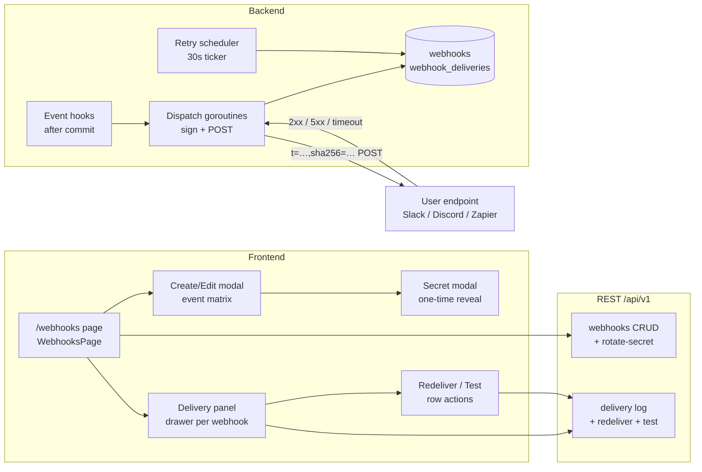
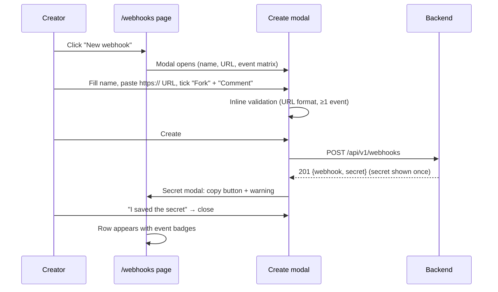
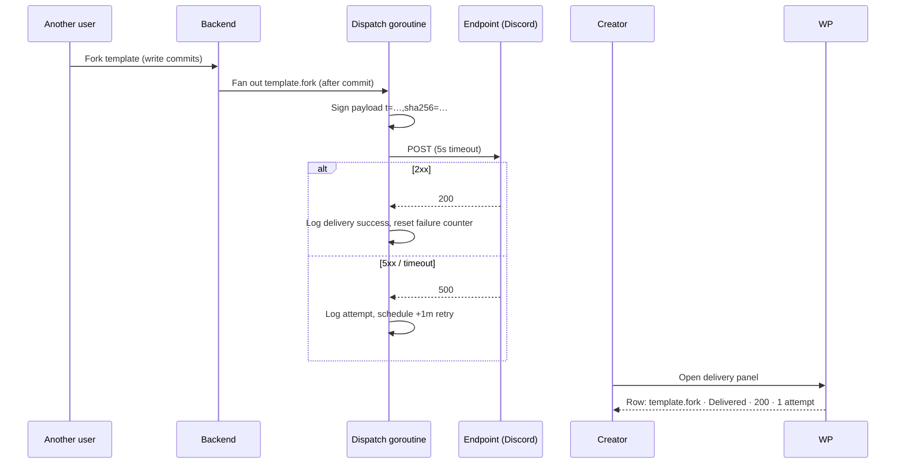
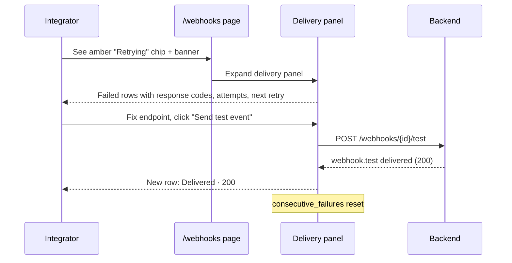
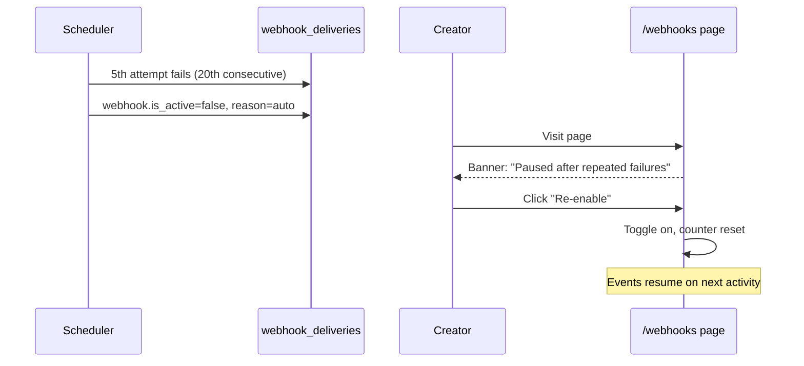
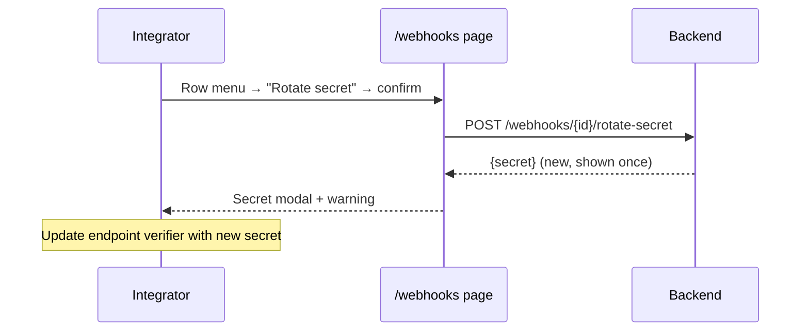

# Webhooks API Integration — UI/UX Design

- **Feature ID:** webhooks-api-integration
- **Version:** 1.0
- **Status:** Proposed (for architecture review)
- **Author:** ui-ux-agent
- **Date:** 2026-10-12
- **Related docs:** [Requirements](./webhooks-api-integration-requirements.md) · [中文 UI/UX 设计](./webhooks-api-integration-ui-ux-design-zh-CN.md)

## 1. Design Principles

1. **Paste a URL, tick some boxes, done.** The primary persona is a creator automating into Slack/Discord/Zapier — not an infra engineer. Creation is one modal, no jargon without a tooltip.
2. **The secret is sacred.** One-time reveal, copy button, explicit "never shown again" warning — same contract users learned from API key generation.
3. **The delivery log is the product.** "Did my endpoint get it? What did it return?" — the log with status chips, response codes, and Redeliver answers debugging without support tickets.
4. **Failures are calm and recoverable.** Retrying is a normal state (amber chip, next attempt time); auto-pause is a banner with a one-click re-enable, never a silent black hole.
5. **Trust through transparency.** Signature scheme, payload examples, and event catalog are visible in the UI (docs drawer), so verification code can be written without leaving the page.

## 2. Information Architecture



## 3. User Flows

### 3.1 Create a webhook (primary flow)



### 3.2 Real event → delivery → log



### 3.3 Debug a failing endpoint



### 3.4 Auto-pause and recover



### 3.5 Rotate a secret



## 4. Page Layouts (Wireframes)

### 4.1 /webhooks — list

```
┌──────────────────────────────────────────────────────────────────────┐
│  ← Header        Webhooks                              [+ New webhook]│
│  ────────────────────────────────────────────────────────────────────│
│  Send platform events to your HTTPS endpoints. Signed, retried, and  │
│  logged. See docs →                                                   │
│  ────────────────────────────────────────────────────────────────────│
│  ⚠ Paused after repeated failed deliveries — check your endpoint     │
│    and re-enable.                                    [Re-enable]      │
│  ────────────────────────────────────────────────────────────────────│
│  NAME            EVENTS              LAST DELIVERY   STATUS    ACTIONS│
│  Discord hook    fork comment        2 min ago       ● Active  ⋮      │
│  Zapier mirror   created updated     1 h ago         ● Active  ⋮      │
│                  deleted fork                                             │
│  ────────────────────────────────────────────────────────────────────│
│  (empty state: "No webhooks yet — create one to get push events")    │
└──────────────────────────────────────────────────────────────────────┘
```

### 4.2 Create/Edit modal

```
┌──────────────────────────────────────────────────────────────┐
│  New webhook                                           [×]  │
│  ────────────────────────────────────────────────────────────│
│  Name                                                        │
│  ┌────────────────────────────────────────────────────────┐ │
│  │ Discord hook                                           │ │
│  └────────────────────────────────────────────────────────┘ │
│                                                              │
│  Payload URL (HTTPS only)                                   │
│  ┌────────────────────────────────────────────────────────┐ │
│  │ https://discord.com/api/webhooks/…/…                   │ │
│  └────────────────────────────────────────────────────────┘ │
│  ⓘ Your endpoint must be publicly reachable over HTTPS.    │
│                                                              │
│  Events                                                      │
│  Template lifecycle        Engagement                        │
│  ☑ created                 ☐ like                            │
│  ☑ updated                 ☑ fork                            │
│  ☐ deleted                 ☑ comment                         │
│  (new version)             ☐ favorite                        │
│                                                              │
│              [Cancel]   [ Create webhook ]                  │
└──────────────────────────────────────────────────────────────┘
```

### 4.3 One-time secret modal

```
┌──────────────────────────────────────────────────────────────┐
│  Save your signing secret                               [×]  │
│  ────────────────────────────────────────────────────────────│
│  Use this secret to verify X-OpenPrompts-Signature.         │
│  It will never be shown again.                              │
│                                                              │
│  ┌────────────────────────────────────────────────┐ [Copy]  │
│  │ whsec_3f9a…c21b                                 │        │
│  └────────────────────────────────────────────────┘         │
│                                                              │
│  Verification (Stripe-style):                                │
│  HMAC-SHA256(secret, "<t>." + raw_body) == sha256 value     │
│                                                              │
│                        [ I saved the secret ]               │
└──────────────────────────────────────────────────────────────┘
```

### 4.4 Delivery panel (drawer)

```
┌──────────────────────────────────────────────────────────────┐
│  Deliveries — Discord hook                        [×]       │
│  [Send test event]                                           │
│  ────────────────────────────────────────────────────────────│
│  EVENT            STATUS      RESP  ATTEMPTS  WHEN           │
│  template.fork    ● Delivered  200   1         2 min ago     │
│  template.comment ● Delivered  200   1         18 min ago    │
│  template.fork    ◐ Retrying   500   3         1 h ago       │
│                  next attempt in 4 m            [Redeliver]  │
│  template.like    ● Delivered  204   1         3 h ago       │
│  webhook.test     ● Delivered  200   1         yesterday     │
│  template.fork    ✕ Failed     500   5         yesterday     │
│                  permanent                     [Redeliver]  │
│  ────────────────────────────────────────────────────────────│
│  Showing latest 50 · retained 30 days                        │
└──────────────────────────────────────────────────────────────┘
```

### 4.5 Row action menu (⋮)

```
  View deliveries
  Send test event
  Edit
  Rotate secret…
  ──────────────────
  Delete (red, confirm dialog)
```

## 5. Component Specifications

| Component | Based on | Props / Behavior |
|---|---|---|
| `WebhooksPage` | `APIKeys.js` page pattern | Session-auth redirect; page header + description + docs link; auto-pause banner(s) above the table; empty state with CTA; loads `GET /webhooks` on mount. |
| `WebhookTable` | `APIKeyManager` table pattern | Columns: name, event badges (chips, +N overflow), last delivery outcome + relative time, status (Active/Paused toggle), actions menu. Sort by created_at desc. |
| `WebhookFormModal` | `CreateTemplateModal` modal pattern | Create + edit modes; fields: name (1–100), URL (https enforced, inline format error), event checkbox matrix (two groups); submit disabled until valid; server errors mapped inline (cap reached, invalid URL). |
| `SecretRevealModal` | APIKeys generated-key modal pattern | `{secret}`; monospace value + Copy button (copies, shows check); verification snippet; single dismiss button; cannot reopen after close. |
| `DeliveryPanel` | right-side drawer (new, follows modal SCSS patterns) | `{webhookId}`; loads latest 50 deliveries; rows: event type (mono), status chip, response code, attempts, relative time, next-retry countdown for pending rows; Redeliver button on failed/any row; Send test event in header. |
| `StatusChip` | small presentational component | `success` → green dot "Delivered"; `pending` → amber pulse "Retrying"; `failed_permanent` → red "Failed". Color + text, never color alone. |
| `AutoPauseBanner` | existing banner pattern | Shown per paused webhook; explains cause, Re-enable button → `PATCH {is_active: true}`; dismiss not offered (state is real, not a toast). |
| `ConfirmDialog` | existing confirm pattern (delete template) | Used for delete webhook and rotate secret; destructive styling for delete. |

## 6. Interaction Details

1. **Create flow:** modal validates client-side (URL `https://` + hostname, name length, ≥ 1 event) before enabling submit; server 400/409 errors render inline under the offending field (cap reached → under the header, friendly).
2. **Secret reveal:** the create/rotate response is held in component state only; closing the modal clears it; the list never contains secrets. Copy button uses `navigator.clipboard` with a success toast (existing pattern).
3. **Active toggle:** immediate `PATCH {is_active}` with optimistic flip; failure reverts + error toast. Toggling a paused webhook ON resets `consecutive_failures` (server-side).
4. **Delivery panel:** opens as a right drawer on desktop / bottom sheet on mobile; loads once + a Refresh button; pending rows show a live "next attempt in Nm" countdown computed from `next_retry_at` (client clock, no polling).
5. **Redeliver:** confirmation not required (idempotent-ish: creates a new delivery row); button shows spinner until the API responds; new row appears at top with `is_redelivery` badge; toast on success.
6. **Send test event:** button in panel header; spinner; the resulting `webhook.test` row appears at top within seconds (single refetch after 2 s, no polling loop).
7. **Event badges:** chips show up to 3 event names, then "+N"; tooltip lists all; chips use the same visual language as template tag chips.
8. **URL display:** table shows `host` + truncated path (`discord.com/api/webhooks/…/…` → `discord.com/api/webhooks/8x…`); full URL visible in edit modal only.
9. **Delete:** confirm dialog names the webhook and states deliveries are removed; destructive red button; success toast + row removal.
10. **Keyboard:** modals and drawer are focus-trapped, Escape closes, focus returns to trigger; table rows are focusable with Enter opening the actions menu; all actions reachable via keyboard.

## 7. States Summary

| State | Trigger | UI |
|---|---|---|
| List loading | page open | Skeleton rows (existing pattern) |
| List empty | no webhooks | Illustration + "No webhooks yet" + CTA button |
| Cap reached | 5 webhooks exist | "New webhook" opens modal; submit → friendly cap error inline |
| Create success | 201 | Modal → secret reveal modal → row added |
| URL invalid | non-https / no host | Inline error under URL field; submit disabled |
| No events selected | 0 checked | Inline error under matrix; submit disabled |
| Delivery success | 2xx | Green chip "Delivered" + response code |
| Delivery retrying | failed attempt, retries left | Amber chip "Retrying" + attempts + next-attempt countdown |
| Delivery failed | 5 failed attempts | Red chip "Failed" + Redeliver button |
| Webhook paused | 20 consecutive failures | Banner + Paused status; Re-enable button |
| Redeliver in flight | click | Spinner on button; row appears on completion |
| Test in flight | click | Spinner; result row after refetch |
| API error | network/5xx | Error toast (existing); state preserved |

## 8. i18n String Table

Namespace: `webhooks` (new) + `header` (extended).

| Key / EN | ZH |
|---|---|
| `header.webhooks` / Webhooks | Webhooks |
| `webhooks.title` / Webhooks | Webhooks |
| `webhooks.description` / Send platform events to your HTTPS endpoints. Signed, retried, and logged. | 将平台事件推送到你的 HTTPS 端点。带签名、自动重试并记录日志。 |
| `webhooks.docs_link` / See docs | 查看文档 |
| `webhooks.new` / New webhook | 新建 webhook |
| `webhooks.empty_title` / No webhooks yet | 还没有 webhook |
| `webhooks.empty_body` / Create a webhook to receive push events when someone engages with your templates. | 创建 webhook，即可在有人与你的模板互动时接收推送事件。 |
| `webhooks.col_name` / Name | 名称 |
| `webhooks.col_events` / Events | 事件 |
| `webhooks.col_last_delivery` / Last delivery | 最近投递 |
| `webhooks.col_status` / Status | 状态 |
| `webhooks.col_actions` / Actions | 操作 |
| `webhooks.status_active` / Active | 启用 |
| `webhooks.status_paused` / Paused | 已暂停 |
| `webhooks.last_delivery_none` / Never | 从未 |
| `webhooks.form_title_new` / New webhook | 新建 webhook |
| `webhooks.form_title_edit` / Edit webhook | 编辑 webhook |
| `webhooks.field_name` / Name | 名称 |
| `webhooks.field_url` / Payload URL (HTTPS only) | 负载 URL（仅 HTTPS） |
| `webhooks.field_url_hint` / Your endpoint must be publicly reachable over HTTPS. | 你的端点必须可通过公网 HTTPS 访问。 |
| `webhooks.field_events` / Events | 事件 |
| `webhooks.group_lifecycle` / Template lifecycle | 模板生命周期 |
| `webhooks.group_engagement` / Engagement | 互动 |
| `webhooks.event_created` / created | 创建 |
| `webhooks.event_updated` / updated (new version) | 更新（新版本） |
| `webhooks.event_deleted` / deleted | 删除 |
| `webhooks.event_like` / like | 点赞 |
| `webhooks.event_favorite` / favorite | 收藏 |
| `webhooks.event_fork` / fork | fork |
| `webhooks.event_comment` / comment | 评论 |
| `webhooks.error_url` / Enter a valid HTTPS URL | 请输入有效的 HTTPS URL |
| `webhooks.error_events` / Select at least one event | 请至少选择一个事件 |
| `webhooks.error_name` / Name is required (1–100 characters) | 名称必填（1–100 字符） |
| `webhooks.error_cap` / You can create at most 5 webhooks. Delete one first. | 最多创建 5 个 webhook，请先删除一个。 |
| `webhooks.create` / Create webhook | 创建 webhook |
| `webhooks.save` / Save changes | 保存更改 |
| `webhooks.secret_title` / Save your signing secret | 保存你的签名密钥 |
| `webhooks.secret_body` / Use this secret to verify X-OpenPrompts-Signature. It will never be shown again. | 使用此密钥验证 X-OpenPrompts-Signature。它将不会再次显示。 |
| `webhooks.secret_verify_hint` / Verification: HMAC-SHA256(secret, "<t>." + raw_body) == sha256 value | 验证方式：HMAC-SHA256(密钥, "<t>." + 原始请求体) == sha256 值 |
| `webhooks.secret_saved` / I saved the secret | 我已保存密钥 |
| `webhooks.copy_secret` / Copy secret | 复制密钥 |
| `webhooks.copied` / Copied | 已复制 |
| `webhooks.deliveries_title` / Deliveries — {{name}} | 投递记录 — {{name}} |
| `webhooks.send_test` / Send test event | 发送测试事件 |
| `webhooks.col_event` / Event | 事件 |
| `webhooks.col_status_delivery` / Status | 状态 |
| `webhooks.col_resp` / Resp | 响应码 |
| `webhooks.col_attempts` / Attempts | 尝试次数 |
| `webhooks.col_when` / When | 时间 |
| `webhooks.delivery_success` / Delivered | 已送达 |
| `webhooks.delivery_retrying` / Retrying | 重试中 |
| `webhooks.delivery_failed` / Failed | 失败 |
| `webhooks.delivery_permanent` / permanent | 永久失败 |
| `webhooks.next_attempt` / next attempt in {{time}} | {{time}}后下次尝试 |
| `webhooks.redeliver` / Redeliver | 重新投递 |
| `webhooks.redelivered` / Delivery queued | 已加入投递队列 |
| `webhooks.test_sent` / Test event sent | 测试事件已发送 |
| `webhooks.redelivery_badge` / redelivered | 重新投递 |
| `webhooks.deliveries_footer` / Showing latest 50 · retained 30 days | 显示最近 50 条 · 保留 30 天 |
| `webhooks.deliveries_empty` / No deliveries yet — activity on your templates will appear here. | 还没有投递记录 —— 模板上的互动会显示在这里。 |
| `webhooks.paused_banner` / Paused after repeated failed deliveries — check your endpoint and re-enable. | 因连续投递失败已暂停 —— 请检查你的端点后重新启用。 |
| `webhooks.reenable` / Re-enable | 重新启用 |
| `webhooks.menu_deliveries` / View deliveries | 查看投递记录 |
| `webhooks.menu_edit` / Edit | 编辑 |
| `webhooks.menu_rotate` / Rotate secret… | 轮换密钥… |
| `webhooks.menu_delete` / Delete | 删除 |
| `webhooks.rotate_title` / Rotate signing secret? | 轮换签名密钥？ |
| `webhooks.rotate_body` / The current secret will stop working immediately. Your endpoint must be updated with the new secret. | 当前密钥将立即失效。你的端点必须更新为新密钥。 |
| `webhooks.delete_title` / Delete webhook? | 删除 webhook？ |
| `webhooks.delete_body` / "{{name}}" and all its delivery records will be removed. | "{{name}}" 及其所有投递记录将被删除。 |
| `webhooks.delete_confirm` / Delete webhook | 删除 webhook |
| `webhooks.deleted` / Webhook deleted | 已删除 webhook |
| `webhooks.created` / Webhook created | 已创建 webhook |
| `webhooks.updated` / Webhook updated | 已更新 webhook |
| `webhooks.error_generic` / Something went wrong — try again | 出错了，请重试 |

## 9. Accessibility Notes

- Status chips pair color with text ("Delivered"/"Retrying"/"Failed") — never color alone; the retrying chip's pulse animation respects `prefers-reduced-motion`.
- The event checkbox matrix is a real `<fieldset>` with `<legend>` per group; each label wraps its checkbox (large hit target); group errors are `aria-describedby` on the fieldset.
- The secret value is a `<code>` block with a copy button whose accessible name updates to "Copied" on success; the one-time warning is announced via `role="alert"` when the modal opens.
- The delivery drawer is `role="dialog"` with `aria-modal`, focus-trapped, Escape to close, focus returned to the trigger row; the table inside uses standard table semantics with `scope` headers.
- Next-attempt countdowns tick silently (`aria-live="off"`); only the state transition (Retrying → Delivered/Failed) is announced politely.
- The active toggle is a switch (`role="switch"`, `aria-checked`) with a visible text label; the auto-pause banner is `role="status"` so it is announced on page load.
- Row action menus are keyboard-openable (Enter on focused row), arrow-navigable, and Escape-closeable; destructive items are marked `aria-describedby` pointing at the confirm dialog text.

## 10. Responsive Behavior

- **Desktop (≥1024px):** table full-width with all columns; delivery drawer fixed 480 px right side; modals centered 560 px.
- **Tablet (768–1023px):** last-delivery column collapses into the status cell (tooltip on hover/tap); drawer becomes full-height overlay; event badges wrap to two rows max.
- **Mobile (<768px):** table becomes stacked cards (name + badges + status row + actions); drawer becomes a bottom sheet with drag handle; create modal full-screen; secret value wraps with `word-break: break-all`; countdown labels shorten ("in 4m").
- The event matrix stays a two-column grid on desktop, single column on mobile; checkboxes remain 44 px touch targets at all widths.

## 11. Analytics Events (optional, if analytics ships)

- `webhook_created` `{events_count}`
- `webhook_secret_copied`
- `webhook_test_sent`
- `webhook_redelivered` `{event_type}`
- `webhook_reenabled` (from auto-pause)
- `webhook_deleted`

## 12. Out of Scope (UI)

- Admin webhook console (platform-wide delivery stats).
- Payload template editor or per-template subscription filters.
- Endpoint verification handshake UI (challenge request).
- Email/in-app alerts when a webhook auto-pauses.
- Delivery log filtering/search beyond the latest 50 (retention window is 30 days).
- Docs page content itself (linked, not designed here).
